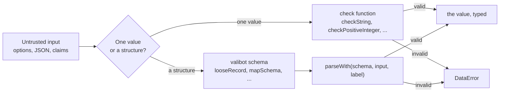

# Checks

`@interopkit/core/checks` validates what a host or a network passes in. A check throws `DataError` with a full sentence that
names the value and what was expected, such as `The option timeoutMs must be a positive integer, found 0.` A schema reads
JSON with valibot, and `parseWith` turns its first issue into a `DataError` that names the path.



## Quick start

```ts
import { checkPositiveInteger, httpsUrlSchema, mapSchema, nonEmptyStringSchema, parseWith } from "@interopkit/core/checks";

checkPositiveInteger(10_000, "The option timeoutMs");
parseWith(httpsUrlSchema, "https://platform.example/jwks", "The key set address"); // => "https://platform.example/jwks"
const claims = parseWith(mapSchema(nonEmptyStringSchema), { sub: "user-1" }, "The claims");
Object.fromEntries(claims); // => { sub: "user-1" }
```

## Checks of one value

An entry point checks each argument once, where it reads it, with the `label` that names it: `The option <name>` for an
option. Inner functions trust their callers.

| Check                                   | Accepts                                       | Message                                                  |
| --------------------------------------- | --------------------------------------------- | -------------------------------------------------------- |
| `checkRecord(value, message)`           | An object that is neither `null` nor an array | `<message>, found <value>.`                              |
| `checkArray(value, message)`            | An array                                      | `<message>, found <value>.`                              |
| `checkFunction(value, message)`         | A function                                    | `<message>, found <value>.`                              |
| `checkProperties(record, label, known)` | A record with no property but the known ones  | `<label> has the properties "a" and "b", found "c".`     |
| `checkString(value, label)`             | A string                                      | `<label> must be a string, found <value>.`               |
| `checkNonEmptyString(value, label)`     | A string of at least one character            | `<label> must be a non-empty string, found <value>.`     |
| `checkHttpsUrl(value, label)`           | An absolute `https` URL                       | `<label> must be an absolute https URL, found <value>.`  |
| `checkNonNegativeInteger(value, label)` | A safe integer from 0                         | `<label> must be a non-negative integer, found <value>.` |
| `checkPositiveInteger(value, label)`    | A safe integer from 1                         | `<label> must be a positive integer, found <value>.`     |
| `checkAbortSignal(value, label)`        | An `AbortSignal`                              | `<label> must be an AbortSignal, found <value>.`         |

`describe(value)` writes a value into a message: strings quoted, and arrays, functions and objects as `an array`,
`a function` and `an object`. `isRecord(value)` is the test that `checkRecord` uses.

## Schemas

| Export                                              | Reads                                                                                                                                                       |
| --------------------------------------------------- | ----------------------------------------------------------------------------------------------------------------------------------------------------------- |
| `parseWith(schema, input, label)`                   | Parses with any valibot schema and stops at the first issue: `<label> is invalid at items[0].id: expected a string, found 1.`                               |
| `issueText(issue)`                                  | The text of one issue with its path, for a message that wraps the issue of a nested parse                                                                   |
| `looseRecord(entries)`                              | An object with the given entries that keeps the properties it does not know, and refuses an array                                                           |
| `mapSchema(value)`                                  | An object whose property names are data, such as claim names, into a `Map`: a name such as `__proto__` stays data, which the `record` of valibot would skip |
| `methodsSchema(...names)`                           | A host's object with the given functions, such as a store; the object passes on whole, so a class instance keeps its methods                                |
| `guardSchema(guard, expected)`                      | A value that a type guard accepts, passed on whole                                                                                                          |
| `finiteSchema`                                      | A finite number                                                                                                                                             |
| `positiveSchema`                                    | A finite number above 0                                                                                                                                     |
| `nonNegativeIntegerSchema`, `positiveIntegerSchema` | A safe integer from 0, and from 1                                                                                                                           |
| `nonEmptyStringSchema`                              | A string of at least one character                                                                                                                          |
| `httpsUrlSchema`                                    | An absolute `https` URL                                                                                                                                     |

The `Schema<TOutput>` type is a valibot schema of unknown input.

## Errors

| Error       | When                              | What to do                                                                                                                                         |
| ----------- | --------------------------------- | -------------------------------------------------------------------------------------------------------------------------------------------------- |
| `DataError` | A value fails its check or schema | Read the message: it names the value and what was expected. Input from users or files can be passed in directly, because the entry points check it |

## Differences from the references

|          | `@assesskit/runtime/checks`           | `@interopkit/core/checks`                                                                                                          |
| -------- | ------------------------------------- | ---------------------------------------------------------------------------------------------------------------------------------- |
| Messages | The same words and the same paths     | The same                                                                                                                           |
| Contents | Every check that QTI processing needs | Only what the interopkit packages use, and `checkHttpsUrl` with `httpsUrlSchema` for the `https` URLs that LTI and Caliper require |

The module is a separate copy of that shape, because packages of different families never import each other.

## Not included

| What                        | Reason                                                                                                     |
| --------------------------- | ---------------------------------------------------------------------------------------------------------- |
| Checks that no package uses | A check arrives with the first function that needs it                                                      |
| A validator of its own      | Valibot reads structures; this module adds the sentences of the messages and the few schemas valibot lacks |
