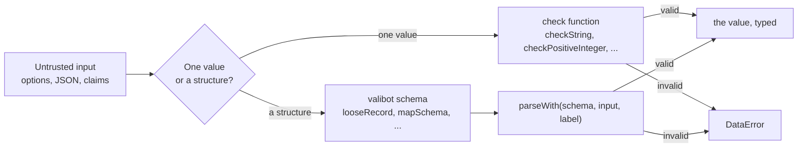
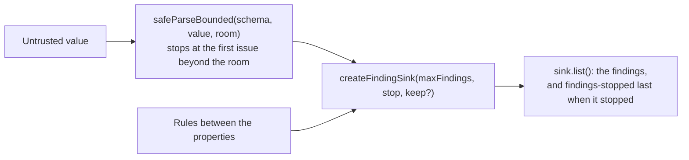

# Checks

`@interopkit/core/checks` validates what a host or a network passes in. A check throws `DataError` with a full sentence that
names the value and what was expected, such as `The option timeoutMs must be a positive integer, found 0.` A schema reads
JSON with valibot, and `parseWith` turns its first issue into a `DataError` that names the path.



## Quick start

```ts
import { checkPositiveInteger, httpsUrlSchema, mapSchema, nonEmptyStringSchema, parseWith } from "@interopkit/core/checks";

checkPositiveInteger(10_000, "The option timeoutMs");
parseWith(httpsUrlSchema, "https://platform.example/jwks", "The key set address"); // => "https://platform.example/jwks"
const claims = parseWith(mapSchema(nonEmptyStringSchema), { sub: "user-1" }, "The claims");
Object.fromEntries(claims); // => { sub: "user-1" }
```

## Checks of one value

An entry point checks each argument once, where it reads it, with the `label` that names it: `The option <name>` for an
option. Inner functions trust their callers.

| Check                                   | Accepts                                       | Message                                                  |
| --------------------------------------- | --------------------------------------------- | -------------------------------------------------------- |
| `checkRecord(value, message)`           | An object that is neither `null` nor an array | `<message>, found <value>.`                              |
| `checkArray(value, message)`            | An array                                      | `<message>, found <value>.`                              |
| `checkFunction(value, message)`         | A function                                    | `<message>, found <value>.`                              |
| `checkProperties(record, label, known)` | A record with no property but the known ones  | `<label> has the properties "a" and "b", found "c".`     |
| `checkString(value, label)`             | A string                                      | `<label> must be a string, found <value>.`               |
| `checkNonEmptyString(value, label)`     | A string of at least one character            | `<label> must be a non-empty string, found <value>.`     |
| `checkHttpsUrl(value, label)`           | An absolute `https` URL                       | `<label> must be an absolute https URL, found <value>.`  |
| `checkRemoteUrl(value, label)`          | An `https` URL that names a public host (below) | `<label> must be an https URL that names a public host, found <value>, which <what is wrong>.` |
| `checkNonNegativeInteger(value, label)` | A safe integer from 0                         | `<label> must be a non-negative integer, found <value>.` |
| `checkPositiveInteger(value, label)`    | A safe integer from 1                         | `<label> must be a positive integer, found <value>.`     |
| `checkAbortSignal(value, label)`        | An `AbortSignal`                              | `<label> must be an AbortSignal, found <value>.`         |

`checkHttpsUrl` is for a URL that the host configures. `checkRemoteUrl` is for a URL that a message or a document gives, which
a server then fetches or sends a token to. It reads the host after URL parsing and refuses:

| Refused | Examples |
| --- | --- |
| An IP address, in any spelling the URL parser reads | `127.0.0.1`, `2130706433`, `0x7f.1`, `[::1]` |
| A single label | `localhost`, `intranet` |
| A name of a private network, and the names below it | `localhost` (RFC 6761), `local` (RFC 6762), `home.arpa` (RFC 8375), `internal` |
| User information | `https://user@lms.example.edu/` |

A final dot of the root is read away, so `localhost.` is `localhost`. The check sees only the URL: a public name may still
resolve to a private address, so the host's `fetch` refuses loopback, private, link-local and metadata addresses after
resolution, and `checkRemoteUrl` does not replace it.

`describe(value)` writes a value into a message: strings quoted, and arrays, functions and objects as `an array`,
`a function` and `an object`. `isRecord(value)` is the test that `checkRecord` uses.

## Schemas

| Export                                              | Reads                                                                                                                                                                                                                                                                                                                       |
| --------------------------------------------------- | --------------------------------------------------------------------------------------------------------------------------------------------------------------------------------------------------------------------------------------------------------------------------------------------------------------------------- |
| `parseWith(schema, input, label)`                   | Parses with any valibot schema and stops at the first issue: `<label> is invalid at items[0].id: expected a string, found 1.`                                                                                                                                                                                               |
| `pathOf(issue.path)`                                | Where an issue is, as code writes it: `items[0].session.status`, and the empty string for the value as a whole                                                                                                                                                                                                              |
| `issueText(issue)`                                  | The text of one issue with its path, for a message that wraps the issue of a nested parse                                                                                                                                                                                                                                   |
| `findingsOf(issues)`                                | The issues of a parse as findings, `{ path, rule, message }`, for a reader or a validator that returns them as data (see Findings)                                                                                                                                                                                          |
| `looseRecord(entries)`                              | An object with the given entries that keeps the properties it does not know, and refuses an array                                                                                                                                                                                                                           |
| `strictRecord(entries)`                             | An object with the given entries that refuses a property it does not know, as `additionalProperties: false` does, and refuses an array                                                                                                                                                                                      |
| `openRecord(entries)`                               | An object with the given entries that keeps the properties it does not know, as `additionalProperties: true` does, for a JSON-LD class that anyone may extend: they are copied, so they must be JSON, and a member named `__proto__`, `constructor` or `prototype` of the object itself is not carried. It refuses an array |
| `jsonObjectSchema`                                  | An object of JSON, copied, with no function, `undefined`, number that is not finite or object that is not plain, and at most `MAX_JSON_DEPTH` levels                                                                                                                                                                        |
| `mapSchema(value)`                                  | An object whose property names are data, such as claim names, into a `Map`: a name such as `__proto__` stays data, which the `record` of valibot would skip                                                                                                                                                                 |
| `methodsSchema(...names)`                           | A host's object with the given functions, such as a store; the object passes on whole, so a class instance keeps its methods                                                                                                                                                                                                |
| `guardSchema(guard, expected)`                      | A value that a type guard accepts, passed on whole                                                                                                                                                                                                                                                                          |
| `abortSignalSchema`                                 | An `AbortSignal`, the `signal` of a call that waits on I/O                                                                                                                                                                                                                                                                  |
| `finiteSchema`                                      | A finite number                                                                                                                                                                                                                                                                                                             |
| `positiveSchema`                                    | A finite number above 0                                                                                                                                                                                                                                                                                                     |
| `nonNegativeIntegerSchema`, `positiveIntegerSchema` | A safe integer from 0, and from 1                                                                                                                                                                                                                                                                                           |
| `nonEmptyStringSchema`                              | A string of at least one character                                                                                                                                                                                                                                                                                          |
| `httpsUrlSchema`                                    | An absolute `https` URL                                                                                                                                                                                                                                                                                                     |
| `remoteUrlSchema`                                   | An `https` URL that names a public host, as `checkRemoteUrl` reads it                                                                                                                                                                                                                                                       |
| `uuidSchema`, `dateSchema`, `dateTimeSchema`        | A UUID as 8-4-4-4-12 digits, a date that exists, and a date and time of RFC 3339 with an offset (see Formats)                                                                                                                                                                                                               |
| `absoluteUriSchema`                                 | A URI with a scheme, such as `https://example.org/x`                                                                                                                                                                                                                                                                        |
| `languageTagSchema`                                 | A language tag that is well-formed by RFC 5646, such as `en-US` (see Formats)                                                                                                                                                                                                                                               |

The `Schema<TOutput>` type is a valibot schema of unknown input.

## Findings

A reader that returns what is wrong as data, and not as an exception, returns findings: `Finding` is `{ path, rule, message }`.
`path` is where the fault is, as `pathOf` writes it. `message` is a sentence that reads after the path and does not repeat it.
A package adds fields to its own finding, such as a `severity`, by extending `Finding`. `findingsOf(issues)` makes the findings of a
parse and owns the rule names:

| `rule`             | When                                                                                                                           |
| ------------------ | ------------------------------------------------------------------------------------------------------------------------------ |
| `missing-property` | A property that the schema requires is absent                                                                                  |
| `unknown-property` | A strict object has a property that it does not know; valibot reports one for each object                                      |
| `wrong-type`       | A value is of another JSON type (an array where a tuple is read included), or is a number that is not an integer or not finite |
| `invalid-format`   | A string has the wrong form: a UUID, a date, a date and time or a URI that a check refuses                                     |
| `invalid-value`    | A value is outside a vocabulary, or a guard or a transform refuses it                                                          |
| `too-few-entries`  | A list is shorter than the least that the schema allows                                                                        |

A reader that throws writes the sentence of its `DataError` with `refusalOf(label, errors, validator)`: the first error with its
path, how many errors follow, and the function that lists them, such as `The statement is invalid at actor: needs exactly one of
mbox, mbox_sha1sum, openid and account, found none. 1 more error: validateStatement lists every finding.` When the list stopped at
its limit, the sentence says that there may be more.

## Bounding the findings

A value that is wrong in a million places must not cost the memory of a million findings: valibot keeps about a kilobyte for each
issue. The readers and validators of the packages stop at `maxFindings` (`DEFAULT_MAX_FINDINGS`, 1,000).



| Export | Does |
| ------ | ---- |
| `DEFAULT_MAX_FINDINGS` | 1,000: the limit of a list of findings unless the caller says another |
| `createFindingSink(maxFindings, stop, keep?)` | A list that takes findings up to the limit. The first one beyond it is dropped and `stopped` turns true, so that the check stops looking. `stop` makes the last finding in the type of the package, with the rule `findings-stopped`; `keep` leaves findings out of the count, such as the warnings that a reader does not report. `within(place)` gives a view that changes the findings it is given, such as the path of one entry of a batch, and shares the limit |
| `safeParseBounded(schema, value, limit)` | `v.safeParse` that stops at the first issue beyond `limit`; the issues are those of `v.safeParse`, in the same order. A schema that makes issues and throws them away, such as a union, is parsed again with no limit when the parse stopped on them |
| `hasMoreTokensThan(text, maxTokens)` | Whether a text of JSON has more tokens than a limit, counted without building anything; `MAX_JSON_TOKENS` is 1,000,000 |

A reader or a client that parses a text counts its tokens before `JSON.parse`, because the memory of a parse grows with the
tokens and not with the bytes: a text of 16 MiB written `[{},{},...]` takes 700 MB to parse.

## Formats

| Export                  | Reads                                                                                                                                                                                  |
| ----------------------- | -------------------------------------------------------------------------------------------------------------------------------------------------------------------------------------- |
| `isDate(text)`          | A date `YYYY-MM-DD` that exists: the days of each month and the leap years are known                                                                                                    |
| `parseDateTime(text)`   | A date and time of RFC 3339 section 5.6 into epoch milliseconds, or `undefined`: `T` and `Z` of either case, an offset `Z` or `+hh:mm` to 23:59, a fraction that keeps three digits, and a leap second at 23:59 |
| `isDateTime(text)`      | Whether `parseDateTime` reads it                                                                                                                                                       |
| `isUuid(text)`          | A UUID as 8-4-4-4-12 hexadecimal digits of either case, which is the `uuid` of valibot                                                                                                 |
| `isAbsoluteUri(text)`   | A URI that has a scheme and no white space, which `URL` parses                                                                                                                         |
| `isLanguageTag(text)`   | A language tag that is well-formed by RFC 5646 section 2.1, grandfathered tags included, of at most 1,024 characters; a subtag is not looked up in the registry                                                   |

The `isoDate` and `isoTimestamp` of valibot are patterns, so that they accept `2023-02-31`; the date and the date and time are read
by hand because valibot has no check that knows the calendar. A caller that needs a narrower form, such as the
upper case of AGS or the milliseconds of Caliper, adds its own test to these.

## JSON

`copyJson(value, path)` copies a value that must be JSON and returns `{ value }`, or `{ problem }` with a sentence that says where
the value is not JSON. `JsonValue` and `JsonObject` are the types.

| Limit            | Value | Applies to                                                                                      |
| ---------------- | ----- | ----------------------------------------------------------------------------------------------- |
| `MAX_JSON_DEPTH` | 64    | The levels that arrays and objects nest in `copyJson`, and the default depth of `readJson`      |

A member named `__proto__` stays a member of the copy and never changes its prototype.

`nestsDeeperThan(text, maxDepth)` tells whether the arrays and objects of a text of JSON nest deeper than a limit, without parsing it: the text may be
any string, and a string literal hides its brackets. `readStatementJson` checks the depth with it before it parses.
`exceededJsonLimit(text, maxDepth, maxTokens)` reads the text once for both limits and tells which it passes first, in the order of
the text; `readJson` and the readers of `achievement-credentials` bound a text with it, at the cost of one reading instead of two.

```ts
import { exceededJsonLimit } from "@interopkit/core/checks";

exceededJsonLimit('{"a":[[["b"]]]}', 3, 100); // => "depth"
exceededJsonLimit("[1, 2, 3]", 64, 6); // => "tokens"
exceededJsonLimit('["[[[["]', 2, 10); // => undefined
```

## Errors

| Error       | When                              | What to do                                                                                                                                         |
| ----------- | --------------------------------- | -------------------------------------------------------------------------------------------------------------------------------------------------- |
| `DataError` | A value fails its check or schema | Read the message: it names the value and what was expected. Input from users or files can be passed in directly, because the entry points check it |

## Differences from the references

|          | `@assesskit/runtime/checks`           | `@interopkit/core/checks`                                                                                                          |
| -------- | ------------------------------------- | ---------------------------------------------------------------------------------------------------------------------------------- |
| Messages | The same words and the same paths     | The same                                                                                                                           |
| Contents | Every check that QTI processing needs | Only what the interopkit packages use, `checkHttpsUrl` with `httpsUrlSchema` for the `https` URLs that LTI and Caliper require, and `checkRemoteUrl` with `remoteUrlSchema` for the URLs that a message or a document gives |

The module is a separate copy of that shape, because packages of different families never import each other.

## Not included

| What                        | Reason                                                                                                     |
| --------------------------- | ---------------------------------------------------------------------------------------------------------- |
| Checks that no package uses | A check arrives with the first function that needs it                                                      |
| A validator of its own      | Valibot reads structures; this module adds the sentences of the messages and the few schemas valibot lacks |
