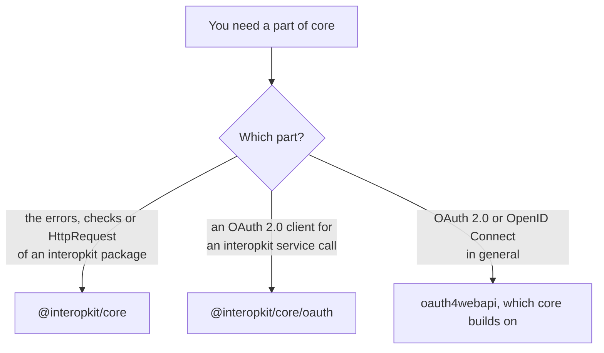

# Choosing core

`@interopkit/core` is what the other interopkit packages share; most projects install the package of a standard and get it
with it. This page says when to use it directly, and when another library fits better.

| You need                                                                                                  | Use                                                                                                |
| --------------------------------------------------------------------------------------------------------- | -------------------------------------------------------------------------------------------------- |
| To catch the errors of the packages, read their findings, or build the `HttpRequest` that a handler takes | This package                                                                                       |
| OAuth 2.0 tokens with the deadline, the size limit and the refusal of redirects of the other calls        | This package: `/oauth`                                                                             |
| OAuth 2.0 or OpenID Connect in general, with the flows and the server metadata of its own                 | `oauth4webapi` 3.8.8, the version that `packages/core/package.json` pins, on which `/oauth` builds |
| A general HTTP client                                                                                     | The platform's `fetch`: `requestService` adds what a service call of a standard needs and no more  |

## What the others have that the package lacks

| Library              | What it has                                                                                                                      | Here                                                                                                |
| -------------------- | -------------------------------------------------------------------------------------------------------------------------------- | --------------------------------------------------------------------------------------------------- |
| `oauth4webapi` 3.8.8 | OpenID Connect, the device authorization grant, DPoP and pushed authorization requests, as its README at that version lists them | Excluded: `/oauth` has the grants that the packages call ([the OAuth guide](oauth.md#not-included)) |

## Where the evidence is

[The evidence](evidence.md) gives the OAuth flows against an authorization server of other authors and the tests of every
check; [performance](performance.md) times the service call, the signer and the cache.
