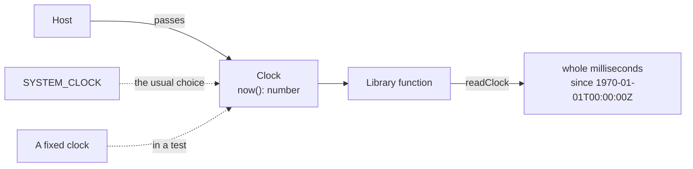

# Reading the time through a clock

A library reads the time only through a `Clock`, so that a host and a test control it: an option `clock` that is left out is
`SYSTEM_CLOCK`, and a test passes a clock of its own. Tokens, logins and events carry the times it gives.



## Quick start

```ts
import { readClock, SYSTEM_CLOCK } from "@interopkit/core";

const clock = { now: () => 1_700_000_000_000 };
readClock(clock); // => 1700000000000
Number.isInteger(readClock(SYSTEM_CLOCK)); // => true
```

## API

| Export              | Does                                                                                                                               |
| ------------------- | ---------------------------------------------------------------------------------------------------------------------------------- |
| `Clock`             | The interface: `now()` answers whole milliseconds since 1970-01-01T00:00:00Z, as `Date.now()` does                                 |
| `SYSTEM_CLOCK`      | A `Clock` over `Date.now()`. The only place in the packages that reads the system time                                             |
| `checkClock(value)` | Throws `DataError` unless the value is `undefined` or an object with a function `now`; for options a host passes from JavaScript   |
| `readClock(clock?)` | Returns the time, of `SYSTEM_CLOCK` when none is given, or throws `DataError` unless the clock answers a non-negative safe integer |

## Errors

| Error                                                               | When                                                                | What to do                                                       |
| ------------------------------------------------------------------- | ------------------------------------------------------------------- | ---------------------------------------------------------------- |
| `DataError`, `The option clock must be an object`                   | The value is not an object                                          | Pass `{ now }` or `SYSTEM_CLOCK`                                 |
| `DataError`, `The time of the clock must be a non-negative integer` | `now` answered a fraction, a negative number, `NaN` or another type | Answer whole milliseconds: `Date.now()`, not `performance.now()` |

## Not included

| Not included           | Why                                                                                                   |
| ---------------------- | ----------------------------------------------------------------------------------------------------- |
| Timers, `sleep`        | A library waits on I/O with a deadline (see [service calls](service.md)), never on a timer of its own |
| Time zones, formatting | A caller formats the time it needs, such as the ISO 8601 form of a Caliper event                      |

## Differences from the references

| Reference           | Difference                                                                                                                                                                                         |
| ------------------- | -------------------------------------------------------------------------------------------------------------------------------------------------------------------------------------------------- |
| `Date.now()`        | `SYSTEM_CLOCK` answers the same whole milliseconds. `readClock` throws unless the answer is a non-negative safe integer, so `NaN`, a fraction or a negative time never reaches a token or an event |
| `performance.now()` | Refused as a clock: it counts from the start of the process and answers a fraction                                                                                                                 |
