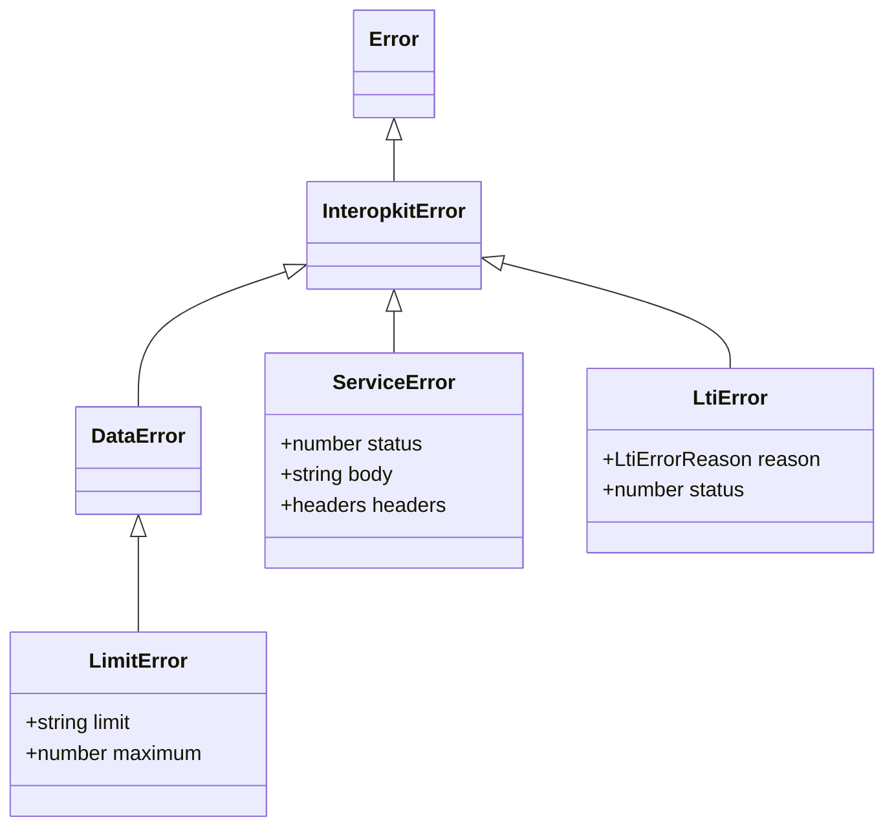

# Errors of the packages

Every error that an interopkit package throws extends `InteropkitError`, so one `instanceof` catches them all. A message is
a full sentence that names the offending value or path and says what to do. Every class takes `ErrorOptions` after its own
arguments, and an error that reports another, such as the failure of a `fetch` or the `SyntaxError` of a parse, carries it as
its `cause`.



`LtiError` is thrown by `@interopkit/tool-integration`; the others are in `@interopkit/core`. The `reason` of an `LtiError` is a
term of `LtiErrorReason`, the kebab-case union that the package exports, so that a host can switch on it exhaustively.

## Quick start

```ts
import { DataError, InteropkitError, LimitError, ServiceError } from "@interopkit/core";
import { readJson } from "@interopkit/core/http";

const error = new ServiceError("The key set answered 503.", 503, "busy");
error instanceof InteropkitError; // => true
error instanceof DataError; // => false
error.status; // => 503
error.headers; // => {}
new ServiceError("The key set answered 429.", 429, "", { headers: { "retry-after": "30" } }).headers["retry-after"]; // => "30"

const body = new TextEncoder().encode("[1,2,3]");
const request = { method: "POST", url: "https://lrs.example/x", headers: {}, body };
const thrownBy = (run) => {
  try {
    run();
  } catch (error) {
    return error;
  }
};
const over = thrownBy(() => readJson(request, { maxTokens: 6 }));
over instanceof LimitError; // => true
over instanceof DataError; // => true
[over.limit, over.maximum]; // => ["maxTokens", 6]
new DataError("The body is not JSON.", { cause: new SyntaxError("Unexpected end") }).cause.message; // => "Unexpected end"
```

## Answering a limit

Every reader and handler of the packages throws `LimitError` at each of its limits, so a host answers 413 for any of them from
one check, before it answers 400 for another `DataError`:

```ts
import { DataError, LimitError } from "@interopkit/core";

const statusOf = (error) => (error instanceof LimitError ? 413 : error instanceof DataError ? 400 : 500);
statusOf(new LimitError("The body has 2 MiB.", "maxBytes", 1_048_576)); // => 413
statusOf(new DataError("The body is not JSON.")); // => 400
```

| Where the limit is passed                          | Answer                                                                                                          |
| -------------------------------------------------- | --------------------------------------------------------------------------------------------------------------- |
| A handler of a package                             | 413, unless its specification names another answer                                                              |
| The token endpoint of an LTI platform              | 400 `invalid_request`, as OAuth 2.0 answers every fault of a request                                            |
| The payload of a launch token                      | `token-malformed`, which a launch answers 401                                                                   |
| A client that reads the JSON of a service's answer | `LimitError` for its levels and tokens; an answer over `maxBytes` is a `ServiceError`, a failure of the service |

## Expected outcomes are not errors

An outcome that a caller must handle is a value in the result, such as a refusal. Invalid input and broken invariants throw.
A rejected `signal` is neither: a call rejects with `signal.reason`, the value the caller aborted with, so a caller can tell
its own abort from a failure.

## Errors

| Class             | Thrown when                                                                                                                                            | Properties                                                                                                                                                                                        | What to do                                                                                                                         |
| ----------------- | ------------------------------------------------------------------------------------------------------------------------------------------------------ | ------------------------------------------------------------------------------------------------------------------------------------------------------------------------------------------------- | ---------------------------------------------------------------------------------------------------------------------------------- |
| `InteropkitError` | Never by itself: it is the base class                                                                                                                  | `message`, `name`                                                                                                                                                                                 | Catch it to catch every error of the packages, then branch on the class                                                            |
| `DataError`       | An argument has the wrong type or is out of range, or data breaks the shape it must have                                                               |                                                                                                                                                                                                   | Fix the input; a handler of a host answers 400. The message names the value and the path                                           |
| `LimitError`      | Untrusted input is over a limit of a reader or a handler: more bytes, tokens, levels, parts, entries or characters than it allows. It is a `DataError` | `limit`, the name of the limit: the option that sets it, such as `maxBytes`, or a fixed limit that the guide of the reader names; `maximum`, its value                                            | Answer 413 before 400; where `limit` names an option, raise it for a source you trust; see [answering a limit](#answering-a-limit) |
| `ServiceError`    | A call to an HTTP service fails: no answer, an error status, a redirect or an answer that is too large                                                 | `status`, the HTTP status, and 0 when the call got no answer; `body`, the text of the answer up to 65,536 bytes; `headers`, those of the answer by name in lower case, and none without an answer | Act on `status`: 0 means no answer, 429 and 5xx a retry later (`headers["retry-after"]`); log `body` as untrusted                  |

## Not included

| Not included                    | Why                                                                                                                                                    |
| ------------------------------- | ------------------------------------------------------------------------------------------------------------------------------------------------------ |
| An error class for each package | A package names the failure, not itself: `ServiceError` and `LtiError` say what went wrong, and `check:standards` refuses an error named for a package |
| Error codes in `DataError`      | The message names the value and the path, and no caller needs to branch on a code                                                                      |

## Differences from the references

| Reference                                | Difference                                                                                                                                                                                                                                                                                                                  |
| ---------------------------------------- | --------------------------------------------------------------------------------------------------------------------------------------------------------------------------------------------------------------------------------------------------------------------------------------------------------------------------- |
| `Error` with `cause` of ECMAScript       | Every class takes `ErrorOptions` after its own arguments, and an error that reports another carries it as its `cause`                                                                                                                                                                                                       |
| `@assesskit/runtime`, `@measurekit/core` | Each family has a base of its own (`AssesskitError`, `MeasurekitError`) and a `DataError`, since packages of different families never import each other. `@assesskit/runtime` throws `SecurityError` for input over a limit, with `limit` and `maximum`; here `LimitError` has the same two properties and is a `DataError` |
