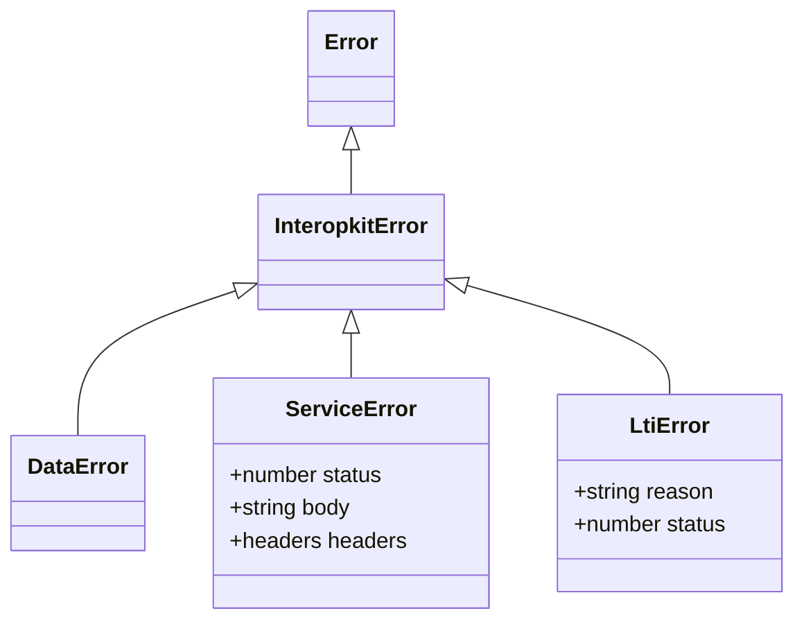

# Errors

Every error that an interopkit package throws extends `InteropkitError`, so one `instanceof` catches them all. A message is
a full sentence that names the offending value or path and says what to do.



`LtiError` is thrown by `@interopkit/tool-integration`; the others are in `@interopkit/core`.

## Quick start

```ts
import { DataError, InteropkitError, ServiceError } from "@interopkit/core";

const error = new ServiceError("The key set answered 503.", 503, "busy");
error instanceof InteropkitError; // => true
error instanceof DataError; // => false
error.status; // => 503
error.headers; // => {}
new ServiceError("The key set answered 429.", 429, "", { headers: { "retry-after": "30" } }).headers["retry-after"]; // => "30"
```

## Classes

| Class             | Thrown when                                                                                            | Properties                                                                                                                                                                                        |
| ----------------- | ------------------------------------------------------------------------------------------------------ | ------------------------------------------------------------------------------------------------------------------------------------------------------------------------------------------------- |
| `InteropkitError` | Never by itself: it is the base class                                                                  | `message`, `name`                                                                                                                                                                                 |
| `DataError`       | An argument has the wrong type or is out of range, or data breaks the shape it must have               |                                                                                                                                                                                                   |
| `ServiceError`    | A call to an HTTP service fails: no answer, an error status, a redirect or an answer that is too large | `status`, the HTTP status, and 0 when the call got no answer; `body`, the text of the answer up to 65,536 bytes; `headers`, those of the answer by name in lower case, and none without an answer |

## Expected outcomes are not errors

An outcome that a caller must handle is a value in the result, such as a refusal. Invalid input and broken invariants throw.
A rejected `signal` is neither: a call rejects with `signal.reason`, the value the caller aborted with, so a caller can tell
its own abort from a failure.

## Not included

| What                            | Reason                                                                                                                                                 |
| ------------------------------- | ------------------------------------------------------------------------------------------------------------------------------------------------------ |
| An error class for each package | A package names the failure, not itself: `ServiceError` and `LtiError` say what went wrong, and `check:standards` refuses an error named for a package |
| Error codes in `DataError`      | The message names the value and the path, and no caller needs to branch on a code                                                                      |
