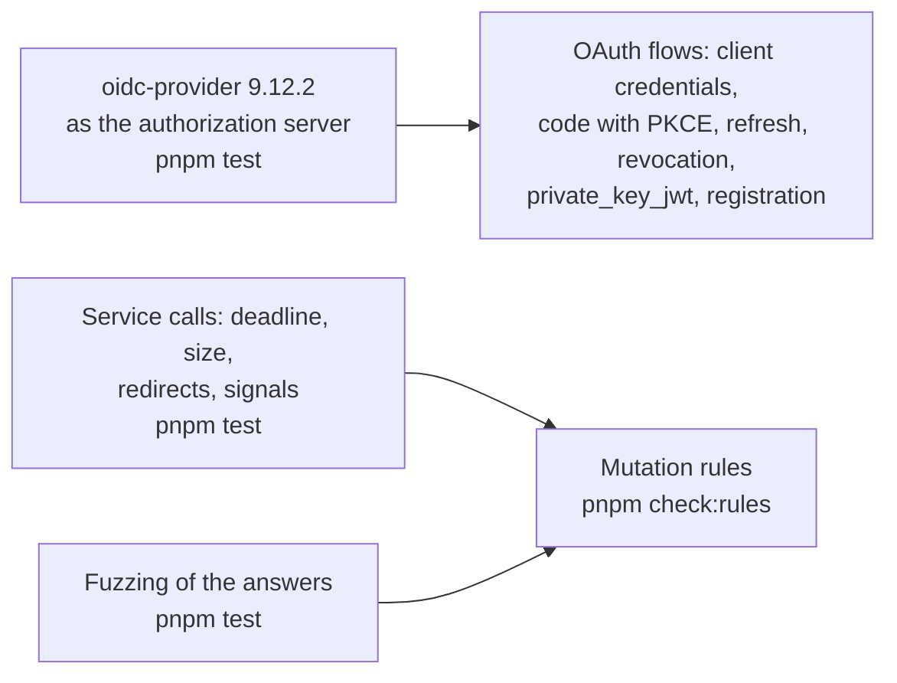

# Evidence for core

What shows that `@interopkit/core` does what it says; the speed and the size are in [performance](performance.md).

| Layer          | Question                                                                                                                  | Where                                                                                                | Runs               |
| -------------- | ------------------------------------------------------------------------------------------------------------------------- | ---------------------------------------------------------------------------------------------------- | ------------------ |
| OAuth flows    | Does each grant get, refresh and revoke tokens from an authorization server of other authors?                             | `oauth-*.test.ts` against `oidc-provider` 9.12.2, the version that `packages/core/package.json` pins | `pnpm test`        |
| Service calls  | Does a call end at its deadline, refuse a redirect and an answer above its size, and end one caller's wait on its signal? | `service.test.ts`, `race-abort.test.ts`, `keyed-cache.test.ts`                                       | `pnpm test`        |
| Answers        | Does a reader of an answer refuse every malformed body with a `DataError`?                                                | `answer.fuzz.test.ts`                                                                                | `pnpm test`        |
| Checks         | Does each check accept what its standard allows and refuse the rest, with a sentence that names the value?                | `checks.test.ts`, `formats.test.ts`, `json.test.ts`                                                  | `pnpm test`        |
| Peak memory    | Does each reader of untrusted input stay within its heap at its worst input?                                              | `peak-memory.test.ts`                                                                                | `pnpm test`        |
| Mutation rules | Does the test of each rule that keeps a request from being forged or redirected fail without it?                          | `scripts/rules/core.ts`                                                                              | `pnpm check:rules` |

## Not included

| Not included                             | Why                                                                                  |
| ---------------------------------------- | ------------------------------------------------------------------------------------ |
| A conformance suite of OAuth 2.0 clients | The OpenID Foundation certifies OpenID Connect, which the package does not implement |

## Differences from the references

None: the OAuth flows follow `oauth4webapi`, on which they build, and the differences of a standard above them are in the guide of
its package.
