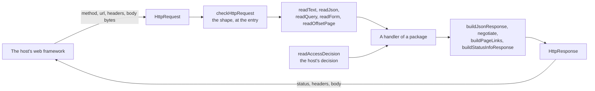

# Requests and answers

`@interopkit/core/http` holds the request and the answer that the handlers of the packages take and return, as plain data that
does not depend on a web framework, and the helpers that a handler uses to read a request and build an answer: among them the
paging by `limit` and `offset`, the `imsx_StatusInfo` of a failure and the decision of a host's `authorize` port, which the
providers of the 1EdTech services share. A host builds an `HttpRequest` from the request type of its framework and sends the
`HttpResponse` that a handler returns. The module does no I/O, holds no state and imports no platform API.



## Quick start

```ts
import { buildJsonResponse, negotiate, readForm, readJson } from "@interopkit/core/http";

const form = {
  method: "POST",
  url: "https://tool.example/token",
  headers: { "content-type": "application/x-www-form-urlencoded" },
  body: new TextEncoder().encode("grant_type=client_credentials&scope=score"),
};
readForm(form).get("scope"); // => "score"

const statement = {
  method: "POST",
  url: "https://lrs.example/statements",
  headers: { "content-type": "application/json" },
  body: new TextEncoder().encode('{"verb":{"id":"https://example.com/completed"}}'),
};
readJson(statement); // => { verb: { id: "https://example.com/completed" } }

negotiate("text/plain;q=0.9, application/json", ["application/json", "text/plain"]); // => "application/json"
buildJsonResponse(404, { error: "not_found" }); // => { status: 404, headers: { "content-type": "application/json;charset=UTF-8" }, body: '{"error":"not_found"}' }
```

A host turns a web `Request` into an `HttpRequest` like this, with the header names in lower case, which `Headers` gives:

```ts
const toHttpRequest = async (request) => ({
  method: request.method,
  url: request.url,
  headers: Object.fromEntries(request.headers),
  body: new Uint8Array(await request.arrayBuffer()),
});
const sample = await toHttpRequest(new Request("https://tool.example/login?iss=a", { method: "GET", headers: { Cookie: "a=1" } }));
// => { method: "GET", url: "https://tool.example/login?iss=a", headers: { cookie: "a=1" }, body: new Uint8Array() }
```

The `HttpResponse` goes back as `new Response(response.body, { status: response.status, headers: response.headers })`; a status
that has no body, such as 204, takes `null`.

## Functions

| Function                                    | Does                                                                                   |
| ------------------------------------------- | -------------------------------------------------------------------------------------- |
| `checkHttpRequest(value)`                   | Checks the shape of a request that a host passes from JavaScript, and narrows its type |
| `basePathSchema`                            | The schema of the option that names the path a handler is mounted at: `""` or a path that starts with `/` and does not end with one, written as `URL` writes the path of a request |
| `readText(request)`                         | Reads the body as UTF-8 text                                                           |
| `readJson(request, options)`                | Reads the body as JSON within limits on its size, its depth and its tokens             |
| `readQuery(request)`                        | Reads the parameters of the query into a map                                           |
| `readForm(request, options)`                | Reads the parameters of an `application/x-www-form-urlencoded` body into a map         |
| `readBearerToken(request)`                    | Returns the token of an `Authorization` header of the bearer scheme (RFC 6750 section 2.1): the scheme in any case, one or more spaces, a b64token; `undefined` for no header or another scheme or form |
| `buildJsonResponse(status, body, headers, type)` | Builds an answer with a JSON body                                                      |
| `negotiate(accept, offered)`                | Chooses a media type from the `Accept` header                                          |
| `readOffsetPage(parameters, sizes)`         | Reads the `limit` and `offset` of a query into the page it asks for                    |
| `buildPageLinks(url, page, extent)`        | Builds the `Link` header of a page: first, prev, next, and last when the total is known |
| `buildStatusInfoResponse(status, description, options)` | Builds the answer of a failure of a 1EdTech service, with its `imsx_StatusInfo` |
| `readAccessDecision(value, label, options)` | Reads what a host's `authorize` port decided: allowed, with what it grants, or refused  |

| Type           | Fields                                                                                                                                       |
| -------------- | -------------------------------------------------------------------------------------------------------------------------------------------- |
| `HttpRequest`  | `method`, in upper case; `url`, absolute, with its query; `headers`, by name in lower case; `body`, a `Uint8Array`, empty when there is none |
| `HttpResponse` | `status`; `headers`, by name; `body`, text sent as UTF-8 or a `Uint8Array` over an `ArrayBuffer`, the empty string when there is none        |
| `OffsetPage`   | `limit`, at least 1; `offset`, from 0                                                                                                        |
| `PageSizes`    | `pageSize`, the items of a page without a `limit`; `maxPageSize`, the most items of a page                                                   |
| `ListExtent`   | `{ total }`, the number of items in the list; or `{ more }`, whether items may follow the page when the store cannot count them               |
| `AccessDecision` | `{ allowed: true }` with what the host grants, or an `AccessRefusal`: `{ allowed: false, status, reason?, challenge?, retryAfterSeconds? }`, with 401, 403 or 429. A handler sends `reason` as the message of its answer, `challenge` as the `WWW-Authenticate` of a 401 and `retryAfterSeconds` as the `Retry-After` of a 429, and its own sentence and challenge when they are absent |
| `ReadAccessDecisionOptions` | `grant`: the schema of what an allowed decision carries besides `allowed` |

## Options and limits

| Option or limit               | Default                          | Unit   | Refused with | Where                                                               |
| ----------------------------- | -------------------------------- | ------ | ------------ | ------------------------------------------------------------------- |
| `readJson` `options.maxBytes` | 1,048,576                        | bytes  | `DataError`  | The size of the body, counted in bytes                              |
| `readJson` `options.maxDepth` | 64                               | levels | `DataError`  | Arrays and objects nested inside each other: `[]` is 1, `[[]]` is 2 |
| `readJson` `options.maxTokens` | 1,000,000                       | tokens | `DataError`  | Each bracket, brace, colon and comma, each string, each number and each `true`, `false` and `null` |
| `readForm` `options.maxBytes` | none                             | bytes  | `DataError`  | The size of the body, counted before anything is decoded            |
| `buildJsonResponse` `headers`      | none                             |        |              | Win over the `content-type` that it sets                            |
| `buildJsonResponse` `type`         | `application/json;charset=UTF-8` |        |              | The media type of the answer                                        |
| `readOffsetPage` `limit`      | `sizes.pageSize`, at most `sizes.maxPageSize` | items | `DataError` | A whole number of at least 1 in digits; a larger one is lowered to `maxPageSize` |
| `readOffsetPage` `offset`     | 0                                | items  | `DataError`  | A whole number of at least 0 in digits                              |
| `buildStatusInfoResponse` `options.minor` | none                      |        |              | The code of the detail, from the vocabulary of the specification    |
| `buildStatusInfoResponse` `options.severity` | `"error"`              |        |              | `"error"`, or `"status"` where the specification pairs the code with it |
| `buildStatusInfoResponse` `options.headers` | none                    |        |              | More headers, such as `Retry-After` or `Allow`                      |

`readText` and `readQuery` set no limit, nor does `readForm` without `maxBytes`: the host caps the size of a body before it
builds the request, as the handlers of the packages document. A handler that reads a form passes its own limit, so that a
form is measured before it is decoded.

## Reading

| Rule                          | Value                                                                                                                          |
| ----------------------------- | ------------------------------------------------------------------------------------------------------------------------------ |
| Text                          | UTF-8 only. A byte sequence that is not UTF-8 is refused, never replaced. A byte order mark at the start is dropped            |
| JSON depth                    | Checked on the text before it is parsed, so a body of a hundred thousand opening brackets is refused without building anything |
| JSON tokens                   | Counted on the text before it is parsed, so a body of a million empty arrays is refused without building anything: the memory of a parse grows with the tokens, not the bytes |
| JSON keys                     | `__proto__` becomes an own property of the result and changes no prototype                                                     |
| A parameter that occurs twice | Refused in a query and in a form (RFC 6749 section 3.1)                                                                        |
| Form media type               | `application/x-www-form-urlencoded`, in any case and with parameters such as `charset`; any other type is refused              |
| The path a handler is mounted at | `basePathSchema` writes it as `URL` writes the `pathname` of a request, percent-encoded and without dot segments, so `/café` and `/caf%C3%A9` are one path; a path whose dot segments leave `/`, such as `/xapi/..`, is refused |

## Paging, failures and decisions

The REST bindings of CASE, Open Badges and CLR page a list with `limit` and `offset`, answer a page with `X-Total-Count` and a
`Link` header, and answer every failure with an `imsx_StatusInfo`. A provider asks the host's `authorize` port whether a request
may go on, and the port allows it, with what it grants such as the owner of the resources, or refuses it with 401, 403 or 429.

```ts
import { buildPageLinks, buildStatusInfoResponse, readOffsetPage, readQuery } from "@interopkit/core/http";

const list = {
  method: "GET",
  url: "https://badges.example.org/ims/ob/v3p0/credentials?limit=2&offset=2",
  headers: {},
  body: new Uint8Array(),
};
const page = readOffsetPage(readQuery(list), { pageSize: 100, maxPageSize: 1000 }); // => { limit: 2, offset: 2 }
buildPageLinks(list.url, page, { more: true }); // => '<https://badges.example.org/ims/ob/v3p0/credentials?limit=2&offset=0>; rel="first", <https://badges.example.org/ims/ob/v3p0/credentials?limit=2&offset=0>; rel="prev", <https://badges.example.org/ims/ob/v3p0/credentials?limit=2&offset=4>; rel="next"'
const busy = buildStatusInfoResponse(429, "Retry later.", { minor: "server_busy", headers: { "retry-after": "60" } });
busy.headers; // => { "content-type": "application/json;charset=UTF-8", "retry-after": "60" }
JSON.parse(String(busy.body)); // => { imsx_codeMajor: "failure", imsx_severity: "error", imsx_description: "Retry later.", imsx_codeMinor: { imsx_codeMinorField: [{ imsx_codeMinorFieldName: "TargetEndSystem", imsx_codeMinorFieldValue: "server_busy" }] } }
```

| Rule                    | Value                                                                                                                         |
| ----------------------- | ----------------------------------------------------------------------------------------------------------------------------- |
| `Link` addresses        | The URL of the request with `limit` and `offset` set, so that the other parameters stay                                       |
| `Link` relations        | `first` always; `prev` when the offset is above 0; `next` when items follow; `last` when the total is known (Open Badges 6.4) |
| The last page           | Starts at the last multiple of `limit` below the total; for an empty list, the first page                                     |
| `imsx_StatusInfo`       | `imsx_codeMajor` `failure`, the severity, the description, and a detail of `TargetEndSystem` with the code when there is one  |
| A decision of the port  | Read with `readAccessDecision(value, label, { grant })`, so that another shape is a `DataError` that names its path; the grant reads what an allowed decision carries, such as an owner |

## Choosing a media type

`negotiate` follows RFC 9110 section 12.5.1.

| Step                                 | Rule                                                                                                                                 |
| ------------------------------------ | ------------------------------------------------------------------------------------------------------------------------------------ |
| The weight of an offered type        | The `q` of the most specific range that names it: `type/subtype`, then `type/*`, then `*/*`. A type that no range names has weight 0 |
| The choice                           | The highest weight; the first of the offered types wins a tie                                                                        |
| No `Accept` header, or none accepted | The first offered type: an error still has to be answered in some format                                                             |
| A range that is malformed            | It accepts nothing: not `type/subtype`, `*/subtype`, or a weight that is not `0` to `1` with up to three decimals                    |
| Parameters of a range                | Ignored, except `q`, and the extensions after it. `text/plain;charset=utf-8` counts as `text/plain`                                  |

```ts
import { negotiate } from "@interopkit/core/http";

const ranges = "text/*;q=0.3, text/plain;q=0.7, */*;q=0.5";
negotiate(ranges, ["text/html", "image/jpeg"]); // => "image/jpeg"
negotiate(ranges, ["text/html", "image/jpeg", "text/plain"]); // => "text/plain"
```

## Errors

| Error       | When                                                                                                                                                               | What to do                                                       |
| ----------- | ------------------------------------------------------------------------------------------------------------------------------------------------------------------ | ---------------------------------------------------------------- |
| `DataError` | `checkHttpRequest`: the value is not an object with a string `method` and an absolute `url`, a `Uint8Array` `body`, and `headers` of strings by name in lower case | Build the request as shown above; encode text with `TextEncoder` |
| `DataError` | `readText`, `readJson`, `readForm`: the body holds bytes that are not UTF-8                                                                                        | Answer 400                                                       |
| `DataError` | `readJson`: the body is larger or deeper than the limits, or is not JSON                                                                                           | Answer 400, or 413 for the size                                  |
| `DataError` | `readJson`: an option is not a positive integer                                                                                                                    | Fix the option                                                   |
| `DataError` | `readQuery`, `readForm`: a parameter occurs twice, or a form has another media type                                                                                | Answer 400, or 415 for the media type                            |
| `DataError` | `negotiate`: `accept` is not a string, or `offered` is not a list of at least one `type/subtype` without parameters                                                | Fix the call                                                     |
| `DataError` | `readOffsetPage`: `limit` is not a whole number of at least 1, or `offset` one of at least 0, in digits                                                            | Answer 400 with the message, which names the parameter           |
| `DataError` | `readOffsetPage`, `buildPageLinks`, `buildStatusInfoResponse`: an argument of another type, a status outside 400 to 599, an empty description                          | Fix the call                                                     |
| `DataError` | `readAccessDecision`: the port answered another shape: a status other than 401, 403 or 429, a delay that is not whole, an allowed decision without its grant           | Fix the port: a broken contract is a bug of the host             |

The message of a `DataError` names the offending value, except for a text body, which it does not repeat, since a body may
hold a token.

## Speed and memory

`pnpm bench` times the build that ships against the platform API that a function wraps, the least work of the same kind, in
three rounds that alternate which runs first; the gate is the ratio of the fastest samples, five times the highest of three runs
rounded up to one significant digit, which holds on any machine. Each peak is measured by `process.resourceUsage().maxRSS` in a
test file of its own, on Node.js 22 and 24.

| Benchmark or worst input | Reference or test | Ratio or peak | Budget |
| --- | --- | ---: | ---: |
| `readJson` of a body of 1 MiB | `TextDecoder` and `JSON.parse` | 1.81–1.84 | 10 |
| `readForm` of 2,000 parameters | `URLSearchParams` | 0.86–0.90 | 5 |
| A body at the size limit of the most empty objects that the tokens allow | `http-memory.test.ts` | 43–55 MiB | 96 MiB |
| A form of 10 MiB of plus signs | `form-memory.test.ts` | 20 MiB | 64 MiB |

`readJson` counts the levels and the tokens of the text in one reading, which finds the end of each string with `indexOf`, before
`JSON.parse` builds anything; that reading is the work that the reference does not do. Two readings, each over the strings one
unit at a time, take 3.6 ms for 1 MiB where it takes 2.4. `readForm` turns each `+` into a space on the bytes: URLSearchParams
alone joins a node of a rope for each in Node.js, and raised the peak by 368 MiB on Node.js 22 and 467 MiB on 24 for that form.

## Data flows

| Data                     | Comes from  | Goes to                   | Kept by the package |
| ------------------------ | ----------- | ------------------------- | ------------------- |
| The request and its body | The host    | The handler that reads it | No                  |
| The answer               | The handler | The host, which sends it  | No                  |

## Not included

| What                                                      | Reason                                                                                        |
| --------------------------------------------------------- | --------------------------------------------------------------------------------------------- |
| Adapters for web frameworks                               | A host builds the request in a few lines from its own framework                               |
| Routing, sessions, authentication                         | They belong to the host. A handler takes a request and gives an answer                        |
| Cookies                                                   | Only `tool-integration` reads them, so the reader stays there                                 |
| Multipart bodies, other character sets, compressed bodies | The host decodes them before it builds the request, or the package that needs them reads them |
| A 406 answer                                              | `negotiate` always chooses a type, since an error has to be answered in some format           |

## Differences from the references

| Reference                                 | Difference                                                                                                                      |
| ----------------------------------------- | ------------------------------------------------------------------------------------------------------------------------------- |
| RFC 9110: `Accept` ranges with parameters | A range matches by its type and subtype, and its other parameters are ignored, so that `application/json;charset=utf-8` matches |
| `URLSearchParams`                         | A parameter that occurs twice is refused instead of read as a list, since the protocols of the packages forbid it               |
| `TextDecoder`                             | Invalid UTF-8 is refused instead of replaced, so that a signature or an identifier never changes in decoding                    |
