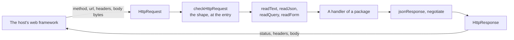

# Requests and answers

`@interopkit/core/http` holds the request and the answer that the handlers of the packages take and return, as plain data that
does not depend on a web framework, and the helpers that a handler uses to read a request and build an answer. A host builds an
`HttpRequest` from the request type of its framework and sends the `HttpResponse` that a handler returns. The module does no
I/O, holds no state and imports no platform API.



## Quick start

```ts
import { jsonResponse, negotiate, readForm, readJson } from "@interopkit/core/http";

const form = {
  method: "POST",
  url: "https://tool.example/token",
  headers: { "content-type": "application/x-www-form-urlencoded" },
  body: new TextEncoder().encode("grant_type=client_credentials&scope=score"),
};
readForm(form).get("scope"); // => "score"

const statement = {
  method: "POST",
  url: "https://lrs.example/statements",
  headers: { "content-type": "application/json" },
  body: new TextEncoder().encode('{"verb":{"id":"https://example.com/completed"}}'),
};
readJson(statement); // => { verb: { id: "https://example.com/completed" } }

negotiate("text/plain;q=0.9, application/json", ["application/json", "text/plain"]); // => "application/json"
jsonResponse(404, { error: "not_found" }); // => { status: 404, headers: { "content-type": "application/json;charset=UTF-8" }, body: '{"error":"not_found"}' }
```

A host turns a web `Request` into an `HttpRequest` like this, with the header names in lower case, which `Headers` gives:

```ts
const toHttpRequest = async (request) => ({
  method: request.method,
  url: request.url,
  headers: Object.fromEntries(request.headers),
  body: new Uint8Array(await request.arrayBuffer()),
});
const sample = await toHttpRequest(new Request("https://tool.example/login?iss=a", { method: "GET", headers: { Cookie: "a=1" } }));
// => { method: "GET", url: "https://tool.example/login?iss=a", headers: { cookie: "a=1" }, body: new Uint8Array() }
```

The `HttpResponse` goes back as `new Response(response.body, { status: response.status, headers: response.headers })`; a status
that has no body, such as 204, takes `null`.

## Functions

| Function                                    | Does                                                                                   |
| ------------------------------------------- | -------------------------------------------------------------------------------------- |
| `checkHttpRequest(value)`                   | Checks the shape of a request that a host passes from JavaScript, and narrows its type |
| `readText(request)`                         | Reads the body as UTF-8 text                                                           |
| `readJson(request, options)`                | Reads the body as JSON within a limit on its size and its depth                        |
| `readQuery(request)`                        | Reads the parameters of the query into a map                                           |
| `readForm(request)`                         | Reads the parameters of an `application/x-www-form-urlencoded` body into a map         |
| `jsonResponse(status, body, headers, type)` | Builds an answer with a JSON body                                                      |
| `negotiate(accept, offered)`                | Chooses a media type from the `Accept` header                                          |

| Type           | Fields                                                                                                                                       |
| -------------- | -------------------------------------------------------------------------------------------------------------------------------------------- |
| `HttpRequest`  | `method`, in upper case; `url`, absolute, with its query; `headers`, by name in lower case; `body`, a `Uint8Array`, empty when there is none |
| `HttpResponse` | `status`; `headers`, by name; `body`, text sent as UTF-8 or a `Uint8Array` over an `ArrayBuffer`, the empty string when there is none        |

## Options and limits

| Option or limit               | Default                          | Unit   | Refused with | Where                                                               |
| ----------------------------- | -------------------------------- | ------ | ------------ | ------------------------------------------------------------------- |
| `readJson` `options.maxBytes` | 1,048,576                        | bytes  | `DataError`  | The size of the body, counted in bytes                              |
| `readJson` `options.maxDepth` | 64                               | levels | `DataError`  | Arrays and objects nested inside each other: `[]` is 1, `[[]]` is 2 |
| `jsonResponse` `headers`      | none                             |        |              | Win over the `content-type` that it sets                            |
| `jsonResponse` `type`         | `application/json;charset=UTF-8` |        |              | The media type of the answer                                        |

`readText`, `readQuery` and `readForm` set no limit: the host caps the size of a body before it builds the request, as the
handlers of the packages document.

## Reading

| Rule                          | Value                                                                                                                          |
| ----------------------------- | ------------------------------------------------------------------------------------------------------------------------------ |
| Text                          | UTF-8 only. A byte sequence that is not UTF-8 is refused, never replaced. A byte order mark at the start is dropped            |
| JSON depth                    | Checked on the text before it is parsed, so a body of a hundred thousand opening brackets is refused without building anything |
| JSON keys                     | `__proto__` becomes an own property of the result and changes no prototype                                                     |
| A parameter that occurs twice | Refused in a query and in a form (RFC 6749 section 3.1)                                                                        |
| Form media type               | `application/x-www-form-urlencoded`, in any case and with parameters such as `charset`; any other type is refused              |

## Choosing a media type

`negotiate` follows RFC 9110 section 12.5.1.

| Step                                 | Rule                                                                                                                                 |
| ------------------------------------ | ------------------------------------------------------------------------------------------------------------------------------------ |
| The weight of an offered type        | The `q` of the most specific range that names it: `type/subtype`, then `type/*`, then `*/*`. A type that no range names has weight 0 |
| The choice                           | The highest weight; the first of the offered types wins a tie                                                                        |
| No `Accept` header, or none accepted | The first offered type: an error still has to be answered in some format                                                             |
| A range that is malformed            | It accepts nothing: not `type/subtype`, `*/subtype`, or a weight that is not `0` to `1` with up to three decimals                    |
| Parameters of a range                | Ignored, except `q`, and the extensions after it. `text/plain;charset=utf-8` counts as `text/plain`                                  |

```ts
import { negotiate } from "@interopkit/core/http";

const ranges = "text/*;q=0.3, text/plain;q=0.7, */*;q=0.5";
negotiate(ranges, ["text/html", "image/jpeg"]); // => "image/jpeg"
negotiate(ranges, ["text/html", "image/jpeg", "text/plain"]); // => "text/plain"
```

## Errors

| Error       | When                                                                                                                                                               | What to do                                                       |
| ----------- | ------------------------------------------------------------------------------------------------------------------------------------------------------------------ | ---------------------------------------------------------------- |
| `DataError` | `checkHttpRequest`: the value is not an object with a string `method` and an absolute `url`, a `Uint8Array` `body`, and `headers` of strings by name in lower case | Build the request as shown above; encode text with `TextEncoder` |
| `DataError` | `readText`, `readJson`, `readForm`: the body holds bytes that are not UTF-8                                                                                        | Answer 400                                                       |
| `DataError` | `readJson`: the body is larger or deeper than the limits, or is not JSON                                                                                           | Answer 400, or 413 for the size                                  |
| `DataError` | `readJson`: an option is not a positive integer                                                                                                                    | Fix the option                                                   |
| `DataError` | `readQuery`, `readForm`: a parameter occurs twice, or a form has another media type                                                                                | Answer 400, or 415 for the media type                            |
| `DataError` | `negotiate`: `accept` is not a string, or `offered` is not a list of at least one `type/subtype` without parameters                                                | Fix the call                                                     |

The message of a `DataError` names the offending value, except for a text body, which it does not repeat, since a body may
hold a token.

## Data flows

| Data                     | Comes from  | Goes to                   | Kept by the package |
| ------------------------ | ----------- | ------------------------- | ------------------- |
| The request and its body | The host    | The handler that reads it | No                  |
| The answer               | The handler | The host, which sends it  | No                  |

## Not included

| What                                                      | Reason                                                                                        |
| --------------------------------------------------------- | --------------------------------------------------------------------------------------------- |
| Adapters for web frameworks                               | A host builds the request in a few lines from its own framework                               |
| Routing, sessions, authentication                         | They belong to the host. A handler takes a request and gives an answer                        |
| Cookies                                                   | Only `tool-integration` reads them, so the reader stays there                                 |
| Multipart bodies, other character sets, compressed bodies | The host decodes them before it builds the request, or the package that needs them reads them |
| A 406 answer                                              | `negotiate` always chooses a type, since an error has to be answered in some format           |

## Differences from the references

| Reference                                 | Difference                                                                                                                      |
| ----------------------------------------- | ------------------------------------------------------------------------------------------------------------------------------- |
| RFC 9110: `Accept` ranges with parameters | A range matches by its type and subtype, and its other parameters are ignored, so that `application/json;charset=utf-8` matches |
| `URLSearchParams`                         | A parameter that occurs twice is refused instead of read as a list, since the protocols of the packages forbid it               |
| `TextDecoder`                             | Invalid UTF-8 is refused instead of replaced, so that a signature or an identifier never changes in decoding                    |
