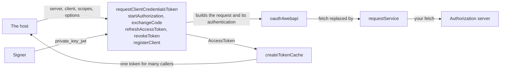
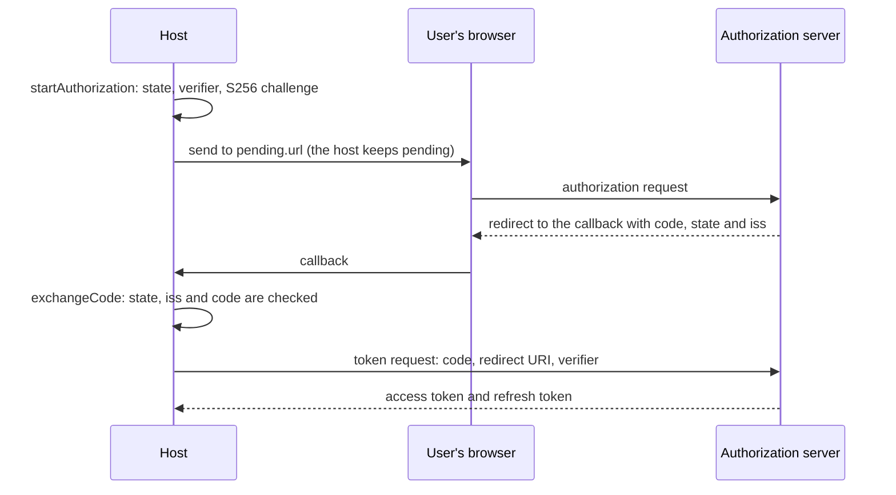

# OAuth clients

`@interopkit/core/oauth` is the client side of OAuth 2.0 for the APIs that the packages call: it gets tokens for the client
itself, runs the authorization code flow with PKCE, refreshes and revokes tokens, registers clients, and keeps one current
token for many callers. It is built on [oauth4webapi](https://github.com/panva/oauth4webapi), which writes and reads the
messages; every request goes through [`requestService`](service.md), so the deadline, the size limit, the refusal of
redirects and the signals of the other calls hold here too.



## Quick start

```ts
import { requestClientCredentialsToken } from "@interopkit/core/oauth";

const fetch = async () =>
  Response.json({ access_token: "at-1", token_type: "Bearer", expires_in: 3600, scope: "read" });
const token = await requestClientCredentialsToken(
  { tokenEndpoint: "https://as.example/token" },
  { clientId: "client-1", authentication: { method: "client_secret_basic", clientSecret: "secret" } },
  ["read"],
  { fetch, timeoutMs: 10_000, clock: { now: () => 1_700_000_000_000 } },
);
// => { accessToken: "at-1", expiresAt: 1700003600000, scopes: ["read"] }
```

In a host, `fetch` is `globalThis.fetch` and the clock is `SYSTEM_CLOCK`.

The grant that LTI tools use, with a JWT assertion that a `Signer` signs (the `Signer` guide shows how to make one):

```ts
import { createCryptoKeySigner } from "@interopkit/core";
import { requestClientCredentialsToken } from "@interopkit/core/oauth";

const rsa = {
  name: "RSASSA-PKCS1-v1_5",
  modulusLength: 2048,
  publicExponent: new Uint8Array([1, 0, 1]),
  hash: "SHA-256",
};
const pair = await crypto.subtle.generateKey(rsa, false, ["sign", "verify"]);
const signer = createCryptoKeySigner(pair.privateKey, { algorithm: "RS256", keyId: "tool-key-1" });
const client = { clientId: "tool-1", authentication: { method: "private_key_jwt", signer } };
const fetch = async (_url, init) =>
  Response.json({
    access_token: init.body.includes("&client_assertion=") ? "signed" : "unsigned",
    token_type: "Bearer",
  });
const options = { fetch, timeoutMs: 10_000, clock: { now: () => 1_700_000_000_000 } };
const token = await requestClientCredentialsToken({ tokenEndpoint: "https://lms.example/token" }, client, [], options);
token.accessToken; // => "signed"
```

The authorization code flow starts with the address that the host sends the user's browser to:

```ts
import { startAuthorization } from "@interopkit/core/oauth";

const server = { tokenEndpoint: "https://as.example/token", authorizationEndpoint: "https://as.example/authorize" };
const client = { clientId: "client-1", authentication: { method: "none" } };
const pending = await startAuthorization(server, client, {
  redirectUri: "https://app.example/callback",
  scopes: ["read"],
});
new URL(pending.url).searchParams.get("code_challenge_method"); // => "S256"
```

## API

| Function                                                         | Does                                                                                                                  |
| ---------------------------------------------------------------- | --------------------------------------------------------------------------------------------------------------------- |
| `requestClientCredentialsToken(server, client, scopes, options)` | Gets a token for the client itself (RFC 6749 section 4.4); with `private_key_jwt` it is the LTI token request         |
| `startAuthorization(server, client, request)`                    | Builds the address of the authorization endpoint with PKCE S256 and a random `state` (RFC 6749 section 4.1, RFC 7636) |
| `exchangeCode(server, client, callbackUrl, pending, options)`    | Checks the callback and exchanges its code for a token                                                                |
| `refreshAccessToken(server, client, refreshToken, options)`      | Gets a new token with a refresh token (RFC 6749 section 6)                                                            |
| `revokeToken(server, client, token, options)`                    | Revokes an access token or a refresh token (RFC 7009)                                                                 |
| `registerClient(server, metadata, options)`                      | Registers a client (RFC 7591) and returns it as a client that the other calls take                                    |
| `createTokenCache(obtain, options)`                              | Makes a function that gives a current token and obtains a new one only when needed                                    |

| Type                   | Fields                                                                                                                                                                   |
| ---------------------- | ------------------------------------------------------------------------------------------------------------------------------------------------------------------------ |
| `AuthorizationServer`  | `tokenEndpoint`; optional `authorizationEndpoint`, `registrationEndpoint`, `revocationEndpoint`, `audience`, `issuer`                                                    |
| `OAuthClient`          | `clientId`, `authentication`                                                                                                                                             |
| `ClientAuthentication` | `client_secret_basic` or `client_secret_post` with `clientSecret`; `private_key_jwt` with `signer`, `assertionLifetimeSeconds` and `claims`; `none`                      |
| `OAuthCallOptions`     | `fetch`, `timeoutMs` and `signal` of [service calls](service.md), and `clock`                                                                                            |
| `AccessToken`          | `accessToken`; `expiresAt`, in epoch milliseconds, when the server gave an `expires_in`; `refreshToken` when it sent one; `scopes`                                       |
| `PendingAuthorization` | `url`, `state`, `codeVerifier`, `redirectUri`: what the host keeps in the user's session between the redirect and the callback                                           |
| `ClientMetadata`       | `redirectUris`, `clientName`, `clientUri`, `scopes`; optional `grantTypes`, `logoUri`, `tosUri`, `policyUri`, `softwareId`, `softwareVersion`, `tokenEndpointAuthMethod` |
| `RegisteredClient`     | An `OAuthClient`, with `registrationAccessToken` and `clientSecretExpiresAt` when the server gave them                                                                   |

## The server

| Field                   | Meaning                                                                                                                                 | Default                                      |
| ----------------------- | --------------------------------------------------------------------------------------------------------------------------------------- | -------------------------------------------- |
| `tokenEndpoint`         | The token endpoint, an `https` URL                                                                                                      | Required                                     |
| `authorizationEndpoint` | The authorization endpoint; `startAuthorization` needs it                                                                               | none                                         |
| `registrationEndpoint`  | The registration endpoint; `registerClient` needs it                                                                                    | none                                         |
| `revocationEndpoint`    | The revocation endpoint; `revokeToken` needs it                                                                                         | none                                         |
| `audience`              | The `aud` of a JWT client assertion                                                                                                     | `tokenEndpoint`                              |
| `issuer`                | The issuer identifier. A callback with an `iss` (RFC 9207) is accepted only when it equals this, which defeats a mix-up between servers | none: the `iss` of a callback is not checked |

A call that needs an endpoint the server does not have is a `DataError`. The addresses come from the host, which reads them from
the documentation of the API or from the server's metadata; discovery is not included.

## Client authentication

| `method`              | What goes to the token endpoint                                                                                                                                     |
| --------------------- | ------------------------------------------------------------------------------------------------------------------------------------------------------------------- |
| `client_secret_basic` | `Authorization: Basic`, with the id and the secret form-encoded and joined by a colon (RFC 6749 section 2.3.1)                                                      |
| `client_secret_post`  | `client_id` and `client_secret` in the body                                                                                                                         |
| `private_key_jwt`     | `client_id`, `client_assertion_type` and `client_assertion` in the body: a JWT that the `signer` signs (RFC 7523 section 2.2, Security Framework 1.1 section 4.1.1) |
| `none`                | `client_id` in the body                                                                                                                                             |

Each request with `private_key_jwt` gets an assertion of its own:

| Part         | Value                                                                                             |
| ------------ | ------------------------------------------------------------------------------------------------- |
| Header       | `alg` of the signer, `kid` when the signer has a `keyId`, `typ` `JWT`                             |
| `iss`, `sub` | The `clientId`                                                                                    |
| `aud`        | `server.audience`, else `server.tokenEndpoint`                                                    |
| `iat`        | The clock's time in whole seconds                                                                 |
| `exp`        | `iat` plus `assertionLifetimeSeconds`, which is 300 unless the client says otherwise              |
| `jti`        | A new random UUID, so that no assertion can be replayed                                           |
| Others       | The `claims` of the client, none by default, such as the deployment of LTI 1.3 Core section 6.2.1 |

The assertion carries no claim beyond these. `claims` must be JSON and must not name `iss`, `sub`, `aud`, `exp`, `nbf`, `iat`
or `jti`, which the assertion sets itself (RFC 7519 section 4.1); a client that does is a `DataError`.

## The authorization code flow



| Step                  | Rule                                                                                                                                                                                                                                                                       |
| --------------------- | -------------------------------------------------------------------------------------------------------------------------------------------------------------------------------------------------------------------------------------------------------------------------- |
| `startAuthorization`  | The `state` and the code verifier are random (`crypto.getRandomValues`) and new for each request; the challenge is S256; the query of the endpoint is kept; no scope parameter when `scopes` is empty                                                                      |
| The callback          | `state` must equal the request's. The `iss` must equal `server.issuer` when the server names one. An `error` in the callback is the server's refusal. A callback with no `code`, or with an `id_token` or `token` (implicit and hybrid flows), does not answer the request |
| `exchangeCode`        | Sends the code, the redirect URI of the request and the verifier. `scopes` are those the server names, else those of the request                                                                                                                                           |
| Where `pending` lives | It holds the verifier, a secret until the token request: keep it in a server-side session, not in a cookie that a script can read                                                                                                                                          |

## Tokens

| Field          | Value                                                                                                                                                             |
| -------------- | ----------------------------------------------------------------------------------------------------------------------------------------------------------------- |
| `accessToken`  | The token. Only bearer tokens are supported; a token of another type is a `ServiceError`                                                                          |
| `expiresAt`    | The clock's time at the answer plus `expires_in`, in epoch milliseconds. Absent when the server gave none                                                         |
| `refreshToken` | Present when the server sent one. A refresh may send a new one or none: the host keeps the one it has until a new one comes                                       |
| `scopes`       | Those the server names. When it names none (RFC 6749 section 5.1): those asked for, for client credentials; those of the request, for a code; none, for a refresh |

### The token cache

`createTokenCache(obtain, { clock, refreshSkewSeconds })` returns a function that gives the access token as a string.

| Rule                                     | Value                                                                                              |
| ---------------------------------------- | -------------------------------------------------------------------------------------------------- |
| A token is good                          | Until `refreshSkewSeconds` before its `expiresAt`; the skew is 60 unless the options say otherwise |
| A token with no expiry                   | Never kept: nothing says how long it is good, so each call obtains one                             |
| Callers that arrive while it is obtained | Share the one call, which runs to its own timeout and receives no caller's `signal`                |
| A caller that aborts                     | Ends only its own wait; the call goes on, and the token it gets is kept for the next caller        |
| A failure                                | Reaches every caller that waits, and is not kept: the next call tries again                        |
| One cache                                | Holds one token, so a host with several clients or scopes makes several caches                     |

```ts
import { createTokenCache } from "@interopkit/core/oauth";

const obtain = async () => ({ accessToken: "at-1", expiresAt: 1_700_003_600_000, scopes: ["read"] });
const current = createTokenCache(obtain, { clock: { now: () => 1_700_000_000_000 } });
await current(); // => "at-1"
```

## Registration

`registerClient` posts the metadata as JSON in the names of RFC 7591 and asks for the grants in `grantTypes`, which are
`authorization_code` and `refresh_token` unless the host names others, with the `code` response type when the authorization
code grant is among them. A server refuses a grant that it does not offer, so ask only for what the API needs: Open Badges 3.0
allows `authorization_code` and `refresh_token` (7.1.1.2), which is the default, and an LTI tool asks for `client_credentials`.
`GRANT_TYPES` lists the three grants; `refresh_token` needs `authorization_code`, and a public client has no credentials for
`client_credentials`. The result is an `OAuthClient` that the other calls take: the identifier and the secret that the server issued,
or `none` for a public client. The secret is shown once, so the host stores it. `private_key_jwt` is not offered, since it needs
the client's public keys, which `ClientMetadata` does not carry.

## Options and limits

| Option                            | Default                       | Where                                                               |
| --------------------------------- | ----------------------------- | ------------------------------------------------------------------- |
| `fetch`                           | Required                      | The `Fetch` of [service calls](service.md)                          |
| `timeoutMs`                       | Required; 10,000 is the habit | From the request to the last byte of the answer                     |
| `signal`                          | none                          | Ends the caller's wait and reaches the signer of an assertion       |
| `clock`                           | `SYSTEM_CLOCK`                | `iat` and `exp` of an assertion, and `expiresAt` of a token         |
| `assertionLifetimeSeconds`        | 300                           | `exp` after `iat` of an assertion                                   |
| `refreshSkewSeconds` of the cache | 60                            | How long before its expiry a cached token counts as expired         |
| Most bytes of an answer           | 65,536                        | The size limit of [service calls](service.md); not replaceable here |

## Failure paths

| Case                                                     | Result                                                                                                                                |
| -------------------------------------------------------- | ------------------------------------------------------------------------------------------------------------------------------------- |
| An argument is not valid                                 | `DataError`, before any request                                                                                                       |
| The server does not answer, or the deadline passes       | `ServiceError`, status 0                                                                                                              |
| The server answers 400 with an OAuth `error`             | `ServiceError`, status 400; the message names the `error` and the description; `body` is the answer                                   |
| The server answers 401 with a challenge                  | `ServiceError`, status 401; `body` is the answer                                                                                      |
| The server answers another status, or redirects          | `ServiceError` with that status, as for [service calls](service.md)                                                                   |
| The answer is not a valid token or registration response | `ServiceError` with the status of the answer; the message says what is wrong                                                          |
| The callback carries the server's refusal                | `ServiceError`, status 400; `body` holds `error` and `error_description` as JSON. No request was made                                 |
| The callback does not answer the request                 | `DataError`: another or no `state`, another `iss`, no `code`, or tokens of an implicit flow. No request was made                      |
| The signer fails or signs in the wrong form              | The error of the signer, or a `DataError`; no request is made                                                                         |
| The signal aborts, or is aborted before the call         | Rejects with its `reason`; a signal that is aborted before the call makes no request                                                  |
| Called again                                             | Nothing is kept. A refresh token used twice may be refused by the server, and the host authorizes again; revocation is safe to repeat |
| Calls back                                               | Nothing                                                                                                                               |

## Errors

| Error                      | When                                                                                                                  | What to do                                                                                                |
| -------------------------- | --------------------------------------------------------------------------------------------------------------------- | --------------------------------------------------------------------------------------------------------- |
| `DataError`                | The server, the client, the scopes, the metadata, the options, the callback or the pending authorization is not valid | Fix the argument; the message names it                                                                    |
| `DataError`                | The server lacks the endpoint that the call needs                                                                     | Give the endpoint                                                                                         |
| `DataError`                | The callback does not answer the request                                                                              | Treat the login as failed and start again: the callback may be forged or stale                            |
| `ServiceError`, 400        | The server refused the grant or the metadata, or the callback carries the server's refusal                            | Read `error` in the message: `invalid_grant` means authorize again, `access_denied` that the user said no |
| `ServiceError`, 401        | The server rejects the client's authentication                                                                        | Check the secret, or the key and the audience of the assertion                                            |
| `ServiceError`, 0          | No answer                                                                                                             | Check the address and the network, or raise `timeoutMs`                                                   |
| `ServiceError`, other      | Another status, a redirect, an answer that is too large, or an answer that is not a valid response                    | As for [service calls](service.md)                                                                        |
| The `reason` of the signal | The caller aborted                                                                                                    | Nothing: the caller ended the wait                                                                        |

## Data flows

| Data              | Comes from  | Goes to                                              | Kept by the package                       |
| ----------------- | ----------- | ---------------------------------------------------- | ----------------------------------------- |
| The client secret | The host    | The token endpoint, in a header or the body          | No                                        |
| The private key   | The host    | Nothing: only the `Signer` touches it                | No                                        |
| The tokens        | The server  | The host                                             | In a cache that the host makes, in memory |
| The code verifier | The package | The host, in `PendingAuthorization`; then the server | No                                        |

## Not included

| Not included                                                                            | Why                                                                                  |
| --------------------------------------------------------------------------------------- | ------------------------------------------------------------------------------------ |
| OpenID Connect                                                                          | The APIs are OAuth 2.0 APIs; a token response with an `id_token` is a `ServiceError` |
| Discovery of the server's metadata                                                      | The host knows the endpoints of the API it calls                                     |
| DPoP, mutual TLS, `client_secret_jwt`, PAR, JAR                                         | No API of the packages asks for them; tokens of another type than bearer are refused |
| A server                                                                                | The packages are clients; an authorization server is an application                  |
| Initial access tokens for registration, and the management of a registration (RFC 7592) | `RegisteredClient` carries the token that manages it, and the call is the host's     |
| Storing tokens and secrets                                                              | The host owns storage; the cache keeps one token in memory                           |

## Differences from the references

| Reference                    | Difference                                                                                                                                          |
| ---------------------------- | --------------------------------------------------------------------------------------------------------------------------------------------------- |
| oauth4webapi                 | Its requests go through `requestService`, with the deadline, the size limit and no redirects; it makes none itself                                  |
| oauth4webapi                 | Its errors are `ServiceError`s that carry the status and the body, and the callback problems are `DataError`s                                       |
| oauth4webapi `PrivateKeyJwt` | The assertion is signed through a `Signer`, so a key in a KMS works, and its `iat`, `exp` and `jti` come from the clock of the options and `crypto` |
| RFC 9207                     | A callback without an `iss` is accepted, since a server may not send one; with `issuer` set, an `iss` that differs is refused                       |
