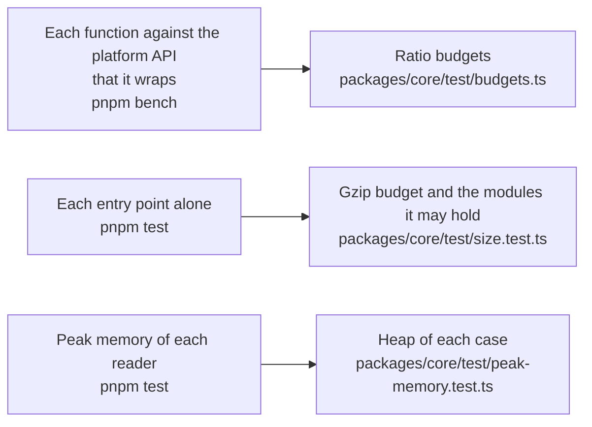

# Performance of core

What the functions of `@interopkit/core` cost against the platform API that each wraps, how much each entry point adds to a bundle, and the heap that each reader of untrusted input needs on its worst input. A budget holds each number and fails a gate of CI: `pnpm bench` for the time, `pnpm test` for the size and the heap. What each function does is in the guides: [service](service.md), [http](http.md), [signer](signer.md) and [signals](signals.md).

## Speed

`pnpm bench` times the build that ships against the platform API that a function wraps, the least work of the same kind, in
three rounds that alternate which runs first; the gate is the ratio of the fastest samples, five times the highest ratio measured on the runner of CI and on a laptop, rounded up to one significant digit, which holds on any machine. No library does what `core` does, so no benchmark has a library as its reference.

| Benchmark | Reference | Ratio | Budget |
| --- | --- | ---: | ---: |
| `readJson` of a body of 1 MiB | `TextDecoder` and `JSON.parse` | 1.47–1.68 | 9 |
| `readForm` of 2,000 parameters | `URLSearchParams` | 0.96–1.00 | 6 |
| `requestService` of an answer of 1 MiB in chunks of 16 KiB | `Response.arrayBuffer` of the same answer | 0.94–1.15 | 6 |
| `signCompactJws` of a payload of 2 KB with EdDSA | `crypto.subtle.sign` of its signing input | 1.15–1.21 | 7 |
| `get` of each of 1,000 kept keys of `createKeyedCache` | a `Map` with an expiry | 1.08–1.21 | 7 |
| `get` of one key by 100 callers while it loads once | 100 waits on one promise | 1.66–2.00 | 20 |

`readJson` counts the levels and the tokens of the text in one reading, which finds the end of each string with `indexOf`, before
`JSON.parse` builds anything; that reading is the work that the reference does not do. Two readings, each over the strings one
unit at a time, take 3.6 ms for 1 MiB where it takes 2.4. `readForm` turns each `+` into a space on the bytes: URLSearchParams
alone joins a node of a rope for each in Node.js, and raised the peak by 368 MiB on Node.js 22 and 467 MiB on 24 for that form.

`requestService` reads the chunks up to `maxBytes`, cancels the rest and joins what it read once.

The parts of a JWS are written as base64url by a table, in time linear in the input: built from the bytes as the arguments of
`String.fromCharCode` and encoded with `btoa`, they take longer than the signature, and `signCompactJws` of 2 KB 58 µs where it
takes 32.

## Size

`size.test.ts` bundles each entry point alone with `scripts/entry-size.ts`: esbuild, minified, with every dependency inside. It
fails above the budget after gzip, 1.25 times the size measured rounded up to the next 500 bytes, or when an entry point holds a
module that its budget does not list. Gzip is measured on Node.js 22; other versions of Node.js differ by up to 1 percent.

| Entry point | Bytes | Gzip | Budget | Holds, besides valibot |
| --- | ---: | ---: | ---: | --- |
| `@interopkit/core` | 33,587 | 11,707 | 15,000 | jose, for the key set cache |
| `@interopkit/core/checks` | 21,945 | 7,639 | 8,500 | nothing more |
| `@interopkit/core/http` | 22,419 | 7,151 | 9,000 | nothing more |
| `@interopkit/core/oauth` | 47,092 | 15,293 | 18,500 | oauth4webapi |

## Memory

Each worst input runs in a Node.js process of its own whose heap is bounded (`test/peak-memory.test.ts`): what the reading keeps
alive at once must fit, whenever V8 collects, so a regression fails and the load of a machine cannot. The heap of a case is twice
the least in which it ends on Node.js 22 and 24, rounded up to 16 MiB; `node scripts/peak-memory.ts core` prints the least, in
steps of 8 MiB.

| Reading | Worst input | Least heap | Heap of the test |
| --- | --- | ---: | ---: |
| `serviceEndless` | An answer without end, read to a limit of 1 MiB | 8 MiB | 16 MiB |
| `formPluses` | A form of 10 MiB of plus signs | 8 MiB | 16 MiB |
| `jsonObjects` | A body at the size limit of the most empty objects that the tokens allow | 32 MiB | 64 MiB |
| `keySets` | Key sets at the limits of bytes and keys, one nested too deep to copy, and one far above the limit | 16 MiB | 32 MiB |
