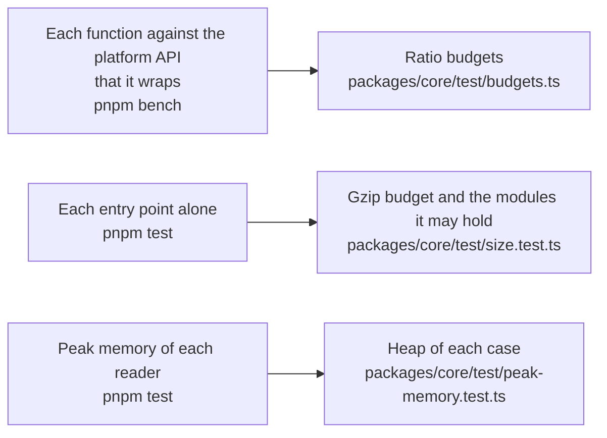

# Performance of core

What the benchmarks of `@interopkit/core` time against the platform API each function wraps and hold to a budget in CI
(`pnpm bench`), the size of each entry point, and the heap of each reader of untrusted input at its worst input (`pnpm test`).
The docs publish no measured time: it differs on every machine.

## Speed

`pnpm bench` times the build that ships against the platform API that a function wraps, in three rounds that alternate which
runs first. The budget is a ratio of the fastest samples, twice the highest measured in 12 runs of the `bench` job on the runner of CI,
rounded up to one significant digit, so it holds on any machine. No library does what `core` does, so no reference is a library.

| Benchmark                                                  | Reference                                 |
| ---------------------------------------------------------- | ----------------------------------------- |
| `readJson` of a body of 1 MiB                              | `TextDecoder` and `JSON.parse`            |
| `readForm` of 2,000 parameters                             | `URLSearchParams`                         |
| `requestService` of an answer of 1 MiB in chunks of 16 KiB | `Response.arrayBuffer` of the same answer |
| `signCompactJws` of a payload of 2 KB with EdDSA           | `crypto.subtle.sign` of its signing input |
| `get` of each of 1,000 kept keys of `createKeyedCache`     | a `Map` with an expiry                    |
| `get` of one key by 100 callers while it loads once        | 100 waits on one promise                  |

| Choice                                                                                                                                                                                                                                                                                           | Measured against the alternative                                                                                                                                                                                                                                                                                                                                  |
| ------------------------------------------------------------------------------------------------------------------------------------------------------------------------------------------------------------------------------------------------------------------------------------------------ | ----------------------------------------------------------------------------------------------------------------------------------------------------------------------------------------------------------------------------------------------------------------------------------------------------------------------------------------------------------------- |
| `readJson` counts levels and tokens in one reading before `JSON.parse`, finding the end of each string with `indexOf`; the reference does no such count                                                                                                                                          | Two readings, each over the strings one unit at a time: about 1.5 times as slow on 1 MiB                                                                                                                                                                                                                                                                          |
| `readForm` turns each `+` into a space on the bytes                                                                                                                                                                                                                                              | `URLSearchParams` alone joins a rope node for each in Node.js: the peak of a form of plus signs rises by 368 MiB on Node.js 22 and 467 MiB on 24                                                                                                                                                                                                                  |
| `requestService` reads the chunks up to `maxBytes`, cancels the rest and joins what it read once                                                                                                                                                                                                 |                                                                                                                                                                                                                                                                                                                                                                   |
| Each object schema of `core/checks` refuses `__proto__`, `constructor` and `prototype` in one pipe step of three lookups, and `copyJson` the same way; `copyJson` assigns each member to an object literal, as valibot builds objects, and `openRecord` copies its unnamed members by assignment | In turns in one process, against a build that refuses none of these names and copies with `Object.entries` and `Object.fromEntries`: `readCredential` of `achievement-credentials` takes about 0.7 of its time. The refusal is about 3 percent of `readEntity` of `learning-analytics`, and `Object.defineProperty` for each member is slower than the assignment |
| The parts of a JWS are written as base64url by a table, in linear time                                                                                                                                                                                                                           | `String.fromCharCode` over the bytes and `btoa` take longer than the signature: `signCompactJws` of 2 KB takes nearly twice as long                                                                                                                                                                                                                               |

## Size

`size.test.ts` bundles each entry point alone with `scripts/entry-size.ts`: esbuild, minified, with every dependency inside. It
fails above the budget after gzip, 1.25 times the size measured rounded up to the next 500 bytes, or when an entry point holds a
module that its budget does not list. Gzip is measured on Node.js 22; other versions of Node.js differ by up to 1 percent.

| Entry point               |  Bytes |   Gzip | Budget | Holds, besides valibot |
| ------------------------- | -----: | -----: | -----: | ---------------------- |
| `@interopkit/core`        | 27,386 |  9,607 | 12,500 | nothing more           |
| `@interopkit/core/checks` | 23,585 |  8,156 | 10,500 | nothing more           |
| `@interopkit/core/http`   | 23,124 |  7,472 |  9,500 | nothing more           |
| `@interopkit/core/oauth`  | 47,472 | 15,429 | 19,500 | oauth4webapi           |

## Memory

Each worst input runs in a Node.js process of its own whose heap is bounded (`test/peak-memory.test.ts`): what the reading keeps
alive at once must fit, whenever V8 collects, so a regression fails and the load of a machine cannot. The heap of a case is twice
the least in which it ends on Node.js 22 and 24, rounded up to 16 MiB; `node scripts/peak-memory.ts core` prints the least, in
steps of 8 MiB.

| Reading          | Worst input                                                              | Least heap | Heap of the test |
| ---------------- | ------------------------------------------------------------------------ | ---------: | ---------------: |
| `serviceEndless` | An answer without end, read to a limit of 1 MiB                          |      8 MiB |           16 MiB |
| `formPluses`     | A form of 10 MiB of plus signs                                           |      8 MiB |           16 MiB |
| `jsonObjects`    | A body at the size limit of the most empty objects that the tokens allow |     32 MiB |           64 MiB |
