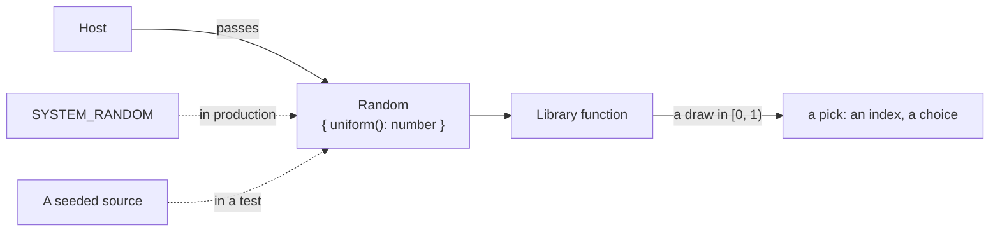

# Random

A library that must pick at random, such as a free index of a status list, takes a `Random` from its caller: an object whose
`uniform()` answers a uniform draw in [0, 1), the shape that `@assesskit/runtime` and `@measurekit/core` take too, so that a host
passes one source to every library. A host passes `SYSTEM_RANDOM` in production, and a test passes a seeded source.



## Quick start

```ts
import { SYSTEM_RANDOM } from "@interopkit/core";

const draw = SYSTEM_RANDOM.uniform();
draw >= 0 && draw < 1; // => true
const seeded = { uniform: () => 0.25 };
Math.floor(seeded.uniform() * 8); // => 2
```

## API

| Export          | Does                                                                                                                                     |
| --------------- | ---------------------------------------------------------------------------------------------------------------------------------------- |
| `Random`        | The type: an object with `uniform()`, which answers a number from 0 up to, and not including, 1, with the same chance for every value   |
| `SYSTEM_RANDOM` | A `Random` over `crypto.getRandomValues`. Each draw holds 53 random bits, so every draw is exact and none is predictable from the others |

## Rules

| Rule                      | Value                                                                                                                                                                                                    |
| ------------------------- | -------------------------------------------------------------------------------------------------------------------------------------------------------------------------------------------------------- |
| Range                     | 0 up to, and not including, 1                                                                                                                                                                            |
| Resolution                | Multiples of 2 to the power of -53                                                                                                                                                                       |
| Source of `SYSTEM_RANDOM` | `crypto.getRandomValues`, two 32-bit words per draw; no `Math.random`                                                                                                                                    |
| A pick                    | `Math.floor(draw * count)` is an index below `count`, and `count` must be below 2 to the power of 53                                                                                                     |
| Secrets                   | The packages draw the `state`, `nonce`, `jti` and verifier of their protocols from `crypto` directly and take no `Random` for them: a source that a caller could replace could make a secret predictable |

## Errors

| Error | When                                                                                             | What to do                                                                                        |
| ----- | ------------------------------------------------------------------------------------------------ | ------------------------------------------------------------------------------------------------- |
| None  | `SYSTEM_RANDOM` does not throw. A `Random` that a caller passes is the caller's to keep in range | A function that takes a `Random` trusts the draw it gets; pass `SYSTEM_RANDOM` or a seeded source |

## Not included

| Not included           | Why                                                                                                   |
| ---------------------- | ----------------------------------------------------------------------------------------------------- |
| A seeded generator     | A test brings its own, as an object of one line, and the library need not choose an algorithm for it |
| Randomness for secrets | Tokens and identifiers that guard a protocol come from `crypto` inside the package, never from a port |

## Differences from the references

| Reference                                          | Difference                                                                                                                                                         |
| -------------------------------------------------- | ------------------------------------------------------------------------------------------------------------------------------------------------------------------ |
| `Math.random()`                                    | Not used in any package: `pnpm lint` fails on it in `packages/*/src`. `SYSTEM_RANDOM` draws 53 bits from `crypto.getRandomValues`                                   |
| `Random` of `@assesskit/runtime` and `@measurekit/core` | The same shape, `uniform()`, so that a host passes one source to every family. Each family defines its own copy, since packages of different families never import each other |
