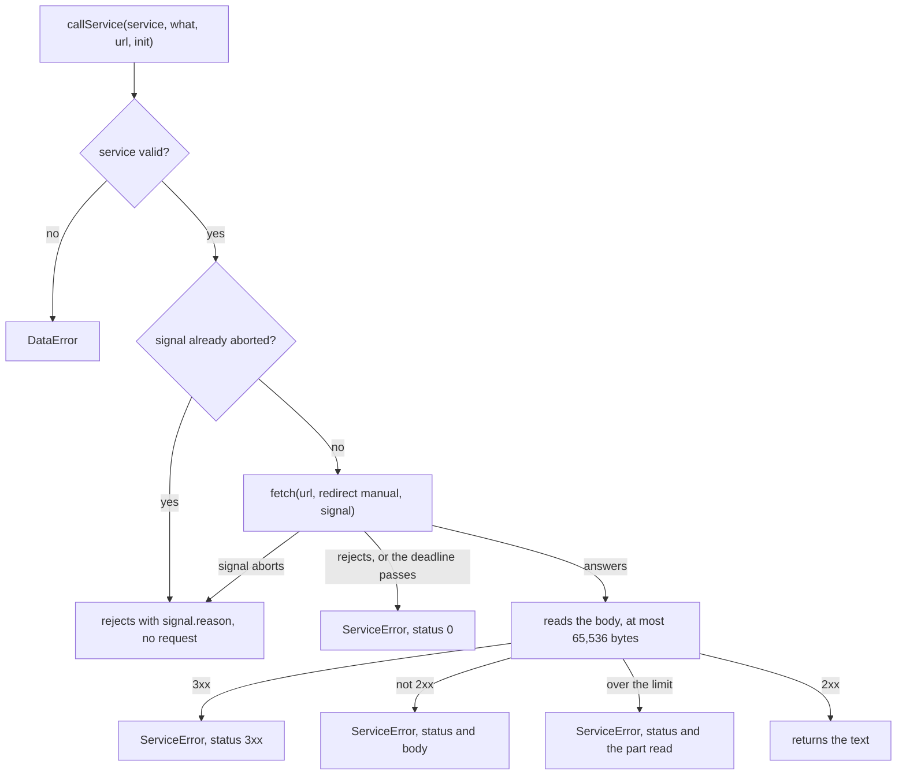

# Service calls

`callService` makes one HTTP request for a library and returns the body of a successful answer as text. The libraries use it
for every call to a key set, a token endpoint, a grade service and a Caliper endpoint, and a host can use it for its own
calls with the same limits.



## Quick start

```ts
import { callService, DEFAULT_TIMEOUT_MS } from "@interopkit/core";

const fetch = async () => new Response('{"keys":[]}');
const body = await callService(
  { fetch, timeoutMs: DEFAULT_TIMEOUT_MS },
  "The key set at https://platform.example/jwks",
  "https://platform.example/jwks",
  { method: "GET", headers: { accept: "application/json" } },
);
// => '{"keys":[]}'
```

In a host, `fetch` is the global one: `{ fetch: globalThis.fetch, timeoutMs: DEFAULT_TIMEOUT_MS }`.

## Arguments

| Argument            | Meaning                                                                                                                                     |
| ------------------- | ------------------------------------------------------------------------------------------------------------------------------------------- |
| `service.fetch`     | The function that makes the request, with the signature of `Fetch`: the part of the web standard `fetch` that the libraries call. Required  |
| `service.timeoutMs` | The most time in milliseconds from the request to the last byte of the answer, a positive integer. Required. `DEFAULT_TIMEOUT_MS` is 10,000 |
| `service.signal`    | Ends this caller's wait. Default: none                                                                                                      |
| `what`              | Names the service in the error messages, such as `The key set at https://platform.example/jwks`                                             |
| `url`               | The address of the request. The caller checks it, with `checkHttpsUrl` of [checks](checks.md) when the standard requires `https`            |
| `init`              | `method` (`"GET"` or `"POST"`), `headers` and, for a `POST`, `body` as a string                                                             |

## Rules

| Rule                                    | Value                                                                                                                                 |
| --------------------------------------- | ------------------------------------------------------------------------------------------------------------------------------------- |
| Deadline                                | `timeoutMs`, for the request and the whole body together                                                                              |
| Most bytes of an answer                 | 65,536, then the reader is cancelled; `ServiceError.body` holds the bytes up to the limit, whatever the chunks                        |
| Redirects                               | Never followed: `redirect` is `"manual"`, and any 3xx answer, or an answer that a `fetch` followed anyway (`redirected`), is an error |
| `fetch` is called                       | As a bare function, so that a global `fetch` works whatever its receiver rules                                                        |
| A `fetch` that ignores its signal       | Cannot hold the call past `timeoutMs`: every wait is raced against the deadline                                                       |
| The body of an answer that arrives late | Cancelled, so the connection is freed                                                                                                 |

## Failure paths

| Case                                                      | Result                                                                                                                                                                                                                                              |
| --------------------------------------------------------- | --------------------------------------------------------------------------------------------------------------------------------------------------------------------------------------------------------------------------------------------------- |
| `fetch` rejects                                           | `ServiceError` with status 0, naming the service and the reason                                                                                                                                                                                     |
| The deadline passes, in the request or in the body        | `ServiceError` with status 0                                                                                                                                                                                                                        |
| The caller's signal aborts, or is aborted before the call | Rejects with `signal.reason`; a signal that is aborted before the call makes no request                                                                                                                                                             |
| Status 3xx, or the opaque redirect that a browser gives   | `ServiceError` with the status and the body read                                                                                                                                                                                                    |
| Status that is not 2xx                                    | `ServiceError` with the status and the body read, up to the same limit                                                                                                                                                                              |
| More than 65,536 bytes                                    | `ServiceError` with the status of the answer and the part read                                                                                                                                                                                      |
| Called again                                              | Nothing is kept between calls. Whether a repeat is safe is the caller's to decide: a `GET` is safe, a token request is safe because each carries a new `jti`, a score needs a later timestamp, and a Caliper envelope repeats its event identifiers |
| Calls back                                                | Nothing                                                                                                                                                                                                                                             |

## Errors

| Error                          | When                                                                                                  | What to do                                                                                            |
| ------------------------------ | ----------------------------------------------------------------------------------------------------- | ----------------------------------------------------------------------------------------------------- |
| `DataError`                    | `fetch` is not a function, `timeoutMs` is not a positive integer, or `signal` is not an `AbortSignal` | Fix the options                                                                                       |
| `ServiceError`, status 0       | The service did not answer within `timeoutMs`, or `fetch` rejected                                    | Check the address and the network, or raise `timeoutMs`; the message names the service and the reason |
| `ServiceError`, status 3xx     | The service redirected                                                                                | Use the address it redirects to; the call follows none                                                |
| `ServiceError`, other status   | The service answered with an error; `body` holds what it said                                         | Act on the status: 401 and 403 mean a bad credential or scope, 5xx mean a retry later                 |
| `ServiceError`, over the limit | The answer is larger than 65,536 bytes                                                                | Ask the service for less, or do not use `callService` for it                                          |
| The `reason` of the signal     | The caller aborted                                                                                    | Nothing: the caller ended the wait. A request in flight may have reached the service                  |

## Differences from `fetch`

|                                   | `fetch`                                   | `callService`                                 |
| --------------------------------- | ----------------------------------------- | --------------------------------------------- |
| Redirects                         | Followed unless `redirect` says otherwise | Refused                                       |
| Time                              | None unless a signal sets one             | `timeoutMs` for request and body              |
| Size                              | Unbounded                                 | 65,536 bytes                                  |
| A non-2xx answer                  | A `Response`                              | A `ServiceError` with the status and the body |
| A `fetch` that ignores its signal | The caller waits                          | The call ends at the deadline                 |

## Data flows

| Data                           | Comes from  | Goes to                                                                 | Kept by the package |
| ------------------------------ | ----------- | ----------------------------------------------------------------------- | ------------------- |
| The URL, the headers, the body | The caller  | The `fetch` that the caller passes                                      | No                  |
| The answer of the service      | The `fetch` | The caller, as the text of a successful body, or as `ServiceError.body` | No                  |

## Not included

| What                                     | Reason                                                                                   |
| ---------------------------------------- | ---------------------------------------------------------------------------------------- |
| Retries                                  | Whether a repeat is safe depends on the request, so the caller decides                   |
| Caching                                  | A cache is shared work with its own rules, such as a key set cache in `tool-integration` |
| Following redirects                      | A redirect could lead from HTTPS to another scheme                                       |
| Bodies other than strings, other methods | No standard the packages implement needs them                                            |
| Streaming an answer                      | The answers are a few kilobytes                                                          |
