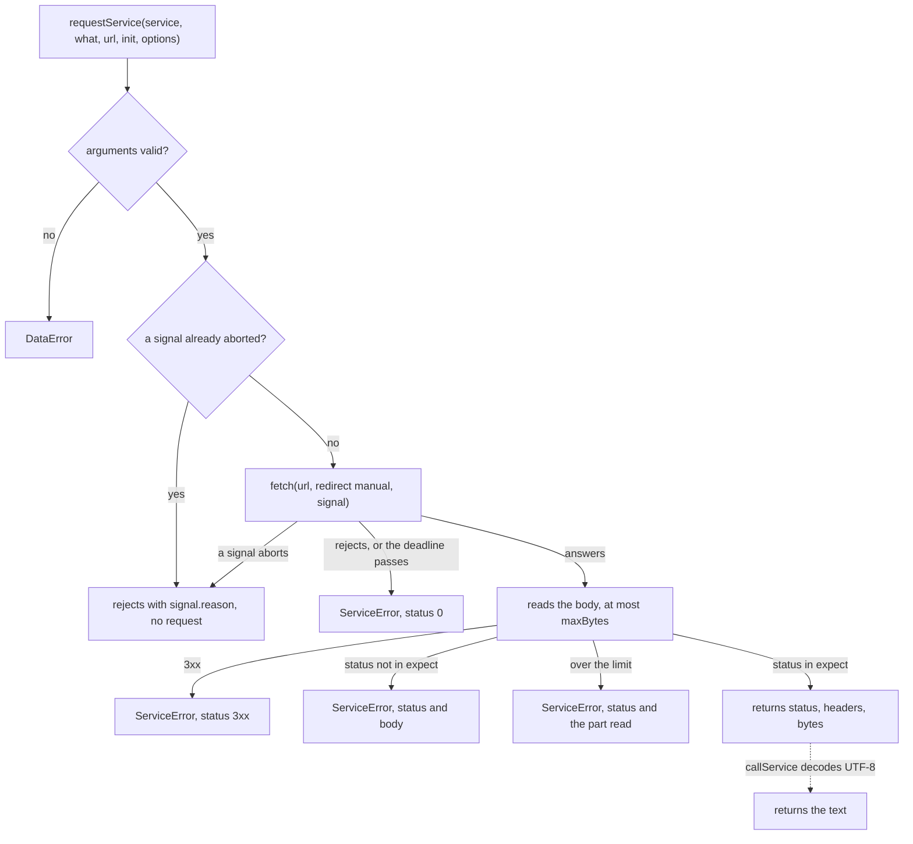

# Service calls

`requestService` makes one HTTP request for a library and returns the status, the headers and the body of the answer as
bytes; `callService` returns the body of a successful answer as text. The libraries use them for every call to a key set, a
token endpoint, a grade service and a Caliper endpoint, and a host can use them for its own calls with the same limits.



## Quick start

```ts
import { callService, DEFAULT_TIMEOUT_MS } from "@interopkit/core";

const fetch = async () => new Response('{"keys":[]}');
const body = await callService(
  { fetch, timeoutMs: DEFAULT_TIMEOUT_MS },
  "The key set at https://platform.example/jwks",
  "https://platform.example/jwks",
  { method: "GET", headers: { accept: "application/json" } },
);
// => '{"keys":[]}'
```

`requestService` gives an answer that a caller can read as a value, such as a missing resource or a failed precondition:

```ts
import { DEFAULT_TIMEOUT_MS, requestService } from "@interopkit/core";

const fetch = async () => new Response(null, { status: 404, headers: { ETag: '"v1"' } });
const answer = await requestService(
  { fetch, timeoutMs: DEFAULT_TIMEOUT_MS },
  "The resource at https://service.example/items/1",
  "https://service.example/items/1",
  { method: "GET", headers: { accept: "application/json" } },
  { expect: [200, 404] },
);
// => { status: 404, headers: { etag: '"v1"' }, body: new Uint8Array() }
```

In a host, `fetch` is the global one: `{ fetch: globalThis.fetch, timeoutMs: DEFAULT_TIMEOUT_MS }`.

## Arguments

| Argument            | Meaning                                                                                                                                                                                       |
| ------------------- | --------------------------------------------------------------------------------------------------------------------------------------------------------------------------------------------- |
| `service.fetch`     | The function that makes the request, with the signature of `Fetch`: the part of the web standard `fetch` that the libraries call. Required                                                    |
| `service.timeoutMs` | The most time in milliseconds from the request to the last byte of the answer, a positive integer. Required. `DEFAULT_TIMEOUT_MS` is 10,000                                                   |
| `service.signal`    | Ends this caller's wait. Default: none                                                                                                                                                        |
| `what`              | Names the service in the error messages, such as `The key set at https://platform.example/jwks`                                                                                               |
| `url`               | The address of the request. The caller checks it, with `checkHttpsUrl` of [checks](checks.md) when the standard requires `https`                                                              |
| `init.method`       | `"GET"`, `"POST"`, `"PUT"`, `"DELETE"` or `"HEAD"`. Required                                                                                                                                  |
| `init.headers`      | The request headers by name. Required                                                                                                                                                         |
| `init.body`         | Text, sent as UTF-8, or a `Uint8Array` over an `ArrayBuffer`, sent as it is. A `GET` or `HEAD` request has none. Default: none                                                                |
| `options.maxBytes`  | The most bytes of the answer, a positive integer. Default: `DEFAULT_MAX_BYTES`, 65,536                                                                                                        |
| `options.expect`    | The statuses that the call returns as values; any other status is a `ServiceError`. It replaces the default, so list every status to accept. A redirect cannot be listed. Default: 200 to 299 |
| `options.signal`    | Ends this caller's wait, like `service.signal`; when both are given, either one ends it. Default: none                                                                                        |

The answer of `requestService` is `{ status, headers, body }`: the headers by name in lower case, with a header that the
answer repeats joined by a comma and a space, and the body as a `Uint8Array`, empty for `HEAD` and for a status with no body.
`callService` returns the body decoded as UTF-8, with U+FFFD for bytes that are not.

## Rules

| Rule                                    | Value                                                                                                                                                                                          |
| --------------------------------------- | ---------------------------------------------------------------------------------------------------------------------------------------------------------------------------------------------- |
| Deadline                                | `timeoutMs`, for the request and the whole body together                                                                                                                                       |
| Most bytes of an answer                 | `maxBytes`, 65,536 by default, then the reader is cancelled; `ServiceError.body` holds the text of the bytes up to the limit, whatever the chunks                                              |
| Where a request goes                    | Not checked: only the URL's scheme. A host whose URLs come from a counterparty passes a `fetch` that checks the address the connection resolves to, not the host name, or DNS rebinding passes |
| Redirects                               | Never followed: `redirect` is `"manual"`, and any 3xx answer, or an answer that a `fetch` followed anyway (`redirected`), is an error, whatever `expect` lists                                 |
| `fetch` is called                       | As a bare function, so that a global `fetch` works whatever its receiver rules                                                                                                                 |
| A `fetch` that ignores its signal       | Cannot hold the call past `timeoutMs`: every wait is raced against the deadline                                                                                                                |
| The body of an answer that arrives late | Cancelled, so the connection is freed                                                                                                                                                          |

## Failure paths

| Case                                                      | Result                                                                                                                                                                                                                                              |
| --------------------------------------------------------- | --------------------------------------------------------------------------------------------------------------------------------------------------------------------------------------------------------------------------------------------------- |
| `fetch` rejects                                           | `ServiceError` with status 0, naming the service and the reason                                                                                                                                                                                     |
| The deadline passes, in the request or in the body        | `ServiceError` with status 0                                                                                                                                                                                                                        |
| The caller's signal aborts, or is aborted before the call | Rejects with `signal.reason`; a signal that is aborted before the call makes no request                                                                                                                                                             |
| Status 3xx, or the opaque redirect that a browser gives   | `ServiceError` with the status and the text of the body read                                                                                                                                                                                        |
| A status that `expect` does not list (2xx by default)     | `ServiceError` with the status and the text of the body read, up to the same limit                                                                                                                                                                  |
| More than `maxBytes`                                      | `ServiceError` with the status of the answer and the text of the part read                                                                                                                                                                          |
| Called again                                              | Nothing is kept between calls. Whether a repeat is safe is the caller's to decide: a `GET` is safe, a token request is safe because each carries a new `jti`, a score needs a later timestamp, and a Caliper envelope repeats its event identifiers |
| Calls back                                                | Nothing                                                                                                                                                                                                                                             |

## Errors

| Error                          | When                                                                                                                                                                                                                                                                                       | What to do                                                                                            |
| ------------------------------ | ------------------------------------------------------------------------------------------------------------------------------------------------------------------------------------------------------------------------------------------------------------------------------------------ | ----------------------------------------------------------------------------------------------------- |
| `DataError`                    | `fetch` is not a function, `timeoutMs` or `maxBytes` is not a positive integer, a signal is not an `AbortSignal`, the method is not one of the five, a `GET` or `HEAD` has a body, the body is not text or bytes, or `expect` is not a list of statuses from 100 to 599 without a redirect | Fix the arguments                                                                                     |
| `ServiceError`, status 0       | The service did not answer within `timeoutMs`, or `fetch` rejected                                                                                                                                                                                                                         | Check the address and the network, or raise `timeoutMs`; the message names the service and the reason |
| `ServiceError`, status 3xx     | The service redirected                                                                                                                                                                                                                                                                     | Use the address it redirects to; the call follows none                                                |
| `ServiceError`, other status   | The service answered with a status that `expect` does not list; `body` holds what it said                                                                                                                                                                                                  | Act on the status: 401 and 403 mean a bad credential or scope, 5xx mean a retry later                 |
| `ServiceError`, over the limit | The answer is larger than `maxBytes`                                                                                                                                                                                                                                                       | Ask the service for less, or raise `maxBytes`                                                         |
| The `reason` of the signal     | The caller aborted                                                                                                                                                                                                                                                                         | Nothing: the caller ended the wait. A request in flight may have reached the service                  |

## Differences from `fetch`

|                                   | `fetch`                                   | `requestService`                                                        |
| --------------------------------- | ----------------------------------------- | ----------------------------------------------------------------------- |
| Redirects                         | Followed unless `redirect` says otherwise | Refused                                                                 |
| Time                              | None unless a signal sets one             | `timeoutMs` for request and body                                        |
| Size                              | Unbounded                                 | `maxBytes`, 65,536 by default                                           |
| A non-2xx answer                  | A `Response`                              | A `ServiceError` with the status and the body, unless `expect` lists it |
| The body                          | A stream                                  | Bytes, read whole                                                       |
| A `fetch` that ignores its signal | The caller waits                          | The call ends at the deadline                                           |

## Data flows

| Data                           | Comes from  | Goes to                                                             | Kept by the package |
| ------------------------------ | ----------- | ------------------------------------------------------------------- | ------------------- |
| The URL, the headers, the body | The caller  | The `fetch` that the caller passes                                  | No                  |
| The answer of the service      | The `fetch` | The caller, as bytes or text, or as the text of `ServiceError.body` | No                  |

## Not included

| What                        | Reason                                                                                   |
| --------------------------- | ---------------------------------------------------------------------------------------- |
| Retries                     | Whether a repeat is safe depends on the request, so the caller decides                   |
| Caching                     | A cache is shared work with its own rules, such as a key set cache in `tool-integration` |
| Following redirects         | A redirect could lead from HTTPS to another scheme                                       |
| Methods other than the five | No standard that the packages implement needs `PATCH` or `OPTIONS`                       |
| Streaming a body, in or out | The answers are read whole under a limit, and the requests are built whole               |
