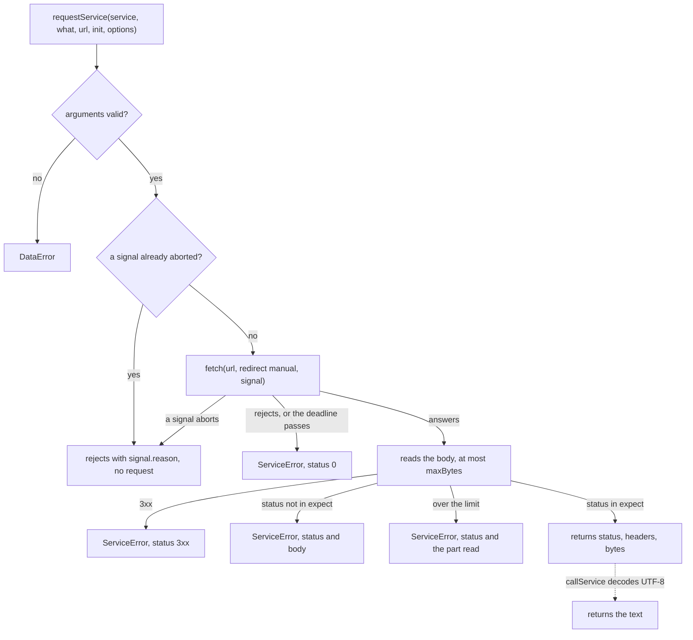

# Service calls

| Function                | Returns                                                                                               |
| ----------------------- | ----------------------------------------------------------------------------------------------------- |
| `requestService`        | The status, the headers and the body as bytes of one HTTP request                                     |
| `callService`           | The body of a successful answer as text                                                               |
| `requestWithCredential` | What `requestService` returns, for a request whose `Authorization` header the host gives at each call |

Every package calls key sets, token endpoints, grade services, Caliper endpoints and the REST services of CASE, Open Badges
and xAPI through them, and a host can make its own calls with the same limits.



## Quick start

```ts
import { callService, DEFAULT_TIMEOUT_MS } from "@interopkit/core";

const fetch = async () => new Response('{"keys":[]}');
const body = await callService(
  { fetch, timeoutMs: DEFAULT_TIMEOUT_MS },
  "The key set at https://platform.example/jwks",
  "https://platform.example/jwks",
  { method: "GET", headers: { accept: "application/json" } },
);
// => '{"keys":[]}'
```

In a host, `fetch` is the global one: `{ fetch: globalThis.fetch, timeoutMs: DEFAULT_TIMEOUT_MS }`.

`requestService` returns an answer that `expect` lists as a value, such as a missing resource:

```ts
import { DEFAULT_TIMEOUT_MS, requestService } from "@interopkit/core";

const fetch = async () => new Response(null, { status: 404, headers: { ETag: '"v1"' } });
const answer = await requestService(
  { fetch, timeoutMs: DEFAULT_TIMEOUT_MS },
  "The resource at https://service.example/items/1",
  "https://service.example/items/1",
  { method: "GET", headers: { accept: "application/json" } },
  { expect: [200, 404] },
);
// => { status: 404, headers: { etag: '"v1"' }, body: new Uint8Array() }
```

The answer is `{ status, headers, body }`: the headers by name in lower case, a repeated header joined by `, `, and the body
as a `Uint8Array`, empty for `HEAD` and for a status with no body. `callService` decodes the body as UTF-8, with U+FFFD for
bytes that are not.

## Arguments

| Argument                | Meaning                                                                                                                                              | Default                                  |
| ----------------------- | ---------------------------------------------------------------------------------------------------------------------------------------------------- | ---------------------------------------- |
| `service.fetch`         | The function that makes the request, of type `Fetch`: the part of the web `fetch` that the packages call                                             | Required                                 |
| `service.timeoutMs`     | The most milliseconds from the request to the last byte of the answer, a positive integer                                                            | Required; `DEFAULT_TIMEOUT_MS` is 10,000 |
| `service.signal`        | Ends this caller's wait                                                                                                                              | None                                     |
| `service.authorization` | `requestWithCredential` only: returns the `Authorization` value, such as `Bearer abc`, or `undefined` to send none                                   | None: no credential                      |
| `what`                  | Names the service in the error messages, such as `The key set at https://platform.example/jwks`                                                      | Required                                 |
| `url`                   | The address. The caller checks it, with `checkHttpsUrl` of [checks](checks.md) where the standard requires `https`                                   | Required                                 |
| `init.method`           | `"GET"`, `"POST"`, `"PUT"`, `"DELETE"` or `"HEAD"`                                                                                                   | Required                                 |
| `init.headers`          | The request headers by name                                                                                                                          | Required                                 |
| `init.body`             | Text, sent as UTF-8, or a `Uint8Array` over an `ArrayBuffer`, sent as it is; a `GET` or `HEAD` has none                                              | None                                     |
| `options.maxBytes`      | The most bytes of the answer, a positive integer                                                                                                     | `DEFAULT_MAX_BYTES`, 65,536              |
| `options.expect`        | The statuses returned as values; any other is a `ServiceError`. It replaces the default, so list every status to accept. A redirect cannot be listed | 200 to 299                               |
| `options.signal`        | Ends this caller's wait; with `service.signal`, either one ends it                                                                                   | None                                     |

## A request with a credential

`requestWithCredential` asks `service.authorization` before every request, so that it can return a refreshed token, and
passes it the call's signals joined: the wait ends when one aborts, whether the host's function stops or not. The clients of
CASE, Open Badges and xAPI make every request through it and add only their own headers.

```ts
import { DEFAULT_TIMEOUT_MS, requestWithCredential } from "@interopkit/core";

const sent = [];
const fetch = async (url, init) => {
  sent.push(init.headers);
  return new Response("{}");
};
const answer = await requestWithCredential(
  { fetch, timeoutMs: DEFAULT_TIMEOUT_MS, authorization: async () => "Bearer abc" },
  "The service at https://service.example/items",
  "https://service.example/items",
  { method: "GET", headers: { accept: "application/json" } },
);
answer.status; // => 200
sent; // => [{ accept: "application/json", authorization: "Bearer abc" }]
```

`clientOptionsEntries` holds the valibot schemas of the options every such client takes (`fetch`, `timeoutMs`, `maxBytes`,
`maxTokens`, `signal`), for a client to spread into the `strictRecord` of its options; the defaults of `maxBytes` and
`maxTokens` are the client's. `checkBaseUrl` of [checks](checks.md) checks the base address of its endpoints.

## Rules

| Rule                                    | Value                                                                                                                                                                                                                                                |
| --------------------------------------- | ---------------------------------------------------------------------------------------------------------------------------------------------------------------------------------------------------------------------------------------------------- |
| Deadline                                | `timeoutMs` covers the request and the whole body; every wait races it, so a `fetch` that ignores its signal cannot hold the call longer                                                                                                             |
| Size                                    | After `maxBytes` the reader is cancelled; `ServiceError.body` holds the text of the bytes up to the limit, whatever the chunks                                                                                                                       |
| Redirects                               | Never followed: `redirect` is `"manual"`, and a 3xx, or an answer that a `fetch` followed anyway (`redirected`), is an error whatever `expect` lists                                                                                                 |
| Where a request goes                    | Only the URL's scheme is checked. A host whose URLs come from a counterparty passes a `fetch` that checks the address the connection resolves to, not the host name, or DNS rebinding passes                                                         |
| `fetch`                                 | Called as a bare function, so a global `fetch` works whatever its receiver rules                                                                                                                                                                     |
| The body of an answer that arrives late | Cancelled, so the connection is freed                                                                                                                                                                                                                |
| A repeated call                         | Nothing is kept between calls, and nothing is called back. The caller decides whether a repeat is safe: a `GET` is, a token request is (each has a new `jti`), a score needs a later timestamp, and a Caliper envelope repeats its event identifiers |

## The headers of an answer

The REST bindings of CASE and Open Badges page a collection with `X-Total-Count` and `Link`, and ask a client to honor
`Retry-After`. These functions read the lower-case `headers` of a `ServiceResponse` or a `ServiceError`:

| Function                                        | Reads                                   | Gives                                                                                                                                                                                                                                                                                        |
| ----------------------------------------------- | --------------------------------------- | -------------------------------------------------------------------------------------------------------------------------------------------------------------------------------------------------------------------------------------------------------------------------------------------- |
| `readRetryAfterSeconds(headers)`                | `Retry-After` (RFC 9110)                | The seconds, or `undefined` when it is absent, a date (which needs a clock) or not a whole number                                                                                                                                                                                            |
| `hasNextPage(headers, offset, received, limit)` | `X-Total-Count`, then `Link` (RFC 8288) | Whether a list paged by `limit` and `offset` has more: while `offset` is below the count, when the count is a whole number of at most 15 digits; else when a `Link` value has the relation `next`, quoted or not, in any case, among several; else when the page holds the `limit` asked for |
| `findLinkTarget(headers, relation, requestUrl)` | `Link` (RFC 8288)                       | The address of the first value with the relation, resolved against `requestUrl`, when it is `https` on the origin of `requestUrl` without user information; else `undefined`                                                                                                                 |

```ts
import { findLinkTarget, hasNextPage, readRetryAfterSeconds } from "@interopkit/core";

const headers = {
  "x-total-count": "503",
  link: '<https://x.example/items?limit=10&offset=20>; rel="next", <https://evil.example/items>; rel="last"',
  "retry-after": "30",
};
hasNextPage(headers, 20, 10, 10); // => true
hasNextPage(headers, 503, 3, 10); // => false
readRetryAfterSeconds(headers); // => 30
findLinkTarget(headers, "next", "https://x.example/items?limit=10"); // => "https://x.example/items?limit=10&offset=20"
findLinkTarget(headers, "last", "https://x.example/items?limit=10"); // => undefined
```

A client that followed any address in a header could be led anywhere with its bearer token. `hasNextPage` answers only
whether a next page exists, for a client that builds each request from its own base; `findLinkTarget` serves a binding whose
next page is an opaque address, such as the paging of LTI Advantage, and gives it only on the origin that answered.

## The body of an answer

A client reads what a server it does not control answers with these functions, which name the service in every message:

| Function                                  | Gives                                                                                                                                                                                                                                                                                                                                                                                          |
| ----------------------------------------- | ---------------------------------------------------------------------------------------------------------------------------------------------------------------------------------------------------------------------------------------------------------------------------------------------------------------------------------------------------------------------------------------------- |
| `readAnswerJson(response, what, options)` | The JSON of the body. Its levels (`maxDepth`, default 64) and tokens (`maxTokens`, default 1,000,000) are counted in one reading before parsing; a text over both is refused for its depth                                                                                                                                                                                                     |
| `readAnswer(what, standard, read)`        | What `read` returns. What it throws becomes a `DataError` with that `cause`: `<what> answered with data that is not valid <standard>: <reason>`. A `LimitError` stays one, with its `limit` and `maximum`: `<what> answered with data over a limit: <reason>`                                                                                                                                  |
| `readStatusInfo(error)`                   | What a 1EdTech service said when it refused: `info`, the `imsx_StatusInfo` of the REST bindings of CASE, Open Badges and CLR (`imsx_codeMajor`, `imsx_severity`, `imsx_description`, the details of `imsx_codeMinor`; `StatusInfo`, `STATUS_CODES_MAJOR`, `STATUS_SEVERITIES`), absent when the body is not JSON, has more than 1,000,000 tokens or is no such status; and `retryAfterSeconds` |

```ts
import { readAnswer, readAnswerJson, readStatusInfo, ServiceError } from "@interopkit/core";

const what = "The service at https://x.example/items";
const answer = { status: 200, headers: {}, body: new TextEncoder().encode('{"items":[1,2]}') };
const json = readAnswerJson(answer, what, { maxTokens: 100 });
readAnswer(what, "CASE", () => json.items.length); // => 2
const status = { imsx_codeMajor: "failure", imsx_severity: "error" };
const slow = new ServiceError("refused", 429, JSON.stringify(status), { headers: { "retry-after": "30" } });
readStatusInfo(slow); // => { info: { imsx_codeMajor: "failure", imsx_severity: "error" }, retryAfterSeconds: 30 }
```

## Errors

| Error                            | When                                                                                                                                                                                                                                                                                       | What to do                                                                                                                 |
| -------------------------------- | ------------------------------------------------------------------------------------------------------------------------------------------------------------------------------------------------------------------------------------------------------------------------------------------ | -------------------------------------------------------------------------------------------------------------------------- |
| `DataError`                      | `fetch` is not a function, `timeoutMs` or `maxBytes` is not a positive integer, a signal is not an `AbortSignal`, the method is not one of the five, a `GET` or `HEAD` has a body, the body is not text or bytes, or `expect` is not a list of statuses from 100 to 599 without a redirect | Fix the arguments                                                                                                          |
| `DataError`                      | `authorization` is not a function, or returns other than `undefined` or a non-empty value without line breaks: `The option authorization must return a non-empty header value without line breaks, or undefined.`                                                                          | Return the header value, such as `Bearer` and the token, or `undefined`                                                    |
| `ServiceError`, status 0         | `fetch` rejected, or the deadline passed in the request or the body                                                                                                                                                                                                                        | Check the address and the network, or raise `timeoutMs`; the message names the service and the reason                      |
| `ServiceError`, status 3xx       | The service redirected, or a browser gave an opaque redirect; `headers` and `body` hold what it answered                                                                                                                                                                                   | Use the address it redirects to; the call follows none                                                                     |
| `ServiceError`, other status     | A status that `expect` does not list; `headers` and `body` hold what the service said, up to `maxBytes`                                                                                                                                                                                    | 401 and 403 mean a bad credential or scope, 5xx a retry later; for a 429, `readRetryAfterSeconds(error.headers)` says when |
| `ServiceError`, over the limit   | The answer is larger than `maxBytes`; `body` holds the part read                                                                                                                                                                                                                           | Ask the service for less, or raise `maxBytes`                                                                              |
| The `reason` of the signal       | The caller aborted, before the call (no request is made) or during it                                                                                                                                                                                                                      | Nothing: the caller ended the wait. A request in flight may have reached the service                                       |
| `DataError` of `readAnswerJson`  | The body is not UTF-8 (`<what> answered with a body that is not UTF-8 text.`), or not JSON, with the `SyntaxError` as `cause` (`<what> answered with a body that is not JSON.`); or an option is not a positive integer, named in the message                                              | Report the service's answer; fix the option                                                                                |
| `LimitError` of `readAnswerJson` | `maxDepth`: `<what> answered with JSON that nests more than <maxDepth> levels.` `maxTokens`: `<what> answered with a body of more than <maxTokens> tokens of JSON, above the limit of the option maxTokens.`                                                                               | Raise the option if the service is trusted to send that much                                                               |

## Data flows

| Data                           | Comes from  | Goes to                                                             | Kept by the package |
| ------------------------------ | ----------- | ------------------------------------------------------------------- | ------------------- |
| The URL, the headers, the body | The caller  | The `fetch` that the caller passes                                  | No                  |
| The answer of the service      | The `fetch` | The caller, as bytes or text, or as the text of `ServiceError.body` | No                  |

## Not included

| Not included                | Why                                                                                      |
| --------------------------- | ---------------------------------------------------------------------------------------- |
| Retries                     | Whether a repeat is safe depends on the request, so the caller decides                   |
| Caching                     | A cache is shared work with its own rules, such as a key set cache in `tool-integration` |
| Following redirects         | A redirect could lead from HTTPS to another scheme                                       |
| Methods other than the five | No standard that the packages implement needs `PATCH` or `OPTIONS`                       |
| Streaming a body, in or out | The answers are read whole under a limit, and the requests are built whole               |

## Differences from the references

The reference is `fetch`, which `requestService` calls.

|                                   | `fetch`                                   | `requestService`                                                        |
| --------------------------------- | ----------------------------------------- | ----------------------------------------------------------------------- |
| Redirects                         | Followed unless `redirect` says otherwise | Refused                                                                 |
| Time                              | None unless a signal sets one             | `timeoutMs` for request and body                                        |
| Size                              | Unbounded                                 | `maxBytes`, 65,536 by default                                           |
| A non-2xx answer                  | A `Response`                              | A `ServiceError` with the status and the body, unless `expect` lists it |
| The body                          | A stream                                  | Bytes, read whole                                                       |
| A `fetch` that ignores its signal | The caller waits                          | The call ends at the deadline                                           |
