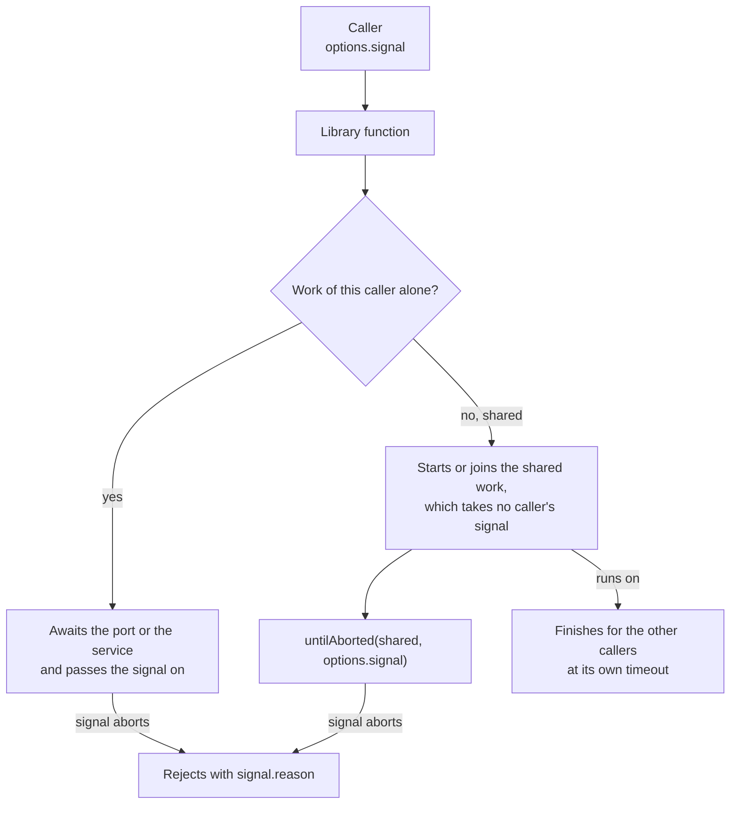

# Signals

Every function that waits on I/O takes a `signal` in its options (`CallOptions`). Aborting it ends that caller's wait and
nothing else: work that several callers share runs on to its own timeout.



## Quick start

```ts
import { untilAborted } from "@interopkit/core";

const controller = new AbortController();
const work = new Promise(() => undefined);
const wait = untilAborted(work, controller.signal);
controller.abort(new Error("The caller left."));
await wait.catch((error) => error.message);
// => "The caller left."
```

## API

| Export                           | Does                                                                                                                                                                                     |
| -------------------------------- | ---------------------------------------------------------------------------------------------------------------------------------------------------------------------------------------- |
| `CallOptions`                    | The options type with `signal`, default none. Every options type of a function that waits on I/O extends it                                                                              |
| `untilAborted(promise, signal?)` | Settles with the promise, or rejects with `signal.reason` as soon as the signal aborts. The promise runs on and its outcome is dropped. Without a signal it returns the promise as it is |

## Rules

| Rule                       | Meaning                                                                                                                                                                           |
| -------------------------- | --------------------------------------------------------------------------------------------------------------------------------------------------------------------------------- |
| The reason is the caller's | A call rejects with `signal.reason`, never with an error of the library, so a caller can tell its own abort from a failure                                                        |
| Ports receive the signal   | A store, a lookup or a hook of a host gets `options.signal` as its last argument, so it can stop too                                                                              |
| Shared work takes none     | A key set fetch, or a token cache, serves several callers: it runs to its own timeout, and `untilAborted` ends one caller's wait on it                                            |
| After a point of no return | Once a change is made that cannot be undone, such as a single-use hint consumed or a score saved, a later abort is ignored or fails closed; the guide of each function says where |
| In doubt                   | A request in flight when the signal aborts may have reached the service. A guide says how to resend safely                                                                        |

## Errors

| Error                      | When                                          | What to do                                                           |
| -------------------------- | --------------------------------------------- | -------------------------------------------------------------------- |
| The `reason` of the signal | The signal aborted, before or during the wait | Nothing: the caller ended the wait                                   |
| `DataError`                | `signal` is not an `AbortSignal`              | Pass `AbortSignal.timeout(ms)` or the signal of an `AbortController` |

## Not included

| What                               | Reason                                                               |
| ---------------------------------- | -------------------------------------------------------------------- |
| Cancelling shared work             | One caller's abort must not fail the others                          |
| A timeout option on `untilAborted` | A caller composes `AbortSignal.timeout` and `AbortSignal.any` itself |
