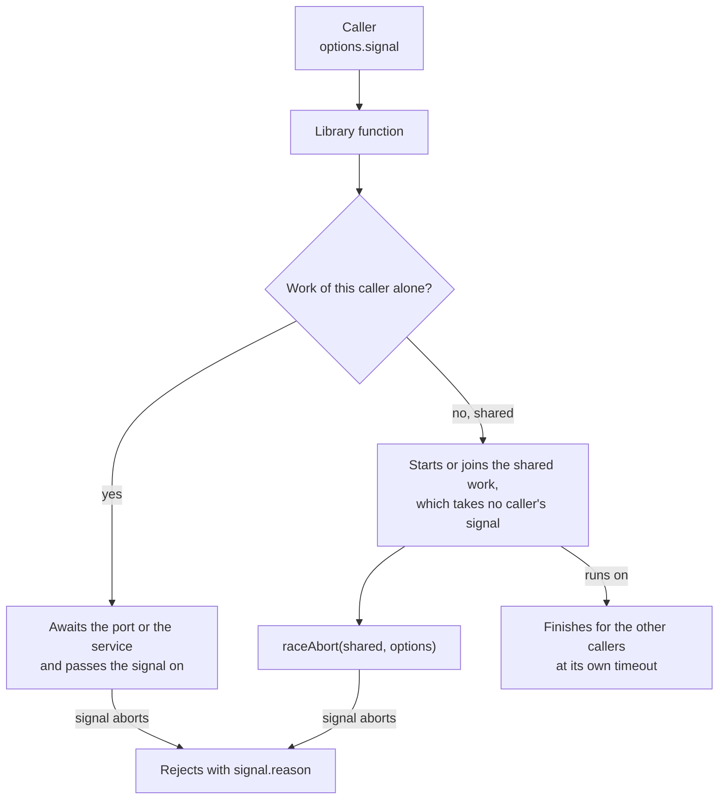

# Abort signals and shared work

Every function that waits on I/O takes a `signal` in its options (`CallOptions`). Aborting it ends that caller's wait and
nothing else: work that several callers share runs on to its own timeout.



## Quick start

```ts
import { raceAbort } from "@interopkit/core";

const controller = new AbortController();
const work = new Promise(() => undefined);
const wait = raceAbort(work, { signal: controller.signal });
controller.abort(new Error("The caller left."));
await wait.catch((error) => error.message);
// => "The caller left."
```

## API

| Export                         | Does                                                                                                                                                                                       |
| ------------------------------ | ------------------------------------------------------------------------------------------------------------------------------------------------------------------------------------------ |
| `CallOptions`                  | The options type with `signal`, default none. Every options type of a function that waits on I/O extends it                                                                                |
| `callPort(call, options?)`     | Waits for a port of the host: its value in an object, `undefined` when it fails, so that a handler answers 500 and says nothing of the failure; an abort rejects with its reason           |
| `raceAbort(promise, options?)` | Settles with the promise, or rejects with `signal.reason` as soon as the signal aborts. The promise runs on and its outcome is dropped. Without a `signal` it returns the promise as it is |
| `createKeyedCache(options)`    | A cache of values by key whose loads are shared work (below)                                                                                                                               |

## The keyed cache

`get(key, load, options?, reloadAfter?)` returns the kept value while its lifetime holds, else joins or starts the one load of
the key, which takes no caller's signal. `createTokenCache` of `@interopkit/core/oauth`, `createJwksCache` of `tool-integration`
and the caches of the key resolver and the status lists of `achievement-credentials` are built on it.

| Option or argument | Meaning                                                                                                                                      | Default        |
| ------------------ | -------------------------------------------------------------------------------------------------------------------------------------------- | -------------- |
| `clock`            | Gives the time that entries expire by                                                                                                        | `SYSTEM_CLOCK` |
| `lifetime(value)`  | How long a loaded value stays good, in milliseconds; a value for zero or less is shared with the callers that waited and not kept            | Required       |
| `maxEntries`       | The most entries kept; the key loaded first goes first                                                                                       | Required       |
| `reloadAfter`      | Of `get`: loads again a value loaded this many milliseconds ago or more, though still good, for a caller that misses something in a document | None           |

A failed load is not kept: the next call loads again.

## Rules

| Rule                       | Meaning                                                                                                                                                                           |
| -------------------------- | --------------------------------------------------------------------------------------------------------------------------------------------------------------------------------- |
| The reason is the caller's | A call rejects with `signal.reason`, never with an error of the library, so a caller can tell its own abort from a failure                                                        |
| Ports receive the signal   | A store, a lookup or a hook of a host gets `options.signal` as its last argument, so it can stop too                                                                              |
| Shared work takes none     | A key set fetch, or a token cache, serves several callers: it runs to its own timeout, and `raceAbort` ends one caller's wait on it                                               |
| After a point of no return | Once a change is made that cannot be undone, such as a single-use hint consumed or a score saved, a later abort is ignored or fails closed; the guide of each function says where |
| In doubt                   | A request in flight when the signal aborts may have reached the service. A guide says how to resend safely                                                                        |

## Errors

| Error                      | When                                          | What to do                                                                    |
| -------------------------- | --------------------------------------------- | ----------------------------------------------------------------------------- |
| The `reason` of the signal | The signal aborted, before or during the wait | Nothing: the caller ended the wait                                            |
| `DataError`                | `signal` is not an `AbortSignal`              | Pass `AbortSignal.timeout(ms)` or the signal of an `AbortController`          |
| `DataError`                | An option of `createKeyedCache` is not valid  | Pass a `lifetime` function and a positive `maxEntries`; a `clock` is optional |

## Not included

| Not included                    | Why                                                                  |
| ------------------------------- | -------------------------------------------------------------------- |
| Cancelling shared work          | One caller's abort must not fail the others                          |
| A timeout option on `raceAbort` | A caller composes `AbortSignal.timeout` and `AbortSignal.any` itself |

## Differences from the references

| Reference                                | Difference                                                                                                                                                                   |
| ---------------------------------------- | ---------------------------------------------------------------------------------------------------------------------------------------------------------------------------- |
| `fetch` with a `signal`                  | `fetch` aborts the request it made. `raceAbort` ends only the wait of one caller: the promise runs on and its outcome is dropped, since shared work serves other callers too |
| `AbortSignal.timeout`, `AbortSignal.any` | Used by the caller and not wrapped: a caller composes them and passes the result as `signal`                                                                                 |
