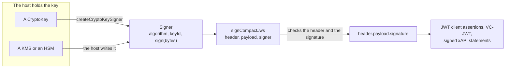

# Signing

A `Signer` signs bytes with a key that the host holds: a `CryptoKey` in the process, or a key in a cloud KMS or an HSM that
never leaves it. Every signing function of the packages takes a `Signer`, so that no package ever sees a private key.
`signCompactJws` assembles a compact JWS (RFC 7515) around one.



## Quick start

```ts
import { createCryptoKeySigner, signCompactJws } from "@interopkit/core";

const pair = await crypto.subtle.generateKey({ name: "ECDSA", namedCurve: "P-256" }, false, ["sign", "verify"]);
const signer = createCryptoKeySigner(pair.privateKey, { algorithm: "ES256", keyId: "key-1" });
const jws = await signCompactJws({ typ: "JWT" }, new TextEncoder().encode('{"sub":"user-1"}'), signer);
jws.split(".").length; // => 3
JSON.parse(atob(jws.split(".")[0].replaceAll("-", "+").replaceAll("_", "/")));
// => { alg: "ES256", kid: "key-1", typ: "JWT" }
```

## API

| Export                                             | Does                                                                                                                |
| -------------------------------------------------- | ------------------------------------------------------------------------------------------------------------------- |
| `Signer`                                           | The port: `algorithm`, an optional `keyId`, and `sign(data, options)`, which answers the signature in its JOSE form |
| `createCryptoKeySigner(key, options)`                | Makes a `Signer` from a private `CryptoKey`, after checking that the key fits the algorithm                         |
| `signCompactJws(header, payload, signer, options)` | Signs `payload` and returns the compact JWS, after checking the header, the signer and the signature                |

## Algorithms

`algorithm` is a JOSE name (RFC 7518, RFC 8037, RFC 8812). `none` and the HMAC algorithms are refused: a signer holds a private
key.

| Algorithm                 | Key of `createCryptoKeySigner`                                         | Signature                                       |
| ------------------------- | -------------------------------------------------------------------- | ----------------------------------------------- |
| `RS256`, `RS384`, `RS512` | `RSASSA-PKCS1-v1_5`, imported with `SHA-256`, `SHA-384` or `SHA-512` | The size of the modulus                         |
| `PS256`, `PS384`, `PS512` | `RSA-PSS`, imported with the same hash; salt as long as the hash     | The size of the modulus                         |
| `ES256`, `ES384`, `ES512` | `ECDSA` on `P-256`, `P-384` or `P-521`                               | The fixed-length R and S: 64, 96 and 132 bytes  |
| `ES256K`                  | None: Web Crypto has no secp256k1. A KMS signer names it             | 64 bytes                                        |
| `EdDSA`                   | `Ed25519`                                                            | Not fixed (64 bytes for Ed25519, 114 for Ed448) |

## The contract of a signer

| Part             | Rule                                                                                                                                                                                       |
| ---------------- | ------------------------------------------------------------------------------------------------------------------------------------------------------------------------------------------ |
| `algorithm`      | One of the names above                                                                                                                                                                     |
| `keyId`          | The `kid` that the signature names, such as a verification method. Default: none                                                                                                           |
| `sign`           | Takes the bytes of the signing input and an optional `{ signal }`; answers a `Uint8Array` that is the signature                                                                            |
| ECDSA signatures | The fixed-length R and S of JWS, never the DER that many cloud KMS services return. A host whose KMS answers DER converts it first. `signCompactJws` refuses a signature of another length |
| `signal`         | The caller's signal reaches `sign`. A signer that waits on a service bounds itself with its own deadline                                                                                   |

## The header and the signature

| `signCompactJws` does                                                                                       | When                                                       |
| ----------------------------------------------------------------------------------------------------------- | ---------------------------------------------------------- |
| Puts `alg` of the signer first in the protected header, then `kid` of the signer, then the rest of `header`; a member that is `undefined` names nothing and leaves the signer's | Always |
| Refuses a header that names another `alg` than the signer's                                                 | Before the signer is called                                |
| Refuses a header that names another `kid` than the signer's                                                 | Before the signer is called, when the signer has a `keyId` |
| Refuses a header whose `jwk` holds a private key (`d`)                                                      | Before the signer is called                                |
| Calls the signer once, with the ASCII bytes of `base64url(header).base64url(payload)`                       | After the checks                                           |
| Refuses a signature that is not a `Uint8Array`, or an ECDSA signature of the wrong length                   | After the signer answers, before the signature is used     |
| Returns `base64url(header).base64url(payload).base64url(signature)`                                         | Always                                                     |

## Options and limits

| Option                            | Default  | Where                                         |
| --------------------------------- | -------- | --------------------------------------------- |
| `createCryptoKeySigner` `algorithm` | Required | The JOSE algorithm of the key                 |
| `createCryptoKeySigner` `keyId`     | none     | The `kid` of the signatures                   |
| `signCompactJws` `signal`         | none     | Ends the caller's wait and goes to the signer |

Neither function limits the size of a payload: the host bounds what it signs.

## Failure paths

| Case                                             | Result                                                                                                                                                      |
| ------------------------------------------------ | ----------------------------------------------------------------------------------------------------------------------------------------------------------- |
| An argument is not valid                         | `DataError`, before the signer is called                                                                                                                    |
| The signer rejects                               | `signCompactJws` rejects with that error; nothing is returned half-signed                                                                                   |
| The signature has the wrong form                 | `DataError`; a signature of the wrong length never reaches a verifier                                                                                       |
| The signal aborts, or is aborted before the call | Rejects with its `reason`; a signer that has begun may finish, and its signature is dropped                                                                 |
| Called again                                     | A new signature each time: RSASSA-PKCS1-v1_5 is deterministic, so equal input gives equal output; ECDSA and EdDSA may differ between calls, and both verify |
| Calls back                                       | Nothing                                                                                                                                                     |

## Errors

| Error                      | When                                                                                                                                                  | What to do                                                |
| -------------------------- | ----------------------------------------------------------------------------------------------------------------------------------------------------- | --------------------------------------------------------- |
| `DataError`                | `createCryptoKeySigner`: the algorithm is not one that a `CryptoKey` signs, the key is not private or does not fit the algorithm (kind, hash or curve)  | Import or generate the key for the algorithm              |
| `DataError`                | `signCompactJws`: the signer has no known algorithm or no `sign` function, the header or the payload has the wrong type, or the header cannot be JSON | Fix the arguments                                         |
| `DataError`                | `signCompactJws`: the header names another algorithm or key than the signer's, or its `jwk` holds `d`                                                 | Leave `alg` and `kid` to the signer; publish a public key |
| `DataError`                | `signCompactJws`: the signature is not a `Uint8Array`, or an ES256, ES384, ES512 or ES256K signature has the wrong length                             | Convert DER to the fixed-length R and S in the signer     |
| The `reason` of the signal | The caller aborted                                                                                                                                    | Nothing: the caller ended the wait                        |

## Speed

`pnpm bench` times the build that ships against the platform API that a function wraps, the least work of the same kind, in
three rounds that alternate which runs first; the gate is the ratio of the fastest samples, 1.5 times the highest ratio
measured on the runner of CI and on a laptop, rounded up to two significant digits, which holds on any machine.

| Benchmark | Reference | Ratio | Budget |
| --- | --- | ---: | ---: |
| `signCompactJws` of a payload of 2 KB with EdDSA | `crypto.subtle.sign` of its signing input | 1.15–1.21 | 1.9 |

The parts of the JWS are written as base64url by a table, in time linear in the input: built from the bytes as the arguments of
`String.fromCharCode` and encoded with `btoa`, they take longer than the signature, and `signCompactJws` of 2 KB 58 µs where it
takes 32.

## Data flows

| Data            | Comes from | Goes to                                | Kept by the package |
| --------------- | ---------- | -------------------------------------- | ------------------- |
| The payload     | The caller | The signer, as bytes, and the JWS      | No                  |
| The private key | The host   | Nothing: only `Signer.sign` touches it | No                  |

## Not included

| What                                                      | Reason                                                                                                      |
| --------------------------------------------------------- | ----------------------------------------------------------------------------------------------------------- |
| Verifying a JWS                                           | A verifier needs the key of an issuer and the rules of its standard; each package brings its own, on `jose` |
| Key generation, storage and rotation                      | The host owns the keys                                                                                      |
| HMAC and `none`                                           | A signer holds a private key                                                                                |
| Unencoded payloads (RFC 7797), JSON serialization, `crit` | No standard that the packages implement needs them                                                          |
| A `Signer` over a KMS                                     | Each KMS has its own client; the host writes the few lines that call it and converts DER                    |

## Differences from the references

| Reference            | Difference                                                                                                                            |
| -------------------- | ------------------------------------------------------------------------------------------------------------------------------------- |
| `jose` `CompactSign` | `jose` signs with a `CryptoKey` or a `KeyObject` only; a `Signer` also takes a KMS or an HSM, and its signature is checked before use |
| `jose` and RFC 7515  | The header may not carry another `alg` or `kid` than the signer's, and no private `jwk`; JOSE itself leaves both to the caller        |
