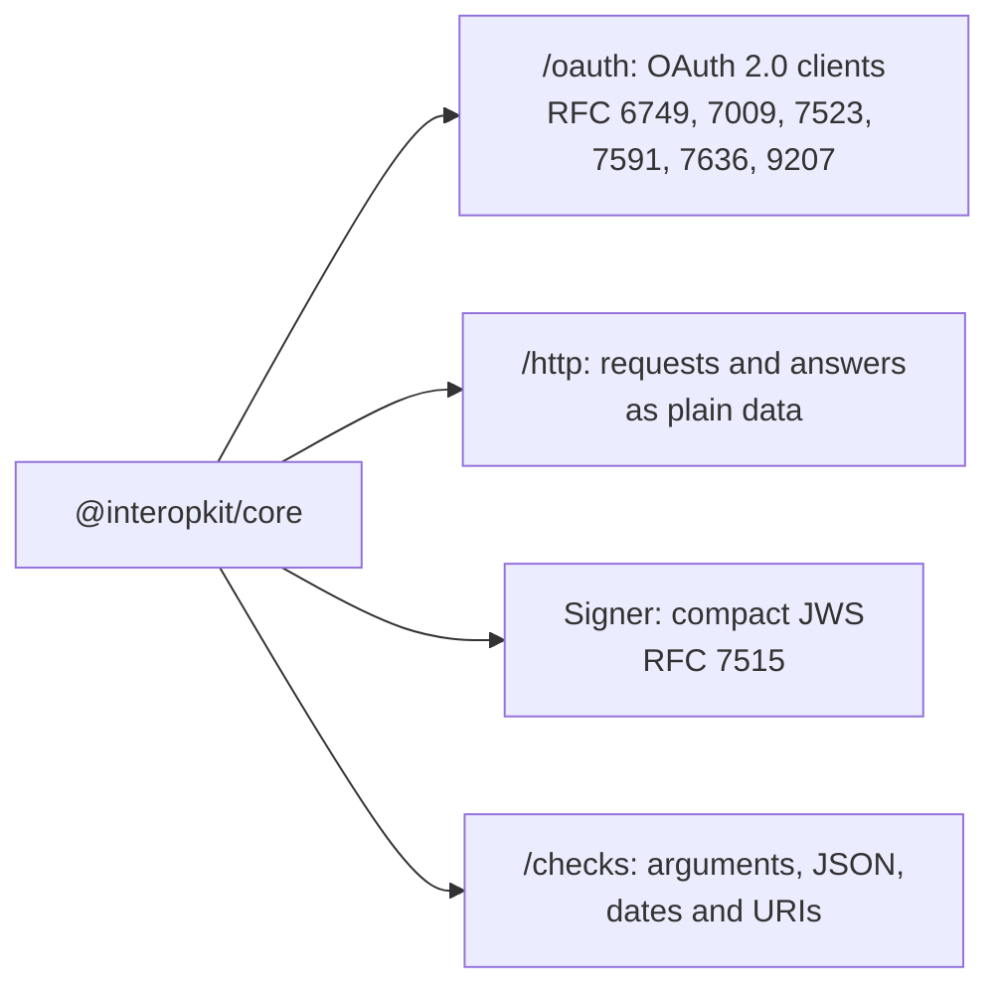

# What core supports

What `@interopkit/core` implements of the standards beneath the packages. It implements no learning standard of its own.

| Standard | Part | Where |
| --- | --- | --- |
| OAuth 2.0 (RFC 6749) | Client credentials (section 4.4), the authorization code (section 4.1), refresh (section 6), `client_secret_basic` (section 2.3.1) | `/oauth`: `requestClientCredentialsToken`, `startAuthorization`, `refreshAccessToken`; [the OAuth guide](oauth.md) |
| PKCE (RFC 7636) | S256 | `startAuthorization` |
| Token revocation (RFC 7009) | An access or a refresh token | `revokeToken` |
| JWT client authentication (RFC 7523) | `private_key_jwt`, the token request of LTI | The client of `/oauth` with a `signer` |
| Dynamic client registration (RFC 7591) | Registering a client | `registerClient` |
| Authorization server issuer identification (RFC 9207) | `iss` of a callback | The `issuer` of the server |
| JSON Web Signature (RFC 7515) | Compact serialization over a `Signer` | `signCompactJws`, `createCryptoKeySigner`; [signing](signer.md) |
| Date and time on the Internet (RFC 3339), URIs (RFC 3986), UUIDs (RFC 9562) | The forms that the standards above the packages use | `/checks`: `isDateTime`, `isAbsoluteUri`, `isUuid`; [checks](checks.md) |

## Not included

| Not included | Why |
| --- | --- |
| The management of a registration (RFC 7592), OpenID Connect, DPoP | No standard of the packages calls them ([the OAuth guide](oauth.md#not-included)) |
| An HTTP server | The host's: a handler takes an `HttpRequest` and returns an `HttpResponse`, plain objects that any framework builds |
