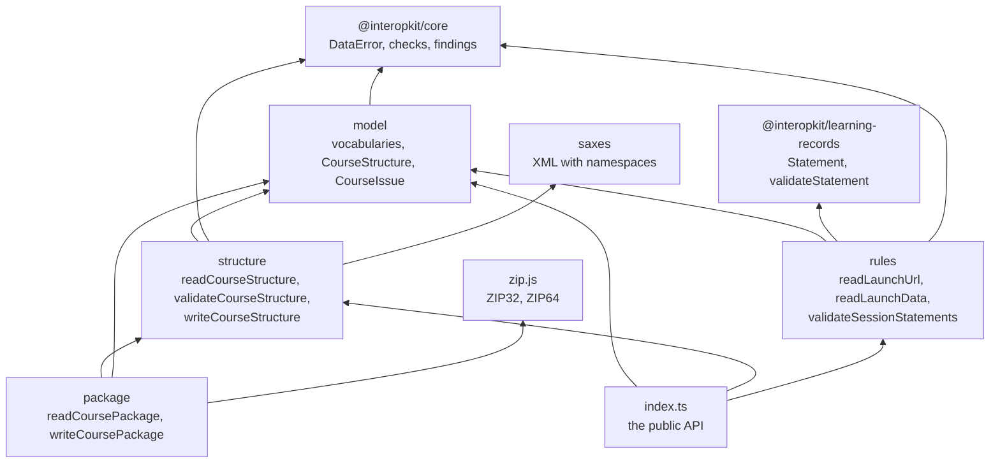

# Architecture of course-launch

`@interopkit/course-launch` implements cmi5 for the publisher of a course and for the LMS that imports it. `model` holds the
vocabularies of the specification and the types of the course structure. `structure` reads, validates and writes `cmi5.xml`
with a parser that tracks namespaces, and enforces the schema of the specification itself. `package` reads and writes the
course package, a ZIP archive or the XML alone, through zip.js. `rules` reads what a launch gives an assignable unit and judges the
statements of a session, over the model and the rules of xAPI of `@interopkit/learning-records`. `model` imports no other module,
`structure` imports `model` and `@interopkit/core` alone, `package` builds on both, and `rules` imports `model`,
`@interopkit/learning-records` and `@interopkit/core`; `structure` and `rules` never import each other, and `package` imports
no rule. Biome enforces the layers.

| Module      | Files                                                                    | Holds                                                                                                                       |
| ----------- | ------------------------------------------------------------------------ | --------------------------------------------------------------------------------------------------------------------------- |
| `model`     | `vocabularies.ts`                                                        | `moveOn`, `launchMethod` and the launch modes as tuples with their types; the IRIs of the verbs, categories, extensions and activity types; the ids of the State and of the preferences |
|             | `course-structure.ts`                                                    | `CourseStructure`, `Course`, `Objective`, `AssignableUnit`, `Block`, `LangString`, `ExtensionElement`, `CourseIssue`         |
| `structure` | `schema.ts`                                                              | The elements of `CourseStructure.xsd`: what each holds, in which order, and its attributes                                  |
|             | `inspect.ts`                                                             | The walk of the parser: the model and the findings of one structure, within its limits                                      |
|             | `values.ts`, `launch-url.ts`                                             | The white space of XML, `xs:language`, the mastery score, and the rules of the URL of an assignable unit                    |
|             | `decode.ts`, `options.ts`                                                | Bytes to text in UTF-8 or UTF-16, the declared encoding, and the options with their defaults                                |
|             | `extension.ts`, `read-course-structure.ts`, `write-course-structure.ts`  | The check of an extension that is written, and the three entry points                                                       |
| `package`   | `archive.ts`                                                             | zip.js behind a reader that bounds each read, the checks of the entries and of the warnings of zip.js                       |
|             | `read-course-package.ts`, `write-course-package.ts`                      | The two entry points of `/package`                                                                                          |
| `rules`     | `classify.ts`, `session.ts`                                              | `classifyStatement`, `SessionFacts`, and the progress of a session from one statement to the next                           |
|             | `judge-statement.ts`                                                     | The judgement of one statement against its session, which `internal.ts` shares with the rest of the package                 |
|             | `validate-session-statements.ts`                                         | The statements of one session, judged in the order of their timestamps                                                      |
|             | `read-launch-url.ts`, `launch-documents.ts`, `xapi-parts.ts`             | The readers of the launch URL, the launch data and the preferences, and the rules of xAPI for an Actor and a Context        |

## What the package owns

| Owns                                                                                     | Does not own                                                                                       |
| ---------------------------------------------------------------------------------------- | -------------------------------------------------------------------------------------------------- |
| The course structure: its model, reader, validator and writer                            | xAPI, its model and the LRS (`@interopkit/learning-records`)                                       |
| Course packages in ZIP of 32 and 64 bits and in XML                                      | The files of a package once it is read: extracting them, hosting them, serving them                |
| The vocabularies of cmi5                                                                 | An editor of courses, storage, servers, accounts                                                   |
| The kinds of statements of cmi5 and the rules of a session                               | What a statement means for learning, and the windows and pages of a launch                         |

## Why the schema is enforced by hand

No library validates XML Schema in JavaScript without a native or WebAssembly build of libxml2, which a browser or an edge runtime
should not load to read a file of a few kilobytes. `CourseStructure.xsd` has eight named types, so the reader enforces each
constraint itself (`schema.ts`), and the tests run libxml2, the validator of CATAPULT's player, as its oracle on the examples of
the specification, on CATAPULT's packages and on thousands of generated structures with one change each
([spec gaps](spec-gaps.md) lists where they differ). XML itself is parsed by saxes, which resolves no external entity, and a
DOCTYPE refuses the structure.
