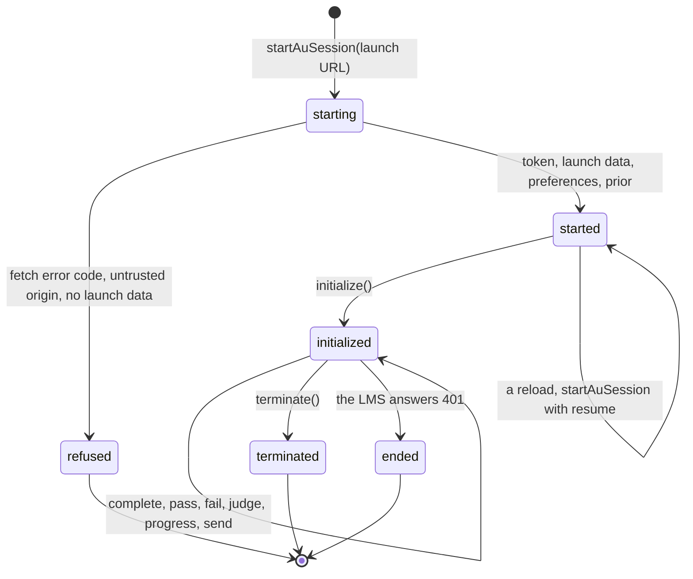

# The assignable unit runtime

`@interopkit/course-launch/au` is what the content of an assignable unit runs: it reads the launch URL, posts to the fetch URL
once for the token, reads the launch data, the preferences of the learner and what the registration holds, and sends the
statements of the session, each judged by the rules of cmi5 before it leaves. It has no DOM: the page opens the URL it was given,
redirects to the return URL and turns the audio on or off.



## Quick start

```ts
import { startAuSession } from "@interopkit/course-launch/au";

// The fetch URL of this launch was used already, so the LMS answers its error code 1.
const fetch = async () => new Response(JSON.stringify({ "error-code": "1", "error-text": "Already used." }));
const query = new URLSearchParams({
  endpoint: "https://lms.example.org/xapi",
  fetch: "https://lms.example.org/fetch?code=c1",
  actor: JSON.stringify({ account: { homePage: "https://lms.example.org", name: "ana" } }),
  registration: "1b0e3f5c-2c4e-4f6a-9b1d-3e5f7a9c1b2d",
  activityId: "https://lms.example.org/activities/rocks",
});
const launchUrl = `https://content.example.org/rocks/index.html?${query}`;
await startAuSession(launchUrl, { fetch });
// => { refusal: "used-or-expired", text: "Already used." }
```

A unit that starts plays its session and gives the page the return URL:

```js
import { startAuSession } from "@interopkit/course-launch/au";

const started = await startAuSession(location.href, { fetch: globalThis.fetch });
if ("session" in started) {
  const { session } = started;
  await session.initialize();
  await session.complete();
  await session.judge({ scaled: 0.9 });
  const { returnUrl } = await session.terminate();
  if (returnUrl !== undefined) location.assign(returnUrl);
}
```

`examples/course-launch/src/au.ts` plays a lesson against the example LMS, and `scenario.ts` reloads a page with `resume`.

## The session

| Call | Sends | Skipped when |
| --- | --- | --- |
| `initialize()` | initialized, the first statement | Sent already |
| `complete(options?)` | completed, with `completion` and the duration | Before initialize or after terminate, in Browse or Review, sent already, or the registration holds a completed |
| `pass(score?, options?)` | passed, with `success`, the duration, the score and the mastery score of the launch | As above, after failed, a scaled score below the mastery score, or a passed in the registration |
| `fail(score?, options?)` | failed, with `success` false and the duration | As above, after passed, a scaled score at or above the mastery score, or a passed in the registration |
| `judge(score, options?)` | passed or failed by the mastery score of the launch | As `pass` and `fail` |
| `progress(percent)` | An allowed statement with the progress, an integer from 0 to 100 | Before initialize or after terminate |
| `send(statement)` | An allowed statement, with the template and the activities and extensions it adds | Before initialize, after terminate, or a statement that cmi5 does not allow |
| `terminate()` | terminated, with the duration; returns the return URL when it is http or https | Before initialize, or sent already |
| `state.get`, `state.put` | The State documents of the unit for its learner in its registration | `put` of `LMS.LaunchData` throws |
| `savePreferences(preferences)` | The preferences document, with a precondition | |

Every statement carries the context template of the launch, which it never changes, the registration, the categories of cmi5
and, in passed and failed, the mastery score; its id is a new UUID and its time the clock's. Each is judged by the same rules
as the LMS judges it, and a statement that they forbid is `"skipped"` with no request.

| A call resolves | When |
| --- | --- |
| `"recorded"` | The LRS stored the statement |
| `"skipped"` | The rules of cmi5 or the launch mode forbid it, or the session ended: nothing was sent |
| `"refused"` | The LMS answered 401 or 403, or holds another statement with that id; after 401 the session counts as ended |
| `"saved"`, `"refused"` | `savePreferences`: written, or refused by the LMS (403, a failed precondition), which is no error (11.0) |

A request that fails otherwise rejects with its `ServiceError`, and the next call of the same kind sends the same statement
again, with its id, so the LRS keeps it once.

`resume` is plain data that the page keeps, in `sessionStorage` for instance: the token, the time of initialized and the verbs
sent. `startAuSession` with it goes on without a second POST to the fetch URL.

## Options

| Option | Default | Meaning |
| --- | --- | --- |
| `fetch` | required | The `fetch` of the page or the runtime |
| `clock` | `SYSTEM_CLOCK` | The time of the statements and their durations |
| `resume` | none | What the page kept before a reload |
| `trustedOrigins` | any https origin | The origins of the LMSs that may have the unit's learner; the endpoint and the fetch URL must be on one |
| `timeoutMs` | 10,000 | The most time of one request |
| `signal` | none | Ends the waits of the session; each call takes its own too |

`OutcomeOptions` of `complete`, `pass`, `fail` and `judge` take `durationMs`, the time the learner spent, which is the time since
initialize by default.

## Limits

| Limit | Value | Refused with |
| --- | --- | --- |
| Launch URL; its actor | 65,536 characters; 1,000 tokens of JSON | `DataError` |
| Answer of the fetch URL | 65,536 bytes, 1,000 tokens of JSON | `ServiceError` |
| An answer of the LRS, the launch data among them | 1,048,576 bytes | `ServiceError` |
| Preferences document | 4,096 bytes | `ServiceError` |
| A request | `timeoutMs`, 10,000 | `ServiceError` with status 0 |

## Errors

| Error or refusal | When | What to do |
| --- | --- | --- |
| `refusal: "used-or-expired"` | The fetch URL was used or the launch expired (error code 1) | Ask the learner to launch the unit again from the LMS |
| `refusal: "security"`, `"application"` | Error codes 2 and 3 | Tell the learner; the LMS keeps the cause |
| `refusal: "no-launch-data"` | The LMS wrote no `LMS.LaunchData` | Tell the learner; the LMS is not ready |
| `refusal: "untrusted-origin"` | The endpoint or the fetch URL is not on `trustedOrigins` | Nothing is sent: the launch came from another LMS |
| `DataError` | A launch URL, options, resume, launch data or preferences that are not valid; a call with arguments that are not | Fix the call, or tell the learner that the launch is broken |
| `ServiceError` | The fetch URL or the LRS failed or answered beyond a limit | Call again: a statement keeps its id |

## Not included

| What | Why |
| --- | --- |
| Opening windows, redirecting to the return URL, unloading, audio | The page's: `terminate` returns the address, and `preferences.audioPreference` says on or off |
| Keeping `resume` across a reload | The page's storage |
| One helper for each type of interaction | xAPI's, not cmi5's: `send` takes any allowed statement of the model of `@interopkit/learning-records` |
| Other launch environments | cmi5 defines none; the runtime has no DOM, so a unit outside a browser uses it as it is |

## Differences from the references

| Case | `@xapi/cmi5`, Rustici's library | Here |
| --- | --- | --- |
| A statement that the rules forbid | Sent, and the LMS refuses it | Skipped, with no request |
| An endpoint without a final slash | `@xapi/cmi5` adds one; Rustici's library appends `/statements` | One is added |
| A reload | `@xapi/cmi5` takes the token again; Rustici's library has none | `resume`, with the verbs sent |
| A failed request | Not sent again | The next call sends the same statement, with its id |
