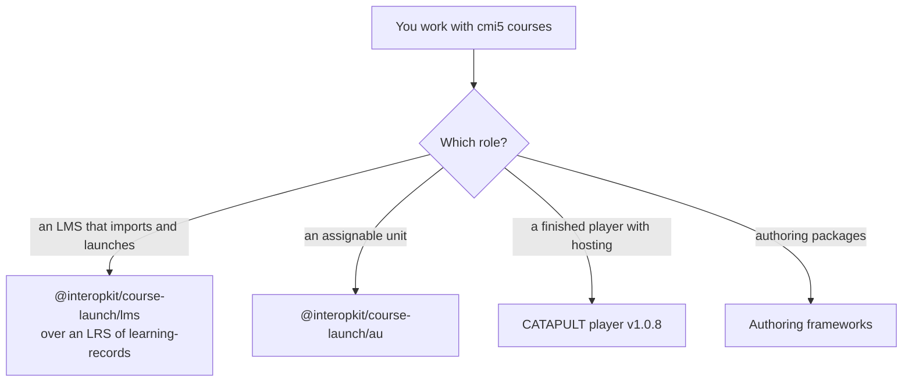

# Choosing course-launch

When `@interopkit/course-launch` fits a project that launches or plays cmi5 courses, and when another implementation fits
better. The candidates were read on 2026-11-02, at the versions that [the comparators](comparators.md) give.

| You need | Use |
| --- | --- |
| Reading, validating and writing course structures and course packages | This package: `readCourseStructure`, `/package` |
| The LMS role: registrations, launches, fetch URLs, the rules of a session, waivers | This package: `/lms`, over the LRS of [`@interopkit/learning-records`](../learning-records/choosing.md) |
| The runtime of an assignable unit, with resume after a reload | This package: `/au` |
| A finished player with content hosting, tenants and MySQL | The CATAPULT player v1.0.8, 2026-01-20 |
| A unit library on axios and `@xapi/xapi` that you already use | `@xapi/cmi5` 1.4.0, 2024-10-06, with no release in the year before the reading |

## What the others have that the package lacks

| Comparator, version | What it has | Here |
| --- | --- | --- |
| `@xapi/cmi5` 1.4.0, 2024-10-06 | A helper for each type of interaction | In part: `send` takes any allowed statement of the model of `learning-records`, which holds every type |
| CATAPULT player v1.0.8, 2026-01-20 | Content hosting, tenants, an API with JWTs, MySQL | Excluded: the host's |
| CATAPULT player v1.0.8, 2026-01-20 | A proxy to an external LRS | Excluded: the LMS of cmi5 is its LRS; a host with another LRS adapts the store ports |

## Where the evidence is

[The evidence](evidence.md) gives CATAPULT's two suites at `806c0ba`: 87 of 87 tests of the LMS suite and 54 of 54 sessions of
the content suite, pinned on 2026-11-03; [supported](supported.md) maps the 305 requirements that CATAPULT lists.
