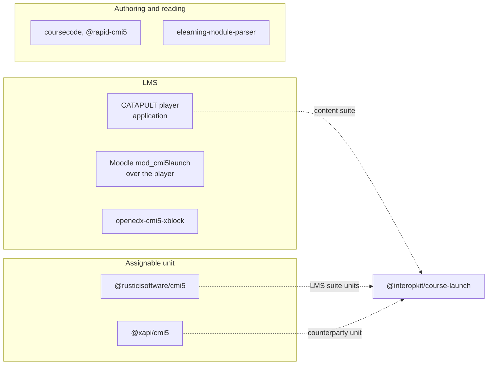

# Comparators

The other implementations of cmi5, read on 2026-11-02, and how each capability of theirs maps to this package. A library is
trusted when it has a permissive license, a release in the last year, the current version of cmi5, and wide use or a known
backer; none that covers a role is, so the package builds both roles and uses the others as counterparties.

| Candidate | Version, date, license | Roles | Trusted | Use here |
| --- | --- | --- | --- | --- |
| CATAPULT player | v1.0.8, 2026-01-20, Apache-2.0 | LMS, a Hapi service with MySQL that proxies an external LRS | An application | The LMS of the content suite |
| CATAPULT LMS and content suites | v1.0.8 | Tests of an LMS and of units | Test suites | Both run (evidence) |
| `@rusticisoftware/cmi5` | 3.2.0, 2023-04-05, Apache-2.0 | Unit | No: no release in a year | The units of the LMS suite use it |
| `@xapi/cmi5` | 1.4.0, 2024-10-06, MIT | Unit, on axios and `@xapi/xapi` | No: no release in a year | A counterparty unit of the example LMS |
| `@scormflow/server` | 0.1.0, 2026-10-12, MIT | An engine with an LRS on Fastify and Prisma | No: no wide use | None |
| `tessera-learn`, `coursecode`, `@rapid-cmi5/*` | 2026 | Authoring frameworks that write packages | No: no wide use; AGPL is not permissive | Comparators of the writer |
| Moodle `mod_cmi5launch` | 1.1.0, 2025-07-01, Apache-2.0, PHP | A bridge from Moodle to the player | Another language | Comparator |
| `openedx-cmi5-xblock` | 2025-03-06, MIT, Python | Plays cmi5 in Open edX | Another language | Comparator |
| `elearning-module-parser` | 1.2.2, 2026-09-09, Apache-2.0, Java | Reads `cmi5.xml` | Another language | Comparator of the reader |

| Capability of a comparator | Who has it | Here |
| --- | --- | --- |
| Launch parameters, fetch, launch data, preferences, the defined verbs, terminate | Both unit libraries | Present: `startAuSession`, `AuSession` |
| Resume after a reload of the page | `@xapi/cmi5` (`initialize(sessionState)`) | Present: `resume` |
| A helper for each type of interaction | `@xapi/cmi5` | Partly: `send` takes any allowed statement of the model of `learning-records`, which holds every type; the helpers are xAPI's, not cmi5's |
| A `moveOn` helper | `@xapi/cmi5` | Present: `prior` and `judge` |
| Import with the schema, registrations, launch URL, fetch, the rules, waive, abandon on relaunch, satisfied, preferences | CATAPULT player | Present: `/lms` |
| Session logs per requirement | CATAPULT content suite | Present: `validateSessionStatements` |
| Writing course packages | `coursecode`, `@rapid-cmi5` | Present: `writeCourseStructure`, `writeCoursePackage` |
| Content hosting, tenants, an API with JWTs, MySQL | CATAPULT player | Excluded: the host's |
| A proxy to an external LRS | CATAPULT player | Excluded: the LMS of cmi5 is its LRS; a host with an external one adapts the store ports of `learning-records` |
