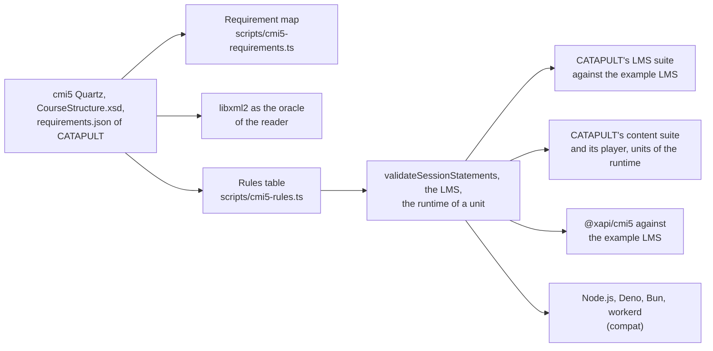

# Evidence

What shows that `@interopkit/course-launch` does what cmi5 asks, and how fast and how small it is. Every check runs from a
pinned source: cmi5 Quartz at `0ff5b30` of `AICC/CMI-5_Spec_Current`, and CATAPULT at `806c0ba` (v1.0.8), whose archive
`scripts/corpus.lock.json` and `validation/catapult/suite.lock.json` pin by its SHA-256.

## Completeness

`scripts/cmi5-requirements.ts` maps each of the 305 requirement ids of CATAPULT's `requirements.json` to one row with the tests
that prove it, and `requirements.spec.test.ts` fails on an id without a row or a row that names a test file that does not
exist.

| State | Rows | Ids | What it means |
| --- | --- | --- | --- |
| Has | 72 | 294 | Met, with its tests |
| In part | 4 | 7 | Met as far as a library can: the window of a launch, the redirect to `returnURL` and the audio are the page's, and cmi5 sets no period for initialized |
| Excluded | 3 | 4 | Undecidable from a package: the schema of an extension, and whether an absolute URL names a packaged file; another launch environment, which cmi5 does not define |

## The suites of CATAPULT

| Suite | What runs | Result |
| --- | --- | --- |
| LMS suite (`pnpm catapult-lms`) | Jest 27 and Puppeteer 10 in the Chromium of Playwright, against the example LMS over https on the loopback address, with `validation/catapult/lms.interopkit.js` as its adapter | 87 of 87 tests pass: 21 package imports and 66 checks around the runs of the 15 test units, waive and abandon among them |
| Content suite (`pnpm catapult-content`) | The suite and its player in containers, with the six course examples; each unit in Normal, Browse and Review played by the runtime of the package | 54 of 54 sessions without a violated requirement, each course "conformant"; a session that sends a statement before initialized is recorded with 9.3.0.0-4 |

The units of the LMS suite are built on Rustici's library, and the content suite plays the runtime of this package against
CATAPULT's own player, so each role is proven against an implementation of other authors. `validation/catapult/README.md` has
the steps.

## Other counterparties and oracles

| Check | Source | Result |
| --- | --- | --- |
| The reader against libxml2 | `CourseStructure.xsd` through `scripts/xsd-oracle.ts`, on the Spec's examples, CATAPULT's packages and generated structures with one change each | The same verdict, or a stricter one that [spec gaps](spec-gaps.md) names |
| The rules table | `scripts/cmi5-rules.ts`, one entry per sentence of 6.3, 7.1, 9, 10.2.2 and 11 | `validateSessionStatements` finds each finding, the LMS refuses each statement listed, and the runtime skips the same |
| `@xapi/cmi5` 1.4.0 | The AU library of xapijs, in the process of the tests of `examples/course-launch` | A whole session against the example LMS, satisfied, and a second fetch refused |
| Runtimes | `pnpm compat` | The example's package, LMS and units give the same outcomes on Node.js 22, Deno 2.9, Bun 1.4 and workerd |
| Mutation rules | `scripts/rules/course-launch.ts` | Every rule of the LMS and of the runtime that keeps a request from being forged, replayed or redirected fails its test when removed |

## Speed

Each benchmark is timed in turns with its reference by `scripts/bench-rounds.ts`, and its budget is five times the largest
ratio measured, rounded up to one significant digit (`test/budgets.ts`). Measured on an Apple M-series laptop under load.

| Benchmark | Reference | Ratio | Budget |
| --- | --- | --- | --- |
| `readCourseStructure` of LMS suite 101 (1,001 units) | libxml2 validating it | 3.34 | 20 |
| The same | saxes parsing it alone | 1.88 | 10 |
| `readCoursePackage` of a ZIP64 archive of 66,001 entries | zip.js listing its entries | 0.77 | 4 |
| The LMS judging the seven statements of a session | `validateStatements` of them | 0.81 | 5 |
| The LMS judging 1,000 allowed statements of one request | `validateStatements` of them | 0.31 | 2 |
| `prepareLaunch` over stores in memory and the LRS in the same process | none | 0.36 ms fastest | Pending a sample of CI |

The reader does not reach parity with libxml2: saxes, a parser in JavaScript, takes 2.0 times libxml2 in WebAssembly to parse
the text alone, and the reader also builds the model and checks the rules of cmi5 that the schema leaves out.

## Size

`test/size.test.ts` bundles each entry point alone with esbuild, every dependency inside, and fails above its budget: 1.25 times
the size measured, rounded up to the next 500 bytes.

| Entry point | Minified | Gzip | Budget |
| --- | --- | --- | --- |
| `@interopkit/course-launch` | 105,122 | 32,463 | 41,000 |
| `@interopkit/course-launch/package` | 209,957 | 73,934 | 92,500 |
| `@interopkit/course-launch/lms` | 132,033 | 41,067 | 51,500 |
| `@interopkit/course-launch/au` | 106,731 | 36,757 | 46,000 |

The LMS loads no ZIP code and the runtime of a unit no LMS, LRS or reader of a structure.

## Peak memory

Each reader of untrusted input runs on its worst input in a Node.js process of its own whose heap is bounded
(`test/memory.test.ts`): what the reading keeps alive at once must fit, whenever V8 collects, so the test holds on a loaded
machine. The heap of each test is twice the least in which it ended on Node.js 22, 24 and 26, rounded up to 16 MiB; the least
counts the input and the code of the process.

| Reader | Worst input | Least heap | Heap of the test |
| --- | --- | --- | --- |
| The access of the LMS | A preferences document of 10 MiB, refused after 4,096 bytes | 13 MiB | 32 MiB |
| The LMS judging a batch | 1,000 statements of a unit near 10 MiB | 33 MiB | 80 MiB |
| The runtime reading the fetch URL | 65,536 bytes of tokens, refused before it is parsed | 15 MiB | 32 MiB |
| The runtime reading the launch data | 1 MiB of values | 17 MiB | 48 MiB |
| The runtime reading the preferences | 1 MiB, over the limit of 4,096 bytes | 15 MiB | 32 MiB |
| The runtime reading what the registration holds | An answer over 1 MiB | 15 MiB | 32 MiB |

The readers of a structure and of a package are in the [structure](structure.md) and [package](package.md) guides.
