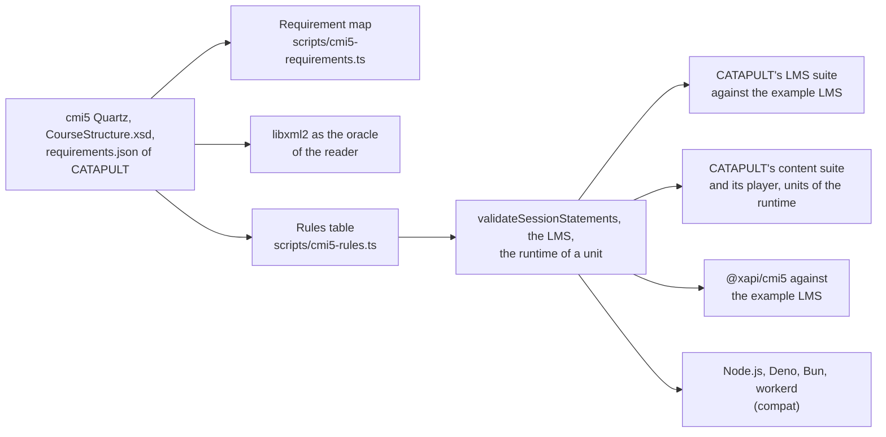

# Evidence for course-launch

What shows that `@interopkit/course-launch` does what cmi5 asks; [performance](performance.md) says how fast and how small it is.
Every check runs from a pinned source: cmi5 Quartz at `0ff5b30` of `AICC/CMI-5_Spec_Current`, and CATAPULT at `806c0ba` (v1.0.8), whose archive
`scripts/corpus.lock.json` and `validation/catapult/suite.lock.json` pin by its SHA-256.

## Completeness

`scripts/cmi5-requirements.ts` maps each of the 305 requirement ids of CATAPULT's `requirements.json` to one row with the tests
that prove it, and `requirements.spec.test.ts` fails on an id without a row or a row that names a test file that does not
exist.

| State | Rows | Ids | What it means |
| --- | --- | --- | --- |
| Has | 72 | 294 | Met, with its tests |
| In part | 4 | 7 | Met as far as a library can: the window of a launch, the redirect to `returnURL` and the audio are the page's, and cmi5 sets no period for initialized |
| Excluded | 3 | 4 | Undecidable from a package: the schema of an extension, and whether an absolute URL names a packaged file; another launch environment, which cmi5 does not define |

## The suites of CATAPULT

| Suite | What runs | Result |
| --- | --- | --- |
| LMS suite (`pnpm catapult-lms`) | Jest 27 and Puppeteer 10 in the Chromium of Playwright, against the example LMS over https on the loopback address, with `validation/catapult/lms.interopkit.js` as its adapter | At CATAPULT `806c0ba`, pinned in `validation/catapult/suite.lock.json` on 2026-11-03, 87 of 87 tests pass: 21 package imports and 66 checks around the runs of the 15 test units, waive and abandon among them |
| Content suite (`pnpm catapult-content`) | The suite and its player in containers, with the six course examples; each unit in Normal, Browse and Review played by the runtime of the package | At the same commit and date, 54 of 54 sessions without a violated requirement; a session that sends a statement before initialized is recorded with 9.3.0.0-4 |

The units of the LMS suite are built on Rustici's library, and the content suite plays the runtime of this package against
CATAPULT's own player, so each role is proven against an implementation of other authors. `validation/catapult/README.md` has
the steps.

## Other counterparties and oracles

| Check | Source | Result |
| --- | --- | --- |
| The reader against libxml2 | `CourseStructure.xsd` through `scripts/xsd-oracle.ts`, on the Spec's examples, CATAPULT's packages and generated structures with one change each | The same verdict, or a stricter one that [spec gaps](spec-gaps.md) names |
| The rules table | `scripts/cmi5-rules.ts`, one entry per sentence of 6.3, 7.1, 9, 10.2.2 and 11 | `validateSessionStatements` finds each finding, the LMS refuses each statement listed, and the runtime skips the same |
| `@xapi/cmi5` 1.4.0 | The AU library of xapijs, in the process of the tests of `examples/course-launch` | A whole session against the example LMS, satisfied, and a second fetch refused |
| Runtimes | `pnpm compat:runtimes` | The example's package, LMS and units give the same outcomes on Node.js 22, Deno 2.9, Bun 1.4 and workerd |
| Mutation rules | `scripts/rules/course-launch.ts` | Every rule of the LMS and of the runtime that keeps a request from being forged, replayed or redirected fails its test when removed |
