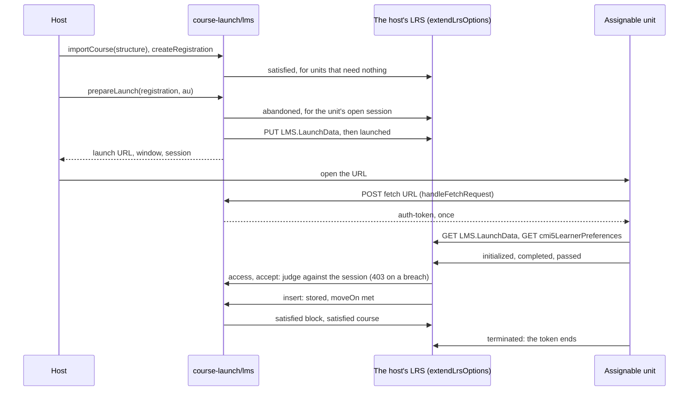
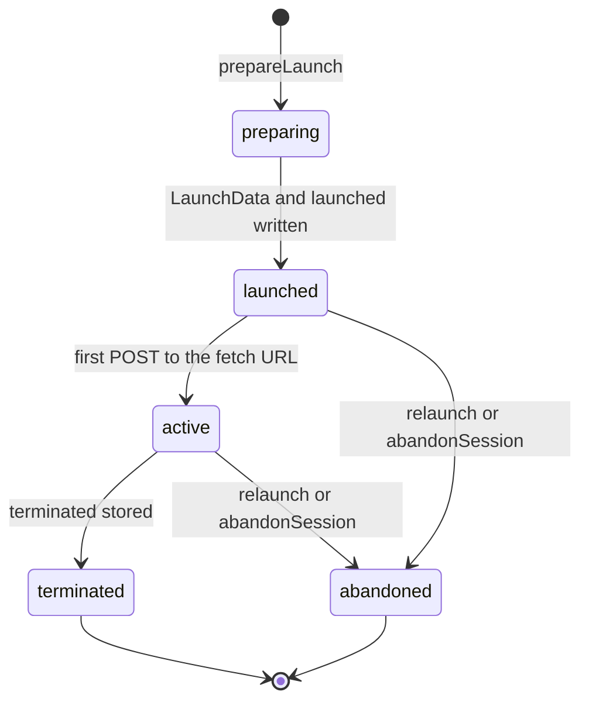

# The LMS role

`@interopkit/course-launch/lms` makes a host an LMS of cmi5. It imports a course, registers learners, launches assignable
units with a fetch URL of one use, and turns the host's LRS of `@interopkit/learning-records` into the LRS of cmi5: requests
with the token of a session are judged by the rules of cmi5, and what a unit stores satisfies its unit, its blocks and the
course. The host keeps the records in its `Cmi5Store`, serves the files of its courses, opens the windows and runs the server.



## Quick start

```ts
import { readCourseStructure } from "@interopkit/course-launch";
import { importCourse } from "@interopkit/course-launch/lms";

const xml = `<courseStructure xmlns="https://w3id.org/xapi/profiles/cmi5/v1/CourseStructure.xsd">
  <course id="https://publisher.example.org/geology">
    <title><langstring>Geology</langstring></title><description><langstring>Rocks.</langstring></description>
  </course>
  <au id="https://publisher.example.org/geology/rocks" moveOn="Completed">
    <title><langstring>Rocks</langstring></title><description><langstring>Kinds of rock.</langstring></description>
    <url>rocks/index.html</url>
  </au>
</courseStructure>`;
const course = importCourse(readCourseStructure(xml, { packaged: true }), {
  courseId: "geology",
  idBase: "https://lms.example.org/activities/",
  idNamespace: "4a8f0c2e-5b1d-4e7a-9c3f-2d6e8b0a1c4f",
  contentBase: "https://content.example.org/geology/",
});
course.aus.map(({ url, moveOn }) => [url, moveOn]);
// => [["https://content.example.org/geology/rocks/index.html", "Completed"]]
course.aus[0]?.lmsId.startsWith("https://lms.example.org/activities/");
// => true
```

`examples/course-launch` is a whole LMS over the campus LRS in memory: `src/lms.ts` wires the store, the client and the
handlers, and `scenario.ts` plays sessions against it.

## What the host wires

| Part         | What the host gives                                                                                       | What the package does with it                                                        |
| ------------ | --------------------------------------------------------------------------------------------------------- | ------------------------------------------------------------------------------------ |
| `Cmi5Store`  | Courses by id, and registrations and sessions with a put that compares the revision                       | Reads and writes the records, again after a conflict                                 |
| `records`    | An `LrsClient` of xAPI 1.0.3 with the LMS's own credential, whose `fetch` reaches the host's LRS          | Writes `LMS.LaunchData` and the launched, abandoned, waived and satisfied statements |
| `LrsOptions` | The stores and the `access` of its credentials                                                            | `extendLrsOptions` returns the options to pass to `handleLrsRequest`                 |
| Routes       | The LRS at `endpoint`, `handleFetchRequest` at `fetchEndpoint`                                            | Answers the requests                                                                 |
| Content      | The files of each package at the URLs that `importCourse` resolved, and a window or frame for each launch | Nothing: the page and the files are the host's                                       |

## Functions

| Function                                     | Does                                                                                                                                                                                                                                                                                          |
| -------------------------------------------- | --------------------------------------------------------------------------------------------------------------------------------------------------------------------------------------------------------------------------------------------------------------------------------------------- |
| `importCourse(structure, input)`             | Checks the structure by every rule of the reader, with the `launchSchemes` of the input, resolves relative URLs against `contentBase`, and makes the ids of the LMS: `idBase` and a UUID of version 5 of the course id, the kind and the publisher id, the same in every registration (8.1.5) |
| `createRegistration(input, options)`         | Makes the registration, satisfies at once every unit whose `moveOn` is `NotApplicable` and the blocks and course they fill (9.6.1.1), and returns an existing one of the same learner and course as it is                                                                                     |
| `prepareLaunch(input, options)`              | Abandons the unit's open session, writes the launch data and the launched statement, and returns the URL, the window (`own` for `OwnWindow`) and the session id; of two launches of a unit at once, one abandons the other                                                                    |
| `handleFetchRequest(request, options)`       | Answers the first POST of a fetch code with the token, and every other request with an error code of cmi5                                                                                                                                                                                     |
| `extendLrsOptions(lrs, options)`             | The host's LRS options with the access and the rules of cmi5, and its store of Statements wrapped for satisfaction                                                                                                                                                                            |
| `abandonSession(session, options)`           | Ends a session that its unit did not terminate, and writes its abandoned statement                                                                                                                                                                                                            |
| `waiveAu(input, options)`                    | Writes the waived statement of a unit and the satisfied statements it causes                                                                                                                                                                                                                  |
| `deriveCourseProgress(registration, course)` | Tells what each unit, block and the course hold, for a host that shows progress or sequences units                                                                                                                                                                                            |

## Sessions and tokens



| Secret                            | Holds                                                                  | Kept as                     | Valid                                                                                                                                                                           |
| --------------------------------- | ---------------------------------------------------------------------- | --------------------------- | ------------------------------------------------------------------------------------------------------------------------------------------------------------------------------- |
| The fetch code, in the launch URL | The session id and a secret of 32 random bytes                         | Its SHA-256, in the session | Once, within `fetchLifetimeSeconds` of the launch                                                                                                                               |
| The token, never in a URL         | A Basic credential: the session id as user, another secret as password | Its hash                    | While the session is active and for `maxSessionSeconds` after the launch; the request that stores terminated is its last, and every later one is 401, as CATAPULT's player does |

Every 401 to a token carries the challenge `cmi5 realm="xAPI"`, which RFC 7235 asks a 401 to have and at which no browser prompts
for a password, as it does at a challenge of Basic. A request of a page without a token reaches the host's `access`, whose 401
should carry such a challenge too, as the example's does.

| The fetch URL answers      | When                                                                   |
| -------------------------- | ---------------------------------------------------------------------- |
| 200, `{"auth-token": ...}` | The first POST within `fetchLifetimeSeconds` of the launch             |
| 200, `error-code` 1        | A code used already, expired, or of a session that ended               |
| 200, `error-code` 2        | A code that the LMS did not make, or a query that gives the code twice |
| 200, `error-code` 3        | The store failed or kept a conflict                                    |
| 405 with `Allow: POST`     | Any other method                                                       |

## What a unit may do with its token

| Resource                            | Allowed                                                            | Refused with 403                                                                                                                                                                                                                                 |
| ----------------------------------- | ------------------------------------------------------------------ | ------------------------------------------------------------------------------------------------------------------------------------------------------------------------------------------------------------------------------------------------ |
| Statements                          | PUT and POST, judged by the rules of cmi5; GET of its registration | A statement that a rule refuses (the rule in the message), a GET by id, a GET without its registration or of another registration or learner                                                                                                     |
| State                               | Its learner, in its registration                                   | A write or a removal of `LMS.LaunchData` of any activity, a removal of every document of an activity, another learner or registration                                                                                                            |
| Agent Profile                       | Its learner; the preferences read, and written as a valid document | A preferences document that is not JSON, not an object, without both properties, with a list that is not of RFC 5646 tags, or over 4,096 bytes; a removal of the preferences; any write under `learnerPreferences: "read-only"`; another learner |
| Agents                              | Its learner                                                        | Another learner                                                                                                                                                                                                                                  |
| Activities, Activity Profile, About | Read; Activity Profiles also written                               |                                                                                                                                                                                                                                                  |

Another learner is an `agent` that is not an Agent with the learner's identifier: another identifier, a Group, or an object that
is no Actor of xAPI. A request with neither a token nor a credential of the host reaches the host's `access`, and the handler
answers 400 for a request that lacks its `agent`, gives one that is no JSON object, or whose query names a parameter twice, as
xAPI asks.

## Records

| Record           | Holds                                                                                                                                                                                                                                                                                | Written by                                                                                        |
| ---------------- | ------------------------------------------------------------------------------------------------------------------------------------------------------------------------------------------------------------------------------------------------------------------------------------ | ------------------------------------------------------------------------------------------------- |
| `ImportedCourse` | The structure, the ids of the LMS for the course, its blocks and its units, each unit's absolute URL and the blocks that hold it                                                                                                                                                     | The host, from `importCourse`                                                                     |
| `Registration`   | The learner and the course; per unit its `moveOn`, its completed and passed statements with whether the LRS stored them, its waiver, whether it is satisfied and its active session; the blocks and the course whose satisfied statement is written                                  | `createRegistration`, `accept`, the wrapped insert, `prepareLaunch`, `waiveAu`, `abandonSession`  |
| `Session`        | The unit, its activity id and learner, its state, its launch data, the hashes of the fetch code and of the token, the times of the launch, the fetch, the last statement and the end, the statements that cmi5 defines which the LMS took, and whether the unit read the preferences | `prepareLaunch`, `handleFetchRequest`, the access, `accept`, the wrapped insert, `abandonSession` |

`SESSION_STATES` lists the states of a session in the order it passes through them: `preparing`, `launched`, `active` once the unit
fetched its token, `terminated` by the unit's statement, and `abandoned` by the LMS.

`accept` reserves a verb by writing the statement's id into the session and the registration before the store holds it, so two
requests at once cannot both take what a session or a registration takes once. A batch is judged against what the records held
before it, without its own reservations, so a batch sent again after a failure is judged as the first time. A completed or
passed statement that another session reserved counts once the LRS holds it, so one whose store failed, and that its unit never
sent again, blocks no later session of the registration. The statements of
the LMS have ids derived from what they are, under the course's `idNamespace`: a call made again writes the same statement once.

## Satisfaction

| `moveOn`             | A unit is satisfied when its registration holds, stored |
| -------------------- | ------------------------------------------------------- |
| `NotApplicable`      | Nothing: at registration                                |
| `Passed`             | passed                                                  |
| `Completed`          | completed                                               |
| `CompletedAndPassed` | completed and passed                                    |
| `CompletedOrPassed`  | completed or passed                                     |
| Any                  | waived                                                  |

A block is satisfied when every member in it is, and the course when every member is. Once the store holds a unit's completed
or passed statement, the wrapped insert writes the satisfied statements that are due, the innermost block first and the course
last, with the session id of the launch, before the LRS answers the unit; at registration and for a waiver they carry a session
id of their own. The `moveOn` and mastery score of a launch apply to its statements; the course structure's apply at
registration and to waivers.

## Options

| Option                 | Default             | Meaning                                                                                    |
| ---------------------- | ------------------- | ------------------------------------------------------------------------------------------ |
| `store`                | required            | The `Cmi5Store`                                                                            |
| `records`              | required            | The client of xAPI 1.0.3 with the LMS's own credential                                     |
| `endpoint`             | required            | The https address of the LRS, ending in a slash; the launch URL gives it without the slash |
| `fetchEndpoint`        | required            | The https address of the route of `handleFetchRequest`, without a fragment                 |
| `authority`            | required            | The `authority` of the statements of units                                                 |
| `clock`                | `SYSTEM_CLOCK`      | The time of the LMS                                                                        |
| `newId`                | `crypto.randomUUID` | The ids of registrations and sessions: UUIDs                                               |
| `fetchLifetimeSeconds` | 600                 | How long a fetch code may be used                                                          |
| `maxSessionSeconds`    | 86,400              | How long a session and its token last after the launch                                     |
| `learnerPreferences`   | `"writable"`        | `"read-only"` refuses every write of the preferences by a unit                             |
| `signal`               | none                | Ends the wait of the call                                                                  |

## Limits

| Limit                              | Value                                       | Refused with                                        |
| ---------------------------------- | ------------------------------------------- | --------------------------------------------------- |
| Preferences document a unit writes | 4,096 bytes                                 | 403                                                 |
| The `agent` of a request of a unit | 1,000 tokens of JSON                        | Left to the handler's 400                           |
| Fetch code; session                | `fetchLifetimeSeconds`; `maxSessionSeconds` | error-code 1; 401                                   |
| Statements of a request            | The LRS's limits                            | 413                                                 |
| Store conflicts                    | 3 retries                                   | 500 from handlers; `InteropkitError` from functions |
| Secrets of fetch codes and tokens  | 32 random bytes, kept as SHA-256            |                                                     |

## Errors

| Error                                     | When                                                                                                                                                    | What to do                           |
| ----------------------------------------- | ------------------------------------------------------------------------------------------------------------------------------------------------------- | ------------------------------------ |
| `DataError`                               | An input or an option that is not valid; a course, registration, session or unit that the store does not hold; a record that the store returned changed | Fix the input, or the store          |
| `InteropkitError`                         | The store kept a conflict after the retries, or the LRS did not write the launch data                                                                   | Call again                           |
| What the store or the client rejects with | A port failed                                                                                                                                           | Call again: every write is made once |
| 401 from the LRS                          | A token that is not, or no longer, that of an active session                                                                                            | The unit ends its session            |
| 403 from the LRS                          | A request or a statement that cmi5 refuses, with the rule in the message                                                                                | The unit keeps its session           |
| 500 from the LRS                          | A port failed; the Statements may be stored                                                                                                             | The unit sends them again            |

| A port                                                         | Fails                                                                           | Hangs                    | Called again                         |
| -------------------------------------------------------------- | ------------------------------------------------------------------------------- | ------------------------ | ------------------------------------ |
| `Cmi5Store`                                                    | Functions reject; handlers answer 500, and the fetch URL error code 3           | `signal`                 | A conflict is read again and retried |
| `records` in `prepareLaunch`                                   | Rejects; the session stays preparing and is never active; no URL                | The client's `timeoutMs` | A new session each time              |
| `records` in the wrapped insert                                | The LRS answers 500 with the Statements stored; the unit's resend runs it again | As above                 | Derived ids: each statement once     |
| `records` in `abandonSession`, `waiveAu`, `createRegistration` | Rejects                                                                         | As above                 | Same id, so once                     |

## Not included

| Not included                                                                         | Why                                                                                                  |
| ------------------------------------------------------------------------------------ | ---------------------------------------------------------------------------------------------------- |
| Opening windows, frames, the redirect to `returnURL`, hosting the files of a package | The page and the server are the host's: `prepareLaunch` returns the window that the unit asks for    |
| Abandoning a session after a time without statements                                 | The host's schedule calls `abandonSession`; a token ends at `maxSessionSeconds`                      |
| Voiding conflicting statements (6.3, a SHOULD)                                       | Every statement that conflicts is refused on arrival, so none is stored                              |
| A proxy to an external LRS                                                           | The LMS of cmi5 is its LRS; a host with an external one adapts the store ports of `learning-records` |
| An editor of courses, reports, dashboards                                            | Applications                                                                                         |

## Differences from the references

CATAPULT's player differs from the LMS role in the reads of a unit, the endpoint in the launch URL, the order of the statements and
the removal of State documents: [spec gaps](spec-gaps.md#the-lms) gives each. It differs besides in:

| Case                   | CATAPULT's player                                         | Here                                          |
| ---------------------- | --------------------------------------------------------- | --------------------------------------------- |
| Satisfied statements   | Written after the unit's statement                        | The same, before the LRS answers the unit     |
| The challenge of a 401 | Basic, at which a browser asks the learner for a password | `cmi5 realm="xAPI"`, at which no browser does |
