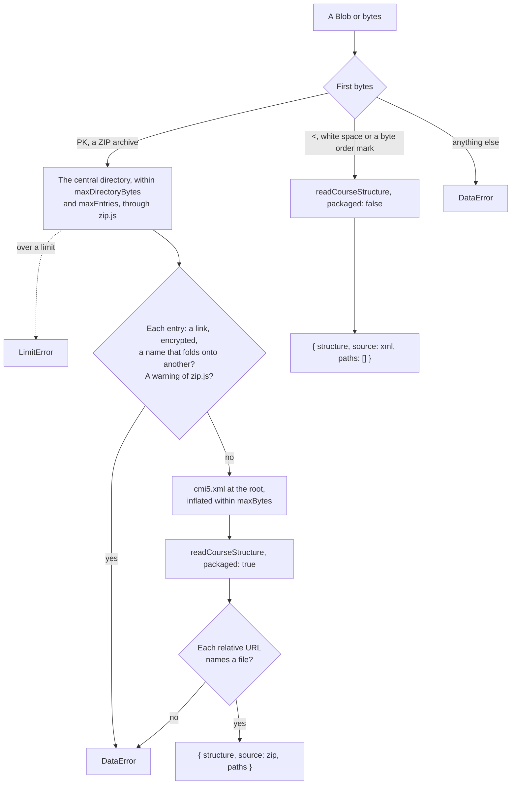

# The course package

`@interopkit/course-launch/package` reads a course package in the three formats that an LMS must take (14.0): a ZIP archive of
32 or 64 bits with `cmi5.xml` at its root, or the XML of a course structure alone. `readCoursePackage` tells them apart by their
first bytes, reads a ZIP archive in place, refuses one that another extractor could read differently, and checks that each
relative URL names one of its files. `writeCoursePackage` writes a ZIP package from a structure and its files.



## Quick start

```ts
import { readCourseStructure } from "@interopkit/course-launch";
import { readCoursePackage, writeCoursePackage } from "@interopkit/course-launch/package";

const structure = readCourseStructure(
  `<courseStructure xmlns="https://w3id.org/xapi/profiles/cmi5/v1/CourseStructure.xsd">
  <course id="https://example.org/courses/geology">
    <title><langstring>Introduction to Geology</langstring></title>
    <description><langstring>Plate tectonics.</langstring></description>
  </course>
  <au id="https://example.org/courses/geology/au/1">
    <title><langstring>Plate tectonics</langstring></title>
    <description><langstring>How the plates move.</langstring></description>
    <url>lesson/index.html?part=1</url>
  </au>
</courseStructure>`,
  { packaged: true },
);
const files = new Map([["lesson/index.html", new TextEncoder().encode("<!doctype html><title>Plates</title>")]]);
const archive = await writeCoursePackage(structure, files);
const read = await readCoursePackage(archive);
read.source;
// => "zip"
read.paths;
// => ["cmi5.xml", "lesson/index.html"]
```

## What a ZIP package may not hold

A host extracts the files of a package to serve them. Each of these could make its extractor write another file, or another
`cmi5.xml`, than the one judged here, so the package is refused:

| The archive holds                                                                                                                                                                                   | Found by                                |
| --------------------------------------------------------------------------------------------------------------------------------------------------------------------------------------------------- | --------------------------------------- |
| A name that leaves the archive: `../`, an absolute path, a drive, a backslash, `a/../../`                                                                                                           | zip.js                                  |
| A header that lies about the size of its data, or a CRC-32 that fails for `cmi5.xml`                                                                                                                | zip.js                                  |
| A symbolic link                                                                                                                                                                                     | The reader, from the mode of the entry  |
| An encrypted entry                                                                                                                                                                                  | The reader                              |
| Two entries whose names are one file to an extractor: case folded, characters composed, segments `.` and empty ones dropped, and the dots and spaces that end a segment dropped, as Windows does    | The reader                              |
| Data before or after the archive, two central directories, a duplicate name, and every other warning of zip.js but a count of entries that wrapped past 65,535 without ZIP64, which zip.js recovers | The reader, from the warnings of zip.js |
| No `cmi5.xml` at its root                                                                                                                                                                           | The reader (14.1)                       |
| A relative URL that names no file of the archive, read without its query and fragment and with its escapes decoded                                                                                  | The reader (14.1)                       |

A ZIP package may name an assignable unit by a URL relative to its root, or by a fully qualified one (14.1). An XML package names
each by a fully qualified URL (14.2).

## Options

`readCoursePackage` takes the options of [`readCourseStructure`](structure.md#options) but `packaged`, which the format of the
package sets, and these:

| Option              | Default    | Meaning                                                                  |
| ------------------- | ---------- | ------------------------------------------------------------------------ |
| `maxEntries`        | 100,000    | The most entries of a ZIP package, directories included                  |
| `maxDirectoryBytes` | 16,777,216 | The most bytes of its central directory, which zip.js reads in one piece |
| `maxBytes`          | 16,777,216 | The most bytes of `cmi5.xml` once inflated, and of an XML package        |
| `signal`            | none       | Ends the wait of the reader, which rejects with its reason               |

`writeCoursePackage` takes `launchSchemes`, which it writes and reads its structure with, and `signal`.

## Writing a package

`writeCoursePackage` writes `cmi5.xml` with [`writeCourseStructure`](structure.md) and then the files in the order of the map,
each compressed and dated midnight of 1980-01-01, the first date that ZIP holds, so the same course writes the same bytes; the
archive turns to ZIP64 where its size needs it.

| Rule                            | Value                                                                                                  |
| ------------------------------- | ------------------------------------------------------------------------------------------------------ |
| A path                          | Names below the root of the package, without `.`, `..`, `\`, `:`, control characters or empty segments |
| Two paths                       | Never one file to an extractor, with each other or with `cmi5.xml`, by the reader's test of two names  |
| A relative URL of the structure | Names one of the files                                                                                 |
| Entries                         | At most the `maxEntries` that the reader takes by default, checked before anything is written          |
| The result                      | Read again by `readCoursePackage` with its default limits before it is returned                        |

## Limits

The values of the options are in [Options](#options).

| Limit             | Value               | Refused with                                                                                                     |
| ----------------- | ------------------- | ---------------------------------------------------------------------------------------------------------------- |
| Entries           | `maxEntries`        | `LimitError` at the entry past it, as zip.js lists them                                                          |
| Central directory | `maxDirectoryBytes` | `LimitError` before it is read: zip.js reads it in one read, the only read that may ask for so much              |
| `cmi5.xml`        | `maxBytes`          | `LimitError` for a size above it in its header; zip.js refuses data that inflates past its header, a `DataError` |
| Archive           | none                | A `Blob` is read for its central directory and `cmi5.xml` alone; the host bounds an upload                       |

The central directory of a package of real courses has a few kilobytes: about 1 KB in each of the six course examples of
CATAPULT. 16 MiB, as the family's other readers of untrusted input take at most, holds the 100,000 entries with names of about
120 bytes.

The tests read the worst packages in a process whose heap is bounded, on Node.js 22, 24 and 26; each ends within:

| Worst package                                                 | Heap                                                                        |
| ------------------------------------------------------------- | --------------------------------------------------------------------------- |
| 100,000 entries                                               | 29 MiB                                                                      |
| A central directory at its limit                              | 15 MiB, besides the bytes of the directory, which V8 keeps outside its heap |
| A `cmi5.xml` that inflates to 64 MiB and says it has 64 bytes | 11 MiB                                                                      |

With the default heap of V8, the resident memory grows further before V8 collects, by about 100 MiB for each of the first two.

## Errors

| Error                                                                                                             | What to do                                                                   |
| ----------------------------------------------------------------------------------------------------------------- | ---------------------------------------------------------------------------- |
| `DataError` "The course package is neither a ZIP archive nor the XML …"                                           | Give a ZIP archive or the XML of a course structure                          |
| `DataError` "The ZIP package is not a valid ZIP archive: …"                                                       | Write the archive again with a tool that follows the APPNOTE                 |
| `DataError` "The ZIP package is ambiguous: …", "holds … as a symbolic link", "holds … encrypted", "holds … and …" | Write the archive again without what the message names                       |
| `DataError` "The ZIP package has no cmi5.xml at its root …"                                                       | Put the course structure at the root, named `cmi5.xml` in lower case         |
| `DataError` "The course package has no file …, which the URL … names"                                             | Add the file, or fix the URL                                                 |
| `LimitError` "… above the limit … of the option …", with the option in `limit` and its value in `maximum`         | Raise the option for a trusted package, or refuse it: a host answers 413     |
| `DataError` "The course structure is invalid at …"                                                                | Fix the structure; [the structure guide](structure.md#rules) lists the rules |
| `DataError` "The file … of the package must be …", "The files … are one file …"                                   | Give the files of a package by paths of names below its root                 |

## Not included

| Not included                                                                     | Why                                                                         |
| -------------------------------------------------------------------------------- | --------------------------------------------------------------------------- |
| Extracting, storing and serving the files of a package                           | The host's; `paths` lists the files that it extracts                        |
| Checking that a fully qualified URL names a file of the package (14.1, a SHOULD) | Undecidable: an absolute URL may name anything                              |
| Encrypted entries, split archives                                                | cmi5 names none, and an encrypted entry is one that the reader cannot judge |

## Differences from the references

The player of CATAPULT reads a package with `node-stream-zip`, which takes more than this reader does: links, encrypted entries
other than `cmi5.xml`, names that fold onto each other and data around the archive. How it finds the file of a relative URL
also differs. [Spec gaps](spec-gaps.md#the-course-package) gives each case with its reading.
