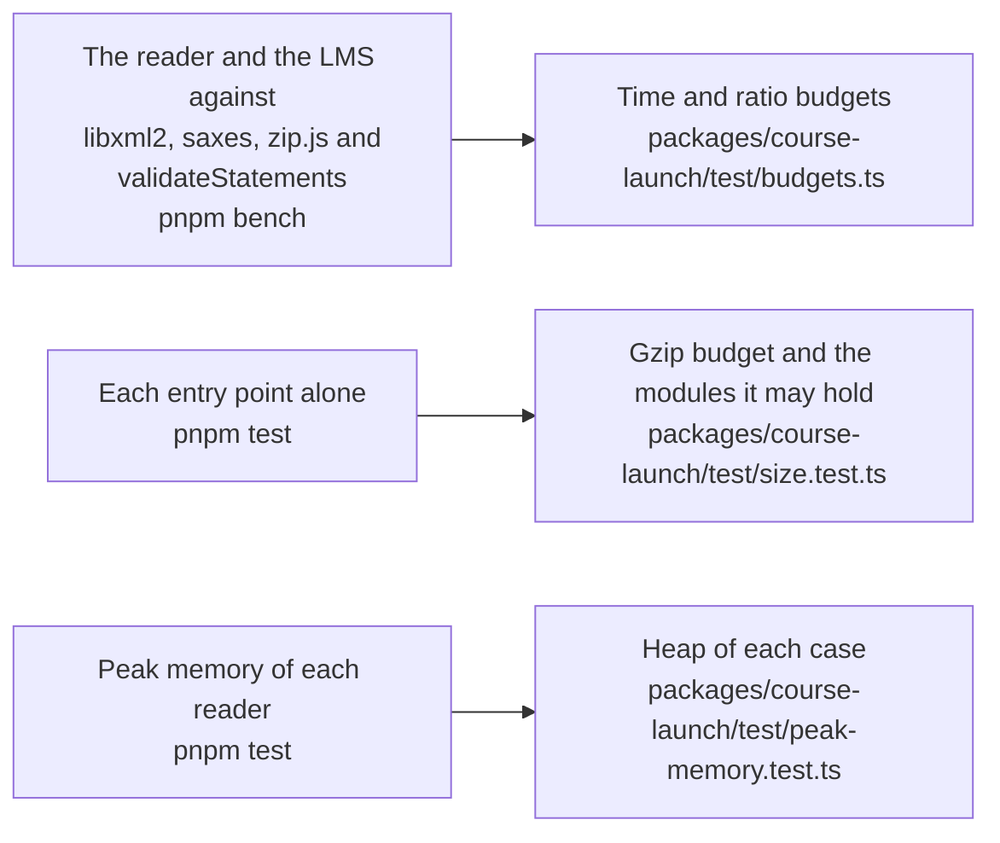

# Performance of course-launch

What the hot paths of `@interopkit/course-launch` cost, how much each entry point adds to a bundle, and the heap that each reader of untrusted input needs on its worst input. A budget holds each number and fails a gate of CI: `pnpm bench` for the time, `pnpm test` for the size and the heap. That the package does what it says is in [evidence](evidence.md).

## Speed

Each benchmark is timed in turns with its reference by `scripts/bench-rounds.ts` (`test/budgets.ts`). The ratio of the fastest samples holds
on any machine: its budget is five times the highest ratio measured on the runner of CI (the eight latest green runs) and on a laptop, rounded up to one significant digit. The time is five times the fastest sample of the runner, rounded up to one significant digit.

| Benchmark | Reference | Ratio | Budget | Fastest on the runner | Time budget |
| --- | --- | ---: | ---: | ---: | ---: |
| `readCourseStructure` of LMS suite 101 (1,001 units) | libxml2 validating it | 3.35–4.85 | 30  | 54.1–97.2 ms | 300 ms |
| The same | saxes parsing it alone | 1.76–2.72 | 20  | 64.3–96.8 ms | 400 ms |
| `readCoursePackage` of a ZIP64 archive of 66,001 entries | zip.js listing its entries | 0.69–0.84 | 5   | 999.0–1410.6 ms | 5000 ms |
| The LMS judging the seven statements of a session | `validateStatements` of them | 0.83–1.24 | 7   | 0.10–0.17 ms | 0.5 ms |
| The LMS judging 1,000 allowed statements of one request | `validateStatements` of them | 0.32–0.47 | 3    | 7.1–14.6 ms | 40 ms |
| `prepareLaunch` over stores in memory and the LRS in the same process | none | n/a | n/a | 1.6–2.4 ms | 9 ms |

The reader does not reach parity with libxml2: saxes, a parser in JavaScript, takes 2.0 times libxml2 in WebAssembly to parse
the text alone, and the reader also builds the model and checks the rules of cmi5 that the schema leaves out.

## Size

`test/size.test.ts` bundles each entry point alone with `scripts/entry-size.ts`: esbuild, minified, with every dependency inside.
It fails above its budget after gzip, 1.25 times the size measured rounded up to the next 500 bytes, or when an entry point holds a
module that its budget does not list.

Gzip is measured on Node.js 22; other versions of Node.js differ by up to 1 percent.

| Entry point | Bytes | Gzip | Budget | Holds, besides `@interopkit/core`, `model` and valibot |
| --- | ---: | ---: | ---: | --- |
| `@interopkit/course-launch` | 106,634 | 33,017 | 41,000 | `rules`, `structure`, saxes; `compare`, `model` and `read` of learning-records |
| `@interopkit/course-launch/package` | 210,795 | 74,134 | 92,500 | `structure`, saxes, zip.js |
| `@interopkit/course-launch/lms` | 134,564 | 41,967 | 51,500 | `rules`, `structure`, saxes, uuid; `build`, `compare`, `model`, `read` and `store` of learning-records |
| `@interopkit/course-launch/au` | 109,804 | 37,719 | 46,000 | `rules`, `@noble/hashes`, the multipart parser of Remix; `attachments`, `build`, `client`, `compare`, `model` and `read` of learning-records |

The LMS loads no ZIP code and the runtime of a unit no LMS, LRS or reader of a structure.

## Peak memory

Each reader of untrusted input runs on its worst input in a Node.js process of its own whose heap is bounded
(`test/peak-memory.test.ts`, with the readings in `test/peak-memory-readings.ts`): what the reading keeps alive at once must fit, whenever V8 collects, so the test holds on a loaded
machine. The heap of each test is twice the least in which it ended on Node.js 22 and 24, rounded up to 16 MiB; the least
counts the input and the code of the process, and `node scripts/peak-memory.ts course-launch` prints it, in steps of 8 MiB.

| Reader | Worst input | Least heap | Heap of the test |
| --- | --- | --- | --- |
| The access of the LMS | A preferences document of 10 MiB, refused after 4,096 bytes | 16 MiB | 32 MiB |
| The LMS judging a batch | 1,000 statements of a unit near 10 MiB | 32 MiB | 80 MiB |
| The runtime reading the fetch URL | 65,536 bytes of tokens, refused before it is parsed | 16 MiB | 32 MiB |
| The runtime reading the launch data | 1 MiB of values | 24 MiB | 48 MiB |
| The runtime reading the preferences | 1 MiB, over the limit of 4,096 bytes | 16 MiB | 32 MiB |
| The runtime reading what the registration holds | An answer over 1 MiB | 16 MiB | 32 MiB |

The readers of a structure and of a package are in the [structure](structure.md) and [package](package.md) guides.
