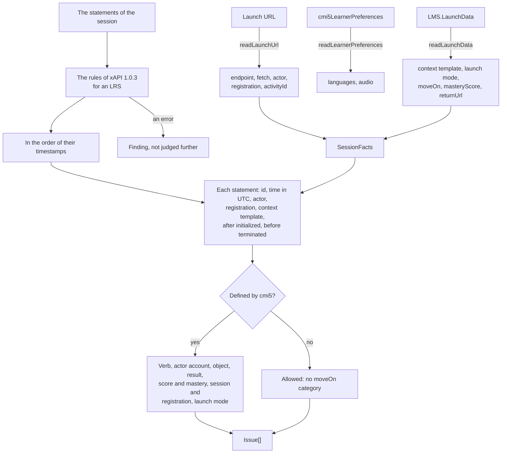

# The rules of a session

The rules module reads what a launch gives an assignable unit, the launch URL, the document `LMS.LaunchData` and the preferences
of the learner, and judges the statements that the unit sends in a session. `classifyStatement` tells a statement that cmi5
defines from one that it allows and one that it does not. `validateSessionStatements` judges the statements of one session
against its launch data and what its registration held before it, as an LMS judges what it receives and a tool of reports judges
what it recorded.



## Quick start

```ts
import { readLaunchData, readLaunchUrl, validateSessionStatements } from "@interopkit/course-launch";

const query = new URLSearchParams({
  endpoint: "https://lms.example.org/xapi/",
  fetch: "https://lms.example.org/fetch?code=k1",
  actor: JSON.stringify({ objectType: "Agent", account: { homePage: "https://lms.example.org", name: "learner-1" } }),
  registration: "1b0e3f5c-2c4e-4f6a-9b1d-3e5f7a9c1b2d",
  activityId: "https://lms.example.org/au/1",
});
const launch = readLaunchUrl(`https://content.example.org/geology/1/index.html?${query}`);
const launchData = readLaunchData({
  contextTemplate: {
    contextActivities: { grouping: [{ id: "https://publisher.example.org/au/1" }] },
    extensions: { "https://w3id.org/xapi/cmi5/context/extensions/sessionid": "s-1" },
  },
  launchMode: "Normal",
  moveOn: "Completed",
});
const context = {
  registration: launch.registration,
  contextActivities: {
    grouping: [{ id: "https://publisher.example.org/au/1" }],
    category: [{ id: "https://w3id.org/xapi/cmi5/context/categories/cmi5" }],
  },
  extensions: { "https://w3id.org/xapi/cmi5/context/extensions/sessionid": "s-1" },
};
const statement = (n = 1, verb = "initialized") => ({
  id: `0b5c6d7e-8f90-4a1b-8c2d-00000000000${n}`,
  actor: launch.actor,
  verb: { id: `http://adlnet.gov/expapi/verbs/${verb}` },
  object: { id: launch.activityId },
  result: verb === "terminated" ? { duration: "PT5M" } : undefined,
  context,
  timestamp: `2026-01-15T10:0${n}:00.000Z`,
});
const facts = { actor: launch.actor, registration: launch.registration, activityId: launch.activityId, launchData };
validateSessionStatements([statement(1, "initialized"), statement(2, "terminated")], facts);
// => []
validateSessionStatements([statement(2, "terminated")], facts).map(({ path, rule }) => `${path} ${rule}`);
// => ["[0].verb.id before-initialized"]
```

## Reading what a launch gives

| Function                  | Reads                                                                                                                                                                  | Refuses with `DataError`                                                                                                                                                                                                                                                   |
| ------------------------- | ---------------------------------------------------------------------------------------------------------------------------------------------------------------------- | -------------------------------------------------------------------------------------------------------------------------------------------------------------------------------------------------------------------------------------------------------------------------- |
| `readLaunchUrl`           | The five parameters of 8.1, in any order, each once, decoded                                                                                                           | A parameter missing or repeated; an `endpoint` or `fetch` that is not https; an actor that is not the JSON of an Agent with an account, or of more than 1,000 tokens; a registration that is no UUID; an `activityId` that is no IRI; a URL of more than 65,536 characters |
| `readLaunchData`          | `contextTemplate` (a Context of xAPI 1.0.3), `launchMode`, `moveOn`, and `launchParameters`, `masteryScore`, `returnURL` as `returnUrl`, `entitlementKey` when present | A value of the wrong type or vocabulary, a mastery score outside 0 to 1, a template that xAPI refuses                                                                                                                                                                      |
| `readLearnerPreferences`  | `languagePreference` as a list of RFC 5646 tags, the preferred first, and `audioPreference`, each when present                                                         | A list with spaces or a tag that is not one, an audio preference other than `on` and `off`                                                                                                                                                                                 |
| `writeLearnerPreferences` | Writes both properties, which the document must hold (11.0)                                                                                                            | A property missing or not valid                                                                                                                                                                                                                                            |

CATAPULT's player writes `masteryScore: null` and `entitlementKey: {}` into the launch data of a unit that has neither, so
`readLaunchData` reads both as absent. Members that cmi5 does not define are dropped, and both readers refuse a member named
`__proto__`, `constructor` or `prototype`, whose name is of the prototype chain, but in the value of an extension of the context
template, whose names are data and which holds it as an own member.

## Rules

Each finding is an `Issue` of `@interopkit/core/checks`: the `path` in the list (`[3].result.score.scaled`), a
`rule`, a `message` and a `severity`. The rules of xAPI 1.0.3 come first, with their own rules, and a statement with an error
of xAPI is not judged by these. `scripts/cmi5-rules.ts` holds a session that breaks each sentence, which the tests judge.

| Rule                                                                         | A statement breaks it when                                                                                 | Of      | cmi5              |
| ---------------------------------------------------------------------------- | ---------------------------------------------------------------------------------------------------------- | ------- | ----------------- |
| `statement-id`                                                               | It has no id                                                                                               | Every   | 9.1               |
| `voiding`                                                                    | Its verb is the voided verb                                                                                | Every   | 6.3               |
| `timestamp`, `timestamp-utc`                                                 | It has no timestamp, or one not in UTC (`Z`, `+00`, `+0000`, `+00:00`)                                     | Every   | 9.7               |
| `actor`                                                                      | Its actor is not the learner of the launch, by the identifier of xAPI                                      | Every   | 8.1.3, 9.2        |
| `registration`                                                               | Its context has not the registration of the launch                                                         | Every   | 8.1.4, 9.6.1      |
| `session-id`                                                                 | Its context has no session id, or another than the template's                                              | Every   | 9.6.3.1           |
| `context-template`                                                           | Its context lacks an activity of a list of the template, or changes another value of the template          | Every   | 10.2.1            |
| `before-initialized`                                                         | It comes before the initialized statement, or is timestamped before it                                     | Every   | 7.1.1, 9.3        |
| `after-terminated`                                                           | It comes after the terminated statement                                                                    | Every   | 7.1.2, 9.3.8      |
| `move-on-category`                                                           | It lacks the category of moveOn while it is defined and has `success` or `completion`, or has it otherwise | Every   | 9.6.2.2           |
| `progress`                                                                   | Its `progress` is not an integer from 0 to 100; a warning in completed                                     | Every   | 9.5.5.1           |
| `au-verb`                                                                    | It has the category of cmi5 and a verb other than initialized, completed, passed, failed, terminated       | Defined | 9.3               |
| `actor-account`                                                              | Its actor is a Group or has no account                                                                     | Defined | 9.2               |
| `object`                                                                     | Its object is not the activity of the launch                                                               | Defined | 8.1.5, 9.4        |
| `verb-repeated`                                                              | Its verb came before in the session                                                                        | Defined | 9.3               |
| `passed-and-failed`                                                          | It is passed after failed, or failed after passed, in the session                                          | Defined | 9.3               |
| `completed-in-registration`, `passed-in-registration`, `failed-after-passed` | The registration holds a completed or a passed already                                                     | Defined | 9.3, 9.3.3, 9.3.4 |
| `launch-mode`                                                                | It is completed, passed or failed in Browse or Review                                                      | Defined | 10.2.2            |
| `result-success`                                                             | `success` is not true in passed, not false in failed, or is present in another verb                        | Defined | 9.5.2             |
| `result-completion`                                                          | `completion` is not true in completed, or is present in another verb                                       | Defined | 9.5.3             |
| `result-duration`                                                            | Completed, passed, failed or terminated has no duration                                                    | Defined | 9.5.4.1           |
| `result-score`                                                               | A verb other than passed and failed has a score                                                            | Defined | 9.5.1             |
| `score-range`                                                                | A raw score without min and max, or a raw, min or max that is not an integer                               | Defined | 9.5.1             |
| `mastery-score`                                                              | Passed with a scaled score below the mastery score of the launch, or failed with one at or above it        | Defined | 9.3.4, 9.3.5      |
| `mastery-extension`                                                          | Passed or failed with a score lacks the mastery score of the launch in its context                         | Defined | 9.6.3.2           |
| `preferences-unread`                                                         | Initialized comes before the unit read the preferences, when the facts say so                              | Defined | 11.0              |

## The facts of a session

| Fact              | Default    | Meaning                                                                                                  |
| ----------------- | ---------- | -------------------------------------------------------------------------------------------------------- |
| `actor`           | required   | The learner of the launch, an Agent                                                                      |
| `registration`    | required   | The registration of the launch, a UUID                                                                   |
| `activityId`      | required   | The activity of the unit that the LMS made, an IRI                                                       |
| `launchData`      | required   | The launch data of the session, as `readLaunchData` returns it                                           |
| `prior`           | neither    | Whether the registration held a completed and a passed statement before the session                      |
| `preferencesRead` | not judged | Whether the unit read the preferences before initialized, which an LMS knows from the requests it served |

`validateSessionStatements` takes `maxFindings`, 1,000 by default: the list stops there, and its last finding says so.

## Limits

| Limit                                   | Value         | Refused with                                 |
| --------------------------------------- | ------------- | -------------------------------------------- |
| Characters of a launch URL              | 65,536        | `LimitError` (`maxLaunchUrlLength`)          |
| Tokens of JSON of its actor             | 1,000         | `LimitError` (`maxActorTokens`)              |
| Findings of `validateSessionStatements` | `maxFindings` | The list stops, and its last finding says so |

Both limits of `readLaunchUrl` are fixed. The readers of the launch data and of the preferences take values that are in memory,
and the host limits what it reads; the runtime limits the documents it fetches ([the assignable unit](au.md#limits)).

## Errors

| Error                                                                                                                                                                       | What to do                                                           |
| --------------------------------------------------------------------------------------------------------------------------------------------------------------------------- | -------------------------------------------------------------------- |
| `DataError` "The launch URL …", "The parameter … of the launch URL …", "The actor of the launch URL …"                                                                      | Launch the unit from an LMS of cmi5, which gives the five parameters |
| `LimitError` "The launch URL has more than … characters", "The actor of the launch URL has more than … tokens of JSON"; its `limit` names the limit and `maximum` its value | Refuse the launch                                                    |
| `DataError` "The launch data is invalid at …"                                                                                                                               | The LMS wrote launch data that cmi5 does not define                  |
| `DataError` "The preferences document is invalid at …"                                                                                                                      | Write the languages as RFC 5646 tags separated by commas             |
| `DataError` "The session is invalid at …", "The options object is invalid at …"                                                                                             | Pass the facts and options of the table above                        |

## Not included

| Not included                                                                 | Why                                                                                      |
| ---------------------------------------------------------------------------- | ---------------------------------------------------------------------------------------- |
| Judging the statements of the LMS: launched, abandoned, waived, satisfied    | They are the LMS's own; `validateSessionStatements` judges what an assignable unit sends |
| Voiding a statement that conflicts (6.3, a MUST for statements not rejected) | A judgement finds every conflict, so an LMS rejects them on receipt and stores none      |
| A period of time between launched and initialized (9.3.2)                    | The specification sets none                                                              |

## Differences from the references

CATAPULT's player judges what an assignable unit sends to it. These rules judge the same sentences and differ from it in the
actor of a statement, the activities of the context template, `raw`, `min` and `max`, the order of the statements and
`progress`: [spec gaps](spec-gaps.md#the-statements-of-a-session) gives each with its reading of the text.
