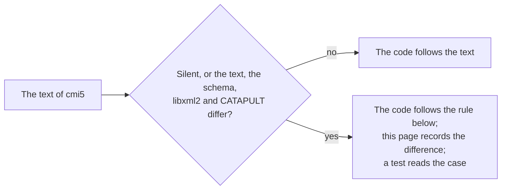

# Gaps in the specification

Where the text of cmi5, its schema, libxml2, the player of CATAPULT and its list of requirements differ, or say nothing, the
package follows the rule below and a test pins the choice. The text and the schema are those of `AICC/CMI-5_Spec_Current` at
`0ff5b30`, and CATAPULT is `adlnet/CATAPULT` at `806c0ba`, both of which `pnpm corpus` downloads.

## The course structure

| Case                                                                                                  | The sources                                                                                                                                                                                                         | The package                                                                                                                                    |
| ----------------------------------------------------------------------------------------------------- | ------------------------------------------------------------------------------------------------------------------------------------------------------------------------------------------------------------------- | ---------------------------------------------------------------------------------------------------------------------------------------------- |
| An `id`, `idref` or `activityType` that is not fully qualified                                        | The text asks every IRI to be fully qualified (3.0) and types `activityType` as an IRI (13.1.4); the schema types them `xs:anyURI` and `xs:string`, which libxml2 takes with spaces or no scheme                    | Refused (`iri`); CATAPULT refuses the ids too (LMS suite 201)                                                                                  |
| Two members of one kind with one id                                                                   | The text asks each id to be unique "within the course structure"; the schema says nothing; CATAPULT compares blocks, objectives and assignable units each among their own kind                                      | Each kind apart, as CATAPULT does (`duplicate-id`); a block and an assignable unit may share an id                                             |
| An objective reference without `idref`, or one that names no objective                                | The schema leaves `idref` optional; CATAPULT refuses a reference to an objective that the structure does not declare                                                                                                | Both refused (`missing-attribute`, `objective-reference`)                                                                                      |
| Elements or attributes in `launchParameters` and `entitlementKey`                                     | The schema leaves both untyped (`xs:anyType`), so libxml2 takes even a `<au>` of cmi5 there; the text types both as strings (13.1.4)                                                                                | Refused (`unexpected-element`, `unexpected-attribute`)                                                                                         |
| A DOCTYPE                                                                                             | XML allows one, and libxml2 takes it                                                                                                                                                                                | Refused (`doctype`), so that no entity is declared or expanded                                                                                 |
| A `masteryScore` of more than 4 decimal places                                                        | The text gives it "up to 4 decimal places of precision"; the schema types it `xs:decimal` from 0 to 1, which libxml2 takes with any number of places                                                                | Refused (`mastery-score`) when more than 4 places are not trailing zeros: `0.80000` is 0.8                                                     |
| White space around `moveOn` and `launchMethod`                                                        | The text asks the LMS to remove the white space around every value (13.1); the schema types both as enumerations of `xs:string`, which keep it, and libxml2 refuses `Passed`                                        | Compared as written, as the schema does: `Passed` is refused (`enumeration`). Every other value is trimmed                                     |
| The characters of the url of an assignable unit                                                       | The text asks for RFC 1738 (13.1.4), which calls `~`, space, `{`, `}`, `\|`, `\`, `^`, `[`, `]` and `` ` `` unsafe and puts `#` outside the URL; CATAPULT parses the url with `URL`, which encodes a space silently | The characters of RFC 1738 on the text as written (`url-characters`), and one fragment after `#` in the same characters                        |
| The scheme of the url                                                                                 | The text allows an "application specific protocol" followed by `://` (13.1.4)                                                                                                                                       | `https` and `http` unless the host names others in `launchSchemes`; a scheme always followed by `//`, so that `javascript://%0a...` is refused |
| A `langstring` or an `objective` after an extension in a title, a description or a list of objectives | The sequence of the schema puts the extensions last; libxml2 takes the element where a particle that may repeat precedes the wildcard, and refuses it everywhere else                                               | Refused (`unexpected-element`), as the schema says                                                                                             |
| White space in an objective reference                                                                 | The schema gives the element empty content, and libxml2 refuses even white space in it                                                                                                                              | Refused (`unexpected-text`), as libxml2 does                                                                                                   |
| Extensions of a title, a description or a list of objectives, and attributes of other namespaces      | The schema allows them; the text names extensions as elements and lets an LMS ignore them (13.1.5)                                                                                                                  | Checked and dropped: the model keeps the extensions of the structure, the course, blocks and assignable units                                  |

## The course package

| Case                                                                      | The sources                                                                                                                                       | The package                                                                                                       |
| ------------------------------------------------------------------------- | ------------------------------------------------------------------------------------------------------------------------------------------------- | ----------------------------------------------------------------------------------------------------------------- |
| An absolute URL in a ZIP package                                          | The current text says an entry point in the package SHOULD be named by a relative URL (14.1); `requirements.json` lists it as a MUST (14.1.0.0-3) | Taken: undecidable, since an absolute URL may name anything                                                       |
| How a relative URL names a file                                           | The text says nothing; CATAPULT looks up the text before `?`                                                                                      | The path without its query and fragment, its escapes decoded and its `.` and `..` resolved, as a browser reads it |
| Links, encrypted entries, names that fold to one, data around the archive | The APPNOTE allows each; CATAPULT's `node-stream-zip` takes them                                                                                  | Refused: an extractor could serve another file than the one judged                                                |

## The statements of a session

| Case                                                             | The sources                                                                                               | The package                                                                                                                                                       |
| ---------------------------------------------------------------- | --------------------------------------------------------------------------------------------------------- | ----------------------------------------------------------------------------------------------------------------------------------------------------------------- |
| `raw`, `min` and `max` of a score                                | 9.5.1 calls them integers; xAPI takes any number, and CATAPULT judges none                                | Integers (`score-range`)                                                                                                                                          |
| The actor of a statement                                         | The AU MUST use the actor of the launch (8.1.3); CATAPULT compares the JSON                               | The same identifier of xAPI by `isSameActor`, which folds the case of an address, a hash and a host, and an Agent and not a Group, so that a name may be left out |
| The context template                                             | The AU MUST NOT overwrite its values (10.2.1); CATAPULT compares each activity of a list at its index     | Each activity of a list of the template anywhere in that list, and every other value equal by content                                                             |
| The order of the statements                                      | 9.3 orders by `timestamp`; CATAPULT judges in the order of arrival                                        | The order of the timestamps, and a statement timestamped before initialized is refused                                                                            |
| A time in UTC                                                    | 9.7 asks for UTC; CATAPULT takes `Z`, `+00`, `+0000` and `+00:00`                                         | The same forms, and `z`                                                                                                                                           |
| `progress`                                                       | 9.5.5.1: an integer from 0 to 100 in any statement, and SHOULD NOT in completed                           | An error for another value, and a warning in completed                                                                                                            |
| `masteryScore: null` and `entitlementKey: {}` in the launch data | 10.2 names neither; CATAPULT's player writes both for a unit that has no mastery score or entitlement key | Read as absent                                                                                                                                                    |
| The languages of the preferences                                 | 11.1: a list of RFC 5646 tags separated by commas; CATAPULT's pattern takes letters, digits and hyphens   | Well-formed tags of RFC 5646 without spaces; an empty text is no language                                                                                         |

## The LMS

| Case                                                        | The sources                                                                                                                                              | The package                                                                                                                                                                                                                      |
| ----------------------------------------------------------- | -------------------------------------------------------------------------------------------------------------------------------------------------------- | -------------------------------------------------------------------------------------------------------------------------------------------------------------------------------------------------------------------------------- |
| The endpoint in the launch URL                              | The example of 8.1 ends it with a slash; Rustici's library and the units of CATAPULT append `/statements`; CATAPULT's player writes no final slash       | No final slash: units that append `/statements` and units that add a missing slash both reach the LRS                                                                                                                            |
| The period after terminated in which the LMS takes requests | 9.3.8 leaves it to the LMS; CATAPULT's LMS suite fails on any success after terminated                                                                   | None: the token ends when terminated is stored                                                                                                                                                                                   |
| A removal of every State document of an activity            | 10.2.1 forbids a unit to remove `LMS.LaunchData`; xAPI removes every document of the activity at once, of every registration when the request names none | Refused with 403 for any activity: the activity of each unit that the learner launched holds its `LMS.LaunchData`, the access does not read the store to tell it from another, and a unit removes its other documents one by one |
| The preferences a unit writes                               | 11.0 asks for a JSON object with both properties; CATAPULT's LMS suite refuses an empty list of languages                                                | Both properties, a list of at least one RFC 5646 tag, `application/json`, at most 4,096 bytes; a merge by POST as a whole document                                                                                               |
| Reads of a unit                                             | cmi5 says nothing; CATAPULT's player passes every read through                                                                                           | The Statements of its registration and learner, none by id, and the documents of its learner                                                                                                                                     |
| The duration of abandoned                                   | 9.5.4.2: from launched to the last statement of the unit                                                                                                 | Both times by the clock of the LMS, so a unit's clock never makes it negative                                                                                                                                                    |

## The assignable unit

| Case                                             | The sources                                                                                        | The package                                                  |
| ------------------------------------------------ | -------------------------------------------------------------------------------------------------- | ------------------------------------------------------------ |
| An endpoint without a final slash                | 8.1.1 makes it the base of xAPI requests; CATAPULT's player and the LMS of this package write none | A slash is added                                             |
| A statement that the rules of the session forbid | The unit MUST NOT send it; nothing says what it does instead                                       | Skipped with no request, as a value, so the content goes on  |
| The verb of progress                             | 9.5.5.1 names the extension and no verb                                                            | `progressed` of the registry of ADL, in an allowed statement |

## The list of requirements

`requirements.json` of CATAPULT dates from 2021 and lags the text in places: its ids of 13.2 follow an older numbering, and
14.1.0.0-3 is a MUST where the text says SHOULD. The map of `scripts/cmi5-requirements.ts` keeps the ids of the list and
follows the text.
