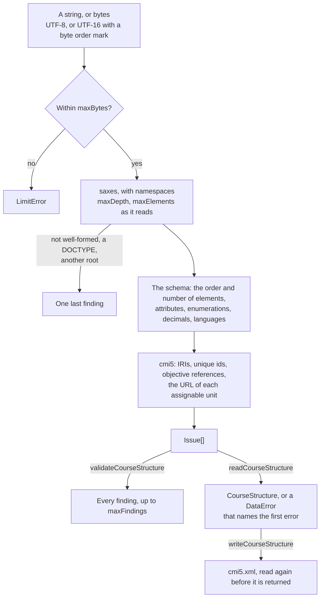

# The course structure

`readCourseStructure` reads `cmi5.xml`, the course structure of cmi5, into the model and throws a `DataError` on its first
error. `validateCourseStructure` judges a structure by the same rules and lists every finding as data. `writeCourseStructure`
writes the model as XML that the reader takes back. The rules are every constraint of `CourseStructure.xsd` and the rules of
cmi5 that the schema leaves out.



## Quick start

```ts
import { readCourseStructure, validateCourseStructure, writeCourseStructure } from "@interopkit/course-launch";

const xml = `<courseStructure xmlns="https://w3id.org/xapi/profiles/cmi5/v1/CourseStructure.xsd">
  <course id="https://example.org/courses/geology">
    <title><langstring lang="en-US">Introduction to Geology</langstring></title>
    <description><langstring lang="en-US">Plate tectonics and the history of the Earth.</langstring></description>
  </course>
  <au id="https://example.org/courses/geology/au/1" launchMethod="OwnWindow">
    <title><langstring lang="en-US">Plate tectonics</langstring></title>
    <description><langstring lang="en-US">How the plates move.</langstring></description>
    <url>index.html?lesson=1</url>
  </au>
</courseStructure>`;
validateCourseStructure(xml).map(({ path, rule }) => `${path} ${rule}`);
// => ["children[0].url url-relative"]
const structure = readCourseStructure(xml, { packaged: true });
structure.course.title;
// => [{ lang: "en-US", text: "Introduction to Geology" }]
const written = writeCourseStructure(structure);
readCourseStructure(written, { packaged: true }).children.length;
// => 1
```

A structure that is not in a ZIP package names every assignable unit by a fully qualified URL (14.2), so the relative URL of
the sample is a finding until `packaged` says the structure comes from a package. [The package guide](package.md) reads the
structure of a package and checks that each relative URL names one of its files.

## The model

| Type               | Holds                                                                                                                                                                                                                          |
| ------------------ | ------------------------------------------------------------------------------------------------------------------------------------------------------------------------------------------------------------------------------ |
| `CourseStructure`  | `course`, `objectives`, `children` (the assignable units and blocks in order), `extensions`                                                                                                                                    |
| `Course`           | `id`, `title`, `description`, `extensions`                                                                                                                                                                                     |
| `Objective`        | `id`, `title`, `description`                                                                                                                                                                                                   |
| `Block`            | `kind: "block"`, `id`, `title`, `description`, `objectives` (the ids it names), `children`, `extensions`                                                                                                                       |
| `AssignableUnit`   | `kind: "au"`, `id`, `title`, `description`, `objectives`, `url`, `launchMethod` (`AnyWindow`), `moveOn` (`NotApplicable`), and when present `masteryScore`, `activityType`, `launchParameters`, `entitlementKey`; `extensions` |
| `LangString`       | `text`, and `lang` when the `langstring` has one                                                                                                                                                                               |
| `ExtensionElement` | `namespace`, `name` (local) and `xml`: the element as written, with a declaration of each namespace it uses from around it                                                                                                     |

Every value is trimmed of the white space of XML that leads and trails it (13.1), except `moveOn` and `launchMethod`, which the
schema compares as written. Text keeps its inner line breaks and a no-break space.

## Rules

Each finding is an `Issue` of `@interopkit/core/checks`: the `path` in the model (`children[0].children[2].url`, `course.title[0].lang`), a `rule`, a
`message` that reads after the path, and a `severity`, `error` for every rule below.

| Rule                   | A structure breaks it when                                                                                                                                                                         | From                    |
| ---------------------- | -------------------------------------------------------------------------------------------------------------------------------------------------------------------------------------------------- | ----------------------- |
| `well-formed`          | It is not well-formed XML; the reading ends there                                                                                                                                                  | XML                     |
| `doctype`              | It has a DOCTYPE; the reading ends there, and no entity is declared or expanded                                                                                                                    | The reader              |
| `root`                 | Its root is not the `courseStructure` of `https://w3id.org/xapi/profiles/cmi5/v1/CourseStructure.xsd`; the reading ends there                                                                      | The schema              |
| `missing-element`      | An element lacks one it needs: a title, a description, a `langstring`, a course, a member, a url                                                                                                   | The schema              |
| `unexpected-element`   | An element is out of order, repeated, unknown to cmi5, of no namespace, or of another namespace where the schema allows none; or `launchParameters` or `entitlementKey` holds an element           | The schema; cmi5 13.1.4 |
| `unexpected-text`      | Text other than white space stands among elements, or anything at all in an objective reference                                                                                                    | The schema              |
| `unexpected-attribute` | An attribute of no namespace that the element does not have, one of the namespace of cmi5, or one of another namespace on an objective, a reference, `url`, `launchParameters` or `entitlementKey` | The schema; cmi5 13.1.4 |
| `missing-attribute`    | A course, block, objective or assignable unit has no `id`, or an objective reference no `idref`                                                                                                    | The schema; cmi5        |
| `enumeration`          | `moveOn` or `launchMethod` is not one of its values, as written                                                                                                                                    | The schema              |
| `mastery-score`        | `masteryScore` is not an `xs:decimal` from 0 to 1, or has more than 4 decimal places that are not trailing zeros                                                                                   | The schema; cmi5 13.1.4 |
| `language`             | `lang` is not an `xs:language`                                                                                                                                                                     | The schema              |
| `iri`                  | An `id`, `idref` or `activityType` is not a fully qualified IRI                                                                                                                                    | cmi5 3.0                |
| `duplicate-id`         | Two blocks, two objectives or two assignable units have one id                                                                                                                                     | cmi5 13.1.2 to 13.1.4   |
| `objective-reference`  | An `idref` names no objective of the structure                                                                                                                                                     | cmi5 13.1.2, 13.1.4     |
| `url-empty`            | The url of an assignable unit is empty                                                                                                                                                             | The schema              |
| `url-characters`       | The url holds a character that RFC 1738 does not allow: a space, `~`, a character beyond ASCII, or `%` without two hexadecimal digits                                                              | cmi5 13.1.4             |
| `url-scheme`           | A fully qualified url has a scheme that `launchSchemes` does not hold, or no `//` after it                                                                                                         | The reader              |
| `url-relative`         | A relative url outside a ZIP package, or one in a package that starts with `/` or leaves its root                                                                                                  | cmi5 14.1, 14.2         |
| `url-query`            | The query of the url names `endpoint`, `fetch`, `actor`, `registration` or `activityId`, in any case and however encoded                                                                           | cmi5 8.1                |
| `findings-stopped`     | The list of `validateCourseStructure` stopped at `maxFindings`                                                                                                                                     | The validator           |

An element or attribute of another namespace is an extension (13.1.5). The reader keeps the extensions of the structure, the
course, a block and an assignable unit as written, and checks and drops the others, which the model has no place for: those of a
title, a description, a list of objectives, and every attribute of another namespace. The writer parses the `xml` of each
extension as one element of its `namespace` and `name`, and refuses one that holds an element of no namespace without declaring
`xmlns=""`, which would be an element of cmi5 in the structure.

## Options

| Option          | Default             | Meaning                                                                                                                                         |
| --------------- | ------------------- | ----------------------------------------------------------------------------------------------------------------------------------------------- |
| `maxBytes`      | 16,777,216          | The most bytes of the structure, counted as UTF-8 for a string                                                                                  |
| `maxDepth`      | 64                  | The deepest the structure nests elements                                                                                                        |
| `maxElements`   | 1,000,000           | The most elements and attributes together, namespace declarations included                                                                      |
| `maxFindings`   | 1,000               | The most findings that `validateCourseStructure` lists; `readCourseStructure` counts errors alone                                               |
| `packaged`      | false               | Whether the structure is in a ZIP package, where the url of an assignable unit may be relative to its root                                      |
| `launchSchemes` | `["https", "http"]` | The schemes, in lower case, that a fully qualified url may have; `javascript`, `data`, `vbscript`, `file`, `blob` and `about` are never allowed |

`writeCourseStructure` takes `launchSchemes` alone (`CourseWriteOptions`), and reads what it writes with them: a host that reads
structures with a scheme of its own writes them, and imports them into its LMS, with the same schemes.

## Limits

The values of the options are in [Options](#options).

| Limit                     | Value                                | Refused with                                                                        |
| ------------------------- | ------------------------------------ | ----------------------------------------------------------------------------------- |
| Bytes                     | `maxBytes`                           | `LimitError` before the structure is parsed                                         |
| Depth                     | `maxDepth`                           | `LimitError` when the parser meets the element past it                              |
| Elements and attributes   | `maxElements`                        | `LimitError` when the parser meets the one past it, before it keeps it              |
| Encoding                  | UTF-8; UTF-16 with a byte order mark | `DataError` for bytes that are not valid, and for a declaration of another encoding |
| Findings                  | `maxFindings`                        | The list stops, and its last finding says so                                        |
| Levels of blocks to write | 64                                   | `DataError` before the model is read                                                |

The tests read the worst structures in a process whose heap is bounded, the text of the structure included, on Node.js 22, 24
and 26; each ends within:

| Worst structure                                                  | Heap   |
| ---------------------------------------------------------------- | ------ |
| Almost a million `langstring` elements, at the limit of elements | 74 MiB |
| 16 MiB of them, refused at that limit                            | 78 MiB |
| One `langstring` of 16 MiB                                       | 59 MiB |
| Blocks nested past the limit of depth                            | 27 MiB |
| A million wrong values, whose findings stop at 1,000             | 23 MiB |

With the default heap of V8, the resident memory grows further before V8 collects, by about 120 MiB for the million texts.

## Errors

| Error                                                                                                                                                                           | Thrown by                                     | What to do                                                                     |
| ------------------------------------------------------------------------------------------------------------------------------------------------------------------------------- | --------------------------------------------- | ------------------------------------------------------------------------------ |
| `DataError` "The course structure is invalid at …"                                                                                                                              | `readCourseStructure`, `writeCourseStructure` | Fix the first finding; `validateCourseStructure` lists every one               |
| `LimitError` "The course structure has more than … bytes", "nests more than …", "has more than … elements and attributes"; its `limit` names the option and `maximum` its value | Every reader                                  | Raise the option if the structure is trusted, or refuse it: a host answers 413 |
| `DataError` "The course structure is not valid UTF-8", "declares the encoding …"                                                                                                | Every reader                                  | Write the structure in UTF-8, or in UTF-16 with a byte order mark              |
| `DataError` "The course structure must be a string or a Uint8Array"                                                                                                             | Every reader                                  | Pass the text or the bytes of the file                                         |
| `DataError` "The options object is invalid at …"                                                                                                                                | Every reader                                  | Fix the option it names                                                        |
| `DataError` "The extension at … "                                                                                                                                               | `writeCourseStructure`                        | Give the `xml` of the extension as one element of its namespace and name       |
| `DataError` "The course structure nests blocks more than 64 deep"                                                                                                               | `writeCourseStructure`                        | Flatten the blocks                                                             |

## Not included

| Not included                                                                                           | Why                                                                                                                                               |
| ------------------------------------------------------------------------------------------------------ | ------------------------------------------------------------------------------------------------------------------------------------------------- |
| Validating an extension against its own schema (13.1.5)                                                | Nothing in a package says where the schema of an extension is; the schema of cmi5 processes extensions `lax`                                      |
| Keeping attributes of other namespaces, and extensions of titles, descriptions and lists of objectives | The model keeps the extensions of the structure, the course, blocks and assignable units, as 13.1.5 names them; an LMS may ignore every extension |
| An editor of course structures                                                                         | An application; the model and the writer are what an editor builds on                                                                             |

## Differences from the references

libxml2 and the player of CATAPULT validate with `CourseStructure.xsd`; the reader takes what they take and refuses more, each
time by a rule of cmi5 that the schema leaves out, and refuses a langstring or objective after an extension, which the sequence
of the schema forbids and libxml2 takes. [Spec gaps](spec-gaps.md) lists each difference with its reason, and the tests compare
the verdicts of the reader with libxml2 on every example and on generated structures with one change each.
