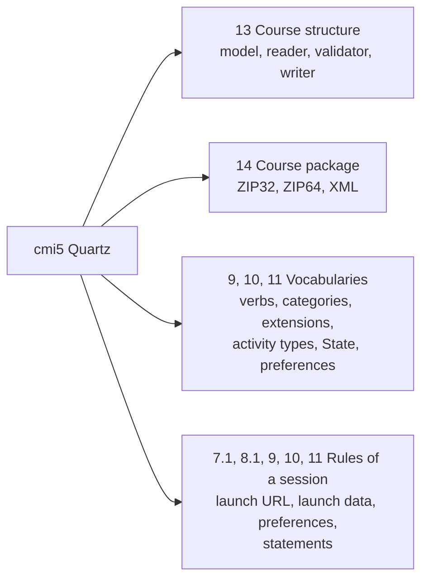

# What course-launch supports

The package follows cmi5 Quartz at commit `0ff5b30` of `AICC/CMI-5_Spec_Current`, its `CourseStructure.xsd`, and the list of
requirements of CATAPULT at `806c0ba`. `scripts/cmi5-requirements.ts` maps each of the 305 requirements of that list to how the
package meets it, and a test fails when one has no row.

| Section of cmi5                                | Supported                                                                                                                                                            |
| ---------------------------------------------- | -------------------------------------------------------------------------------------------------------------------------------------------------------------------- |
| 3.0 IRIs                                       | Every `id`, `idref` and `activityType` of a structure is a fully qualified IRI                                                                                       |
| 8.1 Launch parameters                          | The url of an assignable unit names none of the five parameters of the launch in its query                                                                           |
| 7.1 Types of statements                        | `classifyStatement`: defined, allowed, not allowed                                                                                                                   |
| 8.1 The launch URL                             | `readLaunchUrl`: the five parameters in any order                                                                                                                    |
| 9.1 to 9.7 Statements                          | `validateSessionStatements`: every rule of a statement of an assignable unit and of its session ([rules](rules.md))                                                  |
| 10.0 `LMS.LaunchData`                          | `readLaunchData`                                                                                                                                                     |
| 10.2.2 Launch modes                            | No completed, passed or failed in Browse and Review                                                                                                                  |
| 11.0 Learner preferences                       | `readLearnerPreferences`, `writeLearnerPreferences`; initialized after the preferences were read, when the facts say so                                              |
| 9.3, 9.6, 10.0, 11.0 Vocabularies              | `CMI5_VERBS`, `AU_VERBS`, `CMI5_CATEGORIES`, `CMI5_EXTENSIONS`, `CMI5_ACTIVITY_TYPES`, `LAUNCH_MODES`, `LAUNCH_DATA_STATE_ID`, `LEARNER_PREFERENCES_PROFILE_ID`      |
| 13.1 Course structure data model               | Every element and attribute of the course, the objectives, the blocks and the assignable units; values trimmed                                                       |
| 13.1.2 to 13.1.4 Ids                           | Unique among the blocks, the objectives and the assignable units, each kind apart; an `idref` names a declared objective                                             |
| 13.1.4 url                                     | The characters of RFC 1738; the schemes that the host allows                                                                                                         |
| 13.1.5 Extensions                              | Elements of other namespaces kept as written where the model holds them, and written again                                                                           |
| 13.2, 14.0 `CourseStructure.xsd`               | Every constraint of the schema, enforced by the reader                                                                                                               |
| 14.0 Formats                                   | ZIP of 32 and 64 bits and XML, told apart by their first bytes; any other refused                                                                                    |
| 14.1 ZIP packages                              | `cmi5.xml` at the root; a relative URL names a file of the package; a corrupt or ambiguous archive refused                                                           |
| 14.2 XML packages                              | Every url fully qualified                                                                                                                                            |
| 6.1 Creating and exporting structures (SHOULD) | `writeCourseStructure`, `writeCoursePackage`                                                                                                                         |
| 4.2, 6.0 The LMS is an LRS                     | `extendLrsOptions` over `handleLrsRequest` of `@interopkit/learning-records`, with an account of the host that reads every learner                                   |
| 6.1 Import                                     | `importCourse`: the ids of the LMS for the course, its blocks and units, the same in every registration                                                              |
| 8.1, 8.2 Launch and fetch URL                  | `prepareLaunch`, `handleFetchRequest`: a fetch code of one use, a token for the session, error codes 1 to 3                                                          |
| 9.3 The verbs of the LMS                       | launched, abandoned (`abandonSession` and on a new launch), waived (`waiveAu`), satisfied for blocks and the course                                                  |
| 9.6.1.1, 9.3.9 Satisfaction                    | By `moveOn` at registration and when the store holds a unit's statement; `deriveCourseProgress`                                                                      |
| 4.1, 8.1, 8.2 The unit's start                 | `startAuSession`: the five parameters, the fetch URL posted to once, the token as Basic, the endpoint as the base of xAPI                                            |
| 9.3, 9.5, 10.2, 11.0 The unit's session        | `AuSession`: the verbs of a unit with their results, durations and mastery score, the launch modes, the preferences read at start and saved, a 403 taken as no error |
| 10.0, 11.0 The documents of a launch           | `LMS.LaunchData` before each launch and read-only to units; the preferences read before initialized, written only when valid                                         |

## Not included

| Not included                                                      | Why                                                                                          |
| ----------------------------------------------------------------- | -------------------------------------------------------------------------------------------- |
| The schema of an extension (13.1.5)                               | A package does not say where it is; the schema of cmi5 processes extensions `lax`            |
| A relative URL for every packaged file (14.1, a SHOULD)           | Undecidable: an absolute URL may name anything, so no reader can tell whether it is packaged |
| Other environments of a launch (8.3)                              | The specification defines none                                                               |
| Windows, frames, redirects, hosting the files of a package (8.1)  | The host's page and server; `prepareLaunch` returns the window a unit asks for               |
| The redirect to `returnURL` and the audio at start (10.2.6, 11.2) | The page of the unit; `terminate` returns the address and the session gives the preference   |
| Voiding conflicting statements (6.3, a SHOULD)                    | Every statement that conflicts is refused on arrival, so none is stored                      |
| xAPI itself: Statements, the LRS and its client                   | `@interopkit/learning-records`                                                               |
