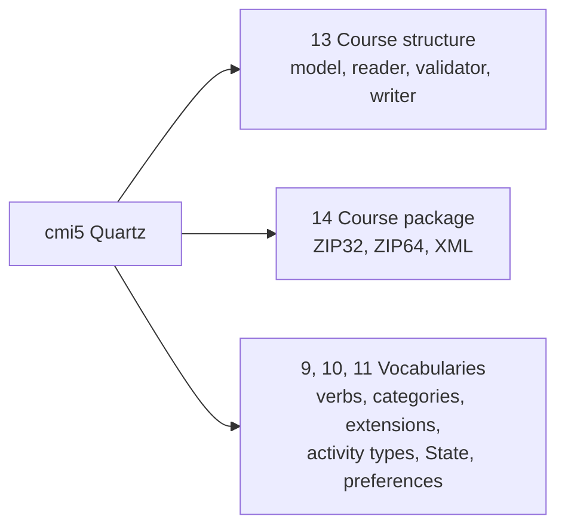

# What course-launch supports

The package follows cmi5 Quartz at commit `0ff5b30` of `AICC/CMI-5_Spec_Current`, its `CourseStructure.xsd`, and the list of
requirements of CATAPULT at `806c0ba`. `scripts/cmi5-requirements.ts` maps each of the 305 requirements of that list to how the
package meets it, and a test fails when one has no row.

| Section of cmi5                                  | Supported                                                                                                                  |
| ------------------------------------------------ | -------------------------------------------------------------------------------------------------------------------------- |
| 3.0 IRIs                                         | Every `id`, `idref` and `activityType` of a structure is a fully qualified IRI                                             |
| 8.1 Launch parameters                            | The url of an assignable unit names none of the five parameters of the launch in its query                                 |
| 9.3, 9.6, 10.0, 11.0 Vocabularies                | `CMI5_VERBS`, `CMI5_CATEGORIES`, `CMI5_EXTENSIONS`, `CMI5_ACTIVITY_TYPES`, `LAUNCH_MODES`, `LAUNCH_DATA_STATE_ID`, `LEARNER_PREFERENCES_PROFILE_ID` |
| 13.1 Course structure data model                 | Every element and attribute of the course, the objectives, the blocks and the assignable units; values trimmed             |
| 13.1.2 to 13.1.4 Ids                             | Unique among the blocks, the objectives and the assignable units, each kind apart; an `idref` names a declared objective   |
| 13.1.4 url                                       | The characters of RFC 1738; the schemes that the host allows                                                               |
| 13.1.5 Extensions                                | Elements of other namespaces kept as written where the model holds them, and written again                                 |
| 13.2, 14.0 `CourseStructure.xsd`                 | Every constraint of the schema, enforced by the reader                                                                     |
| 14.0 Formats                                     | ZIP of 32 and 64 bits and XML, told apart by their first bytes; any other refused                                         |
| 14.1 ZIP packages                                | `cmi5.xml` at the root; a relative URL names a file of the package; a corrupt or ambiguous archive refused                 |
| 14.2 XML packages                                | Every url fully qualified                                                                                                  |
| 6.1 Creating and exporting structures (SHOULD)   | `writeCourseStructure`, `writeCoursePackage`                                                                               |

## Not included

| What                                                                 | Why                                                                                          |
| -------------------------------------------------------------------- | -------------------------------------------------------------------------------------------- |
| The schema of an extension (13.1.5)                                  | A package does not say where it is; the schema of cmi5 processes extensions `lax`            |
| A relative URL for every packaged file (14.1, a SHOULD)              | Undecidable: an absolute URL may name anything, so no reader can tell whether it is packaged |
| Other environments of a launch (8.3)                                 | The specification defines none                                                               |
| xAPI itself: Statements, the LRS and its client                      | `@interopkit/learning-records`                                                               |
