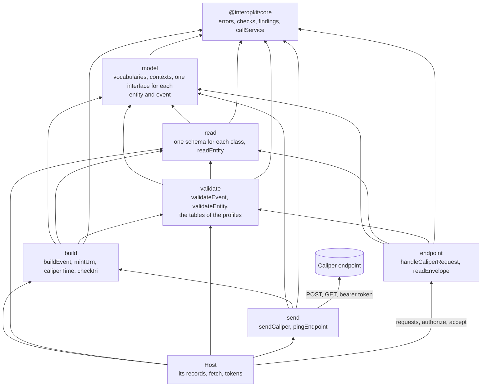

# Learning analytics architecture

`@interopkit/learning-analytics` implements [Caliper Analytics 1.2](https://www.imsglobal.org/spec/caliper/v1p2) and the
Library Use Profile. It holds the model of the events and entities, readers of data that arrives from elsewhere, builders that
give events identifiers which stay the same when an event is reported again, and a sensor that sends events to an endpoint, and the endpoint that receives them.



| Module  | Holds                                                                                                                                                  |
| ------- | ------------------------------------------------------------------------------------------------------------------------------------------------------ |
| `model` | The contexts, the vocabularies, and an interface for each entity of Caliper 1.2 and of the Library Use Profile ([model](./model.md))                    |
| `read`  | A schema for each class, and `readEntity`, which takes an entity describe from outside into the model                                                |
| `validate` | `validateEvent`, `validateEntity` and the tables of the profiles of section 3 and of the certification guide ([judging events](./validate.md))     |
| `build` | `buildEvent`, `mintUrn`, `caliperTime`, `checkIri` ([building events](./build.md))                                                                    |
| `send`  | `sendCaliper`, `pingEndpoint`, `CaliperSender`, `SendCaliperOptions`, `PingResult`, `DEFAULT_CALIPER_TIMEOUT_MS` ([sending events](./send.md))        |
| `endpoint` | `handleCaliperRequest`, `readEnvelope`, `ReceivedEnvelope`, `CaliperEndpointOptions`, from `@interopkit/learning-analytics/endpoint` ([receiving events](./endpoint.md)) |

`model` imports no other module, `read` builds on `model`, `validate` on both, `build` on all three, `send` on `model` and `build`, and `endpoint` on `model`, `read` and `validate`; `send` and `endpoint` never import each other. Biome keeps the rules. The exports come from `@interopkit/learning-analytics`, and those of the endpoint from `@interopkit/learning-analytics/endpoint`. The package depends on `@interopkit/core` for errors, checks, findings
and the call to the service, on `uuid` for name-based UUIDs and on `valibot` for the schemas.

## Quick start

```ts
import { buildEvent, caliperTime, mintUrn, readEntity } from "@interopkit/learning-analytics";

const event = buildEvent({
  id: mintUrn(["event", "session-1", 1]),
  type: "AssessmentEvent",
  profile: "AssessmentProfile",
  actor: { id: "urn:uuid:3f0c8a8e-7b8e-4b6a-9c1d-2a4f6e8b0c1d", type: "Person" },
  action: "Started",
  object: { id: "https://exam.example/tests/42", type: "Assessment" },
  eventTime: caliperTime(1_700_000_000_000, "The time of the event"),
  edApp: "https://exam.example",
});
event.id; // => "urn:uuid:017072c6-a4a4-5227-a083-38da34a6f364"
event.eventTime; // => "2023-11-14T22:13:20.000Z"

const person = readEntity(JSON.parse('{"@context":"http://purl.imsglobal.org/ctx/caliper/v1p2","id":"https://example.edu/users/554433","type":"Person"}'));
person.type; // => "Person"
```

## Data that flows

| Data                                 | From                                   | To                                                           |
| ------------------------------------ | -------------------------------------- | ------------------------------------------------------------ |
| The actor, the IRIs, times, scores   | The calls of the host to `buildEvent`  | The body of the request, to the endpoint                     |
| An entity describe                   | The caller of `readEntity`             | The model, as a copy; nothing is kept                        |
| The bearer token                     | `options.token`                        | The `Authorization` header of the endpoint, and nowhere else |
| The envelope that an endpoint gets   | The request, through the host          | `accept`, as a copy; the library keeps nothing               |
| The answer of the endpoint           | The endpoint                           | `ServiceError.body`, and nowhere else                        |

The library stores nothing, logs nothing and sends nothing but the request. The actor of an event is an IRI that the host
chooses: give an opaque identifier that the host keeps in its own records, such as `urn:uuid:` and a UUID, and never an email
address, a name or an identifier that another service knows. The identifiers of events are UUIDs of the parts that the host
gives, so do not put a secret in the parts. A `SystemIdentifier` can carry an email address or an LTI user id: send one only
when the endpoint is meant to hold it.

## Not in this package

| What                                                 | Reason                                                                                                                                 |
| ---------------------------------------------------- | -------------------------------------------------------------------------------------------------------------------------------------- |
| Which event of a product becomes which Caliper event | Only the adapter of a product knows its parties, steps and rules. The [example](../../examples/learning-analytics/README.md) shows one |
| Retries, queues, batching, backoff                   | Whether and when to resend depends on the host's queue. Stable identifiers make a resend safe                                          |
| A store of events, a Learning Record Store           | A host concern; the library keeps nothing                                                                                              |
| A server, a route, TLS                               | The endpoint takes an `HttpRequest` and two ports, `authorize` and `accept`; the host serves the URL                                   |
| JSON-LD processing: expansion, compaction, framing   | Caliper needs none: the terms are fixed strings, and the published context is the oracle of the tests                                  |
| Answers of a candidate in events                     | They are not analytics data; an event that needs a response builds it from the host's own record                                       |

What of Caliper this version does not yet build is in [supported](./supported.md).

## Differences from the references

| Reference                                                                    | Difference                                                                                                                                                                     |
| ---------------------------------------------------------------------------- | ------------------------------------------------------------------------------------------------------------------------------------------------------------------------------ |
| Section 4.2: an event `id` is a UUID URN                                     | The identifier from `mintUrn` is a version 5 UUID, so it is deterministic. `buildEvent` accepts any UUID URN, upper or lower case, as RFC 4122 does on input                   |
| Section 5.4: the bearer token is recommended                                 | It is optional: a sender with no token sends no `Authorization` header, and an endpoint decides what to do with a request that has none                                       |
| Section 5.2: the envelope has `sensor`, `sendTime`, `dataVersion` and `data` | Same, and no other property; `sensor` must be a non-empty string, and Caliper advises an IRI                                                                                   |
| The JSON-LD context at `purl.imsglobal.org/ctx/caliper/v1p2`                 | Every term that the model writes is defined by it, but those in [spec-gaps](./spec-gaps.md); `pnpm schemas` downloads it at a pinned hash                                      |
| `ims-caliper` 1.1.0 (MIT)                                                    | Writes the 1.1 context and is CommonJS; this package writes 1.2, is ESM and sends through any `fetch`                                                                          |
| `@timeback/caliper` 0.3.3                                                    | A client for one vendor's API, with no license; it posts to fixed paths and needs OAuth credentials. This package sends to any endpoint with a bearer token                    |
