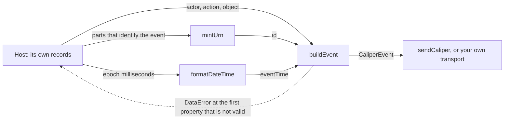

# Building events

`buildEvent` writes the `@context` of an event and checks every property of it, `mintUrn` gives it an identifier that stays the
same when the event is reported again, and `formatDateTime` of `@interopkit/core/checks` writes its times. The classes that an event refers to are those of
the [model](./model.md).



## Quick start

```ts
import { formatDateTime } from "@interopkit/core/checks";
import { buildEvent, mintUrn } from "@interopkit/learning-analytics";

const event = buildEvent({
  id: mintUrn(["event", "session-1", 1]),
  type: "AssessmentEvent",
  profile: "AssessmentProfile",
  actor: { id: "urn:uuid:3f0c8a8e-7b8e-4b6a-9c1d-2a4f6e8b0c1d", type: "Person" },
  action: "Started",
  object: { id: "https://exam.example/tests/42", type: "Assessment" },
  eventTime: formatDateTime(1_700_000_000_000),
  edApp: "https://exam.example",
});
event.id; // => "urn:uuid:017072c6-a4a4-5227-a083-38da34a6f364"
event.eventTime; // => "2023-11-14T22:13:20.000Z"
```

## Building an event

`buildEvent(input)` writes the `@context`, checks every property and returns a new event. The input is not changed, the result
shares no object with it, and its properties are always in the same order, so the same event always serializes to the same
bytes.

| Property           | Meaning                                                                                              | Default  |
| ------------------ | ---------------------------------------------------------------------------------------------------- | -------- |
| `id`               | A UUID URN, `urn:uuid:` and a UUID. Make it with `mintUrn`                                           | required |
| `type`             | The event type: one of `EVENT_TYPES`, which chooses the rest                                         | required |
| `actor`            | The entity that acted, as an object or an IRI                                                        | required |
| `action`           | What the actor did: one that the event type allows                                                   | required |
| `object`           | The entity that the actor acted on                                                                   | required |
| `eventTime`        | When it happened, as `formatDateTime` writes it                                                         | required |
| `profile`          | The profile that governs the event: one of `PROFILES`                                                | none     |
| `edApp`            | The application that the event happened in                                                           | none     |
| `generated`        | The entity that the action made, such as an attempt or a score                                       | none     |
| `target`, `referrer` | A segment of the object, and where the actor came from                                             | none     |
| `group`, `membership`, `session`, `federatedSession` | The organization, the roles of the actor in it, the session, and the session of the platform | none |
| `extensions`       | A JSON object of the sender's own attributes                                                         | none     |

The events that the Library Use Profile defines have their own properties: see the [model](./model.md).

`buildEvent(input, options)` takes the event without its `@context`, which it writes: the context of Caliper, or that of the
Library Use Profile for the events of that profile, after the contexts in `options.contexts`, each the address of a context or
the terms of one defined inline. An input that has an `@context` is refused. `buildEntity(input, options)` does the same for an
entity describe, so that a sensor can send an entity with its events.

```ts
import { buildEntity } from "@interopkit/learning-analytics";

const person = buildEntity(
  { id: "urn:uuid:3f0c8a8e-7b8e-4b6a-9c1d-2a4f6e8b0c1d", type: "Person" },
  { contexts: ["https://schema.org/docs/jsonldcontext.json"] },
);
person["@context"]; // => ["https://schema.org/docs/jsonldcontext.json","http://purl.imsglobal.org/ctx/caliper/v1p2"]
```

An event with a property that its class does not have is refused, so that nothing is dropped without notice. The entities of an
event are checked by the classes of the [model](./model.md): an object of a class that the property does not take is refused.

| Term kind    | Terms that this version builds                                                                         |
| ------------ | ------------------------------------------------------------------------------------------------------ |
| Event types  | Any of `EVENT_TYPES`: the 21 events of Appendix A, the 3 of the Library Use Profile, and the generic `Event` |
| Profiles     | Any of `PROFILES`: the 15 profiles of Caliper 1.2 and the Library Use Profile                          |
| Actions      | The actions that the event type allows, of `ACTIONS`                                                   |
| Entity types | Any of `ENTITY_TYPES`, as the [model](./model.md) describes them, each as an object or as its IRI     |

The profile is checked against the rows of its tables as well: `buildEvent` refuses a `GradeEvent` with the `AssessmentProfile`,
because that profile has no such event, and a `SessionEvent` that logs in an application as the actor. It refuses what
[`validateEvent`](./validate.md) finds an error in, and builds an event that has warnings only, such as one with no `profile`.

## Identifiers

`mintUrn(parts)` returns `urn:uuid:` and the name-based UUID of version 5 ([RFC 9562 section 5.5](https://www.rfc-editor.org/rfc/rfc9562#section-5.5))
of the JSON text of the parts. The same parts always give the same identifier, and parts that a plain join would confuse give
different ones.

```ts
import { mintUrn } from "@interopkit/learning-analytics";

mintUrn(["event", "attempt-1", "started"]); // => "urn:uuid:ce4d4096-7102-5f9f-8d5b-bb94689856e4"
mintUrn(["event", "attempt-1", "started"]) === mintUrn(["event", "attempt-1", "started"]); // => true
mintUrn(["event", "a", "1"]) === mintUrn(["event", "a1"]); // => false
```

| Rule      | Value                                                                                                                                                                                                                   |
| --------- | ----------------------------------------------------------------------------------------------------------------------------------------------------------------------------------------------------------------------- |
| Name      | The JSON text of the array, so `["event","a","1"]` and `["event","a1"]` are two names                                                                                                                                   |
| Namespace | `4bcd2e8b-df2f-56d9-b6c1-d17e5077c977`: the UUID of `https://github.com/assesskit/assesskit/tree/main/packages/player/src/caliper` in the URL namespace. It never changes, because changing it changes every identifier |
| Parts     | At least one string or finite number; a number that is not finite writes as `null`, so it is refused                                                                                                                    |
| Oracle    | `validation/caliper_ids.py` computes the UUIDs with Python's `uuid5`, and a test compares the library with them                                                                                                         |

Put into the parts everything that tells two events apart, such as the kind of event, the session or attempt, and the step,
and nothing that can change between two reports of the same event. The identifier is not an address that a server can
dereference (Caliper 1.2 section 4.2 says an IRI should be one).

## Times

`formatDateTime(at)` of `@interopkit/core/checks` writes epoch milliseconds as Caliper requires: `YYYY-MM-DDTHH:mm:ss.SSSZ`, in
UTC, with milliseconds. The same function writes the Timestamps of xAPI, so one host writes the times of both standards alike.

| Input                                                       | Result                                                                      |
| ----------------------------------------------------------- | --------------------------------------------------------------------------- |
| Whole milliseconds from `-62167219200000` to `253402300799999` | The time, from `0000-01-01T00:00:00.000Z` to `9999-12-31T23:59:59.999Z` |
| Anything else, a fraction of a millisecond, `NaN` and a string included | `DataError`                                                      |

`checkIri(value, label)` throws `DataError` unless the value is an absolute IRI, which Caliper requires of every entity
(section 4.2), in the form that the readers take as the `id` of an entity: a scheme, no white space, and a text that `URL`
parses. A host can use it on the parties it passes in, and `buildEvent` takes what it passes.

## Errors

| Error       | When                                                                                                                                                                           | What to do                                                             |
| ----------- | ------------------------------------------------------------------------------------------------------------------------------------------------------------------------------ | ---------------------------------------------------------------------- |
| `DataError` | The input is not an event: `The event is invalid at action: expected an action of Caliper, found "Graded".`, an entity of a class the property does not take, a relative IRI, a time not in the form, an input with an `@context` | Fix the input. Nothing was built                                       |
| `DataError` | The event breaks a rule of its profile: `The event is invalid at profile: expected a profile that has GradeEvent, found AssessmentProfile; GradeEvent is in GradingProfile.` The message counts the other errors | Fix the event, or call `validateEvent` to see every finding |
| `DataError` | The options are not an object with a list of contexts: `The options is invalid at contexts: ...`                                                                                | Give `contexts` as a list of addresses and objects                     |
| `DataError` | A part of an identifier is not a string or a finite number: `The parts of an identifier ...`; a time is not whole epoch milliseconds in range: `The time must be whole epoch milliseconds in the years 0000 to 9999, found 1.5.` | Fix the argument                                                       |

## Not included

| Not included                                          | Why                                                                                                    |
| ----------------------------------------------------- | ------------------------------------------------------------------------------------------------------ |
| Writing Caliper 1.1 and 1.0                           | 1.2 supersedes 1.1, and 1EdTech retired 1.0; 1.1 is read and never written                              |
| Which step of a product becomes which event           | The host's mapping: the function takes the actor, the action and the object that the host decides on    |
| The time of an event from a clock                     | The library reads no clock; the host passes `eventTime`, which `formatDateTime` writes                  |

[Supported](./supported.md) lists the rest of what is and is not built.

## Differences from the references

| Reference           | Difference                                                                                                                                                                                         |
| ------------------- | -------------------------------------------------------------------------------------------------------------------------------------------------------------------------------------------------- |
| Caliper 1.2         | `buildEvent` refuses what [`validateEvent`](./validate.md) finds an error in, and builds an event that has warnings only; where the specification is silent or contradicts itself, [spec-gaps](spec-gaps.md) gives the reading taken |
| `ims-caliper`       | Builds the classes of 1.1 and gives an event that has no id a random UUID; this package builds 1.2, reads 1.1, and `mintUrn` makes the id from the parts that identify the event, so that a resend keeps it |
| `@timeback/caliper` | Has shortcuts for the events of an item seen, answered and graded; `buildEvent` of an `AssessmentItemEvent` and a `GradeEvent` does the same, and which step of a product becomes which event is the adapter's |
