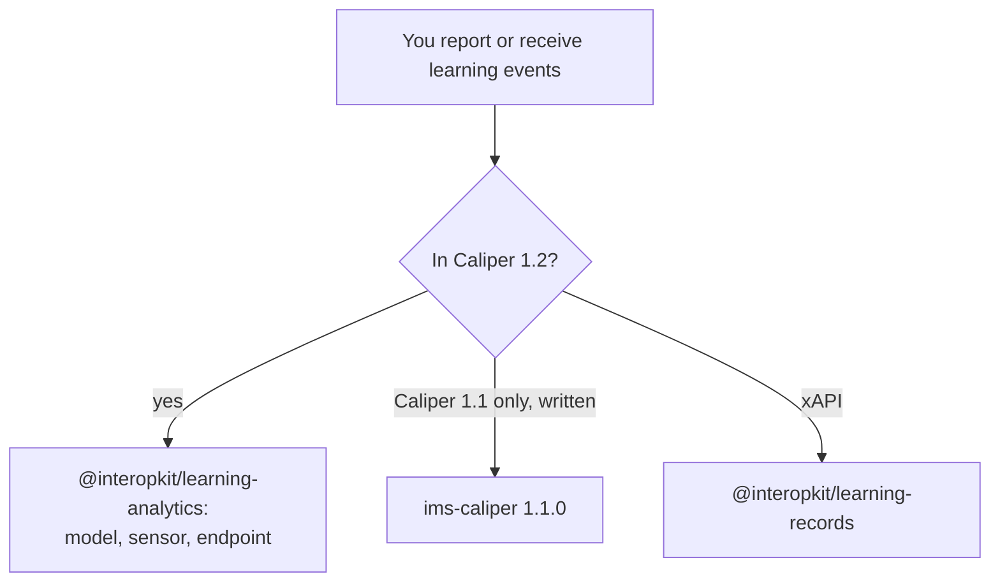

# Choosing learning-analytics

When `@interopkit/learning-analytics` fits a project that sends or receives Caliper events, and when another library fits
better. Each comparator was read at the version that [the comparators](comparators.md) give; that page maps all 36 of their
capabilities, of which the package has 18 and leaves 18 out with a reason.

| You need                                                                                                   | Use                                                                   |
| ---------------------------------------------------------------------------------------------------------- | --------------------------------------------------------------------- |
| Every event and entity of Caliper 1.2 and the Library Use Profile, built and judged against their profiles | This package                                                          |
| A sensor that sends envelopes, and an endpoint that receives and checks them                               | This package: `sendCaliper`, `/endpoint`                              |
| Reading what Caliper 1.1 senders write                                                                     | This package: `readEvent` reads 1.1                                   |
| Writing Caliper 1.1                                                                                        | `ims-caliper` 1.1.0, 2019-06-25: the package reads 1.1 and writes 1.2 |
| xAPI Statements instead of Caliper events                                                                  | [`@interopkit/learning-records`](../learning-records/choosing.md)     |

## What the others have that the package lacks

| Comparator, version                             | What it has                                                                                                     | Here                                                                                             |
| ----------------------------------------------- | --------------------------------------------------------------------------------------------------------------- | ------------------------------------------------------------------------------------------------ |
| `ims-caliper` 1.1.0, 2019-06-25                 | The send time from the clock, several endpoints per sensor, the context of 1.1 written, a logger                | Excluded: the host passes the time and calls once per endpoint; no side channels                 |
| `@timeback/caliper` 0.3.3, 2026-09-25           | One vendor's events, a stored-event API, job status, server addresses, rewritten envelopes, logs by environment | Excluded: one vendor's API and format                                                            |
| `1EdTech/CaliperBootcamp` `0a2d118`, 2025-06-04 | A token endpoint, a graph database with GraphQL and MCP queries, joins with Edu-API, a generator of events      | Excluded: an authorization server, a store and applications                                      |
| The certification guide of Caliper 1.2          | The certification of a sensor and the rows that it must send in all                                             | Excluded: certification needs membership, and the rows are a property of all that a sensor sends |

## Where the evidence is

[The evidence](evidence.md) gives the tables of the specification, the published contexts and the fixtures of `caliper-spec`;
[performance](performance.md) times the readers against the published JSON schemas of Caliper.
