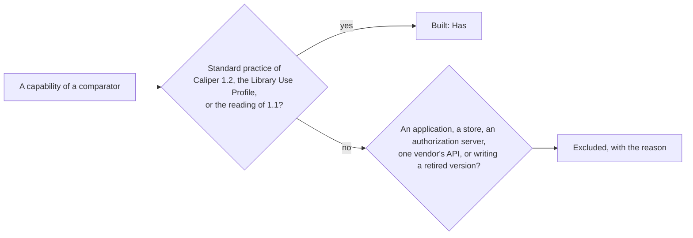

# Comparators

What the other implementations of Caliper and the certification guide of Caliper 1.2 do, and where
`@interopkit/learning-analytics` stands against each: **Has** the capability, **Partly**, **Excluded** with the reason, or
**Missing**. A capability that Caliper 1.2, its Library Use Profile or the reading of Caliper 1.1 treat as standard practice is
built; what belongs to an application, a store, an authorization server or one vendor's API is excluded. Read on 2026-11-03 from
the source of each comparator at the version in the table. No npm or PyPI package is a Caliper 1.2 sensor or endpoint, so the
comparators are the implementations that exist ([architecture](architecture.md)).



## Summary

| Comparator | Kind | Version, last change | License | Rows | Has | Partly | Excluded | Missing |
| --- | --- | --- | --- | ---: | ---: | ---: | ---: | ---: |
| `ims-caliper` | Library of Caliper 1.1, JavaScript | 1.1.0, 2019-06-25 | MIT | 10 | 6 | 0 | 4 | 0 |
| `@timeback/caliper` | Client of one vendor's API, TypeScript | 0.3.3, 2026-09-25 | None | 12 | 6 | 0 | 6 | 0 |
| `1EdTech/CaliperBootcamp` | Proof of concept: a library, a collector and a generator | `0a2d118`, 2025-06-04 | MIT | 10 | 5 | 0 | 5 | 0 |
| Certification guide of Caliper 1.2 | Requirements of a certified sensor | 1.2 Final | 1EdTech | 4 | 1 | 0 | 3 | 0 |
| **All** | | | | **36** | **18** | **0** | **18** | **0** |

The Caliper Analytics Connector is a specification for members and is not read; the certification service needs membership
([evidence](evidence.md)).

## Libraries and clients

| Comparator | Capability | Here | How, or why not |
| --- | --- | --- | --- |
| `ims-caliper` | The classes of the events and entities of Caliper 1.1 | Has | The model of 1.2, and 1.1 read into it with `version: "1.1"` ([Caliper 1.1](versions.md)) |
| `ims-caliper` | An event built with its required properties checked | Has | `buildEvent`, which checks every property and the rules of the profile ([building events](build.md)) |
| `ims-caliper` | An identifier for an event that has none, a random UUID | Has | `mintUrn` makes it from what identifies the event, so that a resend keeps it |
| `ims-caliper` | An envelope of events and entities, mixed | Has | `sendCaliper` ([sending events](send.md)) |
| `ims-caliper` | An `Authorization` header and a time limit for the request | Has | `token` and `timeoutMs` |
| `ims-caliper` | A build for browsers | Has | ESM on web standards alone: `pnpm test:browser` runs the path of a sensor in Chromium, Firefox and WebKit, and `pnpm compat` the example on workerd, Deno and Bun |
| `ims-caliper` | The time of sending from the clock | Excluded | The library reads no clock; the host passes `sendTime` |
| `ims-caliper` | Several endpoints registered with a sensor, sent to in turn | Excluded | The library keeps nothing between calls; a host calls `sendCaliper` once for each endpoint |
| `ims-caliper` | Writing the context of 1.1 | Excluded | 1.2 supersedes it; 1.1 is read and never written |
| `ims-caliper` | A logger | Excluded | No side channels: the result and the errors say what happened |
| `@timeback/caliper` | Events sent in an envelope that the client builds | Has | `sendCaliper` |
| `@timeback/caliper` | An envelope sent as the caller wrote it | Has | The four properties of section 5.2 are the options and the data of `sendCaliper`, and no other is sent |
| `@timeback/caliper` | Events judged against the specification without storing them | Has | `validateEvent` and `validateEntity` in the process, where it asks the vendor's server ([judging events](validate.md)) |
| `@timeback/caliper` | OAuth 2.0 client credentials with a cache of tokens | Has | `requestClientCredentialsToken` and `createTokenCache` of `@interopkit/core/oauth`, whose token goes in `token` |
| `@timeback/caliper` | Shortcuts for the events of an item seen, answered and graded | Has | `buildEvent` of an `AssessmentItemEvent` and a `GradeEvent`; which step of a product becomes which event is the adapter's |
| `@timeback/caliper` | A `fetch` of the caller and a time limit | Has | `fetch` and `timeoutMs` |
| `@timeback/caliper` | The events of the vendor's own profile | Excluded | Not a profile of Caliper; a sender's own data goes in the `extensions` of an event of Caliper |
| `@timeback/caliper` | Listing, streaming and fetching the events that a server stored | Excluded | Caliper defines no reading of what an endpoint keeps; the host's store answers it |
| `@timeback/caliper` | The status of a job in the vendor's queue | Excluded | One vendor's API; Caliper answers a sensor with the status of its request |
| `@timeback/caliper` | The addresses of the vendor's staging and production servers | Excluded | The host gives the address of its endpoint |
| `@timeback/caliper` | Envelopes rewritten for another vendor's platform | Excluded | One vendor's format |
| `@timeback/caliper` | Logs that an environment variable turns on | Excluded | No side channels, and no environment is read |

```ts
import { mintUrn } from "@interopkit/learning-analytics";

mintUrn(["event", "attempt-1", "started"]) === mintUrn(["event", "attempt-1", "started"]); // => true
```

## The proof of concept of 1EdTech

| Comparator | Capability | Here | How, or why not |
| --- | --- | --- | --- |
| `CaliperBootcamp` | Events and entities built with their required properties checked | Has | `buildEvent` and `buildEntity` |
| `CaliperBootcamp` | The `@context` of a nested entity left out when an event is written | Has | `buildEvent` writes one context at the top, and the readers take a nested one where Caliper lets a sender add it |
| `CaliperBootcamp` | An envelope sent with a bearer token | Has | `sendCaliper` |
| `CaliperBootcamp` | A collector that receives envelopes and checks a bearer token | Has | `handleCaliperRequest` with `authorize` ([receiving events](endpoint.md)) |
| `CaliperBootcamp` | Envelopes judged against the draft 4 schemas of 1.1 and 1.2 | Has | The readers of both versions, compared with `schema_1_1` and `schema_1_2`; each difference is in [spec-gaps](spec-gaps.md) |
| `CaliperBootcamp` | Writing the context of 1.1 | Excluded | As `ims-caliper` |
| `CaliperBootcamp` | A token endpoint that issues the tokens of sensors | Excluded | An authorization server; `authorize` takes the host's decision on a token |
| `CaliperBootcamp` | Events kept in a graph database, and queries over them by GraphQL and MCP | Excluded | A store and an application; the library keeps nothing |
| `CaliperBootcamp` | Events joined with the users and courses of a source of truth (Edu-API) | Excluded | An application |
| `CaliperBootcamp` | A generator of simulated events | Excluded | An application; the tests read the fixtures of `caliper-spec` |

## The certification guide

| Comparator | Capability | Here | How, or why not |
| --- | --- | --- | --- |
| Certification guide | The event conformance table of each profile: actions, actors, objects and generated entities | Has | `validateEvent` reads both tables; what only the guide allows is a warning |
| Certification guide | The rows that a sensor must send in all to be certified | Excluded | A property of everything that a sensor sends, which the certification service checks, and not of one event |
| Certification guide | The certification of a sensor | Excluded | It needs membership; the docs say "implements" |
| Certification guide | The certification of an endpoint | Excluded | The guide offers none |

## What no comparator has

The endpoint role of section 6 with its checks in a fixed order and its limits of bytes, levels, tokens and findings, the
configuration of section 6.2 and its ping, Caliper 1.1 read into the model of 1.2 at the endpoint, the 91 rows of the tables of
section 3 and those of the certification guide as findings, the Library Use Profile, identifiers that stay the same when an event
is reported again, the `maxPayloadBytes` of an endpoint kept before any request, an `AbortSignal` on every call, and a peak of
memory measured for each reader of untrusted input.
