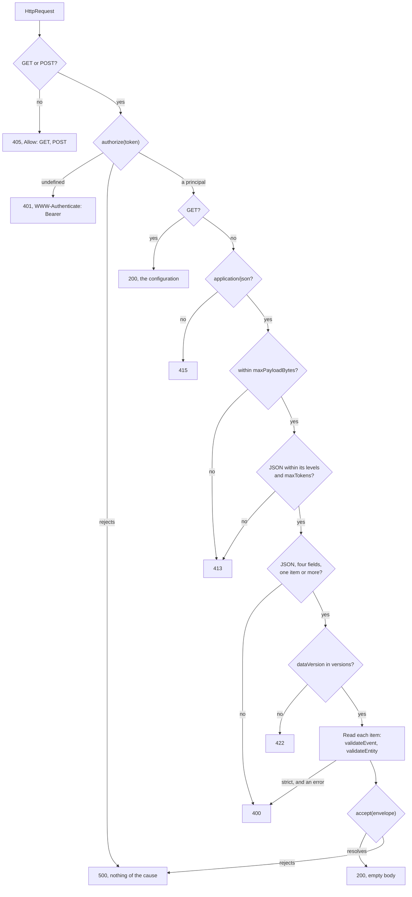

# Receiving events

`handleCaliperRequest` is a Caliper endpoint without a server. It takes the request that a host has received, authorizes it, reads
the envelope in it, judges the events and entities with their profiles, and hands the result to the host's `accept`. It answers a
GET with the configuration of the endpoint. The host keeps the events: the library keeps nothing.



## Quick start

```ts
import { handleCaliperRequest } from "@interopkit/learning-analytics/endpoint";

const received = [];
const options = {
  authorize: async (token) => (token === "secret-1" ? { principal: "exam-app" } : undefined),
  accept: async (envelope) => {
    received.push(envelope);
  },
};
const body = JSON.stringify({
  sensor: "https://exam.example/sensors/1",
  sendTime: "2023-11-14T22:13:20.000Z",
  dataVersion: "http://purl.imsglobal.org/ctx/caliper/v1p2",
  data: [
    {
      "@context": "http://purl.imsglobal.org/ctx/caliper/v1p2",
      id: "https://exam.example/users/554433",
      type: "Person",
    },
  ],
});
const request = {
  method: "POST",
  url: "https://lrs.example/caliper",
  headers: { "content-type": "application/json", authorization: "Bearer secret-1" },
  body: new TextEncoder().encode(body),
};
const response = await handleCaliperRequest(request, options);
response.status; // => 200
received[0].principal; // => "exam-app"
```

`handleCaliperRequest(request, options)` takes an `HttpRequest` of `@interopkit/core/http` and returns an `HttpResponse`. The host
mounts it at the one URL of its endpoint: the handler looks at no path. The host reads the request body into bytes, within a limit
of its own, before it calls the handler.

## The order of the checks

A request runs these checks in this order, and the first that fails answers. A request that fails an early check costs nothing
of the later ones: one that is not authorized is never parsed.

| Step | Check                                                                                                                   | Answer                                    |
| ---- | ----------------------------------------------------------------------------------------------------------------------- | ----------------------------------------- |
| 1    | The request is an `HttpRequest`, and the options are what they must be                                                  | `DataError`: a mistake of the host        |
| 2    | The method is `GET` or `POST`                                                                                           | 405 with `Allow: GET, POST`               |
| 3    | `authorize` names a principal for the token                                                                             | 401 with `WWW-Authenticate: Bearer`       |
| 4    | (POST) The media type is `application/json`; parameters and case are ignored                                            | 415                                       |
| 5    | (POST) The body has at most `maxPayloadBytes`                                                                           | 413                                       |
| 6    | (POST) The body is UTF-8 JSON within the depth and `maxTokens`, and an envelope of four properties and one item or more | 413 over a limit, 400 otherwise           |
| 7    | (POST) `dataVersion` is the context of a version in `versions`: 1.2 and 1.1 by default                                  | 422                                       |
| 8    | (POST) With `strict`, no item has an error                                                                              | 400                                       |
| 9    | (POST) `accept` resolves                                                                                                | 200 with an empty body; 500 if it rejects |

A GET stops after step 3 and answers 200 with the configuration of section 6.2.

Every failure but 500 is a problem detail ([RFC 9457](https://www.rfc-editor.org/rfc/rfc9457)): `application/problem+json` with `type`,
`title`, `status` and a `detail` of at most 500 characters. A 500 has no `detail`: nothing of the cause leaves the host.

## The bearer token

`authorize(token, options)` is asked for every request that passes the method check, with the credential of the `Authorization:
Bearer` header, or `undefined` when the request has no header, has another scheme, or has a credential that is not a b64token
(RFC 6750). It returns `{ principal }`, a name of the host's choosing, or `undefined` to refuse. An endpoint that takes data from
anyone returns a principal for `undefined`: section 5.4 only recommends a token.

The principal goes into `ReceivedEnvelope.principal`. The `sensor` of the envelope is what the sender says of itself, so it is
kept apart and never takes the place of the principal.

## What accept receives

```ts
import { readEnvelope } from "@interopkit/learning-analytics/endpoint";

const envelope = readEnvelope({
  sensor: "https://exam.example/sensors/1",
  sendTime: "2023-11-14T22:13:20.000Z",
  dataVersion: "http://purl.imsglobal.org/ctx/caliper/v1p2",
  data: [
    {
      "@context": "http://purl.imsglobal.org/ctx/caliper/v1p2",
      id: "https://exam.example/users/554433",
      type: "Person",
    },
  ],
});
envelope.data.length; // => 1
envelope.findings; // => []
```

| Property      | Holds                                                                                                                                                                                                                                                                                                      |
| ------------- | ---------------------------------------------------------------------------------------------------------------------------------------------------------------------------------------------------------------------------------------------------------------------------------------------------------- |
| `principal`   | Who sent it, as `authorize` named them                                                                                                                                                                                                                                                                     |
| `sensor`      | The identifier that the sender gave its sensor                                                                                                                                                                                                                                                             |
| `sendTime`    | When the sensor issued the message, as Caliper writes a time                                                                                                                                                                                                                                               |
| `dataVersion` | The context of the Caliper version of the data: `CALIPER_CONTEXT` or `CALIPER_1_1_CONTEXT`                                                                                                                                                                                                                 |
| `data`        | The events and entity describes that read, as the [model](./model.md) has them, copies that share nothing with the request. One that did not read is left out                                                                                                                                              |
| `findings`    | What `validateEvent` and `validateEntity` found in each item, with `data[index]` before each path: the errors of the items left out, and the warnings and errors of the profile rules of those that read. At most `maxFindings`, and a last finding with the rule `findings-stopped` when the list stopped |

`readEnvelope(value, options)` does steps 6 to 8 for a value that is already parsed, and throws a `DataError` where the
handler answers 400 or 422. It returns the envelope without `principal`, which only the handler knows from `authorize`. Its options are
`versions`, `maxFindings` and `strict`.

An item is an event when its `type` is that of an event, and an entity describe otherwise. It is read as `readEvent` and
`readEntity` read it in the version of the envelope, and judged as [`validateEvent`](./validate.md) does. An envelope of 1.1
hands over the same types as an envelope of 1.2, and the tables of the profiles of 1.2 judge none of its events
([Caliper 1.1](./versions.md)). Without `strict` an envelope with a faulty item is
received: the host decides from `findings` what to do with the rest. With `strict` it is refused with 400, and `accept` is not
called.

## The configuration

A GET answers what `pingEndpoint` reads: `caliperMaximumPayloadSize` in kilobytes (`maxPayloadBytes` divided by 1,024, rounded
down), `caliperSupportedVersions` (the contexts of `versions`, in that order) and, when the host gives `extensions`,
`caliperSupportedExtensions`.

## Options

| Option            | Meaning                                                                                                                                     | Default          |
| ----------------- | ------------------------------------------------------------------------------------------------------------------------------------------- | ---------------- |
| `authorize`       | Names the principal behind a token, or refuses it                                                                                           | required         |
| `accept`          | Receives an envelope that read                                                                                                              | required         |
| `versions`        | The versions of Caliper that the endpoint reads, `"1.2"` and `"1.1"`, in the order it announces them                                        | `["1.2", "1.1"]` |
| `maxPayloadBytes` | The most bytes of the body, and what the configuration announces: at least 1,024, a kilobyte, since a smaller limit would be announced as 0 | 1,048,576        |
| `maxTokens`       | The most tokens of JSON in the body, counted before it is parsed                                                                            | 1,000,000        |
| `maxFindings`     | The most findings of an envelope                                                                                                            | 1,000            |
| `strict`          | Refuse with 400 an envelope that has an item with an error                                                                                  | `false`          |
| `extensions`      | A JSON object for `caliperSupportedExtensions`                                                                                              | none             |
| `signal`          | An `AbortSignal` that ends the wait for `authorize` and `accept`                                                                            | none             |

## Limits

Besides `maxPayloadBytes`, `maxTokens` and `maxFindings`, JSON nests at most 64 levels (413), and a `detail` is cut at 500
characters. The limits bound parsing, not reading: the host caps the read of the request before it builds the `HttpRequest`.

## Failure paths

| Port        | Fails                                 | Hangs                                                       | Called again                                                                               | May call back               |
| ----------- | ------------------------------------- | ----------------------------------------------------------- | ------------------------------------------------------------------------------------------ | --------------------------- |
| `authorize` | 500, nothing of the cause             | `signal` ends the wait: the handler rejects with its reason | For every request, before any parsing                                                      | Read-only calls of the host |
| `accept`    | 500; what the host kept is the host's | `signal` ends the wait                                      | A sensor that sends again carries the same event ids, and Caliper defines no deduplication | Nothing                     |

A port that breaks its contract is a mistake of the host, not of the sender: `authorize` that answers something other than
`undefined` or an object with a non-empty `principal` makes the handler throw a `DataError`.

## Errors

| Error               | When                                                                                                                    | What to do                               |
| ------------------- | ----------------------------------------------------------------------------------------------------------------------- | ---------------------------------------- |
| `DataError`         | The request or the options have the wrong type, or `authorize` breaks its contract                                      | Fix the host. The sender is not at fault |
| `DataError`         | `readEnvelope` finds the value is no envelope, of a version that `versions` leaves out, or with an error under `strict` | Answer the sender, or fix what it sent   |
| The `signal` reason | The signal aborted while a port waited                                                                                  | Nothing: nobody is left to answer        |

## Data that flows

| Data                  | From                         | To                                                                   |
| --------------------- | ---------------------------- | -------------------------------------------------------------------- |
| The envelope          | The sender, through the host | `accept`, as a copy; the library keeps nothing                       |
| The bearer token      | The `Authorization` header   | `authorize`, and nowhere else: not in an answer, not in a message    |
| The `detail` of a 400 | The first fault              | The sender; it can quote what the sender wrote, up to 500 characters |

Events may carry personal data. The endpoint never dereferences an IRI or a context, so what an event names costs the host no
request.

## Not included

| Not included                                             | Why                                                                                         |
| -------------------------------------------------------- | ------------------------------------------------------------------------------------------- |
| Writing Caliper 1.1                                      | The endpoint reads 1.1 and a sensor sends 1.2 only; see [Caliper 1.1](./versions.md)        |
| A server, a route, TLS, a store of events, deduplication | The host's: the handler takes a request and two ports, and Caliper defines no deduplication |
| Certification of an endpoint                             | The certification guide does not offer it                                                   |
| A property that the JSON of the envelope gives twice     | `JSON.parse` keeps the last, and section 5.2 says each property is referenced once          |

## Differences from the references

The success status, the names of the configuration and the kilobyte of `caliperMaximumPayloadSize` are readings of the
specification that [spec gaps](./spec-gaps.md#transport) records.

| Reference                                          | Difference                                                |
| -------------------------------------------------- | --------------------------------------------------------- |
| Section 6.1: a body that is not `application/json` | 415 for every other media type, `application/ld+json` too |
