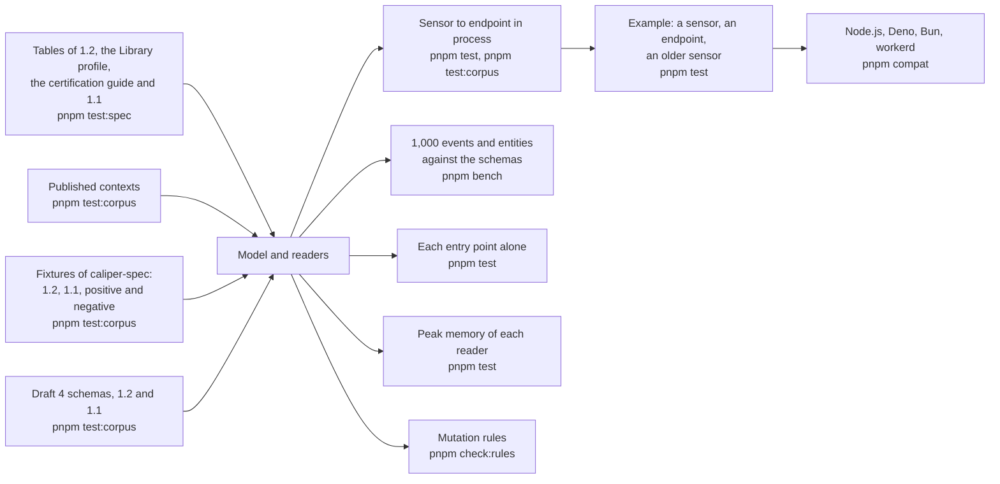

# Evidence for learning-analytics

What shows that the package does what it says: the tables of the specifications, the published contexts, schemas and fixtures of
`caliper-spec`, the rules of the profiles, a sensor and an endpoint that run against each other, the speed of every hot path, the
size of each entry point, the peak memory of every reader, and four runtimes. Each layer answers a question that the one before cannot. Caliper has no public
conformance suite for an endpoint and no open sensor or endpoint of 1.2 to run against, so the oracles are the 1EdTech documents.



| Layer         | Question                                                                                           | Where                                                                                                                  | Runs                  |
| ------------- | -------------------------------------------------------------------------------------------------- | ---------------------------------------------------------------------------------------------------------------------- | --------------------- |
| Tables        | Does the model have each class, property, action and vocabulary that the pages print?               | `entities.spec`, `events.spec`, `profiles.spec`, `versions.spec` tests                                                 | `pnpm test:spec`      |
| Examples      | Do the readers read every example that the pages print?                                             | The same files, through `readSpecPage`                                                                                 | `pnpm test:spec`      |
| Contexts      | Does a published context define every term that the model reads or writes?                          | `context.corpus`, `versions.corpus` tests                                                                              | `pnpm test:corpus`    |
| Fixtures      | Do the readers read the fixtures of `caliper-spec` and refuse the malformed ones?                    | `events.corpus`, `entities.corpus`, `profiles.corpus`, `endpoint.corpus`, `versions.corpus` tests                      | `pnpm test:corpus`    |
| Schemas       | Do the readers give the verdict of the draft 4 schemas on generated values and on values changed in one place? | `events.corpus`, `entities.corpus`, `versions.corpus` tests                                                  | `pnpm test:corpus`    |
| Profiles      | Does `validateEvent` agree with every row of the tables of section 3 and of the certification guide? | `profiles.spec`, `profiles.corpus`, `validate` tests, `scripts/caliper-rules.ts`                                      | `pnpm test:spec`      |
| Endpoint      | Does it answer each status in the order of its checks, and cost an unauthorized caller no parsing?   | `endpoint.test.ts`                                                                                                     | `pnpm test`           |
| Round trip    | Does what a sensor sends reach `accept` equal, in 1.2 and in 1.1?                                    | `endpoint.test.ts`, `roundtrip.corpus.test.ts`, `versions.corpus.test.ts`, `examples/learning-analytics/test`          | `pnpm test`, `pnpm test:corpus` |
| Memory        | Does each reader of untrusted input stay under its budget on its worst input?                        | `read-event-memory`, `read-entity-memory`, `validate-memory`, `read-envelope-memory`, `endpoint-memory`, and the two of 1.1 | `pnpm test`     |
| Rules         | Does a test fail when a rule that keeps the endpoint safe is removed from the code?                  | `scripts/check-rules.ts`                                                                                               | `pnpm check:rules`    |
| Speed         | How long do reading, judging, building, sending and receiving take, against the schemas and the JSON? | `read.bench.ts`, `build.bench.ts`, `endpoint.bench.ts` in `packages/learning-analytics/test/`                        | `pnpm bench`          |
| Size          | Does each entry point hold only what it uses, within its budget?                                    | `packages/learning-analytics/test/size.test.ts`                                                                        | `pnpm test`           |
| Runtimes      | Does the example give the same results everywhere?                                                   | `compat/`                                                                                                              | `pnpm compat`         |

The model that the tables, the contexts and the fixtures are compared with has these counts, and a test fails when a table prints a
class, an action or a role that it lacks:

```ts
import { ACTIONS, CALIPER_VERSIONS, ENTITY_TYPES, EVENT_TYPES, ROLES } from "@interopkit/learning-analytics";

[EVENT_TYPES.length, ENTITY_TYPES.length, ACTIONS.length, ROLES.length]; // => [25, 76, 82, 57]
CALIPER_VERSIONS; // => ["1.2", "1.1"]
```

`pnpm test:spec` needs `pnpm spec-examples`, `pnpm caliper-tables`, `pnpm schemas` and `pnpm corpus` first; `pnpm test:corpus` needs
the last three; `pnpm bench` needs `pnpm corpus`.

## The sources

| Source                                                                                  | What it is                                                                                                   | Pinned by                                                          |
| --------------------------------------------------------------------------------------- | ------------------------------------------------------------------------------------------------------------ | ------------------------------------------------------------------ |
| The pages of Caliper 1.2, the Library Use Profile and the certification guide           | Tables of events, entities, actions, vocabularies and the rows of the profiles                              | `scripts/caliper-tables.lock.json`: the hash of the tables, not of the bytes |
| The page of Caliper 1.1                                                                 | The same, in its own layout, with the classes and properties that it deprecates                              | The same lock, with `layout: "v1p1"`                               |
| `1EdTech/caliper-spec` at `60f7cb7`                                                     | Fixtures of 1.2 (144 positive, 279 negative) and of 1.1 (129), the draft 4 schemas of both (110 and 77), the contexts of 1.2 and of 1.1 with its six extension profiles | `scripts/corpus.lock.json`: the hash of the archive |
| The published context of Caliper 1.2                                                    | The terms and their types                                                                                    | `scripts/schemas.lock.json`                                        |

The license of the repository does not allow redistribution, so `pnpm corpus` fetches it and nothing of it is committed.

## The fixtures

| Set                                 | What the readers do                                                                                                                                  |
| ----------------------------------- | ---------------------------------------------------------------------------------------------------------------------------------------------------- |
| Positive fixtures of 1.2            | Every event, entity and envelope reads and comes back as the fixture has it                                                                          |
| Negative fixtures of 1.2            | All 86 malformed events are refused, and 187 of the 191 malformed entities; the four others differ from a valid one only in the form of a number     |
| Fixtures of 1.1                     | 138 of the 139 documents of the 129 files read as 1.1 and come back as the fixture has them. The one that fails names a `profile`, which 1.1 does not define, and a class of the sender's own context |
| Envelopes of 1.1                    | Every envelope is received with every item, with no finding, strict or not, and is answered 422 by an endpoint that reads 1.2 alone                   |
| Envelopes of 1.2 through a sensor   | `sendCaliper` posts each envelope from its read items, and `accept` receives the sensor, the time and every item equal to the fixture                |

The places where a source disagrees with another are in [spec-gaps](./spec-gaps.md), each pinned by a test.

## The schemas

`schema_1_2` and `schema_1_1` are draft 4 files that refer to one another by `id`; `scripts/schema-oracle.ts` reads a directory of them
into one validator, and `scripts/schema-arbitrary.ts` generates documents from them, narrowed by the tables where the schemas are
looser. For each class, 60 generated documents with a fixed seed must read, and the same documents with one change (a member
removed, retyped or replaced) must be refused whenever the schema refuses them. The schemas allow what the tables close, so the
readers are stricter, never looser: the one exception is the `@context` of a nested entity in 1.1, which the schema allows as a string or
a list and section 4.1 as an object too.

## The example

`examples/learning-analytics` is a sensor and an endpoint of a host. The sensor reports an attempt as Caliper 1.2 events and sends
them again after a failure that a resend can cure; the endpoint is `handleCaliperRequest` over a table of tokens and a store in
memory, and a `fetch` for a sender in the same process; an older sensor posts an envelope of Caliper 1.1 by hand. The tests and the
scenario show:

| What the scenario shows                                                                                              | Where                          |
| -------------------------------------------------------------------------------------------------------------------- | ------------------------------ |
| A 503 before the endpoint, then a send that is received, with the same identifiers and a later time                  | `scenario.test.ts`             |
| The attempt reported again arrives, and the endpoint holds each event once by its `id`                               | `endpoint.test.ts`             |
| The endpoint names the sender by its token, and never by the `sensor` of the envelope                                | `endpoint.test.ts`             |
| An envelope of 1.1 with a describe and an event is received into the same shape as one of 1.2                        | `endpoint.test.ts`             |
| An unknown token is 401, and an endpoint that reads 1.2 alone answers 422 to the envelope of 1.1                     | `endpoint.test.ts`             |
| An item that does not read is left out, and its findings carry the path inside the envelope                          | `endpoint.test.ts`             |

## Speed

`pnpm bench` times the build that ships on 1,000 events and on 1,000 entity describes of the fixtures of `caliper-spec` that the
draft 4 schemas take (an envelope of 1.2 has 1,469,236 bytes), against those schemas and `JSON.parse` in the same run. The table
gives the fastest samples of three runs on a laptop at a load of 10 to 28; each budget is a ratio between two samples of one run,
so it holds on any machine.

| Benchmark                                   | Time         | Reference                                 | Ratio          | Budget |
| ------------------------------------------- | -----------: | ----------------------------------------- | -------------: | -----: |
| `readEnvelope` of 1.2                       | 11.3–12.4 ms | the draft 4 schemas, 318–460 ms           | 0.025–0.039    | 1      |
| `readEnvelope` of 1.2                       |              | `JSON.parse` of the text, 2.0–2.3 ms      | 5.4–5.7        | 30     |
| `validateEvent` over the events             | 10.8–13.1 ms | the draft 4 schemas                       | 0.024–0.041    | 1      |
| `readEntity` over 1,000 entities of 71 classes | 3.5–4.3 ms | the draft 4 schemas, 76–118 ms           | 0.030–0.050    | 1      |
| `validateEntity` over the same              | 4.0–5.0 ms   | the draft 4 schemas                       | 0.034–0.059    | 1      |
| `readEnvelope` of 1.1                       | 10.6–12.0 ms | `schema_1_1`, 4.9–6.9 s                   | 0.002          | 1      |
| `readEnvelope` of 1.1                       |              | `JSON.parse` of the text                  | 5.3–5.9        | 30     |
| `buildEvent` of 1,000 events                | 10.7–11.8 ms | the draft 4 schemas over what it builds   | 0.024–0.032    | 1      |
| `buildEntity` of 1,000 entities             | 4.1–4.3 ms   | the same                                  | 0.026–0.047    | 1      |
| `sendCaliper` of the envelope               | 0.67 ms      | `JSON.stringify` of the envelope          | 1.08–1.23      | 7      |
| `handleCaliperRequest` of the envelope      | 14.3–18.7 ms | `JSON.parse` of the text, 2.1 ms          | 6.9–8.8        | 50     |
| `handleCaliperRequest` of the envelope      |              | the draft 4 schemas                       | 0.033–0.053    | 1      |

A ratio to a schema is parity or better, as the design asks; a ratio to the JSON is five times the highest measured, rounded up to
one significant digit. The schemas of 1.1 try the `oneOf` of every class at each level, so one `Message` event takes about 90 ms.
The reader of a time reads the fields of `YYYY-MM-DDTHH:mm:ss.SSSZ` by their places and the days of the month, and the endpoint
reads the items that `JSON.parse` made of the body without copying them again: against the build before, alternated in one
process, `readEnvelope` takes 0.71 to 0.78 of its time, `handleCaliperRequest` 0.65 to 0.70, `buildEvent` 0.70 to 0.95,
`readEntity` 0.82 to 0.92, and every fixture of `caliper-spec`, in both versions, reads to the same value and the same findings.
What remains is the schemas of valibot, the copy of a host's value, and the counts of the text in `@interopkit/core`.

## Size

`size.test.ts` bundles each entry point alone with `scripts/entry-size.ts`: esbuild, minified, with every dependency inside. It
fails above the budget after gzip, or when an entry point holds a module that its budget does not list.

| Entry point                               | Bytes  | Gzip   | Budget | Holds, besides `@interopkit/core` and valibot              |
| ----------------------------------------- | -----: | -----: | -----: | ---------------------------------------------------------- |
| `@interopkit/learning-analytics`          | 69,388 | 20,415 | 26,000 | `build`, `model`, `read`, `send`, `v1p1`, `validate`, uuid |
| `@interopkit/learning-analytics/endpoint` | 64,996 | 18,248 | 23,000 | `model`, `read`, `v1p1`, `validate`; no sensor and no builder |

## Memory

Each reader of untrusted input has a test of its peak memory, in a file of its own because the peak of a process only grows; the
test reports the rise. The budget is 256 MiB above the peak before the reading, which a reading that kept an issue for each wrong
value would pass by far.

| Reader                                     | Worst input                                                | Peak rose by |
| ------------------------------------------ | ---------------------------------------------------------- | -----------: |
| `readEvent`, `readEntity`, `validateEvent` | An object that holds a list of a million wrong values      | 18–27 MiB    |
| The same, as Caliper 1.1                   | The same list                                              | 21–27 MiB    |
| `readEnvelope`                             | An envelope whose event holds the same list                | 22–25 MiB    |
| `handleCaliperRequest`                     | An envelope of 1 MiB of events, of 1.2 and of 1.1          | 1 and 17 MiB |

The rises are those of Node.js 22 and 24. The copy of a host's value is most of what the million values cost: `copyJson` of
`@interopkit/core` copies the list and names the place of a value only when it is not JSON. The endpoint reads what it parsed
without that copy.

## Runtimes

`pnpm compat` bundles the scenario with the packages as they ship and runs it on Node.js, Deno, Bun and workerd. The example uses web
standards alone, and its results are the same on each: the sends and their identifiers, what the endpoint holds and read of each
envelope, the versions it announces and its two refusals.

## What is not shown

| What                                       | Why                                                                                                                              |
| ------------------------------------------ | -------------------------------------------------------------------------------------------------------------------------------- |
| Certification of a sensor                  | 1EdTech certifies sensors per profile for members. The tables of the guide are read, and the docs say "implements"              |
| An open Caliper 1.2 endpoint or sensor     | None exists. The collector in `CaliperBootcamp` validates with the same schemas and needs Neo4j, so it would add no evidence      |
| A budget in time                           | The runners of CI have not sampled the benchmarks yet; the ratios hold on any machine                                            |
