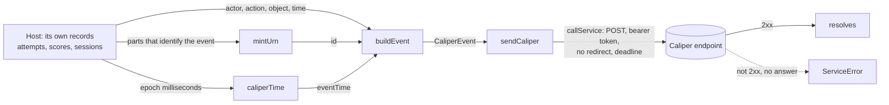
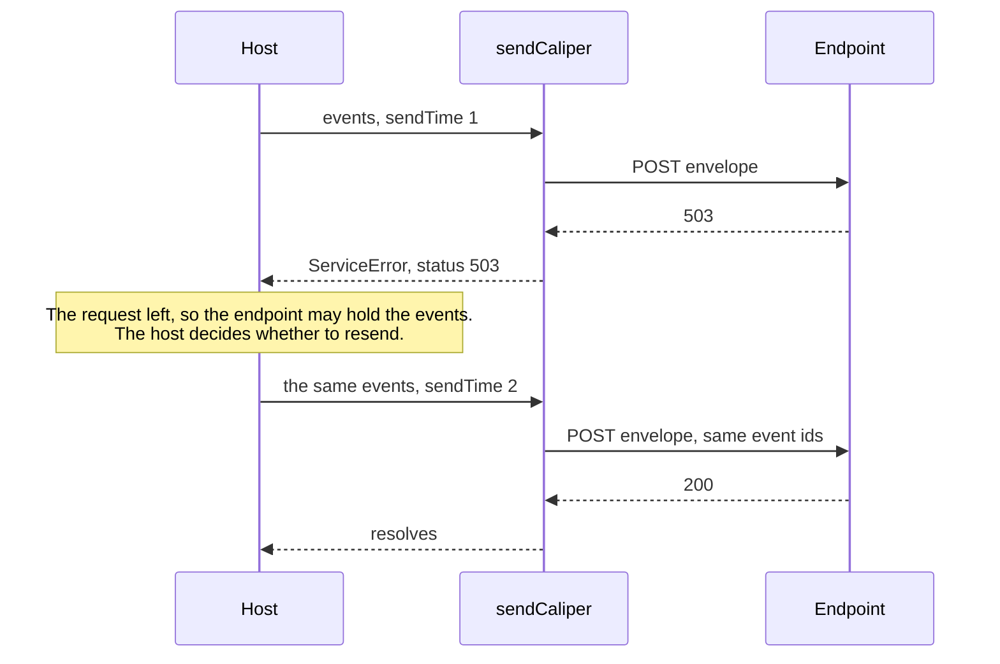

# Learning analytics events

`@interopkit/learning-analytics` builds [Caliper Analytics 1.2](https://www.imsglobal.org/spec/caliper/v1p2) events and sends
them to a Caliper endpoint in one envelope. An event has an actor, an action on an object, and a time. The identifier of an
event comes from what the host says identifies it, so that reporting the same thing again gives the same identifier.



| Module  | Holds                                                                                                     |
| ------- | --------------------------------------------------------------------------------------------------------- |
| `model` | `CALIPER_CONTEXT`, `CaliperEvent`, `CaliperEntity`, `CaliperEventType`, `CaliperProfile`, `CaliperAction` |
| `build` | `buildEvent`, `EventInput`, `mintUrn`, `caliperTime`, `checkIri`                                          |
| `send`  | `sendCaliper`, `CaliperSender`, `SendCaliperOptions`, `DEFAULT_CALIPER_TIMEOUT_MS`                        |

All of them come from `@interopkit/learning-analytics`. The package depends on `@interopkit/core` for errors, argument
checks and the call to the service, on `uuid` for name-based UUIDs and on `valibot` for the schema of an event.

## Quick start

```ts
import { buildEvent, caliperTime, mintUrn, sendCaliper } from "@interopkit/learning-analytics";

const event = buildEvent({
  id: mintUrn(["event", "session-1", 1]),
  type: "AssessmentEvent",
  profile: "AssessmentProfile",
  actor: { id: "urn:uuid:3f0c8a8e-7b8e-4b6a-9c1d-2a4f6e8b0c1d", type: "Person" },
  action: "Started",
  object: { id: "https://exam.example/tests/42", type: "Assessment" },
  eventTime: caliperTime(1_700_000_000_000, "The time of the event"),
  edApp: "https://exam.example",
});
event.id; // => "urn:uuid:017072c6-a4a4-5227-a083-38da34a6f364"
event.eventTime; // => "2023-11-14T22:13:20.000Z"

const sent = [];
const fetch = async (url, init) => {
  sent.push({ url, method: init.method, authorization: init.headers.Authorization });
  return new Response(null, { status: 200 });
};
await sendCaliper([event], {
  endpoint: "https://lrs.example/caliper",
  token: "abc123",
  fetch,
  sensor: "https://exam.example/sensors/1",
  sendTime: 1_700_000_001_000,
});
sent; // => [{ url: "https://lrs.example/caliper", method: "POST", authorization: "Bearer abc123" }]
```

In a host, `fetch` is the global one: `fetch: globalThis.fetch`. The [example](../../examples/learning-analytics/README.md) is
a complete sensor with a resend.

## Building an event

`buildEvent(input)` writes the `@context`, checks every property and returns a new event. The input is not changed, the result
shares no object with it, and its properties are always in the same order, so the same event always serializes to the same
bytes.

| Property    | Meaning                                                        | Default  |
| ----------- | -------------------------------------------------------------- | -------- |
| `id`        | A UUID URN, `urn:uuid:` and a UUID. Make it with `mintUrn`     | required |
| `type`      | The event type: one of the terms below                         | required |
| `profile`   | The profile that governs the event: one of the terms below     | required |
| `actor`     | The entity that acted                                          | required |
| `action`    | What the actor did: one of the terms below                     | required |
| `object`    | The entity that the actor acted on                             | required |
| `generated` | The entity that the action made, such as an attempt or a score | none     |
| `eventTime` | When it happened, as `caliperTime` writes it                   | required |
| `edApp`     | The absolute IRI of the application that the event happened in | required |

An event with a property that is not in this table is refused, so that nothing is dropped without notice.

| Term kind    | Terms that this version builds                                                               |
| ------------ | -------------------------------------------------------------------------------------------- |
| Event types  | `AssessmentEvent`, `AssessmentItemEvent`, `NavigationEvent`, `GradeEvent`                    |
| Profiles     | `AssessmentProfile`, `GradingProfile`                                                        |
| Actions      | `Started`, `Paused`, `Resumed`, `Submitted`, `Skipped`, `Completed`, `NavigatedTo`, `Graded` |
| Entity types | `Person`, `SoftwareApplication`, `Assessment`, `AssessmentItem`, `Attempt`, `Score`          |

An entity has an `id` and a `type`, and the properties below, all of which default to none. Entities refer to other entities by
IRI, which Caliper allows for any entity (section 4.3).

| Property                                      | Meaning                                                                                                    |
| --------------------------------------------- | ---------------------------------------------------------------------------------------------------------- |
| `id`                                          | The absolute IRI of the entity. Required                                                                   |
| `type`                                        | The term of the entity's type. Required                                                                    |
| `name`                                        | What the entity is called                                                                                  |
| `isPartOf`                                    | The IRI of the assessment that an item belongs to, or of the attempt that an attempt of an item belongs to |
| `assignee`, `assignable`                      | The IRIs of the person who made an attempt and of what it is an attempt at                                 |
| `attempt`                                     | The IRI of the attempt that a score is for                                                                 |
| `scoredBy`                                    | The IRI of the agent who scored                                                                            |
| `startedAtTime`, `endedAtTime`, `dateCreated` | Times in the form of `caliperTime`                                                                         |
| `maxScore`, `scoreGiven`                      | Finite numbers                                                                                             |

The profile and the action are checked as terms, and not against the rows of the profile tables: `buildEvent` accepts a
`GradeEvent` with the `AssessmentProfile`. The caller builds the combinations that the profile tables list.

## Identifiers

`mintUrn(parts)` returns `urn:uuid:` and the name-based UUID of version 5 ([RFC 9562 section 5.5](https://www.rfc-editor.org/rfc/rfc9562#section-5.5))
of the JSON text of the parts. The same parts always give the same identifier, and parts that a plain join would confuse give
different ones.

```ts
import { mintUrn } from "@interopkit/learning-analytics";

mintUrn(["event", "attempt-1", "started"]); // => "urn:uuid:ce4d4096-7102-5f9f-8d5b-bb94689856e4"
mintUrn(["event", "attempt-1", "started"]) === mintUrn(["event", "attempt-1", "started"]); // => true
mintUrn(["event", "a", "1"]) === mintUrn(["event", "a1"]); // => false
```

| Rule      | Value                                                                                                                                                                                                                   |
| --------- | ----------------------------------------------------------------------------------------------------------------------------------------------------------------------------------------------------------------------- |
| Name      | The JSON text of the array, so `["event","a","1"]` and `["event","a1"]` are two names                                                                                                                                   |
| Namespace | `4bcd2e8b-df2f-56d9-b6c1-d17e5077c977`: the UUID of `https://github.com/assesskit/assesskit/tree/main/packages/player/src/caliper` in the URL namespace. It never changes, because changing it changes every identifier |
| Parts     | At least one string or finite number; a number that is not finite writes as `null`, so it is refused                                                                                                                    |
| Oracle    | `validation/caliper_ids.py` computes the UUIDs with Python's `uuid5`, and a test compares the library with them                                                                                                         |

Put into the parts everything that tells two events apart, such as the kind of event, the session or attempt, and the step,
and nothing that can change between two reports of the same event. The identifier is not an address that a server can
dereference (Caliper 1.2 section 4.2 says an IRI should be one).

## Times

`caliperTime(at, label)` writes epoch milliseconds as Caliper requires: `YYYY-MM-DDTHH:mm:ss.SSSZ`, in UTC, with
milliseconds. A fraction of a millisecond is cut. `label` names the time in the error message.

| Input                                       | Result                                                                |
| ------------------------------------------- | --------------------------------------------------------------------- |
| `0` to `253402300799999`                    | The time, from `1970-01-01T00:00:00.000Z` to the end of the year 9999 |
| Anything else, including `NaN` and a string | `DataError`                                                           |

`checkIri(value, label)` throws `DataError` unless the value is an absolute IRI, which Caliper requires of every entity
(section 4.2). A host can use it on the parties it passes in.

## Sending

`sendCaliper(events, options)` posts one envelope (section 5.2) with the events as its `data`, over HTTPS (section 5.4).

| Option      | Meaning                                                                                                                                               | Default                               |
| ----------- | ----------------------------------------------------------------------------------------------------------------------------------------------------- | ------------------------------------- |
| `endpoint`  | The address of the endpoint, an `https` URL                                                                                                           | required                              |
| `token`     | The bearer token that the endpoint validates: letters, digits and `-._~+/`, then `=` ([RFC 6750](https://www.rfc-editor.org/rfc/rfc6750#section-2.1)) | required                              |
| `fetch`     | The `fetch` that makes the request: the global one, or a function with the signature of `Fetch` of `@interopkit/core`                                 | required                              |
| `sensor`    | The absolute IRI that identifies the sensor (section 5.2), which is checked                                                                           | required                              |
| `sendTime`  | The time of sending in epoch milliseconds. A resend has the time of the resend                                                                        | required                              |
| `timeoutMs` | The most time in milliseconds from the request to the last byte of the answer                                                                         | `DEFAULT_CALIPER_TIMEOUT_MS`, `10000` |
| `signal`    | An `AbortSignal` that ends this caller's wait                                                                                                         | none                                  |

The request is a `POST` with `Content-Type: application/json` and `Authorization: Bearer <token>`. The body has the properties
`sensor`, `sendTime`, `dataVersion` (the Caliper context) and `data`, and no others. At least one event is needed, as an
envelope has at least one. Each event must have the Caliper `@context` and an `id`; the sensor does not check the rest, so
events from another builder go too.

The call goes through `callService` of `@interopkit/core` ([service calls](../core/service.md)). The token travels only in
the `Authorization` header of the endpoint.



### Failure paths

| Case                                               | Result                                                                                                                                                                                                          |
| -------------------------------------------------- | --------------------------------------------------------------------------------------------------------------------------------------------------------------------------------------------------------------- |
| The endpoint answers with a status that is not 2xx | `ServiceError` with the status and the body; Caliper names 400, 401, 415 and 422. No retry                                                                                                                      |
| The endpoint redirects (3xx)                       | `ServiceError` with the status. The redirect is not followed, because it would send the token elsewhere                                                                                                         |
| `fetch` rejects                                    | `ServiceError` with status `0`, naming the endpoint and the reason                                                                                                                                              |
| The endpoint does not answer within `timeoutMs`    | `ServiceError` with status `0`, even when `fetch` ignores its signal                                                                                                                                            |
| The answer is larger than 65,536 bytes             | `ServiceError` with the status of the answer, and reading stops                                                                                                                                                 |
| The signal is aborted before the call              | Rejects with `signal.reason`; no request is made                                                                                                                                                                |
| The signal aborts while the request is in flight   | Rejects with `signal.reason`. The request may have reached the endpoint                                                                                                                                         |
| Called again                                       | Nothing is kept between calls. The same events give the same identifiers and, with the same `sendTime`, the same bytes. Caliper defines no deduplication, so an endpoint may hold both copies of a resent event |
| Calls back                                         | Nothing                                                                                                                                                                                                         |

## Limits

| Limit                  | Value                                                                                                                                   | Replaceable |
| ---------------------- | --------------------------------------------------------------------------------------------------------------------------------------- | ----------- |
| Time of a call         | `timeoutMs`, `10000` ms by default                                                                                                      | Per call    |
| Bytes of the answer    | 65,536                                                                                                                                  | No          |
| Redirects              | None followed; any 3xx is an error                                                                                                      | No          |
| Events in an envelope  | At least 1. No greatest number: the maximum payload size of the endpoint is not read                                                    |             |
| Times                  | `1970-01-01T00:00:00.000Z` to `9999-12-31T23:59:59.999Z` for `caliperTime`; the form `YYYY-MM-DDTHH:mm:ss.SSSZ` for a time in an entity |             |
| Parts of an identifier | At least one; strings and finite numbers                                                                                                | No          |

## Errors

| Error                              | When                                                                                                                                                                                                                                                                                                                                     | What to do                                                                                             |
| ---------------------------------- | ---------------------------------------------------------------------------------------------------------------------------------------------------------------------------------------------------------------------------------------------------------------------------------------------------------------------------------------- | ------------------------------------------------------------------------------------------------------ |
| `DataError`                        | An argument has the wrong type or value: an event with a property that is not valid, a relative IRI, a time not in the form, a token with a space, an `http` endpoint, an empty list of events. The message names the path and what is expected, such as `The event is invalid at actor.id: expected an absolute IRI, found "person-1".` | Fix the input. Nothing was sent                                                                        |
| `ServiceError`, status `0`         | The endpoint did not answer, or not within `timeoutMs`                                                                                                                                                                                                                                                                                   | Check the address and the network. Resend the same events with a new `sendTime`                        |
| `ServiceError`, status 400 to 499  | The endpoint refused the envelope; `body` holds what it said                                                                                                                                                                                                                                                                             | 401 is a bad token. 415 and 422 are an envelope that the endpoint cannot read. Resending does not help |
| `ServiceError`, status 500 or more | The endpoint failed                                                                                                                                                                                                                                                                                                                      | Resend the same events later with a new `sendTime`                                                     |
| `ServiceError`, status 3xx         | The endpoint redirected                                                                                                                                                                                                                                                                                                                  | Use the address it redirects to                                                                        |
| The `reason` of the signal         | The caller aborted                                                                                                                                                                                                                                                                                                                       | Nothing. The request may have reached the endpoint, so a resend can leave a copy                       |

`ServiceError.body` is text from the endpoint: log it as untrusted, and do not show it to a user.

## Data that flows

| Data                               | From                                  | To                                                           |
| ---------------------------------- | ------------------------------------- | ------------------------------------------------------------ |
| The actor, the IRIs, times, scores | The calls of the host to `buildEvent` | The body of the request, to the endpoint                     |
| The bearer token                   | `options.token`                       | The `Authorization` header of the endpoint, and nowhere else |
| The answer of the endpoint         | The endpoint                          | `ServiceError.body`, and nowhere else                        |

The library stores nothing, logs nothing and sends nothing but the request. The actor of an event is an IRI that the host
chooses: give an opaque identifier that the host keeps in its own records, such as `urn:uuid:` and a UUID, and never an
email address, a name or an identifier that another service knows. The identifiers of events are UUIDs of the parts that the
host gives, so do not put a secret in the parts.

## Not included

### Not built in this version

These belong to Caliper 1.2 and to this package. They are not built yet, so a host that needs one builds the JSON itself and
sends it with `sendCaliper`, which checks only the context and the `id` of an event.

| What                                                                                                                     | Reason                                                                                          |
| ------------------------------------------------------------------------------------------------------------------------ | ----------------------------------------------------------------------------------------------- |
| The other 17 event types, 72 actions and 63 entity types of Appendices A, B and D; the vocabularies of Appendices E to J | Part of Caliper 1.2 that this version leaves out: it builds the Assessment and Grading profiles |
| The 91 rows of the profile tables and the General Profile: which action, object and generated entity go with which event | `buildEvent` checks each term, not the combination                                              |
| Event properties `target`, `referrer`, `group`, `membership`, `session`, `federatedSession`, `extensions`                | Same                                                                                            |
| Entity properties `description`, `dateModified`, `otherIdentifiers`, `extensions`, and the `count` of an Attempt         | Same                                                                                            |
| Entities without an `id` (`TextPositionSelector`, `SystemIdentifier`) and blank node identifiers                         | Same                                                                                            |
| `@context` as an array with local contexts                                                                               | Same                                                                                            |
| An entity as an object inside another entity                                                                             | Same: entities refer to each other by IRI                                                       |
| Entity describes and a mix of events and entities in `data`                                                              | Same                                                                                            |
| Reading the configuration of an endpoint (section 6.2), `caliperMaximumPayloadSize` and splitting an envelope            | Same                                                                                            |
| The limits on string lengths (section 6.3)                                                                               | Same                                                                                            |
| The endpoint role: reading an envelope and answering 2xx, 400, 401, 415 and 422 (section 6)                              | Same                                                                                            |
| A send without a bearer token                                                                                            | The code requires one; the specification recommends it                                          |

### Not in this package

| What                                                 | Reason                                                                                                                                 |
| ---------------------------------------------------- | -------------------------------------------------------------------------------------------------------------------------------------- |
| Which event of a product becomes which Caliper event | Only the adapter of a product knows its parties, steps and rules. The [example](../../examples/learning-analytics/README.md) shows one |
| Retries, queues, batching, backoff                   | Whether and when to resend depends on the host's queue. Stable identifiers make a resend safe                                          |
| A store of events, a Learning Record Store           | A host concern; the library keeps nothing                                                                                              |
| JSON-LD processing: expansion, compaction, framing   | Caliper needs none: the terms are fixed strings, and the published context is the oracle of the tests                                  |
| Answers of a candidate in events                     | They are not analytics data; an event that needs a response builds it from the host's own record                                       |

## Differences from the references

| Reference                                                                    | Difference                                                                                                                                                                     |
| ---------------------------------------------------------------------------- | ------------------------------------------------------------------------------------------------------------------------------------------------------------------------------ |
| Caliper 1.2 section 4.2: an entity `id` is an IRI or a blank node            | `checkIri` and `buildEvent` accept what the URL parser of the runtime reads as an absolute URL, of any scheme, and no blank node                                               |
| Section 4.2: an event `id` is a UUID URN                                     | The identifier from `mintUrn` is a version 5 UUID, so it is deterministic. `buildEvent` accepts any UUID URN, upper or lower case, as RFC 4122 does on input                   |
| Section 4.3 and 5.1: an entity as an object or as an IRI                     | Events hold their actor, object and generated entity as objects, and entities refer to others by IRI                                                                           |
| Section 5.4: the bearer token is recommended                                 | It is required                                                                                                                                                                 |
| Section 5.2: the envelope has `sensor`, `sendTime`, `dataVersion` and `data` | Same, and no other property; `sensor` must be a non-empty string, and Caliper advises an IRI                                                                                   |
| The JSON-LD context at `purl.imsglobal.org/ctx/caliper/v1p2`                 | Every term that the model writes is defined by it, and every built event passes a check of term and value types against the file; `pnpm schemas` downloads it at a pinned hash |
| `ims-caliper` 1.1.0 (MIT)                                                    | Writes the 1.1 context and is CommonJS; this package writes 1.2, is ESM and sends through any `fetch`                                                                          |
| `@timeback/caliper` 0.3.3                                                    | A client for one vendor's API, with no license; it posts to fixed paths and needs OAuth credentials. This package sends to any endpoint with a bearer token                    |
