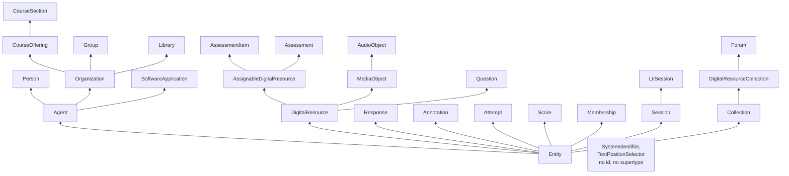

# The model

Every entity and every event of Caliper 1.2 and of the Library Use Profile is an interface of this package and a schema that
reads it. An entity is written as an object, or as the IRI that names it wherever the specification allows an entity. An event
is an actor, an action on an object, and a time, with the entities of its context.



## Quick start

```ts
import { readEntity, ROLES } from "@interopkit/learning-analytics";

const section = readEntity({
  "@context": "http://purl.imsglobal.org/ctx/caliper/v1p2",
  id: "https://example.edu/terms/201601/courses/7/sections/1",
  type: "CourseSection",
  courseNumber: "CPS 435-01",
  members: ["https://example.edu/users/554433"],
});
section.type; // => "CourseSection"
ROLES.includes("Instructor#TeachingAssistant"); // => true
```

## The classes

| Family                | Entities                                                                                                                                                                                                                                                 |
| --------------------- | -------------------------------------------------------------------------------------------------------------------------------------------------------------------------------------------------------------------------------------------------------- |
| Agents                | `Agent`, `Person`, `Organization`, `CourseOffering`, `CourseSection`, `Group`, `SoftwareApplication`, `Library`                                                                                                                                          |
| Context               | `Membership`, `Session`, `LtiSession`                                                                                                                                                                                                                      |
| Digital resources     | `DigitalResource`, `AssignableDigitalResource`, `Chapter`, `Document`, `Frame`, `LtiLink`, `MediaLocation`, `MediaObject`, `AudioObject`, `ImageObject`, `VideoObject`, `Message`, `Page`, `WebPage`, `LearningObjective`, `Link`                           |
| Collections           | `Collection`, `AggregateMeasureCollection`, `DigitalResourceCollection`, `Assessment`, `Forum`, `Thread`, `Questionnaire`, `Survey`                                                                                                                       |
| Assessment            | `Assessment`, `AssessmentItem`, `Attempt`, `Response` and its eight subtypes, `Result`, `Score`, `AggregateMeasure`                                                                                                                                      |
| Questionnaires        | `Question` and three subtypes, `RatingScaleQuestion`, `QuestionnaireItem`, `SurveyInvitation`, `Rating`, `Comment`, `Scale`, `LikertScale`, `MultiselectScale`, `NumericScale`                                                                            |
| Annotations           | `Annotation`, `BookmarkAnnotation`, `HighlightAnnotation`, `SharedAnnotation`, `TagAnnotation`                                                                                                                                                           |
| Search                | `Query`, `SearchResponse`                                                                                                                                                                                                                                  |
| Library Use Profile   | `Library`, `LibraryActivity`, `LibraryResource`, `LibrarySpace`                                                                                                                                                                                           |
| Without an `id`       | `SystemIdentifier`, `TextPositionSelector`                                                                                                                                                                                                                 |

A property takes a class of entity as an object or as its IRI, and every class below it: a property that takes an `Agent`
takes a `Person`, an `Organization`, a `CourseSection` and the other subtypes. `AGENT_TYPES`, `ORGANIZATION_TYPES`,
`COURSE_OFFERING_TYPES`, `DIGITAL_RESOURCE_TYPES`, `QUESTION_TYPES` and `SCALE_TYPES` list the classes of those ranges.

## The events

An event has an `@context`, an `id` that is a UUID URN, a `type`, an `actor`, an `action`, an `object` and an `eventTime`; its
`profile`, `edApp`, `generated`, `target`, `referrer`, `group`, `membership`, `session`, `federatedSession` and `extensions` are
optional. Each event narrows the actions and the classes of its entity properties, as the tables of Appendix A and of the Library
Use Profile say. A property that a row leaves open takes any entity.

| Event                       | Actor                        | Actions                                                                      | Object                               | Generated                             |
| --------------------------- | ---------------------------- | ---------------------------------------------------------------------------- | ------------------------------------ | ------------------------------------- |
| `Event`                     | Agent                        | Any                                                                          | Any entity                           | Any entity                            |
| `AnnotationEvent`           | Person                       | Bookmarked, Highlighted, Shared, Tagged                                      | DigitalResource                      | Annotation                            |
| `AssessmentEvent`           | Person                       | Started, Paused, Resumed, Restarted, Reset, Submitted                        | Assessment                           | Attempt                               |
| `AssessmentItemEvent`       | Person                       | Started, Skipped, Completed                                                  | AssessmentItem                       | Response, or an Attempt               |
| `AssignableEvent`           | Person                       | Activated, Deactivated, Started, Completed, Submitted, Reviewed              | AssignableDigitalResource            | Attempt                               |
| `FeedbackEvent`             | Person                       | Commented, Ranked                                                            | Any entity                           | Rating, Comment                       |
| `ForumEvent`                | Person                       | Subscribed, Unsubscribed                                                     | Forum                                |                                       |
| `GradeEvent`                | Agent                        | Graded                                                                       | Attempt                              | Score                                 |
| `MediaEvent`                | Person                       | The 19 actions of a player, from Started to ClosedPopout                     | MediaObject                          |                                       |
| `MessageEvent`              | Person                       | MarkedAsRead, MarkedAsUnread, Posted                                         | Message                              |                                       |
| `NavigationEvent`           | Person                       | NavigatedTo                                                                  | DigitalResource, SoftwareApplication |                                       |
| `QuestionnaireEvent`        | Person                       | Started, Submitted                                                           | Questionnaire                        |                                       |
| `QuestionnaireItemEvent`    | Person                       | Started, Skipped, Completed                                                  | QuestionnaireItem                    | Response                              |
| `ResourceManagementEvent`   | Person                       | The 14 actions of Archived to Uploaded                                       | DigitalResource                      | DigitalResource, required for Copied  |
| `SearchEvent`               | Person                       | Searched                                                                     | Any entity                           | SearchResponse                        |
| `SessionEvent`              | Person, SoftwareApplication  | LoggedIn, LoggedOut, TimedOut                                                | Session, SoftwareApplication         |                                       |
| `SurveyEvent`               | Person                       | OptedIn, OptedOut                                                            | Survey                               |                                       |
| `SurveyInvitationEvent`     | Person                       | Accepted, Declined, Sent                                                     | SurveyInvitation                     |                                       |
| `ThreadEvent`               | Person                       | MarkedAsRead, MarkedAsUnread                                                 | Thread                               |                                       |
| `ToolLaunchEvent`           | Person                       | Launched, Returned; `federatedSession` is required for Launched              | SoftwareApplication                  | DigitalResource                       |
| `ToolUseEvent`              | Person                       | Used                                                                         | SoftwareApplication                  | AggregateMeasureCollection            |
| `ViewEvent`                 | Person                       | Viewed                                                                       | DigitalResource                      |                                       |
| `LibraryUseEvent`           | Person                       | Used                                                                         | Library, LibrarySpace                |                                       |
| `LibraryResourceUseEvent`   | Person                       | Accessed                                                                     | LibraryResource, DigitalResource     |                                       |
| `LibraryParticipationEvent` | Person                       | Attended                                                                     | LibraryActivity                      |                                       |

The class of a column takes every class below it: a `GradeEvent` takes any agent as its actor. The Library Use Profile adds
`presenceDerivedFromSource` and `presenceDerivedFromID` to its use event, `accessLocation` and `forCourse` to its resource event,
and `participationMode`, `forCourse` and `arrivalTime` to its participation event.

`readEvent(value, options?)` reads an event as `readEntity` reads an entity: the context, the `type` that chooses the class, every
property, every entity inside it, and the rules above. The rules of the profile tables, which entity goes with which action across
events, are not read here. With `{ version: "1.1" }` both readers read a document of Caliper 1.1 into the same types ([Caliper
1.1](./versions.md)); `CALIPER_1_1_CONTEXT` names its context and `CALIPER_VERSIONS` the two versions.

```ts
import { readEvent } from "@interopkit/learning-analytics";

const event = readEvent({
  "@context": "http://purl.imsglobal.org/ctx/caliper/v1p2",
  id: "urn:uuid:27734504-068d-4596-861c-2315be33a2a2",
  type: "AssessmentEvent",
  profile: "AssessmentProfile",
  actor: "https://example.edu/users/554433",
  action: "Started",
  object: { id: "https://example.edu/assess/1", type: "Assessment" },
  eventTime: "2016-11-15T10:15:00.000Z",
});
event.action; // => "Started"
```

## Reading an entity

`readEntity(value, options?)` reads an entity describe (Caliper 1.2 section 5.2): an entity with its `@context`, as a sensor sends it
outside an event. It checks the context, the `type`, every property, and every entity inside it, and returns a copy.

| Rule                  | What is read                                                                                                                                                                    |
| --------------------- | ------------------------------------------------------------------------------------------------------------------------------------------------------------------------------- |
| `@context`            | The context of Caliper 1.2, the context of the Library Use Profile, a list of contexts that ends with one of them, or the terms of one context defined inline. An entry before the last is an address, or terms defined inline |
| `type`                | A term of `ENTITY_TYPES`; it chooses the class that reads the rest                                                                                                              |
| `id`                  | An absolute IRI, or a blank node identifier (`_:` and a name). An anonymous entity has the IRI of its type. `SystemIdentifier` and `TextPositionSelector` have none                |
| Properties            | Those of the class, with those of its supertypes. Any other property is refused: a sender's own go in `extensions`, an object of JSON                                           |
| Entities inside it    | An object of a class that the property takes, or an IRI. An object may carry an `@context` of its own, which is kept as it is                                                    |
| Times                 | `YYYY-MM-DDTHH:mm:ss.SSSZ`, in UTC, for a date that exists; a leap second is refused                                                                                              |
| Durations             | ISO 8601: `PT10M30S`, `P1D`, `P2W`                                                                                                                                                |
| Counts                | An integer from 0 to 4,294,967,295. A decimal is any finite number                                                                                                                |
| Terms                 | A role, a status, an LTI message type, a metric, a type of system identifier: a term of its vocabulary                                                                           |
| Required properties   | `id` and `type`; `AggregateMeasure.metric` and `metricValue`; `Questionnaire.items`; `TextPositionSelector.start` and `end`; `SystemIdentifier.identifier` and `identifierType`    |

The reader keeps the properties in the order of the class, so the same entity always serializes to the same bytes. The result
shares nothing with the input, which is not changed.

## Limits

| Limit                          | Value                                                                                                                                       |
| ------------------------------ | ------------------------------------------------------------------------------------------------------------------------------------------- |
| Nesting of the value           | `MAX_JSON_DEPTH`, 64 levels; a deeper value is refused before it is read                                                                    |
| Kind of value                  | JSON only: a function, a `Date`, `undefined` and a number that is not finite are refused with the path of the first                         |
| Text before parsing            | Not checked here: bound the bytes, the depth and the tokens of the text with `readJson` of `@interopkit/core/http` before you parse it      |
| Findings                       | `readEntity` and `readEvent` stop at the first property that is not valid, so they keep one                                                  |

## Errors

| Error       | When                                                                                          | What to do                                    |
| ----------- | --------------------------------------------------------------------------------------------- | --------------------------------------------- |
| `DataError` | The value is not an entity or an event: `The entity is invalid at assignee: expected an entity of type Person, or its IRI, found an entity of type Document.` | Fix the data, or refuse it at your boundary |
| `DataError` | The value is not JSON, or nests too deep: `The entity is invalid: extensions.at is an object that is not plain, which JSON cannot hold.` | The same                                      |

The sentence names the path of the first fault, as code writes it (`members[0].isPartOf`), and what was expected there.

## Not included

| What                                                                 | Why                                                                                                                          |
| -------------------------------------------------------------------- | ---------------------------------------------------------------------------------------------------------------------------- |
| The deprecated entities of Caliper 1.1: `Reading` and the four Epub entities | Caliper 1.1 deprecated them, and Caliper 1.2 does not list them. The schemas of 1.2 keep them                         |
| A check that a nested `@context` leaves the terms of Caliper as they are | It takes JSON-LD processing; the package expands no context                                                              |
| That an IRI can be dereferenced, or is unique                        | The reader never fetches an IRI. Section 2.2 says an IRI should be dereferenceable                                           |

## Differences from the references

| Reference                                                              | Difference                                                                                                                                                                       |
| ---------------------------------------------------------------------- | -------------------------------------------------------------------------------------------------------------------------------------------------------------------------------- |
| The JSON schemas of `1EdTech/caliper-spec` (draft 4)                   | The schemas leave a property that a class does not define open, and accept ranges the tables close. The reader follows the tables and the fixtures: see [spec-gaps](./spec-gaps.md) |
| The fixtures of `1EdTech/caliper-spec`                                 | Every positive entity reads and returns as it is written. Four malformed ones differ only in writing `25` for `25.0`, which JSON does not tell apart                              |
| `ims-caliper` 1.1.0                                                    | Has no reader; this package refuses what the tables do not allow                                                                                                                 |
