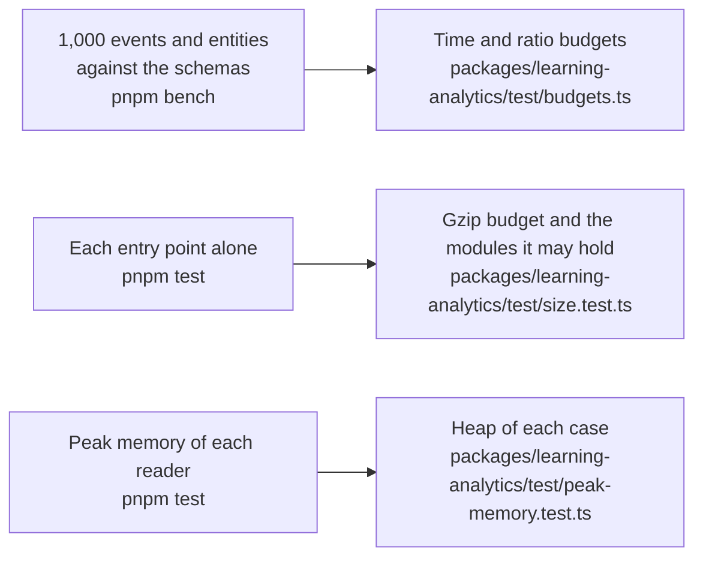

# Performance of learning-analytics

The time of the hot paths of `@interopkit/learning-analytics`, the size of each entry point, and the heap of each reader of
untrusted input at its worst input. A budget holds each number in CI: `pnpm bench` for the time, `pnpm test` for the size and
the heap.

## Speed

`pnpm bench` times the build that ships on 1,000 events and on 1,000 entity describes of the fixtures of `caliper-spec` that the
draft 4 schemas take (an envelope of 1.2 has 1,469,236 bytes), against those schemas and `JSON.parse` in the same run. The table
gives the range of the fastest ratios of 12 runs of the `bench` job on the runner of CI, on 2026-11-04 and 2026-11-05, and the
fastest samples of the runner; the budget of a ratio is between two samples of one run, so it holds on any machine, and the budget
of a time holds for the class of the runner.

| Benchmark                                      | Fastest on the runner | Time budget | Reference                               |         Ratio | Budget |
| ---------------------------------------------- | --------------------: | ----------: | --------------------------------------- | ------------: | -----: |
| `readEnvelope` of 1.2                          |          23.0–35.5 ms |      200 ms | the draft 4 schemas, 615–868 ms         |    0.03–0.044 |   0.09 |
| `readEnvelope` of 1.2                          |          23.0–35.5 ms |      200 ms | `JSON.parse` of the text, 3.5–5.0 ms    |     5.39–8.68 |     20 |
| `validateEvent` over the events                |          22.8–34.4 ms |      200 ms | the draft 4 schemas                     |   0.031–0.043 |   0.09 |
| `readEntity` over 1,000 entities of 71 classes |           7.5–11.9 ms |       40 ms | the draft 4 schemas, 154–237 ms         |    0.041–0.06 |    0.2 |
| `validateEntity` over the same                 |           9.0–13.8 ms |       50 ms | the draft 4 schemas                     |    0.051–0.07 |    0.2 |
| `readEnvelope` of 1.1                          |          21.4–33.7 ms |      200 ms | `schema_1_1`, 7.8–10.5 s                | 0.0023–0.0033 |  0.007 |
| `readEnvelope` of 1.1                          |          21.4–33.7 ms |      200 ms | `JSON.parse` of the text                |     5.19–8.55 |     20 |
| `buildEvent` of 1,000 events                   |          21.7–34.3 ms |      200 ms | the draft 4 schemas over what it builds |   0.028–0.041 |   0.09 |
| `buildEntity` of 1,000 entities                |           8.1–13.0 ms |       50 ms | the same                                |   0.044–0.066 |    0.2 |
| `sendCaliper` of the envelope                  |            5.0–7.1 ms |       30 ms | `JSON.stringify` of the envelope        |     1.27–2.34 |      5 |
| `handleCaliperRequest` of the envelope         |          25.1–37.5 ms |      200 ms | `JSON.parse` of the text, 3.5–5.0 ms    |     6.71–8.69 |     20 |
| `handleCaliperRequest` of the envelope         |          25.1–37.5 ms |      200 ms | the draft 4 schemas                     |   0.039–0.046 |    0.1 |

A ratio is twice the highest measured on the runner, whether the reference is a schema or the JSON, and a time five times the
fastest sample of the runner, each rounded up to one significant digit. The schemas of 1.1 try the
`oneOf` of every class at each level, so one `Message` event takes about 90 ms.

| Choice                                                                                                                                                                                                    | Against a build without it, alternated in one process                                                                                                                                                                             |
| --------------------------------------------------------------------------------------------------------------------------------------------------------------------------------------------------------- | --------------------------------------------------------------------------------------------------------------------------------------------------------------------------------------------------------------------------------- |
| The reader of a time reads the fields of `YYYY-MM-DDTHH:mm:ss.SSSZ` by their places and the days of the month; the endpoint reads the items that `JSON.parse` made of the body without copying them again | `readEnvelope` takes 0.71 to 0.78 of its time, `handleCaliperRequest` 0.65 to 0.70, `buildEvent` 0.70 to 0.95, `readEntity` 0.82 to 0.92; every fixture of `caliper-spec`, in both versions, reads to the same value and findings |

What remains is the schemas of valibot, the copy of a host's value, and the counts of the text in `@interopkit/core`; the copy
and the refusal of the names of the prototype chain are timed in [core](../core/performance.md).

## Size

`size.test.ts` bundles each entry point alone with `scripts/entry-size.ts`: esbuild, minified, with every dependency inside. It
fails above the budget after gzip, or when an entry point holds a module that its budget does not list. Gzip is measured on
Node.js 22; other versions differ by up to 1 percent.

| Entry point                               |  Bytes |   Gzip | Budget | Holds, besides `@interopkit/core` and valibot                 |
| ----------------------------------------- | -----: | -----: | -----: | ------------------------------------------------------------- |
| `@interopkit/learning-analytics`          | 72,484 | 21,641 | 26,000 | `build`, `model`, `read`, `send`, `v1p1`, `validate`, uuid    |
| `@interopkit/learning-analytics/endpoint` | 66,215 | 18,818 | 23,000 | `model`, `read`, `v1p1`, `validate`; no sensor and no builder |

## Memory

Each reader of untrusted input runs on its worst input within its limits in a Node.js process of its own whose heap is
bounded (`test/peak-memory.test.ts`, with the readings in `test/peak-memory-readings.ts`): what the reading keeps alive at once
must fit, whenever V8 collects, so a regression fails and the load of a machine cannot. The heap of a case is twice the least in
which the reading ends on Node.js 22 and 24, rounded up to 16 MiB; `node scripts/peak-memory.ts learning-analytics` prints the least, in steps
of 8 MiB. A reading that kept an issue for each wrong value would pass the heap by far.

| Reader                                     | Worst input                                                                                           | Least heap | Heap of the test |
| ------------------------------------------ | ----------------------------------------------------------------------------------------------------- | ---------: | ---------------: |
| `readEvent`, `readEntity`, `validateEvent` | An object that holds a list of a million wrong values                                                 |     32 MiB |           64 MiB |
| The same, as Caliper 1.1                   | The same list                                                                                         |     32 MiB |           64 MiB |
| `readEnvelope`                             | An envelope whose event holds the same list                                                           |     32 MiB |           64 MiB |
| `handleCaliperRequest`                     | An envelope of 1 MiB of events, of 1.2 and of 1.1                                                     |     16 MiB |           32 MiB |
| `handleCaliperRequest`                     | An event whose extensions have as many distinct keys as 1 MiB holds, the costliest body for its bytes |     24 MiB |           48 MiB |

The copy of a host's value is most of what the million values cost: `copyJson` of
`@interopkit/core` copies the list and names the place of a value only when it is not JSON. The endpoint reads what it parsed
without that copy.
