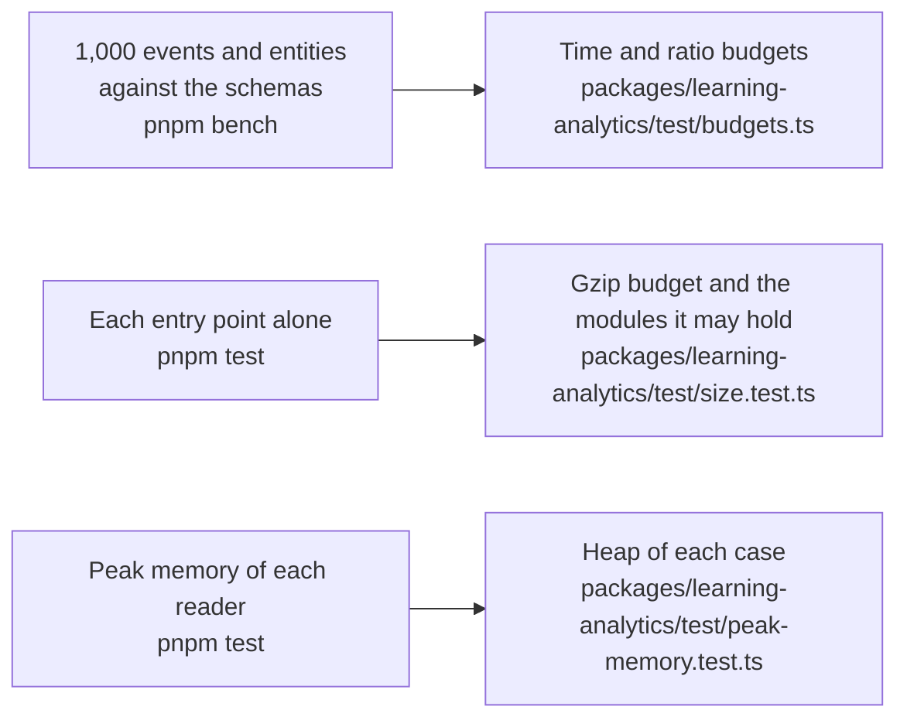

# Performance of learning-analytics

What the hot paths of `@interopkit/learning-analytics` cost, how much each entry point adds to a bundle, and the heap that each reader of untrusted input needs on its worst input. A budget holds each number and fails a gate of CI: `pnpm bench` for the time, `pnpm test` for the size and the heap. That the package does what it says is in [evidence](evidence.md).

## Speed

`pnpm bench` times the build that ships on 1,000 events and on 1,000 entity describes of the fixtures of `caliper-spec` that the
draft 4 schemas take (an envelope of 1.2 has 1,469,236 bytes), against those schemas and `JSON.parse` in the same run. The table
gives the range of the fastest ratios of the eight latest green runs of the runner of CI and of one run on a laptop, and the
fastest samples of the runner; the budget of a ratio is between two samples of one run, so it holds on any machine, and the budget
of a time holds for the class of the runner.

| Benchmark                                   | Fastest on the runner | Time budget | Reference                                 | Ratio          | Budget |
| ------------------------------------------- | --------------------: | ----------: | ----------------------------------------- | -------------: | -----: |
| `readEnvelope` of 1.2 | 41.4–65.4 ms | 300 ms | the draft 4 schemas, 318–460 ms | 0.038–0.042 | 1 |
| `readEnvelope` of 1.2 | 41.4–65.4 ms | 300 ms | `JSON.parse` of the text, 2.0–2.3 ms | 5.99–8.28 | 50 |
| `validateEvent` over the events | 41.2–64.7 ms | 300 ms | the draft 4 schemas | 0.033–0.043 | 1 |
| `readEntity` over 1,000 entities of 71 classes | 12.2–21.9 ms | 70 ms | the draft 4 schemas, 76–118 ms | 0.048–0.063 | 1 |
| `validateEntity` over the same | 15.2–25.8 ms | 80 ms | the draft 4 schemas | 0.059–0.075 | 1 |
| `readEnvelope` of 1.1 | 43.0–57.1 ms | 300 ms | `schema_1_1`, 4.9–6.9 s | 0.002–0.003 | 1 |
| `readEnvelope` of 1.1 | 43.0–57.1 ms | 300 ms | `JSON.parse` of the text | 5.89–8.52 | 50 |
| `buildEvent` of 1,000 events | 36.5–61.1 ms | 200 ms | the draft 4 schemas over what it builds | 0.032–0.040 | 1 |
| `buildEntity` of 1,000 entities | 14.6–23.1 ms | 80 ms | the same | 0.050–0.057 | 1 |
| `sendCaliper` of the envelope | 5.7–10.6 ms | 30 ms | `JSON.stringify` of the envelope | 0.75–1.87 | 10  |
| `handleCaliperRequest` of the envelope | 45.5–65.3 ms | 300 ms | `JSON.parse` of the text, 2.1 ms | 6.29–8.56 | 50 |
| `handleCaliperRequest` of the envelope | 45.5–65.3 ms | 300 ms | the draft 4 schemas | 0.038–0.046 | 1 |

A ratio to a schema is parity or better, as the design asks; a ratio to the JSON is five times the highest ratio measured on the runner and on a laptop, rounded up to one significant digit, and a time is five times the fastest sample of the runner, rounded up to one
significant digit. The schemas of 1.1 try the `oneOf` of every class at each level, so one `Message` event takes about 90 ms.
The reader of a time reads the fields of `YYYY-MM-DDTHH:mm:ss.SSSZ` by their places and the days of the month, and the endpoint
reads the items that `JSON.parse` made of the body without copying them again: against the build before, alternated in one
process, `readEnvelope` takes 0.71 to 0.78 of its time, `handleCaliperRequest` 0.65 to 0.70, `buildEvent` 0.70 to 0.95,
`readEntity` 0.82 to 0.92, and every fixture of `caliper-spec`, in both versions, reads to the same value and the same findings.
What remains is the schemas of valibot, the copy of a host's value, and the counts of the text in `@interopkit/core`.

## Size

`size.test.ts` bundles each entry point alone with `scripts/entry-size.ts`: esbuild, minified, with every dependency inside. It
fails above the budget after gzip, or when an entry point holds a module that its budget does not list.

Gzip is measured on Node.js 22; other versions of Node.js differ by up to 1 percent.

| Entry point                               | Bytes  | Gzip   | Budget | Holds, besides `@interopkit/core` and valibot              |
| ----------------------------------------- | -----: | -----: | -----: | ---------------------------------------------------------- |
| `@interopkit/learning-analytics`          | 70,822 | 21,158 | 26,000 | `build`, `model`, `read`, `send`, `v1p1`, `validate`, uuid |
| `@interopkit/learning-analytics/endpoint` | 65,964 | 18,795 | 23,000 | `model`, `read`, `v1p1`, `validate`; no sensor and no builder |

## Memory

Each reader of untrusted input runs on its worst input within its limits in a Node.js process of its own whose heap is
bounded (`test/peak-memory.test.ts`, with the readings in `test/peak-memory-readings.ts`): what the reading keeps alive at once
must fit, whenever V8 collects, so a regression fails and the load of a machine cannot. The heap of a case is twice the least in
which the reading ends on Node.js 22 and 24, rounded up to 16 MiB; `node scripts/peak-memory.ts learning-analytics` prints the least, in steps
of 8 MiB. A reading that kept an issue for each wrong value would pass the heap by far.

| Reader                                     | Worst input                                                | Least heap | Heap of the test |
| ------------------------------------------ | ---------------------------------------------------------- | ---------: | ---------------: |
| `readEvent`, `readEntity`, `validateEvent` | An object that holds a list of a million wrong values      | 32 MiB     | 64 MiB           |
| The same, as Caliper 1.1                   | The same list                                              | 32 MiB     | 64 MiB           |
| `readEnvelope`                             | An envelope whose event holds the same list                | 32 MiB     | 64 MiB           |
| `handleCaliperRequest`                     | An envelope of 1 MiB of events, of 1.2 and of 1.1          | 16 MiB     | 32 MiB           |
| `handleCaliperRequest`                     | An event whose extensions have as many distinct keys as 1 MiB holds, the costliest body for its bytes | 24 MiB | 48 MiB |

The copy of a host's value is most of what the million values cost: `copyJson` of
`@interopkit/core` copies the list and names the place of a value only when it is not JSON. The endpoint reads what it parsed
without that copy.
