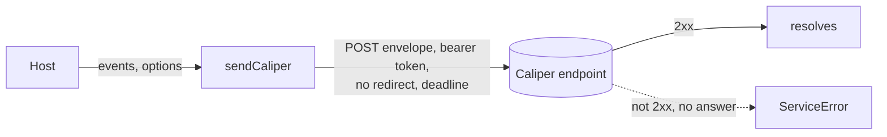
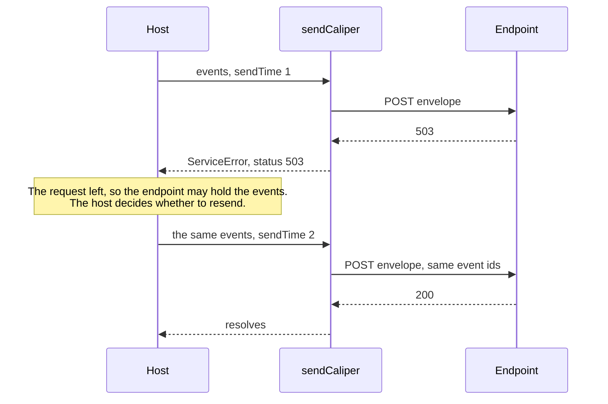

# Sending events

`sendCaliper` posts events in one envelope to a Caliper endpoint with a bearer token. It follows no redirect, ends at a deadline
and takes a `signal` that ends the caller's wait.



## Quick start

```ts
import { buildEvent, caliperTime, mintUrn, sendCaliper } from "@interopkit/learning-analytics";

const event = buildEvent({
  id: mintUrn(["event", "session-1", 1]),
  type: "NavigationEvent",
  profile: "AssessmentProfile",
  actor: { id: "urn:uuid:3f0c8a8e-7b8e-4b6a-9c1d-2a4f6e8b0c1d", type: "Person" },
  action: "NavigatedTo",
  object: { id: "https://exam.example/tests/42/items/3", type: "AssessmentItem" },
  eventTime: caliperTime(1_700_000_000_000, "The time of the event"),
  edApp: "https://exam.example",
});

const requests = [];
const fetch = async (url, init) => {
  requests.push({ url, body: JSON.parse(init.body) });
  return new Response(null, { status: 200 });
};
await sendCaliper([event], {
  endpoint: "https://lrs.example/caliper",
  token: "abc123",
  fetch,
  sensor: "https://exam.example/sensors/1",
  sendTime: 1_700_000_001_000,
});
requests[0].body.sendTime; // => "2023-11-14T22:13:21.000Z"
requests[0].body.data[0].id === event.id; // => true
```

`sendCaliper(events, options)` posts one envelope (section 5.2) with the events as its `data`, over HTTPS (section 5.4).

| Option      | Meaning                                                                                                                                               | Default                               |
| ----------- | ----------------------------------------------------------------------------------------------------------------------------------------------------- | ------------------------------------- |
| `endpoint`  | The address of the endpoint, an `https` URL                                                                                                           | required                              |
| `token`     | The bearer token that the endpoint validates: letters, digits and `-._~+/`, then `=` ([RFC 6750](https://www.rfc-editor.org/rfc/rfc6750#section-2.1)) | required                              |
| `fetch`     | The `fetch` that makes the request: the global one, or a function with the signature of `Fetch` of `@interopkit/core`                                 | required                              |
| `sensor`    | The absolute IRI that identifies the sensor (section 5.2), which is checked                                                                           | required                              |
| `sendTime`  | The time of sending in epoch milliseconds. A resend has the time of the resend                                                                        | required                              |
| `timeoutMs` | The most time in milliseconds from the request to the last byte of the answer                                                                         | `DEFAULT_CALIPER_TIMEOUT_MS`, `10000` |
| `signal`    | An `AbortSignal` that ends this caller's wait                                                                                                         | none                                  |

The request is a `POST` with `Content-Type: application/json` and `Authorization: Bearer <token>`. The body has the properties
`sensor`, `sendTime`, `dataVersion` (the Caliper context) and `data`, and no others. At least one event is needed, as an
envelope has at least one. Each event must have the Caliper `@context` and an `id`; the sensor does not check the rest, so
events from another builder go too.

The call goes through `callService` of `@interopkit/core` ([service calls](../core/service.md)). The token travels only in
the `Authorization` header of the endpoint.




### Failure paths

| Case                                               | Result                                                                                                                                                                                                          |
| -------------------------------------------------- | --------------------------------------------------------------------------------------------------------------------------------------------------------------------------------------------------------------- |
| The endpoint answers with a status that is not 2xx | `ServiceError` with the status and the body; Caliper names 400, 401, 415 and 422. No retry                                                                                                                      |
| The endpoint redirects (3xx)                       | `ServiceError` with the status. The redirect is not followed, because it would send the token elsewhere                                                                                                         |
| `fetch` rejects                                    | `ServiceError` with status `0`, naming the endpoint and the reason                                                                                                                                              |
| The endpoint does not answer within `timeoutMs`    | `ServiceError` with status `0`, even when `fetch` ignores its signal                                                                                                                                            |
| The answer is larger than 65,536 bytes             | `ServiceError` with the status of the answer, and reading stops                                                                                                                                                 |
| The signal is aborted before the call              | Rejects with `signal.reason`; no request is made                                                                                                                                                                |
| The signal aborts while the request is in flight   | Rejects with `signal.reason`. The request may have reached the endpoint                                                                                                                                         |
| Called again                                       | Nothing is kept between calls. The same events give the same identifiers and, with the same `sendTime`, the same bytes. Caliper defines no deduplication, so an endpoint may hold both copies of a resent event |
| Calls back                                         | Nothing                                                                                                                                                                                                         |

## Limits of a send

| Limit                  | Value                                                                                                                                   | Replaceable |
| ---------------------- | --------------------------------------------------------------------------------------------------------------------------------------- | ----------- |
| Time of a call         | `timeoutMs`, `10000` ms by default                                                                                                      | Per call    |
| Bytes of the answer    | 65,536                                                                                                                                  | No          |
| Redirects              | None followed; any 3xx is an error                                                                                                      | No          |
| Events in an envelope  | At least 1. No greatest number: the maximum payload size of the endpoint is not read                                                    |             |
| Times                  | `1970-01-01T00:00:00.000Z` to `9999-12-31T23:59:59.999Z` for `caliperTime`; the form `YYYY-MM-DDTHH:mm:ss.SSSZ` for a time in an entity |             |
| Parts of an identifier | At least one; strings and finite numbers                                                                                                | No          |

## Errors

| Error                              | When                                                                                                                                                                                                                                                                                                                                     | What to do                                                                                             |
| ---------------------------------- | ---------------------------------------------------------------------------------------------------------------------------------------------------------------------------------------------------------------------------------------------------------------------------------------------------------------------------------------- | ------------------------------------------------------------------------------------------------------ |
| `DataError`                        | An argument has the wrong type or value: an event with a property that is not valid, a relative IRI, a time not in the form, a token with a space, an `http` endpoint, an empty list of events. The message names the path and what is expected, such as `The event is invalid at actor.id: expected an absolute IRI, found "person-1".` | Fix the input. Nothing was sent                                                                        |
| `ServiceError`, status `0`         | The endpoint did not answer, or not within `timeoutMs`                                                                                                                                                                                                                                                                                   | Check the address and the network. Resend the same events with a new `sendTime`                        |
| `ServiceError`, status 400 to 499  | The endpoint refused the envelope; `body` holds what it said                                                                                                                                                                                                                                                                             | 401 is a bad token. 415 and 422 are an envelope that the endpoint cannot read. Resending does not help |
| `ServiceError`, status 500 or more | The endpoint failed                                                                                                                                                                                                                                                                                                                      | Resend the same events later with a new `sendTime`                                                     |
| `ServiceError`, status 3xx         | The endpoint redirected                                                                                                                                                                                                                                                                                                                  | Use the address it redirects to                                                                        |
| The `reason` of the signal         | The caller aborted                                                                                                                                                                                                                                                                                                                       | Nothing. The request may have reached the endpoint, so a resend can leave a copy                       |

`ServiceError.body` is text from the endpoint: log it as untrusted, and do not show it to a user.

## Data that flows

| Data                               | From                                  | To                                                           |
| ---------------------------------- | ------------------------------------- | ------------------------------------------------------------ |
| The actor, the IRIs, times, scores | The calls of the host to `buildEvent` | The body of the request, to the endpoint                     |
| The bearer token                   | `options.token`                       | The `Authorization` header of the endpoint, and nowhere else |
| The answer of the endpoint         | The endpoint                          | `ServiceError.body`, and nowhere else                        |

The library stores nothing, logs nothing and sends nothing but the request. The actor of an event is an IRI that the host
chooses: give an opaque identifier that the host keeps in its own records, such as `urn:uuid:` and a UUID, and never an
email address, a name or an identifier that another service knows. The identifiers of events are UUIDs of the parts that the
host gives, so do not put a secret in the parts.
