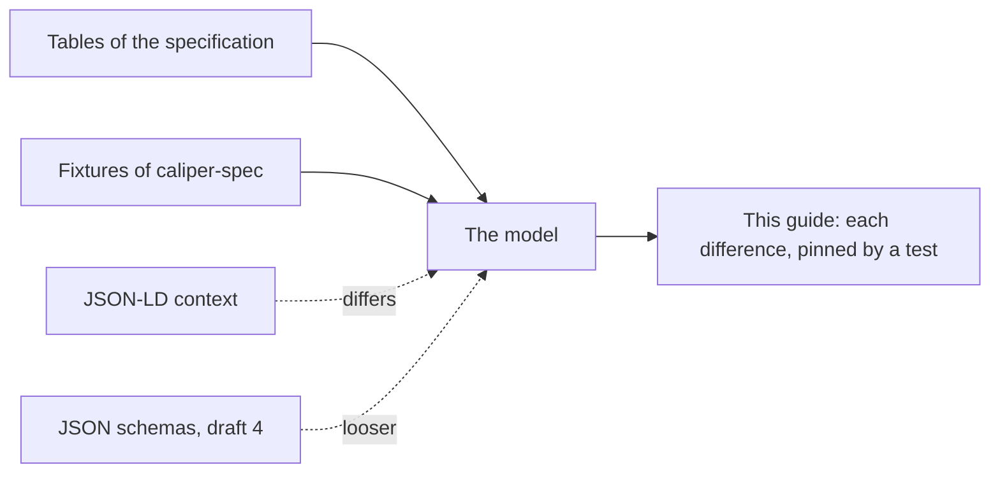

# Where the specifications disagree

Caliper 1.2 and Caliper 1.1 each have a specification, JSON-LD contexts, JSON schemas and fixtures, and they do not always agree.
Each place is here with how the package reads it, and a test pins it.



```ts
import { PROFILES, ROLES } from "@interopkit/learning-analytics";

PROFILES.includes("SurveyProfile"); // => true
ROLES.includes("Mentor#Auditor"); // => true
```

## Vocabularies

| Place                                                                                         | What the sources say                                                                                             | Reading                                                                            |
| --------------------------------------------------------------------------------------------- | ---------------------------------------------------------------------------------------------------------------- | ---------------------------------------------------------------------------------- |
| Appendix E lists 14 profile terms                                                             | Section 3 describes 15 profiles, with the Survey Profile; the schemas list `SurveyProfile`; the context lacks it | `PROFILES` has `SurveyProfile`                                                     |
| The Library Use Profile names `LibraryProfile` in its examples                                | No appendix defines the term; its context answers 404 at both addresses it names                                 | `PROFILES` has `LibraryProfile`, and the context `LIBRARY_PROFILE_CONTEXT` is read |
| Appendix F lists `Manager#Manager`; the context and the schemas list `Mentor#Auditor` instead | The fixture that sends every role uses the 56 roles of Appendix F                                                | `ROLES` has both                                                                   |
| Appendix D lists `EnabledClosedCaptioning` and `DisabledClosedCaptioning`                     | The published context defines neither term                                                                       | `ACTIONS` has both                                                                 |
| The Library Use Profile adds the actions `Accessed` and `Attended`                            | The context of Caliper 1.2 lacks them, and the context of the profile cannot be fetched                          | `ACTIONS` has both                                                                 |
| The Library Use Profile adds ten types of system identifier                                   | Its context cannot be fetched                                                                                    | `SYSTEM_IDENTIFIER_TYPES` has them                                                 |
| Appendix I lists 12 types of system identifier                                                | The context defines `CaseItemUri`, and a fixture of the types uses it                                            | `SYSTEM_IDENTIFIER_TYPES` has it                                                   |
| The tables A.9 and A.18 of Appendix A spell an action `MarkedAsUnRead`                        | Appendix D, the context and the schemas spell it `MarkedAsUnread`                                                | `ACTIONS` has `MarkedAsUnread`                                                     |

## Properties

| Place                                                                                                   | What the sources say                                                                                                                                    | Reading                                                                                                                                                                                                                                      |
| ------------------------------------------------------------------------------------------------------- | ------------------------------------------------------------------------------------------------------------------------------------------------------- | -------------------------------------------------------------------------------------------------------------------------------------------------------------------------------------------------------------------------------------------- |
| A member named `__proto__`, `constructor` or `prototype`, in `extensions` or anywhere                   | The schemas take any name for a member of `extensions` and of a class that takes more                                                                   | Refused with `invalid-value`, at any depth, as every reader of the family does: a schema library would drop it, and an assignment would set a prototype. The generator of the corpus tests makes no such member, and a test pins the refusal |
| `Attempt.isPartOf` and `HighlightAnnotation.selection`                                                  | The tables lack them; the schemas and the fixtures use them                                                                                             | Read                                                                                                                                                                                                                                         |
| `MultiselectScale.isOrderedSelection` and `LtiLink.messageType`                                         | The tables and the context spell them so; the schemas have `orderedSelection` and `LtiMessageType`                                                      | The spelling of the tables                                                                                                                                                                                                                   |
| `Comment.value`, `Score.comment`, `Result.comment`, the `items` of `Forum`, `Thread`, `Questionnaire`   | The tables list them; the schemas do not define them                                                                                                    | Read                                                                                                                                                                                                                                         |
| `isPartOf` on every class, and the properties of a legacy assignable resource on every digital resource | The schemas define them on the base classes; the tables put `isPartOf` on digital resources, `LibrarySpace` and the legacy ones on assignable resources | Only where the tables put them. Anything else is refused                                                                                                                                                                                     |
| `Result.curveFactor` and five more scores, `Rating.scale`                                               | The schemas define them; the tables do not                                                                                                              | Refused: they belong in `extensions`                                                                                                                                                                                                         |
| Prose of `AggregateMeasure` names `value` and `valueMax`                                                | Its table, the context and the fixtures name `metricValue` and `maxMetricValue`                                                                         | The table                                                                                                                                                                                                                                    |
| Counts and decimals                                                                                     | The tables say integer and decimal; the schemas say `number`; the fixtures tell `25` from `25.0`, which JSON text cannot                                | A count is an integer from 0 to 4,294,967,295; a decimal any finite number. Four malformed fixtures that differ only in this are read                                                                                                        |
| A property a class does not define                                                                      | The schemas leave the class open; section 2.2 says a custom attribute goes in `extensions`                                                              | Refused, with the path                                                                                                                                                                                                                       |
| Ranges of entities                                                                                      | The schemas list some classes and not others for one property; the tables name one class                                                                | The class of the table and every class below it                                                                                                                                                                                              |
| `@context` inside an entity                                                                             | Section 4.1 lets a sender add a context wherever it defines an object; the schemas allow it on every class                                              | Read, as a string, an object or a list; only the top level must end with Caliper's                                                                                                                                                           |
| An identifier that is a blank node                                                                      | Section 4.2 allows it; the schemas take any string                                                                                                      | Read                                                                                                                                                                                                                                         |
| The two examples of a library activity that write a duration as `18m` and `1h`                          | The page says the form is ISO 8601                                                                                                                      | Refused; a test pins the two examples as refused                                                                                                                                                                                             |

## Events

| Place                                                                                                   | What the sources say                                                                                  | Reading                                                                                                                 |
| ------------------------------------------------------------------------------------------------------- | ----------------------------------------------------------------------------------------------------- | ----------------------------------------------------------------------------------------------------------------------- |
| `AssessmentItemEvent.generated`                                                                         | The table names a `Response`; a fixture of the event with the action `Started` generates an `Attempt` | A response or an attempt                                                                                                |
| Section 4.1 says the context of Caliper is required at the top and its terms must not be defined inline | Figure 5 and a fixture write a context of inline terms alone                                          | The terms of one context defined inline are read as a whole context; a string or a list must be, or end with, Caliper's |
| The tables name one action or a set of them for each event                                              | The schemas allow any action for every event                                                          | The set of the table                                                                                                    |
| The tables name the class of `actor`, `object`, `target`, `generated` and `referrer`                    | The schemas allow every entity there, and their lists of classes differ from event to event           | The class of the table and every class below it                                                                         |
| A launch needs the session of its platform, and a copy the resource that it made                        | The tables say so in a cell; the schemas cannot                                                       | Refused, with the path of the missing property                                                                          |
| An example of the Library Use Profile gives `ISBN` as the type of an identifier                         | The profile's term is `InternationalStandardBookNumber`                                               | Refused; a test pins the example as refused                                                                             |

## Profiles

| Place                                                                    | What the sources say                                                                                                                                                    | Reading                                                               |
| ------------------------------------------------------------------------ | ----------------------------------------------------------------------------------------------------------------------------------------------------------------------- | --------------------------------------------------------------------- |
| The tables of section 3 and of the certification guide                   | They differ in a few cells: the action `Reset` of an assessment, a `DigitalResource` as the object of navigation and viewing, an `Agent` as the actor of a grading view | The table of section 3 first; what only the guide allows is a warning |
| The certification guide's row for the `ViewEvent` of the Grading Profile | It prints `Viewed` as the object and `Result` as the generated entity; section 3.6 names `Result` as the object                                                         | The object is `Result`                                                |
| The Grading Profile has a `ViewEvent` of a `Result`                      | Appendix A.21 allows a `DigitalResource` as the object of a `ViewEvent`, and a `Result` is not one                                                                      | The reader refuses it, so the row cannot be met; a test names it      |
| The cell `Entity (AggregateMeasureCollection)` of the Tool Use Profile   | The page prints the entity that the action generates as an entity, and names the collection in parentheses                                                              | `AggregateMeasureCollection`                                          |
| The General Profile                                                      | Section 3.15 allows the generic `Event` alone; two envelope fixtures of `caliper-spec` give it to a `NavigationEvent`                                                   | An error, `profile-event`; a test pins the two fixtures               |
| The generic `Event` for an interaction that a profile models             | Section 3.15 limits the General Profile to what the profiles do not model; the fixtures write 68 generic events that a profile models                                   | A warning, `general-profile-modeled`                                  |
| The Library Use Profile prints no table of rows                          | Its events are printed as tables of properties, with one action each                                                                                                    | The three events of the page are the rows of the profile              |
| The target of an event                                                   | The text says a `MediaLocation` or a `Frame` MAY be the target; the table names the class                                                                               | An object of another class is a warning, `target-class`               |
| The `currentTime` of a media location                                    | The text says it MUST be set for the actions that it does not name, and to set it for the others                                                                        | An error, `media-location-time`, for every action                     |
| `profile-missing` in fixtures                                            | 81 events of the fixtures name no profile, which section 3 says they SHOULD                                                                                             | A warning                                                             |

## Transport

| Place                                                       | What the sources say                                                                                                                               | Reading                                                                                             |
| ----------------------------------------------------------- | -------------------------------------------------------------------------------------------------------------------------------------------------- | --------------------------------------------------------------------------------------------------- |
| The names of the configuration of an endpoint               | Section 6.2 and Figure 12 write `caliperMaximumPayloadSize`; the fixture `caliperEndpointConfigPayload.json` writes `caliper_maximum_payload_size` | The names of the table; a test pins the fixture as refused, and as read with the names of the table |
| A kilobyte in `caliperMaximumPayloadSize`                   | Section 6.2 says kilobytes and no more                                                                                                             | 1,024 bytes; the endpoint rounds down                                                               |
| The success status of an endpoint                           | Section 6.1 allows 200, 201 and 202                                                                                                                | 200 with an empty body                                                                              |
| Other statuses than the five                                | Section 6.1 says the endpoint MAY send others                                                                                                      | 405 for a method, 413 for a body above the limit, 500 for a failed port                             |
| The `dataVersion` of an envelope of the Library Use Profile | The page prints no envelope; the fixtures of every other class write the context of Caliper 1.2                                                    | The context of Caliper 1.2, as for every event; the events name the Library context themselves      |
| A property of an envelope given twice                       | Section 5.2 says each property is referenced only once                                                                                             | Not checked: `JSON.parse` keeps the last                                                            |
| The sensor of an envelope                                   | Section 5.2 says it SHOULD be an IRI                                                                                                               | `sendCaliper` requires one; the endpoint takes any name that is not empty                           |
| A status of a ping that is not 200 or 401                   | Section 6.2 says the sensor SHOULD read it as unavailable                                                                                          | Unavailable with the status, except a redirect, which is an error                                   |

## Caliper 1.1

The package reads 1.1 from its tables, its six extension profiles, its contexts and its 129 fixtures ([Caliper 1.1](./versions.md)).

| Place                                                                        | What the sources say                                                                                                      | Reading                                                                       |
| ---------------------------------------------------------------------------- | ------------------------------------------------------------------------------------------------------------------------- | ----------------------------------------------------------------------------- |
| `Collection`                                                                 | The context of 1.1 lacks it, the Survey profile defines it, and a fixture of the collection names the Tool Use profile    | Read                                                                          |
| `MultiselectScale`                                                           | The Feedback profile defines `MultiselectionScale` and the Survey profile `MultiselectScale`; the fixtures use the second | `MultiselectScale`                                                            |
| `scale` of a question                                                        | The fixtures of the Survey profile use it, and no context defines it                                                      | Read                                                                          |
| `EnabledClosedCaptioning` and `DisabledClosedCaptioning`                     | Appendix A lists them, and no context of 1.1 defines them                                                                 | Read                                                                          |
| Appendix E of 1.1 lists `Mentor#Auditor` and lacks `Manager#Manager`         | Appendix F of 1.2 lists the second, and the context of 1.2 the first                                                      | Both are in `ROLES`; a document of 1.1 that uses `Manager#Manager` is refused |
| The target of a `NavigationEvent` and of a `ViewEvent`                       | The tables of 1.1 name a `Frame`; those of 1.2 name a `DigitalResource` and any entity                                    | The table of the version                                                      |
| `ToolUseEvent.generated`                                                     | The table of 1.1 allows any entity; the Tool Use profile names the `AggregateMeasureCollection`, as the table of 1.2 does | The collection: an item that generates another entity is a finding            |
| `AssessmentItemEvent.generated`                                              | The table names a `Response`; a fixture of 1.1 with the action `Started` generates an `Attempt`                           | A response or an attempt, as in 1.2                                           |
| The disposition of `type` in the table of `ViewEvent`                        | The table leaves it empty; every other table writes `Required`                                                            | Required                                                                      |
| `MarkedAsUnRead` in the tables of `MessageEvent` and `ThreadEvent`           | Appendix A, the context and the schemas spell it `MarkedAsUnread`                                                         | `MarkedAsUnread`                                                              |
| A fixture that names the General Profile and an object of the class `Thesis` | The `profile` is a property of 1.2, and the class is defined by the context of the sender                                 | Refused: the readers know the classes of the model alone                      |
| The contexts of the extension profiles                                       | Four of the six answer 404 at `purl.imsglobal.org`                                                                        | Never fetched: the tests read them from `caliper-spec`                        |

## The schemas against the fixtures

`schema_1_2` accepts 62 of the 86 malformed events that the fixtures name: those whose entity is of another class, whose action
is not the event's, whose reference is not a string, and the launch without the session of its platform. The package refuses all
86.

`schema_1_2` accepts 29 of the malformed entities that the fixtures name, because it leaves open what the tables and the fixtures
close: an `id` that is no IRI, a list that holds an entity of the wrong class, a decimal written without a fraction, a metric
that is missing. The package refuses 187 of the 191 malformed entities that a reader of JSON can read; the other four differ from a valid entity
only in the form of a number. The tests of the corpus pin both lists.

The schemas also keep the deprecated terms of Caliper 1.1 (`OutcomeEvent`, `ReadingEvent`, `Reading` and four Epub entities),
which Caliper 1.2 does not list. The model has none of them.

`schema_1_1` refuses six fixtures that the readers of 1.1 read: it gives a `metric` as a number, leaves the generic `Entity` out
of a `Collection`, and names no class of an extension profile as the object, the target or the generated entity of an event. It
allows the `@context` of a nested entity as a string or a list, where section 4.1 of 1.1 allows an object too. The readers read
138 of the 139 documents of the fixtures of 1.1, and refuse everything that the schema refuses after a change, but a nested
`@context` that becomes an object.
