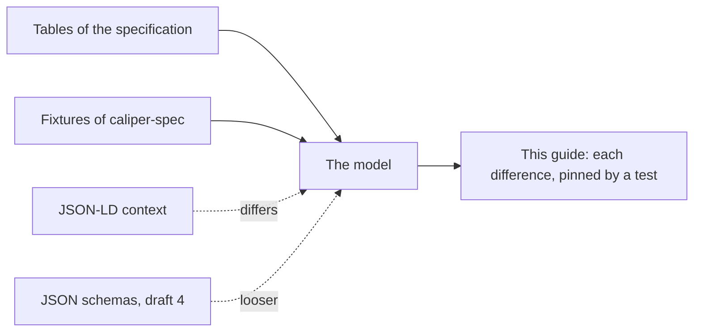

# Where the specifications disagree

Caliper 1.2 has a specification, a JSON-LD context, JSON schemas and fixtures, and they do not always agree. Each place is
here with how the package reads it, and a test pins it.



```ts
import { PROFILES, ROLES } from "@interopkit/learning-analytics";

PROFILES.includes("SurveyProfile"); // => true
ROLES.includes("Mentor#Auditor"); // => true
```

## Vocabularies

| Place                                                                                         | What the sources say                                                                                          | Reading                                                   |
| --------------------------------------------------------------------------------------------- | ------------------------------------------------------------------------------------------------------------- | --------------------------------------------------------- |
| Appendix E lists 14 profile terms                                                             | Section 3 describes 15 profiles, with the Survey Profile; the schemas list `SurveyProfile`; the context lacks it | `PROFILES` has `SurveyProfile`                            |
| The Library Use Profile names `LibraryProfile` in its examples                                | No appendix defines the term; its context answers 404 at both addresses it names                              | `PROFILES` has `LibraryProfile`, and the context `LIBRARY_PROFILE_CONTEXT` is read |
| Appendix F lists `Manager#Manager`; the context and the schemas list `Mentor#Auditor` instead | The fixture that sends every role uses the 56 roles of Appendix F                                             | `ROLES` has both                                          |
| Appendix D lists `EnabledClosedCaptioning` and `DisabledClosedCaptioning`                     | The published context defines neither term                                                                    | `ACTIONS` has both                                        |
| The Library Use Profile adds the actions `Accessed` and `Attended`                            | The context of Caliper 1.2 lacks them, and the context of the profile cannot be fetched                       | `ACTIONS` has both                                        |
| The Library Use Profile adds ten types of system identifier                                   | Its context cannot be fetched                                                                                 | `SYSTEM_IDENTIFIER_TYPES` has them                        |

## Properties

| Place                                                                                               | What the sources say                                                                                                      | Reading                                                              |
| --------------------------------------------------------------------------------------------------- | ------------------------------------------------------------------------------------------------------------------------- | -------------------------------------------------------------------- |
| `Attempt.isPartOf` and `HighlightAnnotation.selection`                                              | The tables lack them; the schemas and the fixtures use them                                                               | Read                                                                 |
| `MultiselectScale.isOrderedSelection` and `LtiLink.messageType`                                     | The tables and the context spell them so; the schemas have `orderedSelection` and `LtiMessageType`                        | The spelling of the tables                                           |
| `Comment.value`, `Score.comment`, `Result.comment`, the `items` of `Forum`, `Thread`, `Questionnaire` | The tables list them; the schemas do not define them                                                                      | Read                                                                 |
| `isPartOf` on every class, and the properties of a legacy assignable resource on every digital resource | The schemas define them on the base classes; the tables put `isPartOf` on digital resources, `LibrarySpace` and the legacy ones on assignable resources | Only where the tables put them. Anything else is refused             |
| `Result.curveFactor` and five more scores, `Rating.scale`                                           | The schemas define them; the tables do not                                                                                | Refused: they belong in `extensions`                                 |
| Prose of `AggregateMeasure` names `value` and `valueMax`                                            | Its table, the context and the fixtures name `metricValue` and `maxMetricValue`                                           | The table                                                            |
| Counts and decimals                                                                                 | The tables say integer and decimal; the schemas say `number`; the fixtures tell `25` from `25.0`, which JSON text cannot   | A count is an integer from 0 to 4,294,967,295; a decimal any finite number. Four malformed fixtures that differ only in this are read |
| A property a class does not define                                                                  | The schemas leave the class open; section 2.2 says a custom attribute goes in `extensions`                                | Refused, with the path                                               |
| Ranges of entities                                                                                  | The schemas list some classes and not others for one property; the tables name one class                                  | The class of the table and every class below it                      |
| `@context` inside an entity                                                                         | Section 4.1 lets a sender add a context wherever it defines an object; the schemas allow it on every class               | Read, as a string, an object or a list; only the top level must end with Caliper's |
| An identifier that is a blank node                                                                  | Section 4.2 allows it; the schemas take any string                                                                        | Read                                                                 |
| The two examples of a library activity that write a duration as `18m` and `1h`                       | The page says the form is ISO 8601                                                                                        | Refused; a test pins the two examples as refused                     |

## The schemas against the fixtures

`schema_1_2` accepts 29 of the malformed entities that the fixtures name, because it leaves open what the tables and the fixtures
close: an `id` that is no IRI, a list that holds an entity of the wrong class, a decimal written without a fraction, a metric
that is missing. The package refuses 187 of the 191 malformed entities that a reader of JSON can read; the other four differ from a valid entity
only in the form of a number. The tests of the corpus pin both lists.

The schemas also keep the deprecated terms of Caliper 1.1 (`OutcomeEvent`, `ReadingEvent`, `Reading` and four Epub entities),
which Caliper 1.2 does not list. The model has none of them.
