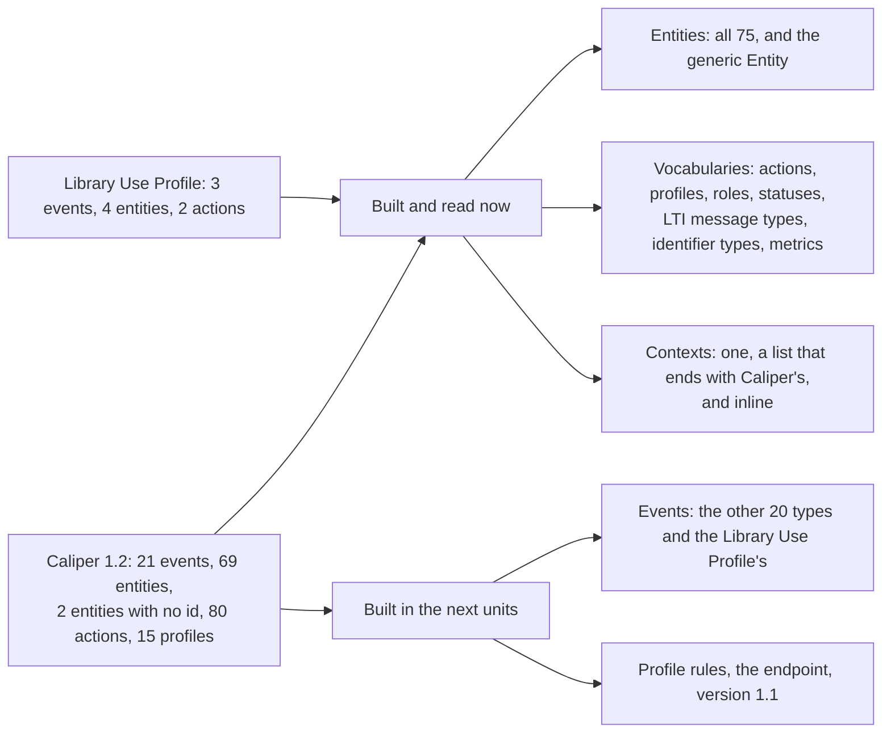

# Supported Caliper constructs

What the package implements of Caliper 1.2 and of the Library Use Profile, by construct. The counts come from the tables of the
specification that the tests read: a test fails when a table has something that the model lacks.



| Construct                                                  | Built | Where                                           |
| ---------------------------------------------------------- | ----- | ----------------------------------------------- |
| Entities of Appendix B                                     | 69 of 69 | `readEntity`, `buildEvent`; [model](./model.md) |
| Entities with no `id` of Appendix C                        | 2 of 2   | Same                                            |
| Entities of the Library Use Profile                        | 4 of 4   | Same                                            |
| Entity as an object or as its IRI, anonymous entities      | Yes      | Same                                            |
| Blank node identifiers, `extensions`, `otherIdentifiers`   | Yes      | Same                                            |
| `@context` as one context, a list ending with Caliper's, inline | Yes | Same                                            |
| Vocabularies of Appendices D to J                          | Yes      | `ACTIONS`, `PROFILES`, `ROLES`, `STATUSES`, `LTI_MESSAGE_TYPES`, `SYSTEM_IDENTIFIER_TYPES`, `METRICS` |
| Events of Appendix A                                       | 4 of 21  | `buildEvent`; [building events](./build.md)     |
| Sensor: one envelope of events with a bearer token         | Yes      | `sendCaliper`; [sending events](./send.md)      |

```ts
import { ACTIONS, ENTITY_TYPES, PROFILES } from "@interopkit/learning-analytics";

ACTIONS.length; // => 82
ENTITY_TYPES.length; // => 76
PROFILES.length; // => 16
```

## Not yet built

| What                                                                                                       | Why                                                              |
| ---------------------------------------------------------------------------------------------------------- | ---------------------------------------------------------------- |
| The other 17 event types of Appendix A, the 3 events of the Library Use Profile, and the readers of events | Built after the entities, which the events refer to              |
| The 91 rows of the profile tables and the General Profile                                                  | Built after the events                                           |
| Event properties `target`, `referrer`, `group`, `membership`, `session`, `federatedSession`, `extensions` | Built with the events                                            |
| `@context` as a list in `buildEvent`                                                                       | Built with the events                                            |
| Entity describes and a mix of events and entities in `data`                                                | Built with the transport                                         |
| Reading the configuration of an endpoint (section 6.2), `caliperMaximumPayloadSize`, splitting an envelope | Built with the transport                                         |
| The endpoint role: reading an envelope and answering 2xx, 400, 401, 415 and 422 (section 6)                | Built with the transport                                         |
| Caliper 1.1 at the endpoint                                                                                | Read, never written                                              |
| A send without a bearer token                                                                              | The code requires one; the specification recommends it           |
