# Supported Caliper constructs

What the package implements of Caliper 1.2 and of the Library Use Profile, by construct. The counts come from the tables of the
specification that the tests read: a test fails when a table has something that the model lacks.

```mermaid
flowchart LR
  spec["Caliper 1.2: 21 events, 69 entities,<br/>2 entities with no id, 80 actions, 15 profiles"] --> have["Built and read now"]
  spec --> next["Built in the next units"]
  lib["Library Use Profile: 3 events, 4 entities, 2 actions"] --> have
  have --> entityNode["Entities: all 75, and the generic Entity"]
  have --> eventNode["Events: all 24, and the generic Event, read and built"]
  have --> vocab["Vocabularies: actions, profiles, roles, statuses,<br/>LTI message types, identifier types, metrics"]
  have --> ctx["Contexts: one, a list that ends with Caliper's,<br/>and inline"]
  have --> prof["Profile rules: 91 rows, the General Profile,<br/>the certification guide, findings"]
  have --> wire["Transport: mixed data, optional token,<br/>size limit, ping, the endpoint role"]
  next --> later["Version 1.1 at the endpoint"]
```



| Construct                                                  | Built | Where                                           |
| ---------------------------------------------------------- | ----- | ----------------------------------------------- |
| Entities of Appendix B                                     | 69 of 69 | `readEntity`, `buildEntity`, `buildEvent`; [model](./model.md) |
| Entities with no `id` of Appendix C                        | 2 of 2   | Same                                            |
| Entities of the Library Use Profile                        | 4 of 4   | Same                                            |
| Entity as an object or as its IRI, anonymous entities      | Yes      | Same                                            |
| Blank node identifiers, `extensions`, `otherIdentifiers`   | Yes      | Same                                            |
| `@context` as one context, a list ending with Caliper's, inline | Yes | Same                                            |
| Vocabularies of Appendices D to J                          | Yes      | `ACTIONS`, `PROFILES`, `ROLES`, `STATUSES`, `LTI_MESSAGE_TYPES`, `SYSTEM_IDENTIFIER_TYPES`, `METRICS` |
| Events of Appendix A, and the generic `Event`              | 21 of 21 | `readEvent`, `buildEvent`; [model](./model.md), [building events](./build.md) |
| Events of the Library Use Profile                          | 3 of 3   | Same                                            |
| The actions, the actors and the objects that each event allows | Yes  | Same                                            |
| Event properties `target`, `referrer`, `group`, `membership`, `session`, `federatedSession`, `extensions` | Yes | Same        |
| `@context` as a list in `buildEvent`, and as terms defined inline | Yes | `buildEvent`, `buildEntity`              |
| The 91 rows of the profile tables, the General Profile, the Library Use Profile | Yes | `validateEvent`, `buildEvent`; [judging events](./validate.md) |
| The event conformance tables of the certification guide    | Yes      | Same                                            |
| The recommendations of the profiles (generated entity, properties of an attempt, a score, a result and a timeout session) | Yes | Same |
| Sensor: one envelope of events and entity describes, mixed, with an optional bearer token | Yes | `sendCaliper`; [sending events](./send.md) |
| Sensor: the maximum payload size of the endpoint, and the ping of section 6.2 | Yes | `maxPayloadBytes`, `pingEndpoint`, `EndpointConfiguration` |
| Endpoint: 200, 400, 401, 405, 413, 415, 422 and 500 in a fixed order, the configuration of a GET | Yes | `handleCaliperRequest`, `readEnvelope`; [receiving events](./endpoint.md) |

```ts
import { ACTIONS, ENTITY_TYPES, EVENT_TYPES, PROFILES } from "@interopkit/learning-analytics";

ACTIONS.length; // => 82
EVENT_TYPES.length; // => 25
ENTITY_TYPES.length; // => 76
PROFILES.length; // => 16
```

## Not built

| What                                                   | Why                                                                                             |
| ------------------------------------------------------ | ----------------------------------------------------------------------------------------------- |
| Caliper 1.1 at the endpoint                            | Read, never written: an envelope of 1.1 is answered 422 until the version routing is built      |
| Splitting an envelope that is too large                | The host decides how to batch: `maxPayloadBytes` refuses an envelope that is too large          |
