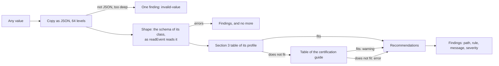
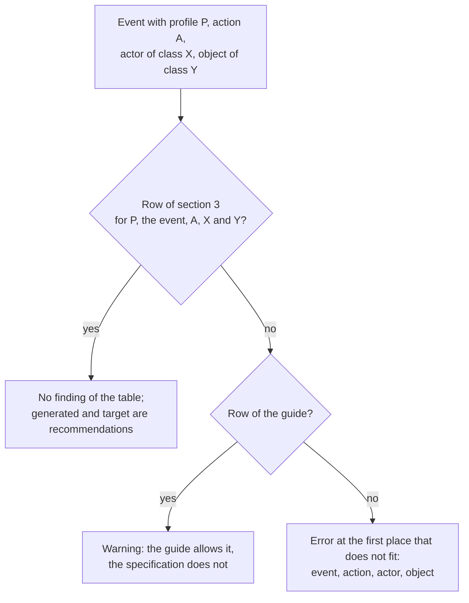

# Judging events against their profiles

`validateEvent` lists what is wrong with a Caliper event, and where it departs from the rules of its profile, as findings with a
severity. `validateEntity` does the same for an entity describe. They return data and never throw for a value: a sensor can
check what it is about to send, and an endpoint can say what it received.



## Quick start

```ts
import { validateEvent } from "@interopkit/learning-analytics";

const event = {
  "@context": "http://purl.imsglobal.org/ctx/caliper/v1p2",
  id: "urn:uuid:3a648e68-f00d-4c08-aa59-8738e1884f2c",
  type: "SessionEvent",
  profile: "SessionProfile",
  actor: { id: "https://exam.example", type: "SoftwareApplication" },
  action: "LoggedIn",
  object: { id: "https://exam.example", type: "SoftwareApplication" },
  eventTime: "2023-11-14T22:13:20.000Z",
};
const findings = validateEvent(event);
findings.map(({ severity, path, rule }) => `${severity} ${path} ${rule}`); // => ["error actor profile-actor"]
```

| Function                          | Takes                                         | Returns                                        |
| --------------------------------- | --------------------------------------------- | ---------------------------------------------- |
| `validateEvent(value, options?)`  | An event: parsed text, or an event of the model | The findings, `CaliperFinding[]`             |
| `validateEntity(value, options?)` | An entity describe, with its `@context`       | The findings                                   |

A finding has a `path` (where, as code writes it: `generated.count`), a `rule` (a kebab-case label to branch on), a `message`
(a sentence that reads after the path) and a `severity`. An empty list means that the value follows every rule that this
function knows. `buildEvent` runs the same rules and refuses an event with an error; a warning does not refuse it.

## What the findings say

The shape is that of `readEvent` and `readEntity`: a value that is wrong there gets those findings, and the rules of the profile
wait until the shape is right.

| Rule                                                                                         | Severity | When                                                                                                                       |
| -------------------------------------------------------------------------------------------- | -------- | -------------------------------------------------------------------------------------------------------------------------- |
| `missing-property`, `unknown-property`, `wrong-type`, `invalid-format`, `invalid-value`, `too-few-entries` | error | The value breaks the schema of its class: the [model](./model.md) says each class                                  |
| `invalid-value` at the path `""`                                                              | error    | The value is not JSON, or nests more than 64 levels: nothing of it is read                                                 |
| `findings-stopped`                                                                            | error    | The list reached `maxFindings`; there may be more                                                                          |
| `profile-event`                                                                               | error    | The `profile` has no event of this `type`, or no profile has it when the event names none                                  |
| `profile-action`                                                                              | error    | No row of the profile has this action for the event                                                                        |
| `profile-actor`, `profile-object`                                                             | error    | No row of the profile for this action allows the class of the actor or of the object                                       |
| `profile-action`, `profile-actor`, `profile-object`                                           | warning  | The table of the specification does not allow it and the table of the certification guide does                             |
| `media-location-time`                                                                         | error    | A `MediaEvent` gives a `MediaLocation` as its target without `currentTime`                                                 |
| `profile-missing`                                                                             | warning  | The event names no `profile`, which Caliper says it SHOULD                                                                 |
| `generated-missing`                                                                           | warning  | The profile advises that the action makes an entity (an attempt, a score, an annotation, a comment) and the event has none |
| `generated-class`, `target-class`                                                             | warning  | The generated entity or the target is an object of a class that the profile does not name for the action                   |
| `property-advised`                                                                            | warning  | An attempt lacks `assignee`, `assignable` or `count`; a score `attempt`, `maxScore` or `scoreGiven`; a result `attempt`, `maxResultScore` or `resultScore`; the session of a timeout `user`, `startedAtTime`, `endedAtTime` or `duration` |
| `general-profile-modeled`                                                                     | warning  | The generic `Event` describes an interaction that an event of a profile models                                             |

An entity that an event gives as its IRI names no class, so only its place is judged.

## The tables

The profiles of Caliper 1.2 print a table of rows, one for each event and action, with the classes of the actor, the object, the
entity that the action generates and the target. The package holds the 91 rows of section 3 and the 3 of the Library Use Profile,
the General Profile, and the 92 rows of the event conformance tables of the certification guide, each as the page prints it. Tests
read the pinned pages and compare every row.



A class that a row names allows the class and its subtypes: a `DigitalResource` is any of the 27 classes below it. The tables
differ in a few cells, and the package reads both:

| Cell                                                    | Section 3                                  | Certification guide                |
| ------------------------------------------------------- | ------------------------------------------ | ---------------------------------- |
| Actions of an `AssessmentEvent`                         | Started, Paused, Resumed, Restarted, Submitted | Those and Reset                |
| Object of a `NavigationEvent` or `ViewEvent` in the Assessment, Assignable, Forum and Media profiles | The classes of the profile | Any `DigitalResource` |
| Actor of a `ViewEvent` in the Grading Profile           | A `Person`                                 | An `Agent` or a subtype            |

The General Profile allows any `Agent` as actor, any action and any entity as object, and its only event is the generic `Event`.

## Options

| Option        | Meaning                                                                                                     | Default |
| ------------- | ----------------------------------------------------------------------------------------------------------- | ------- |
| `version`     | The version of Caliper that governs the value, `"1.2"` or `"1.1"`. A value of 1.1 is judged by its shape alone, since the tables of the profiles are those of 1.2 ([Caliper 1.1](./versions.md)) | `"1.2"` |
| `maxFindings` | The most findings that the call lists. The check stops at the first finding beyond it and says so in the last | 1,000   |

## Limits

| Limit                        | Value  | Replaceable                                                                |
| ---------------------------- | ------ | -------------------------------------------------------------------------- |
| Findings                     | 1,000  | `maxFindings`; the memory of a check is that of its limit, not of the value |
| Levels that a value nests    | 64     | No; a deeper value is one `invalid-value` finding, and nothing of it is read |

## Errors

| Error       | When                                                                                    | What to do                                  |
| ----------- | --------------------------------------------------------------------------------------- | ------------------------------------------- |
| `DataError` | The options are not an object, `maxFindings` is not a positive integer, `version` is not `"1.2"` or `"1.1"`, or an option does not exist | Fix the call. Nothing was checked |

A value that is not an event is not an error of the call: it is a finding.

## Not included

| What                                                                                            | Why                                                                                                                                              |
| ----------------------------------------------------------------------------------------------- | ------------------------------------------------------------------------------------------------------------------------------------------------ |
| Which rows a sensor must send to be certified (the `Required` of the certification guide)       | It is a property of the events that a sensor sends in all, which the certification service checks, and not of one event                           |
| That the actor of a grade is a `SoftwareApplication` when the grading is automatic              | The data does not say how it was graded                                                                                                           |
| That the count of an attempt rises by one at `Started` and stays the same at `Skipped`          | It compares events, and the package keeps none                                                                                                    |
| That a message that replies names `replyTo`, and that a tool names `federatedSession`           | The data does not say that the message replies or that a tool minted the event; a launch must name its session, and the reader refuses it without |
| A property that a JSON text gives twice                                                         | `JSON.parse` keeps the last, so the text is gone before a value exists                                                                           |

## Differences from the references

| Reference                                                                  | Difference                                                                                                                                                                        |
| -------------------------------------------------------------------------- | --------------------------------------------------------------------------------------------------------------------------------------------------------------------------------- |
| The JSON schemas of `caliper-spec`                                         | They hold no rule of a profile. This package reads the tables, so an action, an actor or an object that the schemas allow is a finding when the profile does not                  |
| The certification service                                                  | Not run: certification needs membership. The tables of its guide are read, and the docs say "implements", never "certified"                                                    |
| Two envelope fixtures of `caliper-spec`                                    | They mark a `NavigationEvent` with the General Profile, which section 3.15 allows the generic `Event` alone: the finding is an error, and a test pins both. See [spec-gaps](./spec-gaps.md) |

## Data that flows

| Data                      | From                      | To                                             |
| ------------------------- | ------------------------- | ---------------------------------------------- |
| The event or entity       | The caller                | Read as a copy; nothing is kept                |
| A finding                 | The check                 | The caller. A `message` of the shape can quote the value that it found, so treat it as untrusted text; the other messages name terms of the vocabularies only |

The library stores nothing and logs nothing.
